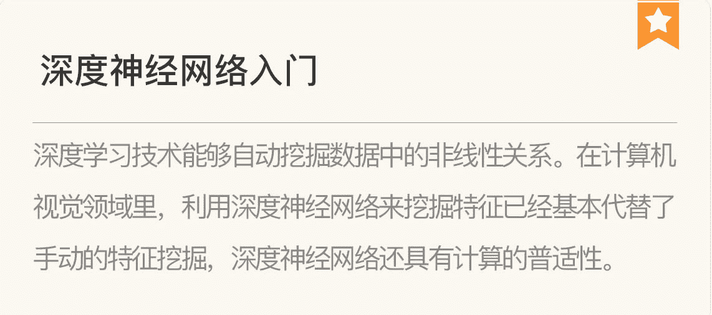
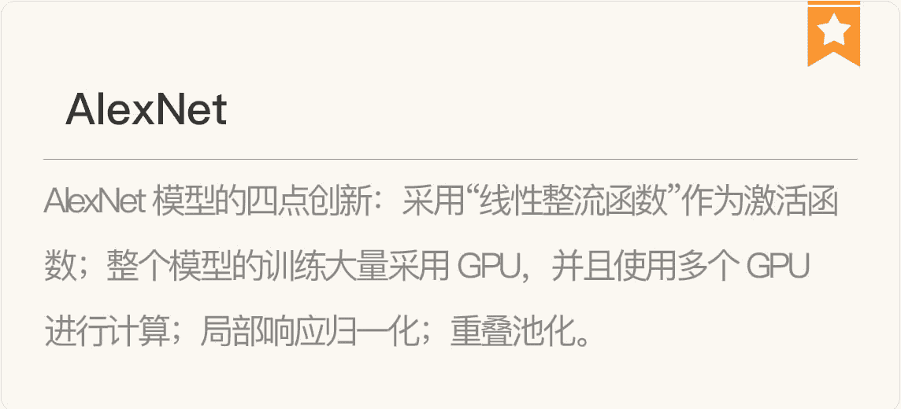
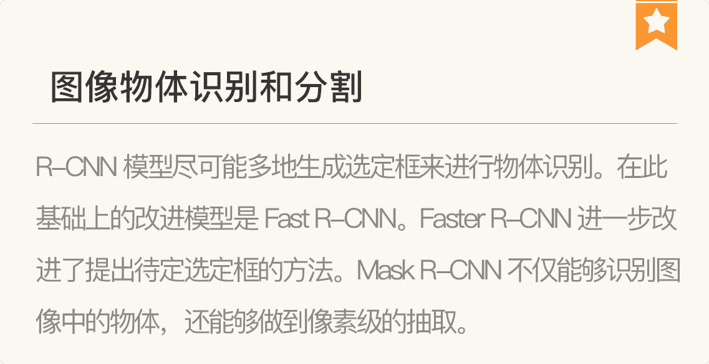
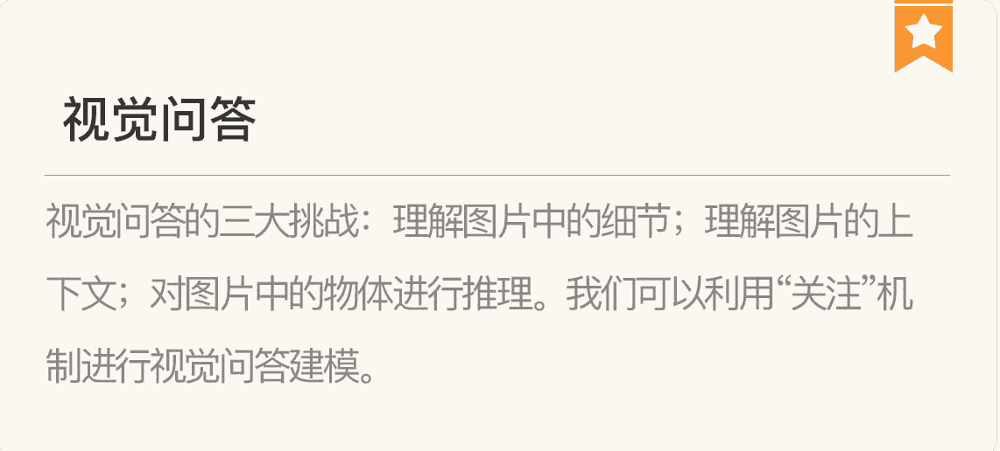
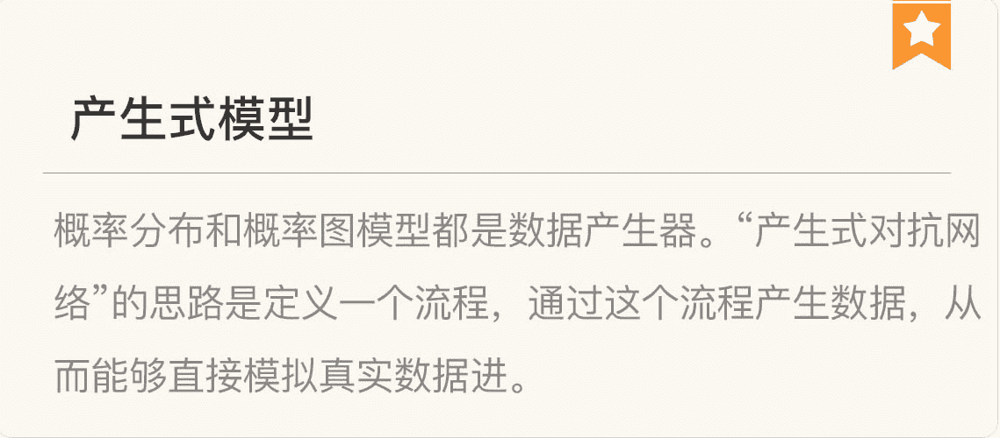

# 复盘 5 | 计算机视觉核心技术模块

 

今天我们来对计算机视觉核心技术模块做一个复盘。在这个模块里，我们一起学习了 12 期内容，讨论了四个话题，这些话题主要围绕计算机视觉的基础知识和深度学习技术在这个领域的应用。
 

之所以这么安排，是因为没有深度学习技术，就不会有现在计算机视觉的发展。我们站得稍微高一点就可以看到，正是因为深度学习技术在计算机视觉中的成功应用，才有了近几年的人工智能浪潮。
 

提示：点击知识卡跳转到你最想看的那篇文章，温故而知新。
 

## 图像技术基础

 

 

 

 

## 基于深度学习的计算机视觉技术

 

 

 

 

## 计算机视觉领域的深度学习模型

 

 

 

 

## 计算机视觉高级话题

 

 

 

 

## 积跬步以至千里

 

最后，恭喜你学完了这个模块中的内容。今日记一事，明日悟一理，积久而成学。每一个收获都是一个不小的成就。
 

在计算机视觉领域你有怎样的经验、心得或者疑惑，都欢迎你留言和我一起交流讨论。
 

