# 复盘 7 | 一起来读人工智能国际顶级会议论文

 

今天我准备了 30 张知识卡，和你一起来复盘“人工智能国际顶级会议”模块。在这个模块里，我总共介绍了 10 个顶级会议，包括机器学习方面的 ICML、NIPS；机器视觉的 CVPR、ICCV；自然语言处理的 ACL、EMNLP；数据挖掘和数据科学的 KDD、WSDM；信息检索和搜索的 SIGIR；互联网综合的 WWW。
 

提示：点击知识卡跳转到你最想看的那篇文章，温故而知新。
 

## KDD 2017（数据挖掘与知识发现大会）论文精讲

 

[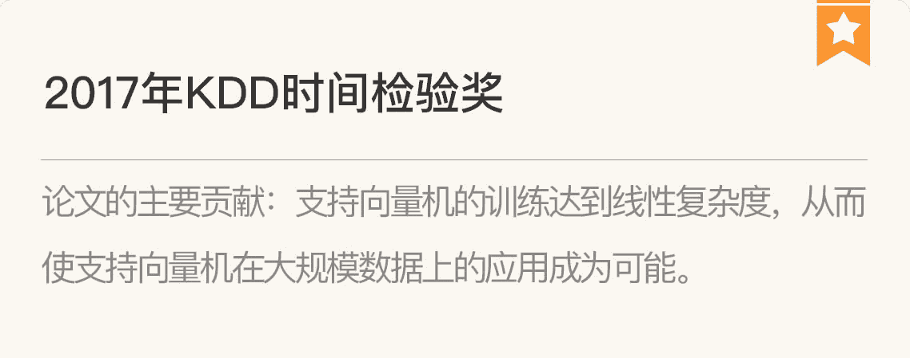](https://time.geekbang.org/column/article/159)
 

[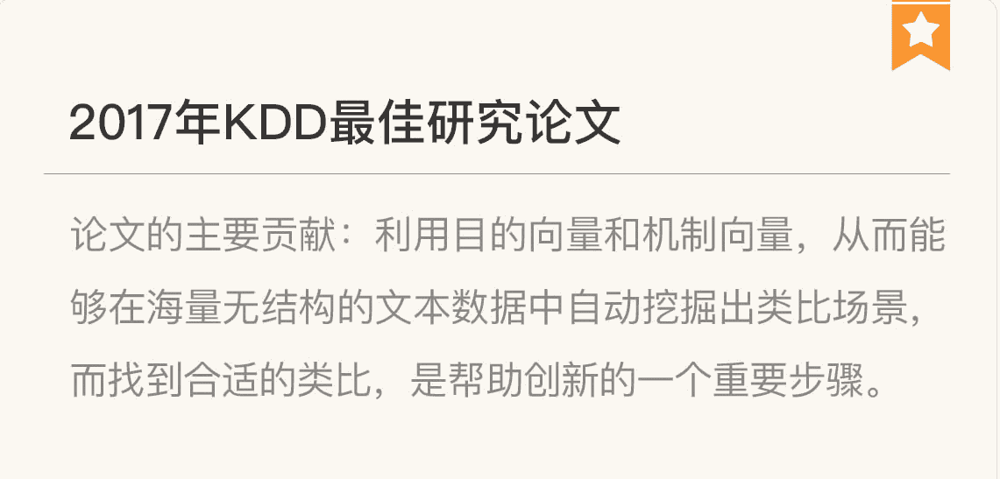](https://time.geekbang.org/column/article/391)
 

[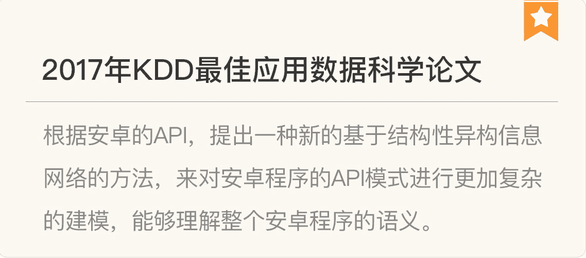](https://time.geekbang.org/column/article/394)
 

## EMNLP 2017（自然语言处理实证方法会议）论文精讲

 

[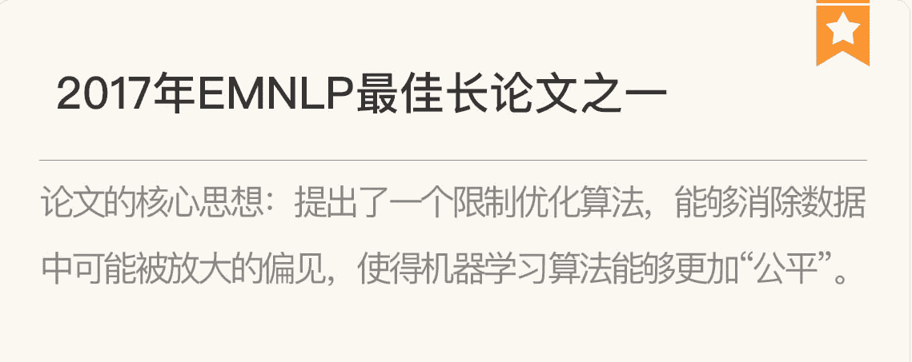](https://time.geekbang.org/column/article/397)
 

[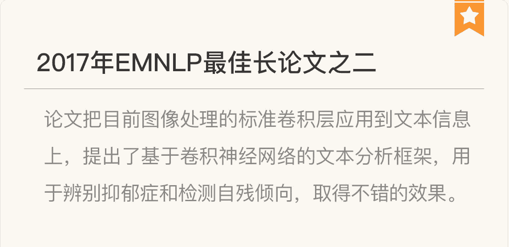](https://time.geekbang.org/column/article/658)
 

[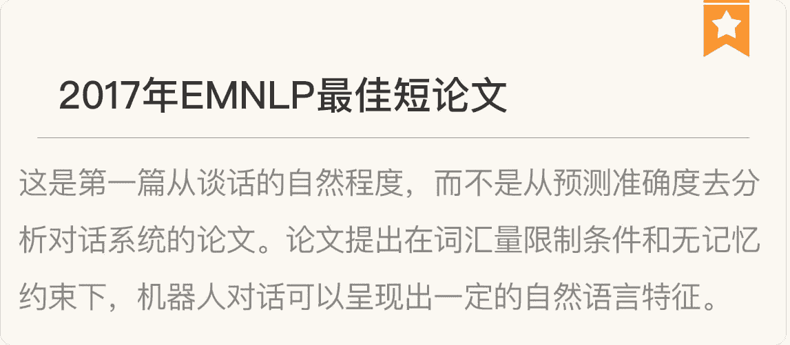](https://time.geekbang.org/column/article/661)
 

## ICCV 2017（国际计算机视觉大会）论文精讲

 

[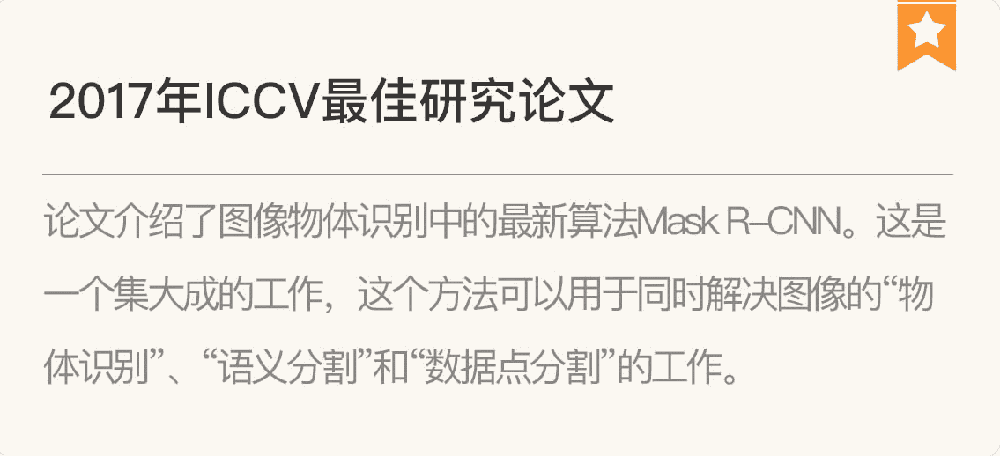](https://time.geekbang.org/column/article/2681)
 

[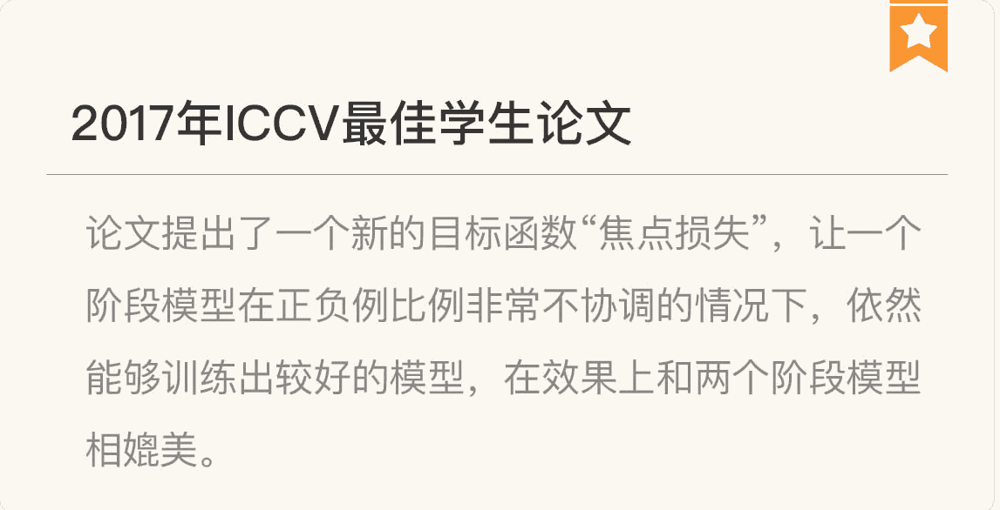](https://time.geekbang.org/column/article/2717)
 

[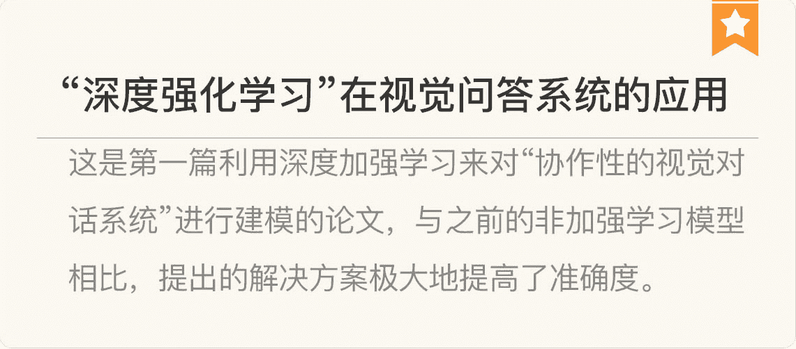](https://time.geekbang.org/column/article/2782)
 

## NIPS 2017（神经信息处理系统大会）论文精讲

 

[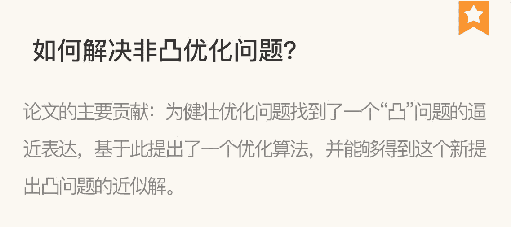](https://time.geekbang.org/column/article/2868)
 

[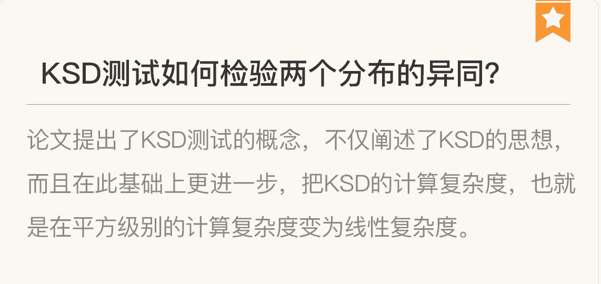](https://time.geekbang.org/column/article/2941)
 

 

## WSDM 2018（网络搜索与数据挖掘国际会议）论文精讲

 

 

[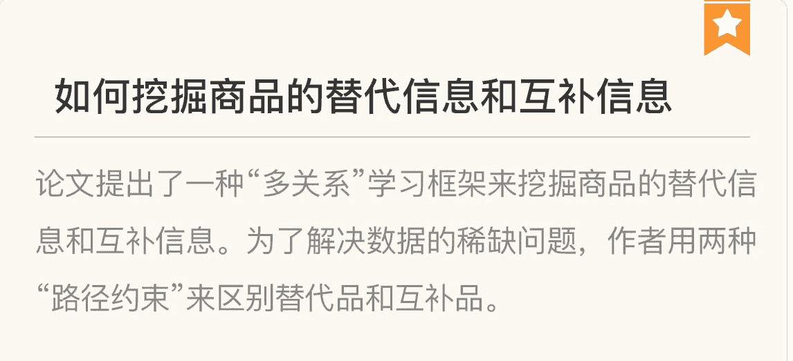](https://time.geekbang.org/column/article/3961)
 

 

## The Web 2018（国际万维网大会）论文精讲

 

 

[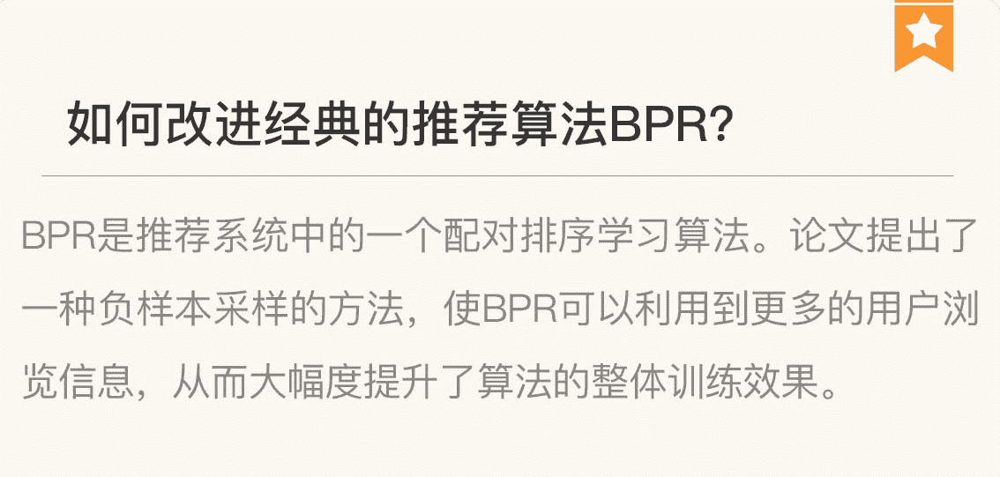](https://time.geekbang.org/column/article/8234)
 

[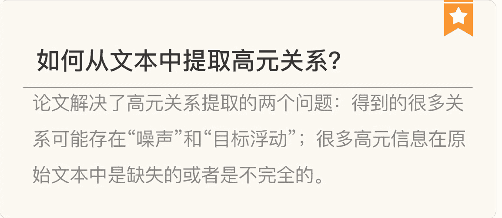](https://time.geekbang.org/column/article/8293)
 

## CVPR 2018（国际计算机视觉与模式识别会议）论文精讲

 

 

 

 

## SIGIR 2018（国际信息检索大会）论文精讲

 

[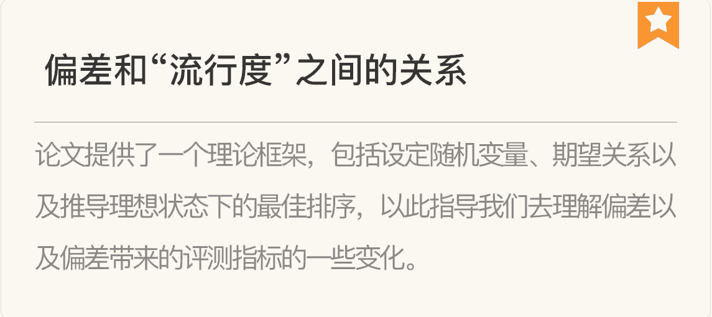](https://time.geekbang.org/column/article/11367)
 

[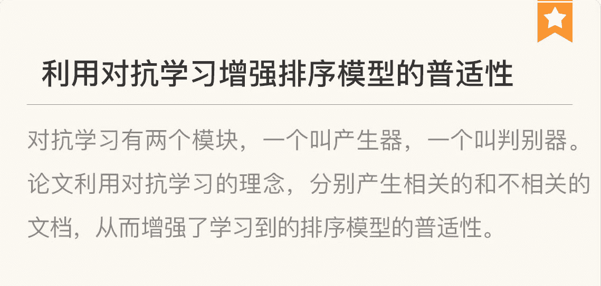](https://time.geekbang.org/column/article/11636)
 

[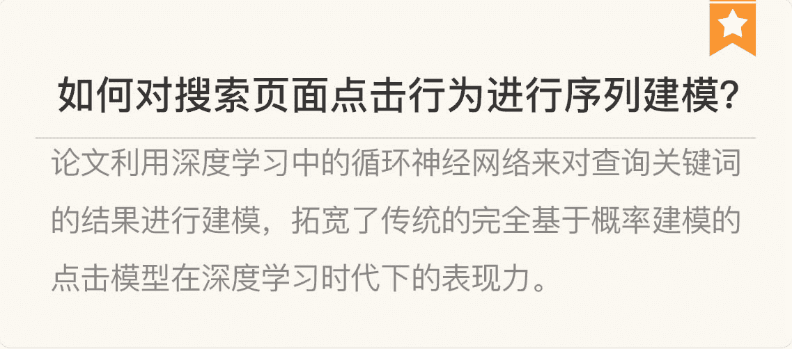](https://time.geekbang.org/column/article/11851)
 

## ICML 2018（国际机器学习大会）论文精讲

 

[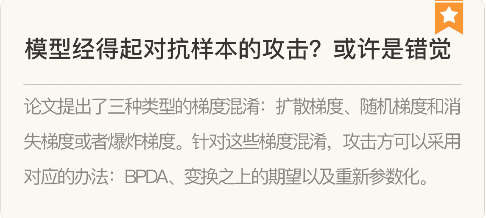](https://time.geekbang.org/column/article/12443)
 

[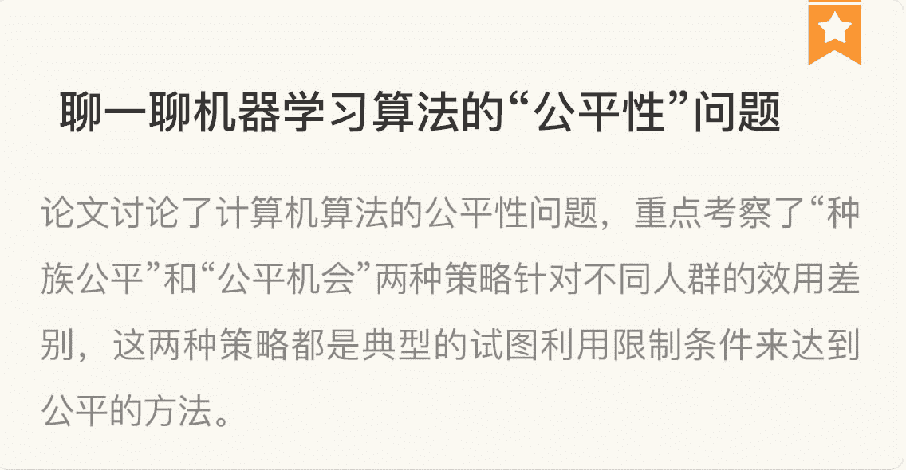](https://time.geekbang.org/column/article/12648)
 

 

## ACL 2018（计算语言学学会年会）论文精讲

 

[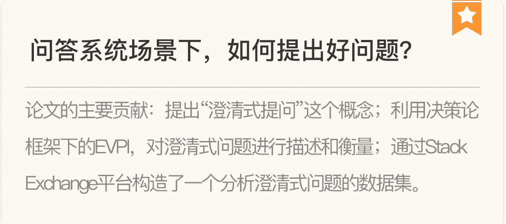](http://uhttps://time.geekbang.org/column/article/13014)
 

[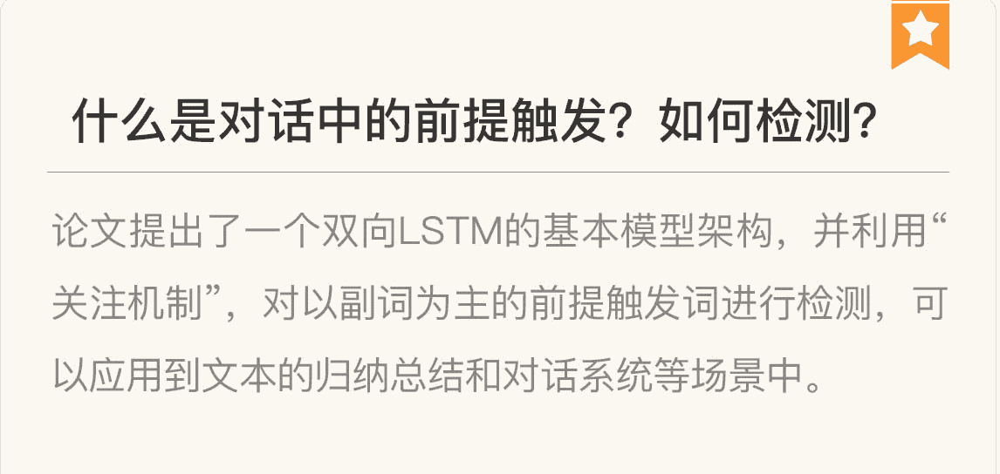](https://time.geekbang.org/column/article/13193)
 

 

## 积跬步以至千里

 

学习是独立的，需要你一个人去完成。但学习者从来都不必孤独，我们走进这些国际顶级学术会议的论文，其实就是和每一篇论文背后的作者进行一场对话。与优秀的人同行一定能让我们走得更快。
 

这个模块我根据自己的经验，为你选择了 10 个顶级会议。针对每一个会议，我都会在会议结束后用 3 篇文章来详细剖析这个会议的精髓和一些前沿信息。我希望通过我的眼睛和思考让你看到在这个领域里那些激动人心的发展，收获新知、拓展视野，同时也把我的学习方法分享给你。
 

我想你应该已经掌握了我分析论文的套路了，对于每一篇文章，我一定会先去做一些背景研究，了解作者群，了解对应的学术机构或者公司信息；然后弄清楚论文解决了什么问题，核心贡献是什么；再详细研究论文的具体方法。这个方法很简单，就是牢牢抓住一个主线，找到最核心的内容来消化吸收。但是**真正让这个方法内化成你的思维模式，还是需要大量的阅读和练习**。相信我，如果想在人工智能领域继续深耕，阅读大量论文，一定是一个最值得做的投资，因为回报极大。
 

那回到阅读论文本身，最后想跟你分享的一点只有八个字：**学好英语，阅读原文**。我知道你可能会说我英语还真不好，但是到达能够阅读原文的水平其实也并没那么难。你不妨直接找一篇我们专栏里讲过的论文原文，就把每一段的第一句读一下，看看能否学到东西。先开始看起来，遇到不会的且影响你理解的单词或句子再去查，你的英语水平就已经开始变得越来越好了。
 

以上就是我们对论文精读这个模块的一个复盘，希望专栏里的这三十篇论文是一个起点，能够帮助你养成关注国际顶级会议、阅读论文的习惯，拥有这一强大的学习利器，提升自己的学习效率。
 

最后，关于这一模块，关于国际会议，或者是在论文阅读方面，你还有什么问题和想法，欢迎你留言和我讨论。
 

