# 复盘 1 | 搜索核心技术模块

 

到目前为止，我们讲完了人工智能核心技术的第一个模块——*搜索*。我们从搜索的核心算法入手，进而讨论了搜索的两个关键组件，分别是查询关键字理解和文档理解，并落实到对搜索系统的评价，然后从宏观视角介绍了搜索框架的历史和发展，最后又从深度学习技术在搜索领域的应用角度，对分享做了一个延伸。
 

整个模块共 27 期，9 大主题，希望通过这些内容，能让你对搜索技术有一个系统的认识和理解，为自己进一步学习和提升打下基础。今天我们就来对这一模块的内容做一个复盘。
 

提示：点击知识卡跳转到你最想看的那篇文章，温故而知新。如不能正常跳转，请先将 App 更新到最新版本。
 

## 1. 现代搜索架构剖析

 

从 20 世纪 50 年代有信息检索系统开始，搜索系统大致经历了三个发展阶段。从最开始的“基于文本匹配的信息检索系统”到“基于机器学习的信息检索系统”，再到近几年受深度学习影响的“更加智能的搜索系统”。
 

[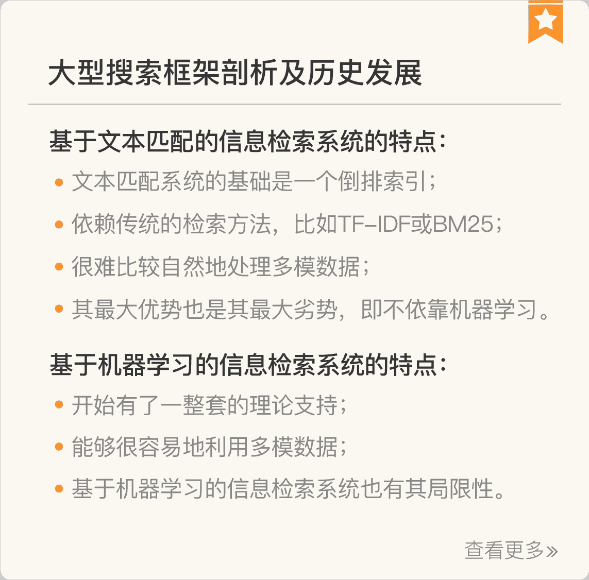](https://time.geekbang.org/column/article/1702)
 

[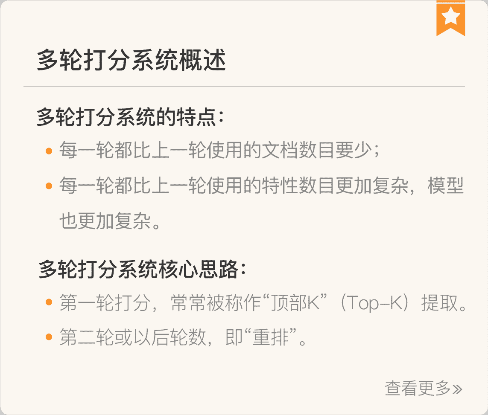](https://time.geekbang.org/column/article/1762)
 

[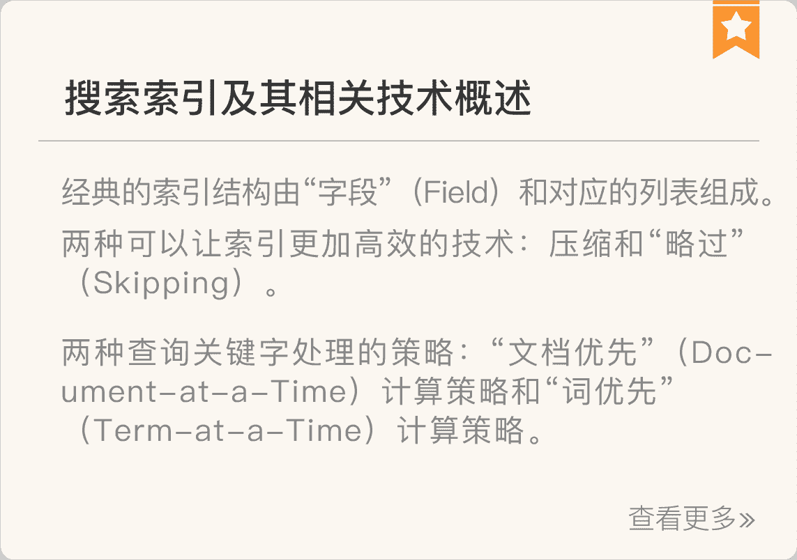](https://time.geekbang.org/column/article/1821)
 

## 2. 经典搜索核心算法

 

[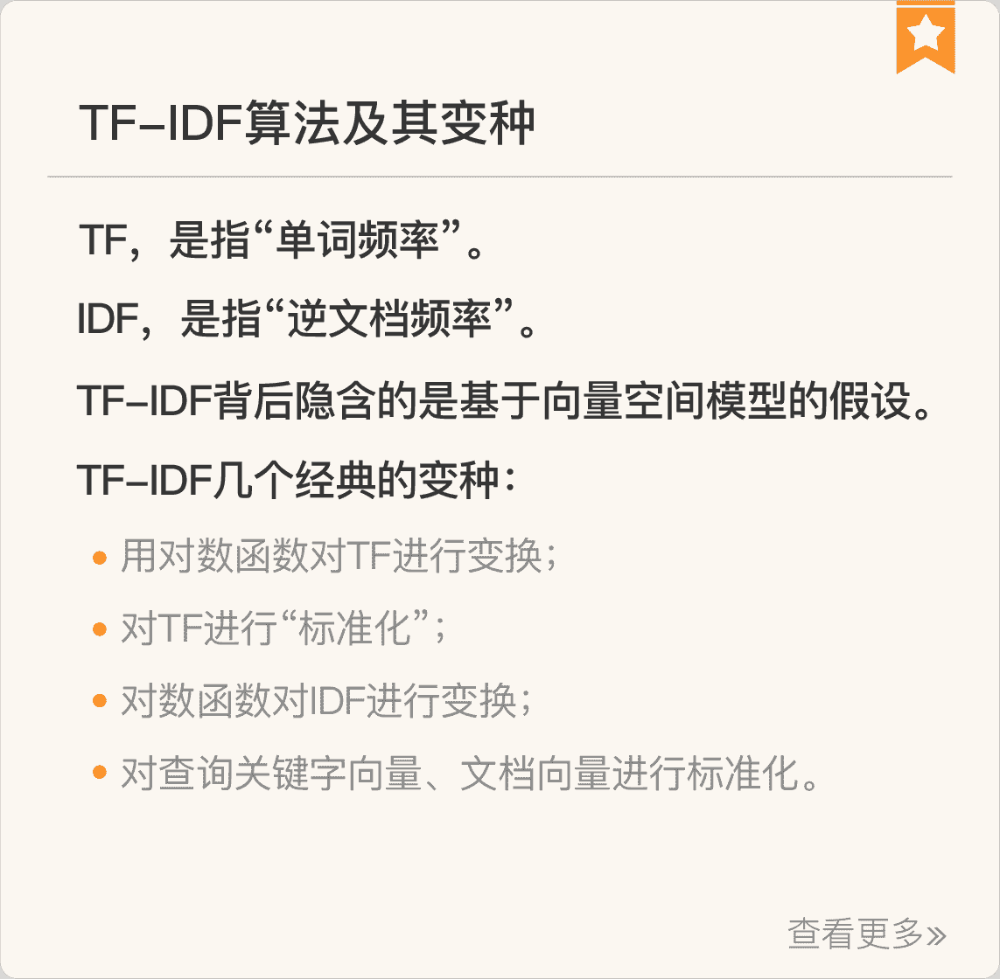](https://time.geekbang.org/column/article/822)
 

[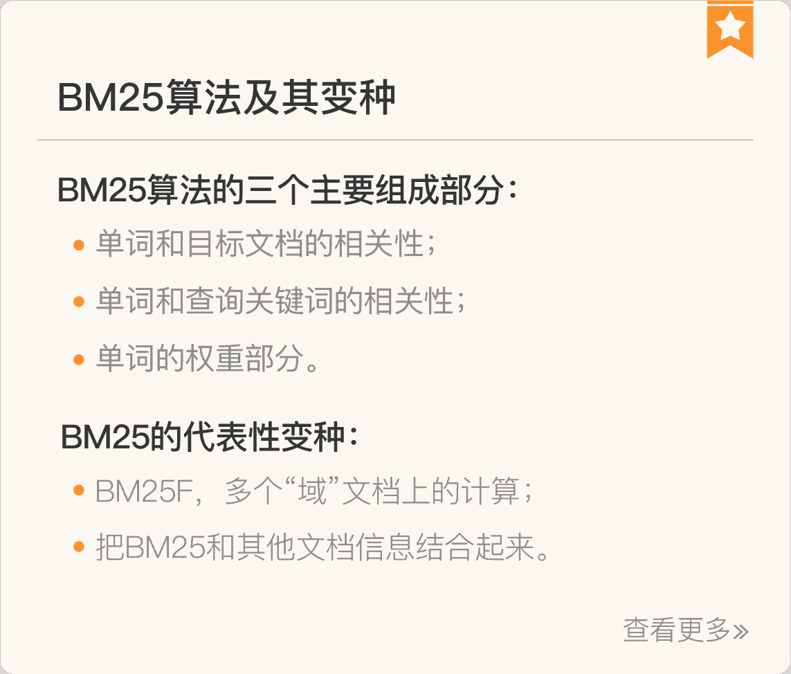](https://time.geekbang.org/column/article/828)
 

 

## 3. 基于机器学习的排序算法

 

问题设置：把一个排序问题转换成一个机器学习的问题设置，特别是监督学习的设置。
 

[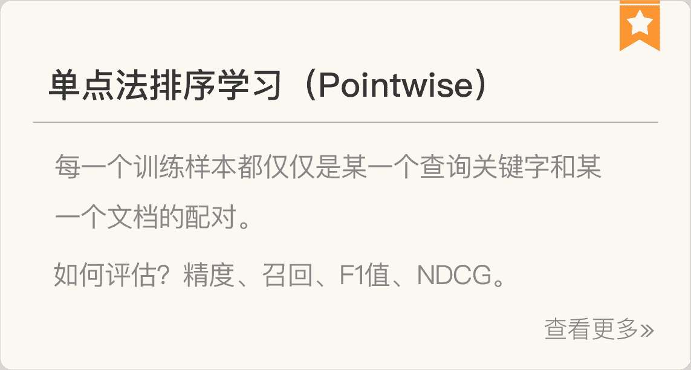](https://time.geekbang.org/column/article/949)
 

 

[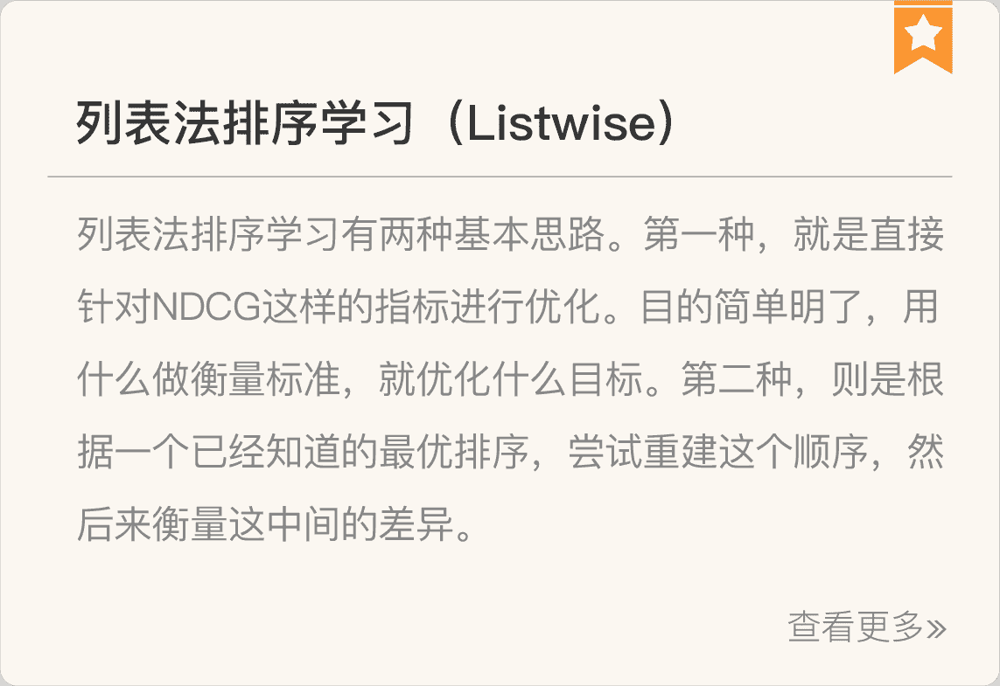](https://time.geekbang.org/column/article/952)
 

## 4. 基于机器学习的高级排序算法

 

 

[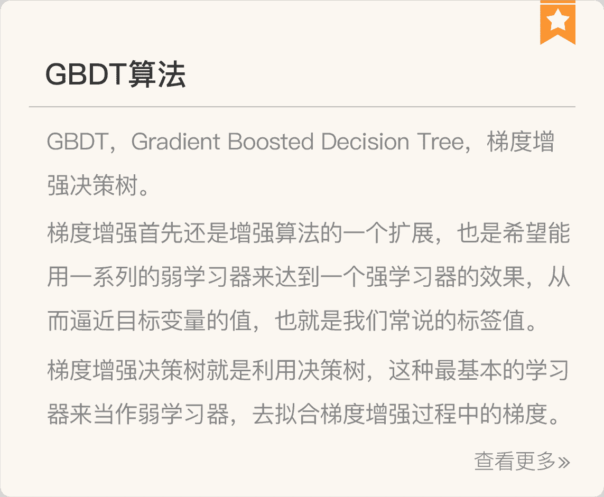](https://time.geekbang.org/column/article/2052)
 

 

## 5. 查询关键字理解

 

[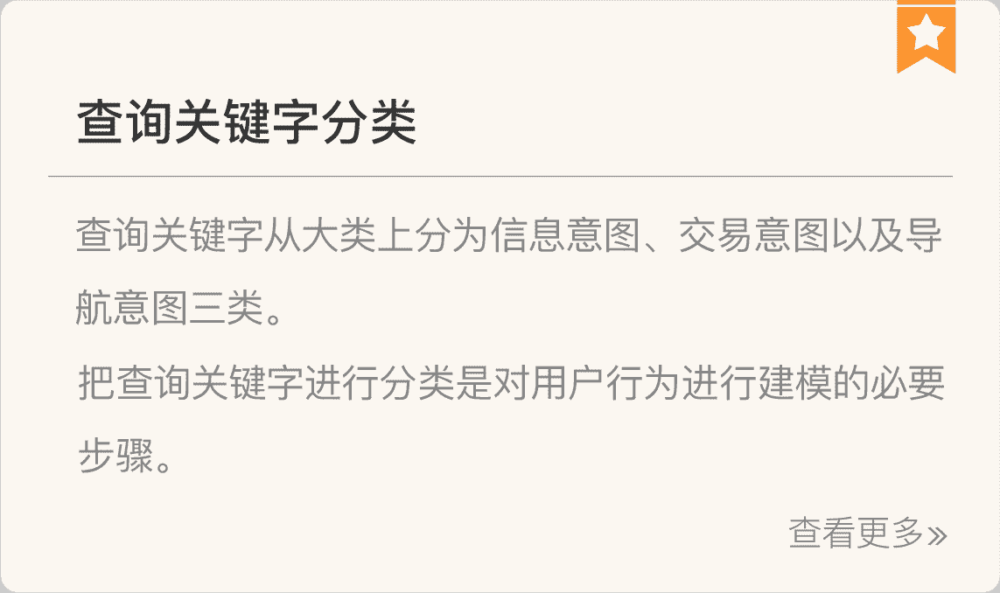](https://time.geekbang.org/column/article/1077)
 

 

 

## 6. 文档理解

 

 

 

 

## 7. 经典图算法

 

 

[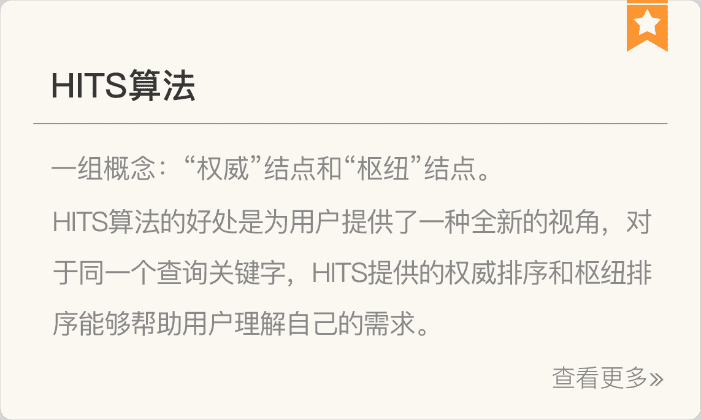](https://time.geekbang.org/column/article/1938)
 

[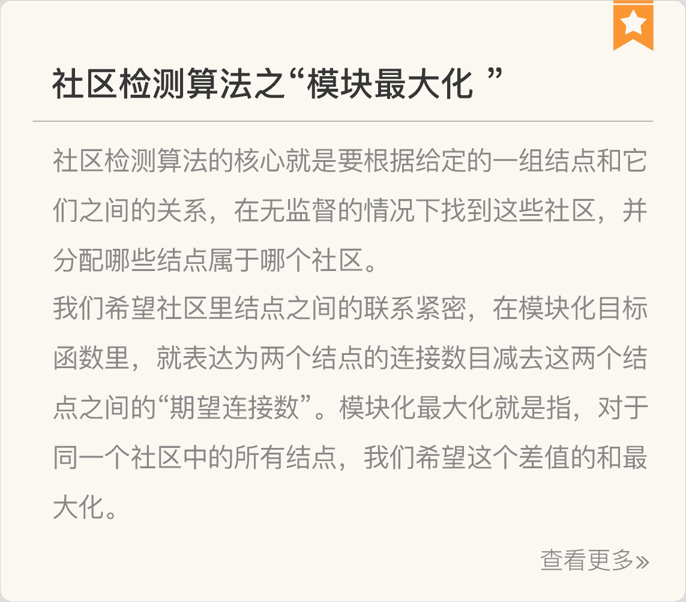](https://time.geekbang.org/column/article/1940)
 

## 8. 基于深度学习的搜索算法

 

[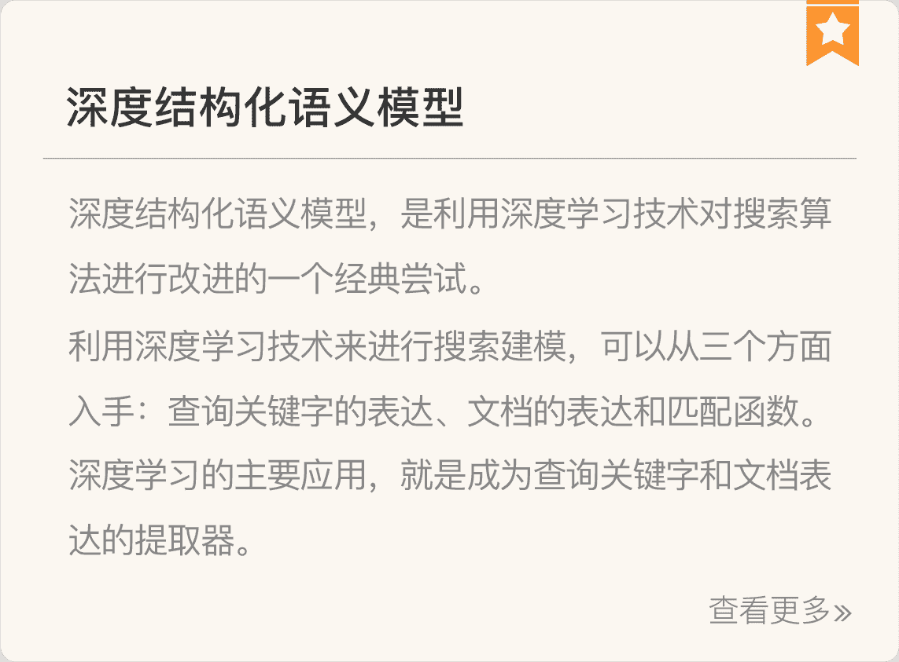](https://time.geekbang.org/column/article/2297)
 

[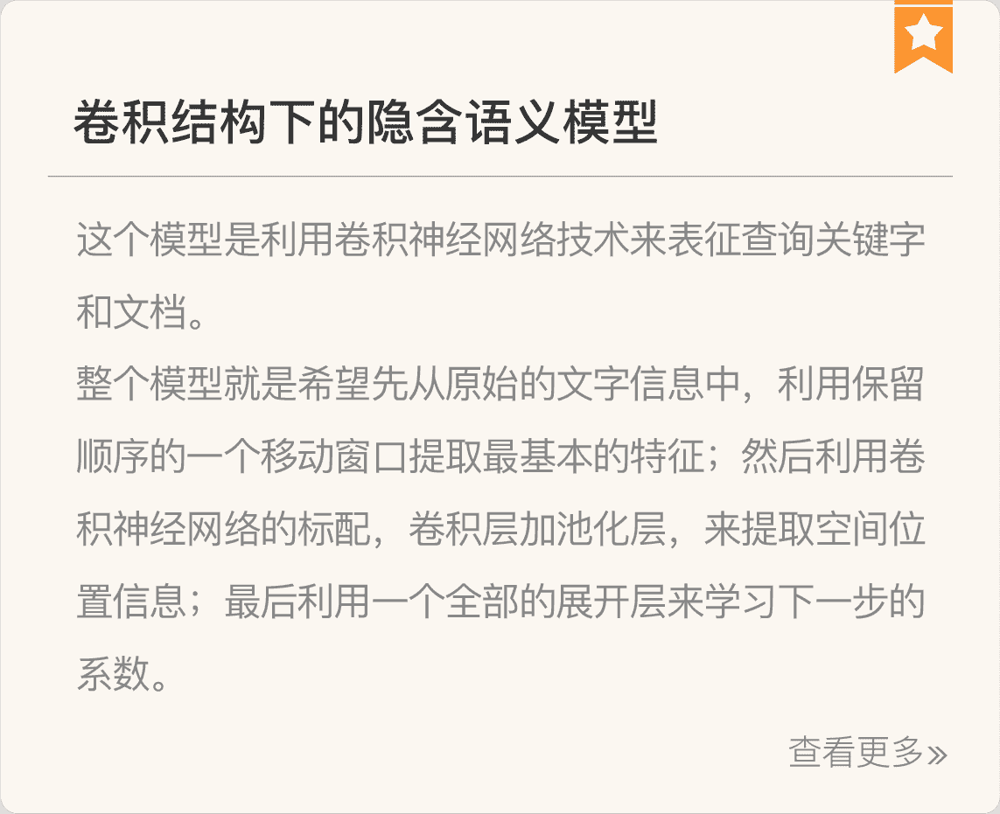](https://time.geekbang.org/column/article/2298)
 

 

## 9. 搜索系统的评价

 

If You Can’t Measure It, You Can’t Improve It.
 

 

 

 

## 积跬步以至千里

 

最后，*恭喜你在这个模块中已经阅读了70047 字，听了220 分钟的音频，这是一个不小的成就*。在人工智能领域的千里之行，我们已经迈出了扎实的第一步。
 

 

感谢你在专栏里的每一个留言，给了我很多思考和启发。期待能够听到你更多的声音，我们一起交流讨论。
  

