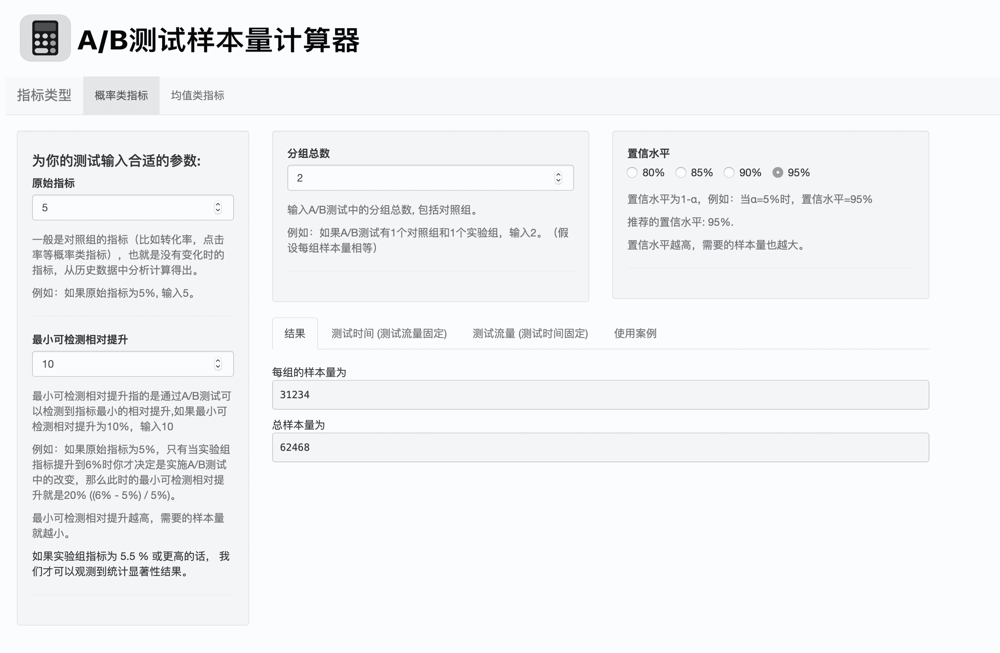
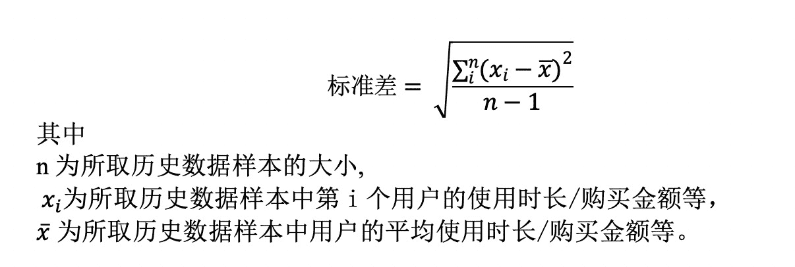
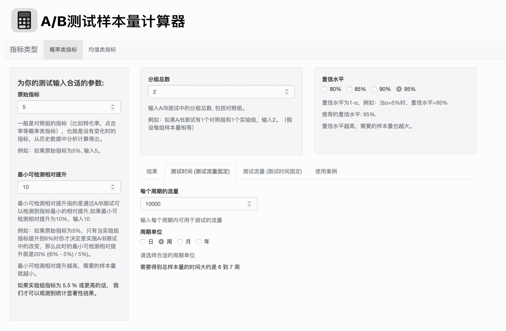
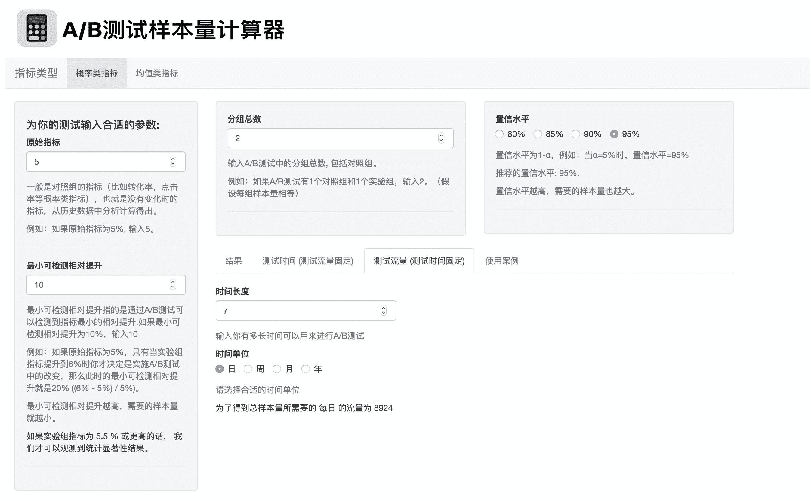
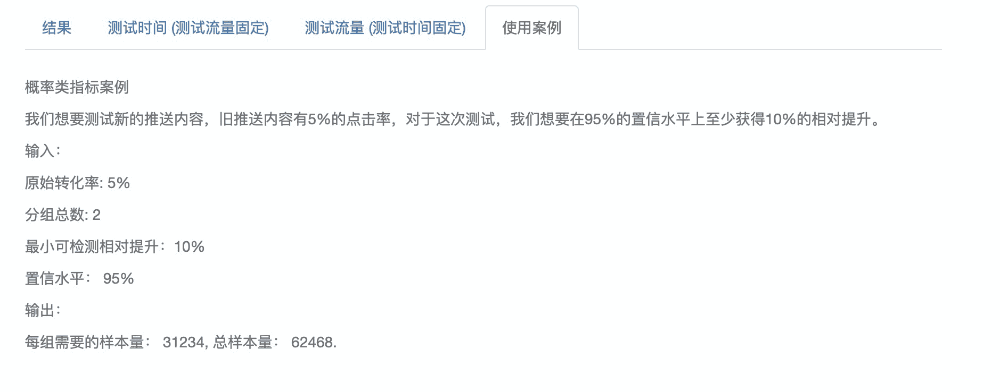
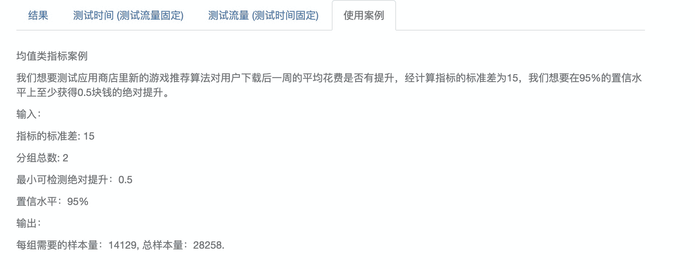
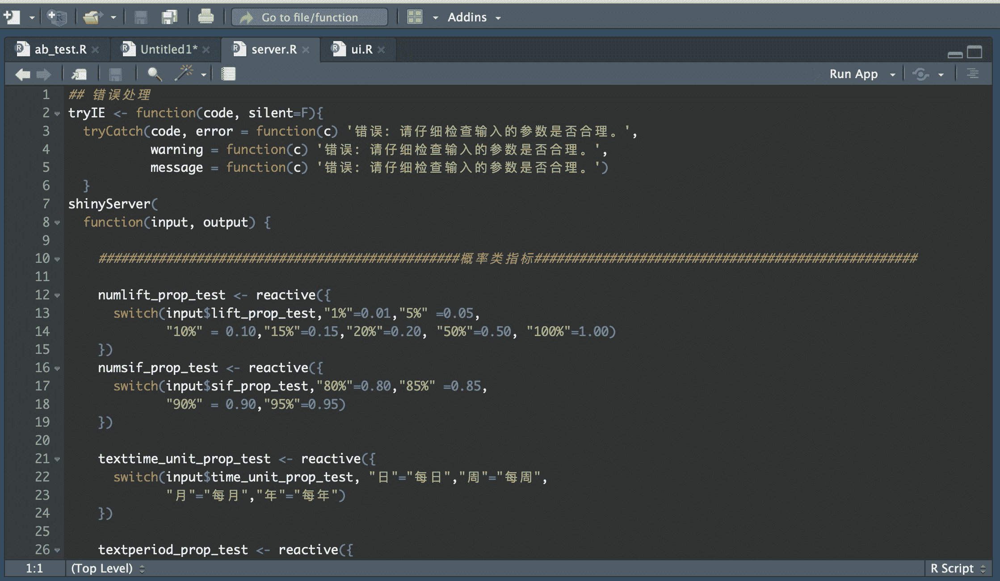

# 15｜用R/Shiny，教你制作一个样本量计算器

 

你好，我是博伟。

A/B 测试前的样本量计算是设计实验时不可或缺的一步。在第 6 节讲样本量计算时，我提到了现在网上的样本量计算器参差不齐的问题，并且网上大部分的计算器都是只能计算概率类指标，不能计算均值类指标，在实际业务应用时十分局限。

鉴于这些问题，加上我在实践中也想要更加快速且正确地计算样本量，提高工作效率，于是就从统计理论出发，去钻研 A/B 测试样本量计算的原理，让自己能够识别和掌握正确的计算方法。

后来渐渐发现身边的同事和朋友在做 A/B 测试时也有这方面的需求，于是我就把样本量的计算方法工具化，做成 App 放在了网上。

所以我今天教你的，就是**把样本量计算工具化的详细过程——我会带你制作一个可以发布在网上的实时计算的 A/B 测试样本量计算器。**

## 实战指南

既然是制作 App，我们还是需要进行一些简单的编程，包括前端和后端，使用 R 语言及其前端库 Shiny。不过你也不用担心，制作这款 App 不需要你掌握前端的 JavaScript、HTML、CSS，也不需要你会在后端如何搭建数据库。你只需要掌握以下 3 点就足够了。

1. **A/B 测试样本量计算的原理**。关于原理，重点学习咱们这门课"统计篇"的两节课和基础篇的第 6 节课即可。
2. **最基本的编程知识**。我指的是通用的编程，不细指特定的语言。包括变量赋值、基本的数据类型（字符串，数字等），这些最基础的编程知识，即使不是专业的编程人员，也是大部分互联网从业者都会知道和掌握的，难度不大。
3. **R 和 Shiny 的基本语法**。如果你对 R 和 Shiny 很熟悉的话，那就可以直接跳过这一点。如果你之前没有接触过 R 和 Shiny，也没关系，这些语法也是可以快速学习和掌握的。我在这里给你一些拓展资料供你参考学习。

1. 如何安装 R 和 Rstudio
2. R 的基本语法（只需看 R Tutorial 这部分即可）
3. Shiny 教程

如果你没有时间和精力学习 R 和 Shiny 的知识，也别担心，我会把我的代码开源贴出来，你可以结合代码和本节课的内容学习理解。

相信如果你是跟我从头开始认真学习这门课的话，现在你肯定已经掌握了第一点：A/B 测试样本量计算的原理。至于第二点：最基本的编程知识，相信作为互联网人的你已经掌握或者有概念性的认知了。那么我们今天就重点讲解下如何把这两点结合起来，制作一个简单方便的样本量计算器，在教你制作的同时呢，我也会穿插讲解 R 和 Shiny 的相关知识，还有一些实战案例。

在讲解前呢，我先把我的代码库和样本量计算器贴出来，供作参考：

1. 代码库
2. 样本量计算器 App

首先，如果你点开 GitHub 上的代码库就会发现，主要的文件有两个：server.R 和 ui.R。这是 Shiny App 的标准文件结构，其实从文件名就能看出它们大概的功能：

1. server.R 负责后端逻辑的文件，比如我们这次的样本量计算的逻辑都在 server.R 当中。
2. ui.R 负责前端用户交互界面的，你的 App 做得好不好看全靠它了。

接着，你点开我贴出来的样本量计算器链接就会发现，它已经按照指标类型分成了概率类和均值类：


那么我今天就按照这两类指标来分别进行讲解。

## 制作过程

### 概率类指标

从概率类指标的样本量计算的逻辑（参看第 6 节课）上来看，我们需要函数：power.prop.test。下面这段代码（L31-35）是在 server.R 文件中的具体实施：

```
number_prop_test <-reactive({ceiling(power.prop.test(  
p1=input$avgRR_prop_test/100,                            
p2=input$avgRR_prop_test/100*(1+input$lift_prop_test/100),  
sig.level=1-numsif_prop_test(),   
power=0.8)[[1]])  
      })
```

函数的输入参数这里，我们需要输入以下四项信息：

1. 两组的指标 p1 和 p2。
2. 显著水平 sig.level。
3. Power。
4. 单双尾检验。

我们来对照实际的前端交互界面来看下应该怎么输入：



**两组的指标 p1 和 p2**

在这里，我会让用户输入原始指标，也就是 p1，和最小可检测提升。注意这里的“提升”是相对提升 =（p2-p1）/p1，而不是绝对提升 =p2-p1（注意和均值类指标的绝对提升进行区别）。通过这两个参数就可以算出 p2 了。

这是根据我平时实践中的实际使用情况来设置的，因为一般是有原始指标和想要获得的提升，当然你也可以根据自己的需求直接让用户输入 p1 和 p2。

**显著水平 sig.level**

在这里，我会让用户输入置信水平（1-α），而不是显著水平α，这也是根据实践中的习惯调整的。

**Power** 和**单双尾检验**

我把 Power 和单双尾检验都设定成了默认值，是不需要用户改变的。因为很多用我制作的计算器的用户，他们的统计背景并不强，所以我就把 Power 隐藏了起来，并且设定为默认的 80%，这样就可以减少他们的困惑。

至于单双尾检验，我在第 2 节课中也讲了，A/B 测试中更推荐使用双尾检验，所以我也把它设定为默认的双尾检验（从代码可以看到并没有涉及这个参数，那是因为函数本身对这个参数的默认值就为“two.sided”，即“双尾”）。

如果你还记得第 6 节讲的样本量计算公式的话，就会知道影响样本量的因素有显著水平α、Power、两组间的差值δ和两组的综合方差 σpooled2​。

你可能会有疑问：为什么不让用户直接输入以上 4 个影响因素呢，而是让用户输入现在交互界面上的参数呢？

这其实是在帮用户省事，通过在实践中最常出现的参数，来帮助用户计算综合方差。

通过把函数的输入参数和这些影响因素对比之后，你就会发现，其实通过函数的输入参数完全可以确定这 4 个影响因素，从而求得样本量。

输入完这四项信息之后，就可以开始运行了。

如果你仔细比较 server.R 和 ui.R 这两个文件，就会发现整个 App 中两个文件通过以下方式运行的：

1. 整个 App 是通过 ui.R 这个文件接收到用户的输入值，然后把这些输入值存到 input 函数中。
2. 接着呢，server.R 再读取 input，进行计算，再把结果存储到 output 函数中，返回给 ui.R。
3. 最后 ui.R 再把这些结果显示在用户的交互界面上。

这里再来举个例子说明下我刚才讲的整个过程。

首先，在 ui.R 中我们需要用户输入**原始指标**avgRR_prop_test（L11-12）：

```
numericInput("avgRR_prop_test", label = "原始指标", value = 5, min = 0, step=1)
```

**最小可检测相对提升**lift_prop_test（L18-19）：

```
numericInput("lift_prop_test", label = "最小可检测相对提升", value = 5,min = 0, step=1)
```

**置信水平**sif_prop_test（L42-44）:

```
radioButtons("sif_prop_test", label = "置信水平",  
choices = list("80%","85%","90%","95%"),   
selected = "95%",inline=T)
```

那么这些用户输入的参数呢，最后都通过 input 这个函数，传递到 server.R 文件当中去进行样本量计算（L31-35）：

```
number_prop_test <-reactive({ceiling(power.prop.test(p1=input$avgRR_prop_test/100,    
p2=input$avgRR_prop_test/100*(1+input$lift_prop_test/100),  
sig.level=1-numsif_prop_test(),   
power=0.8)[[1]])  
      })
```

当计算完成后，再把结果存在 output 函数中（L44-51）：

```
output$resulttext1_prop_test <- renderText({   
        "每组的样本量为 "  
      })  
        
output$resultvalue1_prop_test<-renderText({     
        tryIE(number_prop_test())  
      })
```

最后 output 函数再把结果传递给 ui.R 供前端显示（L57-63）：

```
tabPanel("结果",  
                   br(),  
                   textOutput("resulttext1_prop_test"),  
                   verbatimTextOutput("resultvalue1_prop_test"),  
                   textOutput("resulttext2_prop_test"),  
                   verbatimTextOutput("resultvalue2_prop_test")  
          )
```

这里要注意的一点是，因为通过power.prop.test函数计算出来的样本量是单组的，如果需要求总样本量时，就要用单组样本量乘上分组数量。这里的分组数量也是需要用户手动输入的。

同时你可能也注意到了，我在这款 App 中加入了大量的解释性语言，对于每个需要用户输入的参数都进行了解释说明，这样做其实也是吸取了实践中的用户反馈。就像我刚才说的，很多用户的统计背景并不强，对于这些统计量并不熟悉，所以我们要尽可能地将这些输入参数解释清楚，减少用户使用时的困惑。

### 均值类指标

从均值类指标的样本量计算的逻辑上（参看第 6 节课）来看，我们需要函数：power.t.test。下面这段代码（L105-109）是在 server.R 文件中的具体实施：

```
number_t_test <-   
reactive({ceiling(power.t.test(delta=input$lift_t_test,   
sd=input$sd_t_test,  
sig.level=1-numsif_t_test(),   
power=0.8)[[1]])  
      })
```

从这段代码我们会发现，和概率类指标相比，函数要求的输入参数有所变化，变成了：

1. 标准差 sd。
2. 最小可检测差值 delta（这里是两组指标的绝对差值）。
3. 显著水平 sig.level。
4. Power。
5. 还有单双尾检验。

这是因为均值类指标的标准差（方差）并不能仅仅通过两组指标的值来计算，而是需要知道每个数据点来计算。

我们先看标准差的计算公式：



所以标准差需要用户根据以上公式在数据中计算得出。

最小可检测差值 delta 是用户根据实际业务情况自定的，显著水平一般为 95%。

**Power** 和**单双尾检验**这两项我们还沿用概率类指标的设定去设置默认值：Power 为 80% 的双尾检测。

均值类指标代码的其他部分和概率类指标均类似，这里就不再展开举例了，具体的内容，代码里也写得十分清楚了。

## 应用场景和使用案例

实践中使用样本量计算的应用场景主要分两类：

1. 已知单位时间的流量，求测试时间。
2. 已知测试时间，求单位时间的流量。

所以，你会发现在 App 交互界面右下角区域的结果板块，就有关于测试时间和测试流量的选项。

下面我来举一个例子来分别说明这两种情况。

假设我们现在做 A/B 测试的指标为下载率，原始指标为 5%，最小可检测的相对提升为 10%，置信水平为 95%，一共有一个实验组和一个对照组，通过咱们的样本量计算器，求得的每组样本量为 31234，总样本量为 62468。

### 

**在单位时间测试可用流量固定的情况下，求测试时间**

这种场景是比较常见的。我们假设以周为单位，每周可用的测试流量约为 10000。输入参数后，计算得出一共需要 6 到 7 周的时间才能达到充足的样本量：



### 在测试时间固定的情况下，求单位时间内的流量

这种场景适用于时间紧急的情况，比如一周之内要出结果，一周有 7 天，那么输入参数后，计算得出我们每天的测试流量至少要有 8924。

知道每天需要的流量后，我们就可以根据这个数字去调整我们的测试流量占总流量的比例了。



最后我要说明一点，虽然我举的是一个概率类指标的例子，但这两个使用场景对于均值类指标是同样适用的。

### 使用案例

在使用案例这个版块，我会针对概率类指标和均值类指标各举一个例子，来说明具体情况下应该如何输入不同的参数。

先看概率类指标的案例。



再看均值类指标的案例。



## 如何把 Shiny App 发布在网上

现在我们完成了 server.R 和 ui.R，在下图中点击右上角的“Run App”即可在本地打开我们的 App。



但是如果你想把 App 发布在网上，还是得借助 ShinyApps.io，它是专门发布 Shiny App 的平台，你需要在上面注册一个免费账户，具体过程呢也不难，你可以查看这里的教程。

## 小结

那么到这里呢，关于制作 A/B 测试样本量计算器的讲解就结束了，相信你通过本节课的学习，结合着我提供的代码和 App，已经能成功制作出自己的样本量计算器啦。

不过有一点也需要再说明一下。虽然样本量计算的逻辑是固定的，但是对于用户交互前端的话，在保证基本功能的前提下，你可以根据自己的喜好来设计的，这里我贴出来 Shiny 前端的案例集和常用语句供你参考。

## 思考题

其实样本量计算可以在各种编程语言中实施，这里我选用 R 和 Shiny 的原因是，它们使用起来相对简单些。那如果让你用 Python 来实施的话，对于概率类和均值类指标样本量的计算，你会选择哪些函数呢？

如果你在制作样本量计算器的过程中有遇到什么问题，或者有什么经验，欢迎在留言区和我分享，也欢迎你把课程分享给你的朋友、同事。
