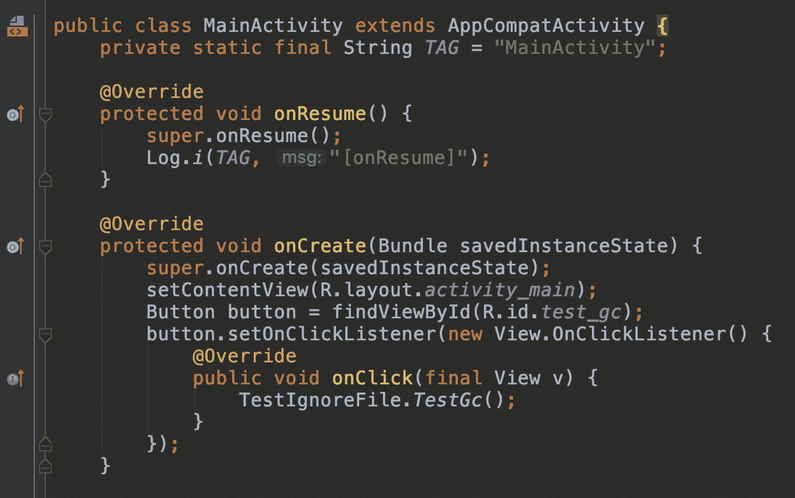
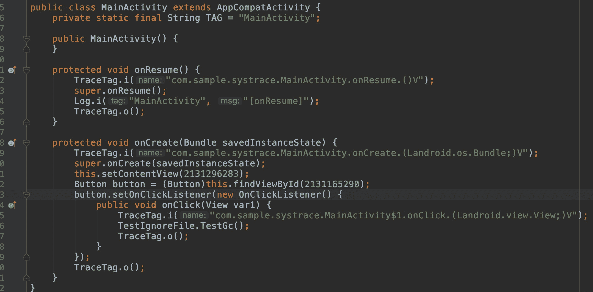
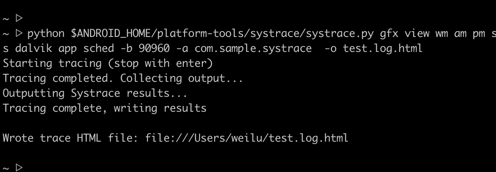
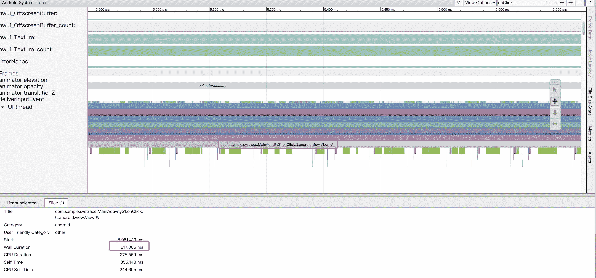
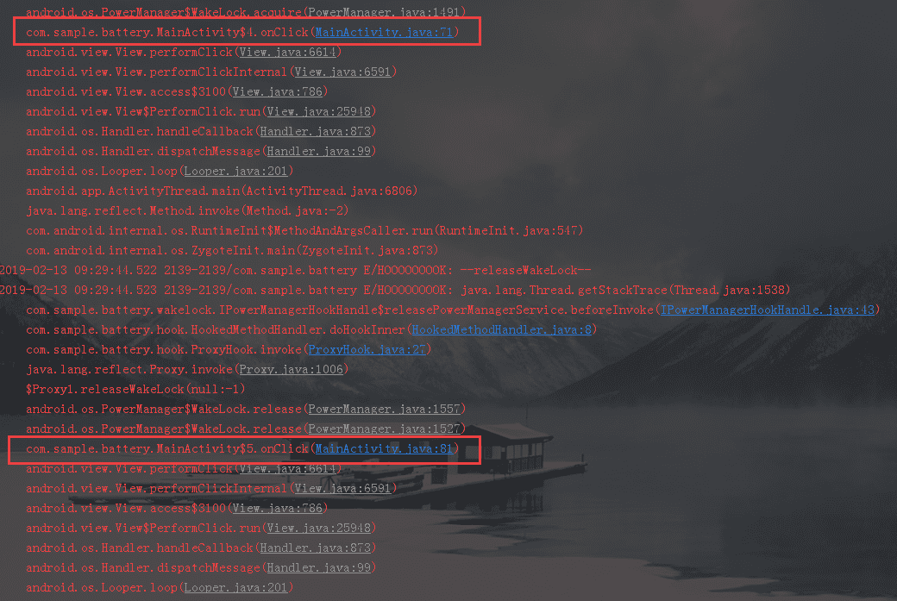
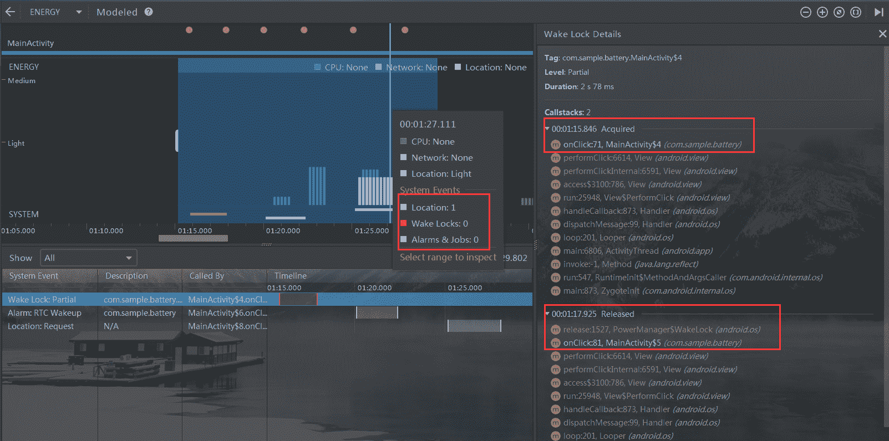

# 练习Sample跑起来 | 唯鹿同学的练习手记 第2辑

 

你好，我是唯鹿。

接着上篇[练习手记](https://time.geekbang.org/column/article/83742)，今天练习 6～8、12、17、19 这六期内容（主要针对有课后 Sample 练习的），相比 1～5 期轻松了很多。

[**Chapter06**](https://github.com/AndroidAdvanceWithGeektime/Chapter06)

>  
> 该项目展示了使用 PLT Hook 技术来获取 Atrace 的日志，可以学习到 systrace 的一些底层机制。
 

没有什么问题，项目直接可以运行起来。运行项目后点击开启 Atrace 日志，然后就可以在 Logcat 日志中查看到捕获的日志，如下：

```
11:40:07.031 8537-8552/com.dodola.atrace I/HOOOOOOOOK: ========= install systrace hoook =========11:40:07.034 8537-8537/com.dodola.atrace I/HOOOOOOOOK: ========= B|8537|Record View#draw()11:40:07.034 8537-8552/com.dodola.atrace I/HOOOOOOOOK: ========= B|8537|DrawFrame11:40:07.035 8537-8552/com.dodola.atrace I/HOOOOOOOOK: ========= B|8537|syncFrameState    ========= B|8537|prepareTree    ========= E    ========= E    ========= B|8537|eglBeginFrame    ========= E    ========= B|8537|computeOrdering    ========= E    ========= B|8537|flush drawing commands    ========= E11:40:07.036 8537-8552/com.dodola.atrace I/HOOOOOOOOK: ========= B|8537|eglSwapBuffersWithDamageKHR    ========= B|8537|setSurfaceDamage    ========= E11:40:07.042 8537-8552/com.dodola.atrace I/HOOOOOOOOK: ========= B|8537|queueBuffer    ========= E11:40:07.043 8537-8552/com.dodola.atrace I/HOOOOOOOOK: ========= B|8537|dequeueBuffer    ========= E    ========= E    ========= E
```

通过 B|事件和 E|事件是成对出现的，这样就可以计算出应用执行每个事件使用的时间。那么上面的 Log 中 View 的 draw() 方法显示使用了 9ms。

这里实现方法是使用了[Profilo](https://github.com/facebookincubator/profilo)的 PLT Hook 来 hook libc.so 的`write`与`__write_chk`方法。libc 是 C 的基础库函数，为什么要 hook 这些方法，需要我们补充 C、Linux 相关知识。

同理[Chapter06-plus](https://github.com/AndroidAdvanceWithGeektime/Chapter06-plus)展示了如何使用 PLT Hook 技术来获取线程创建的堆栈，README 有详细的实现步骤介绍，我就不赘述了。

[**Chapter07**](https://github.com/AndroidAdvanceWithGeektime/Chapter07)

>  
> 这个 Sample 是学习如何给代码加入 Trace Tag，大家可以将这个代码运用到自己的项目中，然后利用 systrace 查看结果。这就是所谓的 systrace + 函数插桩。
 

操作步骤：

 
-  

使用 Android Studio 打开工程 Chapter07。
  
-  

运行 Gradle Task `:systrace-gradle-plugin:buildAndPublishToLocalMaven`编译 plugin 插件。
  
-  

使用 Android Studio 单独打开工程 systrace-sample-android。
  
-  

编译运行 App（插桩后的 class 文件在目录`Chapter07/systrace-sample-android/app/build/systrace_output/classes`中查看）。
  

对比一下插桩效果，插桩前：



插桩后:



可以看到在方法执行前后插入了 TraceTag，这样的话`beginSection`方法和`endSection`方法之间的代码就会被追踪。

```
public class TraceTag {     @TargetApi(Build.VERSION_CODES.JELLY_BEAN_MR2)    public static void i(String name) {        Trace.beginSection(name);    }     @TargetApi(Build.VERSION_CODES.JELLY_BEAN_MR2)    public static void o() {        Trace.endSection();    }
```

其实 Support-Compat 库中也有类似的一个[TraceCompat](https://developer.android.google.cn/reference/android/support/v4/os/TraceCompat)，项目中可以直接使用。

然后运行项目，打开 systrace：

```
python $ANDROID_HOME/platform-tools/systrace/systrace.py gfx view wm am pm ss dalvik app sched -b 90960 -a com.sample.systrace  -o test.log.html
```



最后打开生成的 test.log.html 文件就可以查看 systrace 记录：



当然，这一步我们也可以使用 SDK 中的 Monitor，效果是一样的。

使用 systrace + 函数插桩的方式，我们就可以很方便地观察每个方法的耗时，从而针对耗时的方法进行优化，尤其是 Application 的启动优化。

[**Chapter08**](https://github.com/AndroidAdvanceWithGeektime/Chapter08)

>  
> 该项目展示了关闭掉虚拟机的 class verify 后对性能的影响。
 

在加载类的过程有一个 verify class 的步骤，它需要校验方法的每一个指令，是一个比较耗时的操作。这个例子就是通过 Hook 去掉 verify 这个步骤。该例子尽量在 Dalvik 下执行，在 ART 下的效果并不明显。

去除校验代码（可以参看阿里的[Atlas](https://github.com/alibaba/atlas)）：

```
    AndroidRuntime runtime = AndroidRuntime.getInstance();    runtime.init(this.getApplicationContext(), true);    runtime.setVerificationEnabled(false);
```

具体运行效果这里我就不展示了，直接运行体验就可以了。

[**Chapter12**](https://github.com/AndroidAdvanceWithGeektime/Chapter12)

>  
> 通过复写 Application 的`getSharedPreferences`替换系统`SharedPreferences`的实现，核心的优化在于修改了 Apply 的实现，将多个 Apply 方法在内存中合并，而不是多次提交。
 

修改`SharedPreferencesImpl`的 Apply 部分如下：

```
       public void apply() {			// 先调用 commitToMemory()            final MemoryCommitResult mcr = commitToMemory();             boolean hasDiskWritesInFlight = false;            synchronized (SharedPreferencesImpl.this) {            	// mDiskWritesInFlight 大于 0 说明之前已经有调用过 commitToMemory() 了                hasDiskWritesInFlight = mDiskWritesInFlight > 0;            }            // 源码没有这层判断，直接提交。            if (!hasDiskWritesInFlight) {                final Runnable awaitCommit = new Runnable() {                    public void run() {                        try {                            mcr.writtenToDiskLatch.await();                        } catch (InterruptedException ignored) {                        }                    }                };                 QueuedWork.add(awaitCommit);                  Runnable postWriteRunnable = new Runnable() {                    public void run() {                        awaitCommit.run();                         QueuedWork.remove(awaitCommit);                    }                };                 SharedPreferencesImpl.this.enqueueDiskWrite(mcr, postWriteRunnable);            }             // Okay to notify the listeners before it's hit disk            // because the listeners should always get the same            // SharedPreferences instance back, which has the            // changes reflected in memory.            notifyListeners(mcr);
```

[**Chapter14**](https://github.com/AndroidAdvanceWithGeektime/Chapter14)

这个是全面解析 SQLite 的资料，有兴趣的可以下载看看。

[**Chapter17**](https://github.com/AndroidAdvanceWithGeektime/Chapter17)

>  
> 该项目展示了如何使用 PLT Hook 技术来获取网络请求相关信息。
 

通过 PLT Hook，代理 Socket 相关的几个重要函数：

```
/*** 直接 hook 内存中的所有 so，但是需要排除掉 socket 相关方法本身定义的 libc(不然会出现循坏)* plt hook*/void hookLoadedLibs() {    ALOG("hook_plt_method");    hook_plt_method_all_lib("libc.so", "send", (hook_func) &socket_send_hook);    hook_plt_method_all_lib("libc.so", "recv", (hook_func) &socket_recv_hook);    hook_plt_method_all_lib("libc.so", "sendto", (hook_func) &socket_sendto_hook);    hook_plt_method_all_lib("libc.so", "recvfrom", (hook_func) &socket_recvfrom_hook);    hook_plt_method_all_lib("libc.so", "connect", (hook_func) &socket_connect_hook);}
```

```
int hook_plt_method_all_lib(const char* exclueLibname, const char* name, hook_func hook) {  if (refresh_shared_libs()) {    // Could not properly refresh the cache of shared library data    return -1;  }   int failures = 0;   for (auto const& lib : allSharedLibs()) {      if (strcmp(lib.first.c_str(), exclueLibname) != 0) {        failures += hook_plt_method(lib.first.c_str(), name, hook);      }  }   return failures;}
```

运行项目，访问百度的域名[https://www.baidu.com](https://www.baidu.com)，输出如下：

```
17:08:28.347 12145-12163/com.dodola.socket E/HOOOOOOOOK: socket_connect_hook sa_family: 1017:08:28.349 12145-12163/com.dodola.socket E/HOOOOOOOOK: stack:com.dodola.socket.SocketHook.getStack(SocketHook.java:13)    java.net.PlainSocketImpl.socketConnect(Native Method)    java.net.AbstractPlainSocketImpl.doConnect(AbstractPlainSocketImpl.java:334)    java.net.AbstractPlainSocketImpl.connectToAddress(AbstractPlainSocketImpl.java:196)    java.net.AbstractPlainSocketImpl.connect(AbstractPlainSocketImpl.java:178)    java.net.SocksSocketImpl.connect(SocksSocketImpl.java:356)    java.net.Socket.connect(Socket.java:586)    com.android.okhttp.internal.Platform.connectSocket(Platform.java:113)    com.android.okhttp.Connection.connectSocket(Connection.java:196)    com.android.okhttp.Connection.connect(Connection.java:172)    com.android.okhttp.Connection.connectAndSetOwner(Connection.java:367)    com.android.okhttp.OkHttpClient$1.connectAndSetOwner(OkHttpClient.java:130)    com.android.okhttp.internal.http.HttpEngine.connect(HttpEngine.java:329)    com.android.okhttp.internal.http.HttpEngine.sendRequest(HttpEngine.java:246)    com.android.okhttp.internal.huc.HttpURLConnectionImpl.execute(HttpURLConnection    AF_INET6 ipv6 IP===>183.232.231.173:443    socket_connect_hook sa_family: 1    Ignore local socket connect02-07 17:08:28.637 12145-12163/com.dodola.socket E/HOOOOOOOOK: respond:<!DOCTYPE html>    <html><!--STATUS OK--><head><meta charset="utf-8"><title> 百度一下, 你就知道 </title>
```

可以看到我们获取到了网络请求的相关信息。

最后，我们可以通过 Connect 函数的 hook，实现很多需求，例如：

 
- 禁用应用网络访问 
- 过滤广告 IP 
- 禁用定位功能 

[**Chapter19**](https://github.com/AndroidAdvanceWithGeektime/Chapter19)

>  
> 使用 Java Hook 实现 Alarm、WakeLock 与 GPS 的耗电监控。
 

实现原理

根据老师提供的提示信息，动态代理对应的[PowerManager](http://androidxref.com/7.0.0_r1/xref/frameworks/base/core/java/android/os/PowerManager.java)、[AlarmManager](http://androidxref.com/7.0.0_r1/xref/frameworks/base/core/java/android/app/AlarmManager.java)、[LocationManager](http://androidxref.com/7.0.0_r1/xref/frameworks/base/location/java/android/location/LocationManager.java)的`mService`实现，要拦截的方法在[PowerManagerService](http://androidxref.com/7.0.0_r1/xref/frameworks/base/services/core/java/com/android/server/power/PowerManagerService.java)、[AlarmManagerService](http://androidxref.com/7.0.0_r1/xref/frameworks/base/services/core/java/com/android/server/AlarmManagerService.java)、[LocationManagerService](http://androidxref.com/7.0.0_r1/xref/frameworks/base/services/core/java/com/android/server/LocationManagerService.java)中。

实现核心代码：

```
        Object oldObj = mHostContext.getSystemService(Context.XXX_SERVICE);	Class<?> clazz = oldObj.getClass();	Field field = clazz.getDeclaredField("mService");	field.setAccessible(true); 	final Object mService = field.get(oldObj);	setProxyObj(mService); 	Object newObj = Proxy.newProxyInstance(this.getClass().getClassLoader(), mService.getClass().getInterfaces(), this);	field.set(oldObj, newObj)
```

写了几个调用方法去触发，通过判断对应的方法名来做堆栈信息的输出。

输出的堆栈信息如下：



当然，强大的 Studio 在 3.2 后也有了强大的耗电量分析器，同样可以监测到这些信息，如下图所示（我使用的 Studio 版本为 3.3）。



实现不足之处：

 
- 可能兼容性上不是特别完善（期待老师的标准答案）。 
- 没有按照耗电监控的规则去做一些业务处理。 

心得体会：

 
- 本身并不复杂，只是为了找到 Hook 点，看了对应的 Service 源码耗费了一些时间，对于它们的工作流程有了更深的认识。 
- 平时也很少使用动态代理，这回查漏补缺，一次用了个爽。 

这个作业前前后后用了一天时间，之前作业还有一些同学提供 PR，所以相对轻松些，但这次没有参考，走了点弯路，不过收获也是巨大的。我就不细说了，感兴趣的话可以参考我的实现。完整代码参见[GitHub](https://github.com/simplezhli/Chapter19)，仅供参考。

**参考**

 
- [练习 Sample 跑起来 | 热点问题答疑第 3 期](https://time.geekbang.org/column/article/76413) 
- [练习 Sample 跑起来 | 热点问题答疑第 4 期](https://time.geekbang.org/column/article/79331) 


