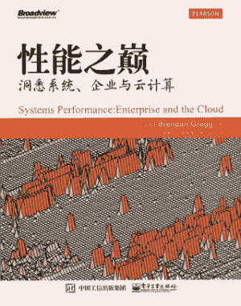
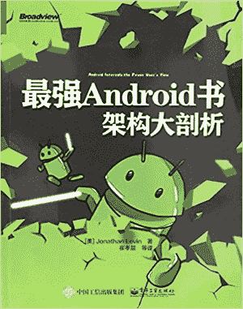
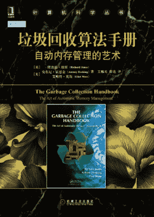
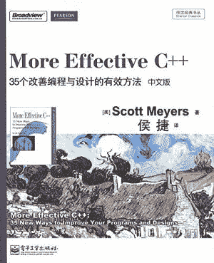
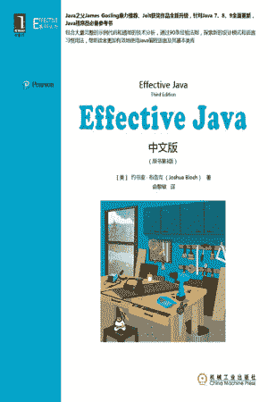
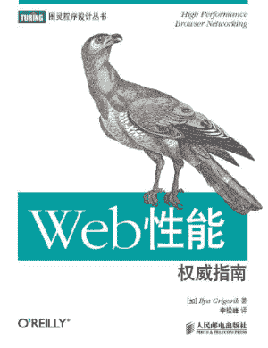
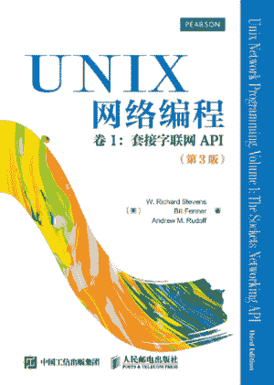

# 专栏学得苦？可能你还需要一份配套学习书单

 

你好，我是张绍文。专栏已经发布了一段时间，很多同学在学习专栏时问我，想补充一些基础知识可以参考哪些图书。今天我就结合专栏的编排，给你推荐几本我看过并且对我帮助很大的图书。推荐的书单不在于数量，而在于希望尽可能覆盖 Android 开发工程师进阶学习的路径，只有掌握牢固的基础知识，才能在进阶的道路上走得平稳。专栏把进阶的各个主题由点到线串联起来，但这背后必然少不了一些基础的、底层的知识进行支撑，而这些经典的图书涵盖的知识点比较全面，即使遇到问题时放在手边也是很好的参考书。

作为一名 Android 开发工程师，**你需要学习一些 Linux 的基础知识，在做优化时可以有更好的思路**。

关于 Linux 学习，我推荐：

[性能之巅](http://book.douban.com/subject/26586598/)

---

[最强 Android 书：架构大剖析](http://book.douban.com/subject/30269276/)

戳此购买

---

极客时间专栏：[Linux 性能优化实战](http://time.geekbang.org/column/140)

---

**如果想更好地学习虚拟机以及 Hook 相关的知识，你需要对 C++ 以及编译原理有一定的了解。**

关于虚拟机，我推荐：

[程序员的自我修养——链接、装载与库](http://book.douban.com/subject/3652388)

---

[垃圾回收算法手册](http://book.douban.com/subject/26740958)

戳此购买

---

关于编程语言，我推荐：

[More Effective C++](http://book.douban.com/subject/5908727/)

戳此购买

---

[Effective Java 中文版（第 3 版）](http://book.douban.com/subject/30412517)

戳此购买

---

**其他的知识，例如网络、数据库的一些细分领域**，我推荐：

[Web 性能权威指南](http://book.douban.com/subject/25856314/)

戳此购买

---

[UNIX 网络编程 卷 1：套接字联网 API（第 3 版）](http://book.douban.com/subject/26434583/)

戳此购买

---

欢迎你点击“请朋友读”，把今天的内容分享给好友，邀请他一起学习。

