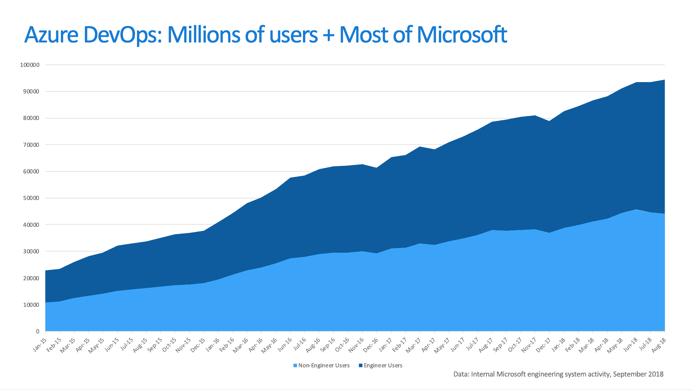
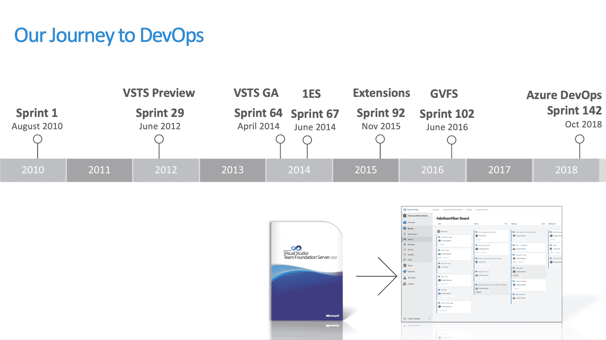
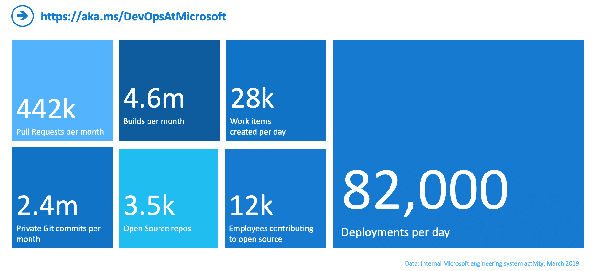
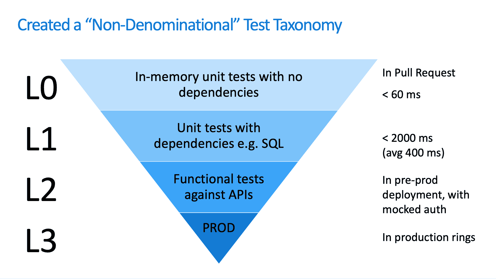
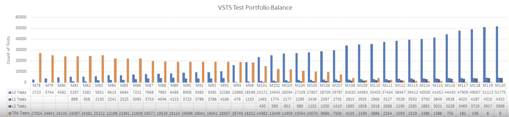
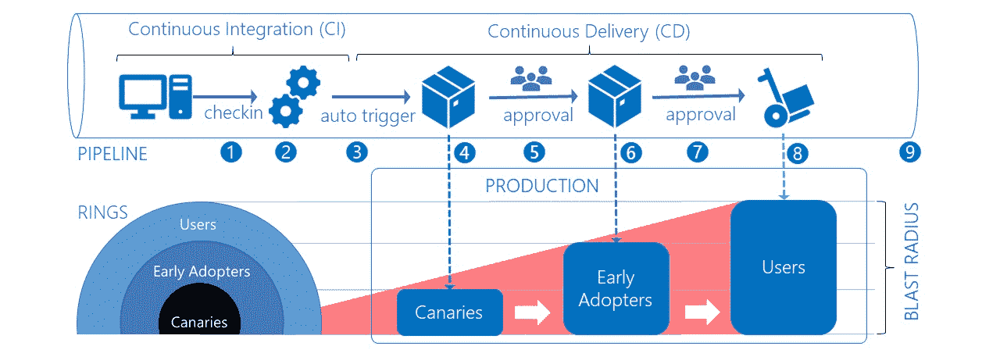

# 30 | 向前一步：万人规模企业的DevOps实战转型案例（下）

 

你好，我是石雪峰。今天，我们接着上一讲的内容，继续来聊一聊微软 DevOps 转型的故事。

经常有人会问，企业的 DevOps 转型应该由哪个团队来负责，是否要组建一个全新的 DevOps 团队呢？带着这个问题，我们来看看微软是怎么做的。

## 1ES

微软有一个特殊的团队，叫作 1ES。1ES 是 One Engineering System 的缩写，直译过来就是“一套工程系统”的意思。从这个名字，相信你就可以看出来，**在微软内部，有一套统一的工程能力平台来支撑微软内部各种形态产品的研发交付工作**。没错！这个 1ES 团队包含了近 200 名工程师，作为组织级的研发效能团队，他们的目标就是**通过一整套通用的工程能力平台，来提升内部的研发交付效率**。

1ES 团队的工作职责可不仅仅是开发通用工具平台，他们还要负责公司的文化转型、最新的工程方法导入试验、研发过程改进、安全合规性检查、内部研发效率咨询以及在工程团队推广最佳实践等等，可以说是一个“全功能”的企业研发效能和生产力团队。截至 2018 年，数据显示，总共有近 10 万名用户在 1ES 提供的平台上协同办公。

但国内的现状是，很多企业对于研发效能的关注才刚刚起步。即便有人员负责类似的事情，也大多分散在各个业务内部，难以形成合力。组建了企业级统一的研发效能团队，而且规模能够跟微软的 1ES 相提并论的企业，基本上一只手就可以数得过来，就更别提建立一套统一的工程能力平台了。我曾见过一家大型企业，他们内部的工具平台有 1700 多个，殊不知，这里面有多少的重复建设和资源浪费。

那么，你以为微软的 1ES 团队天生就是这样“一统天下”的吗？还真不是这么回事。

事实上，1ES 团队的历史可以追溯到 2014 年。当时，微软新上任的 CEO 萨提亚·纳德拉非常重视研发能力建设，他致力于通过最好的工具来赋能研发团队。结果，微软的每个部门都会根据自己的实际情况采购自己习惯的工具平台，这就导致整个公司内部的工具、流程和成熟度差异巨大。差异化的工具和流程进一步增强了不同团队之间的共享和协作，内部人员转岗的成本极高，因为他们到了新团队以后，要从头开始适应一切。

为了解决这个问题，1ES 团队识别了三大领域：**工作计划管理**、**版本控制**和**构建能力**。他们先在企业内部识别哪些团队没有使用公司构建的统一工具，然后自顶向下强推。这背后的核心理念就是“Use what we ship to ship what we use”，也就是使用他们对外发布的工具来研发团队自己的工具。

不知道你发现没有，这三个领域都是软件交付的主路径，**需求和任务管理、版本控制和构建系统无一不是核心系统**。当你想要建立一个统一的效能平台的时候，最重要的就是抓住主路径上的核心系统。

关于“如何基于核心系统扩展一整套解决方案”，我给你推荐一篇 GitHub 的博客，你可以看看他们是如何思考这个问题的。

在接下来的几年里面，1ES 团队推动 VSTS（也就是现在的 Azure DevOps）成为了微软内部的工具平台标准，平台的用户也从最开始的几千个人增长到了后来的 10 万多人。

正是从 2010 年开始至今 150 个迭代的千锤百炼，才造就了后来 Azure DevOps 产品的大放异彩。可以说，无论是从设计理念、功能，还是用户体验等方面，微软的 Azure DevOps 平台在当今业界都是首屈一指的。

## 持续交付

持续交付是 DevOps 转型的核心部分，1ES 提供的统一工程能力平台让这一切成为了可能。那么，微软的持续交付做到了什么程度呢？

从 2019 年 3 月份的数据来看，他们每天部署 82,000 次、创建 28,000 个工作项，每个月有 44 万个提交请求、460 万次构建和 240 万次的提交数量。

无论把这些数据的哪一项拿出来，都是非常惊人的，这体现了微软卓越的工程能力水平。

那么，微软是如何一步步走到今天的呢？我们先来看看 DevOps 中最重要的、也是“老大难”的测试部分，看看微软是如何实现在 6 分钟内完成 6 万个测试用例的。

其实，早在 2014 年，微软在测试中遇到的问题跟大多数公司没什么两样：测试耗时太长、测试频繁失败、主线质量不可靠、迭代周期末端的质量远远达不到发布门槛。

这些问题严重到什么程度呢？我给你列举几个数字，你就明白了。

1. 每天的自动化测试耗时 22 个小时；
2. 全功能自动化测试长达 2 天；
3. 仅有 60% 的 P0 级别用例可以执行成功；
4. 在过往的 8 年里面，甚至没有一次每日自动化测试是全部通过的。

不仅如此，团队成员之间对单元测试存在着巨大的分歧：研发不愿意花时间写单元测试；团队不认为可以通过单元测试替代功能测试；甚至连用不用 Mock，他们在理念上也存在着冲突。

历史总是惊人的相似。在我之前的公司里面，研发总能找到各种理由苦口婆心地说服你他们不需要写单元测试，或者是，各种环境问题导致单元测试压根没法执行完成，因为引用了大量的外部服务。

微软的解法是，**停止这种无意义的争论，为了达成预期目标前进**。他们**先从能达成共识的部分开始推进，并重新整理了内部的测试模型**，如下图所示：

1. L0 级：这是没有外部依赖的单元测试。这部分在代码合并请求中执行，执行时长小于 60ms；
2. L1 级：这是存在外部依赖的单元测试，测试时间一般小于 2 秒，平均 400ms 左右；
3. L2 级：是面向接口的功能测试，在预发环境执行；
4. L3 级：也就是在生产环境下执行的线上测试。

在明确了整体策略之后，团队开始对测试活动进行改造。整个改造过程可以划分为四个阶段：

**阶段一：从 L0/L1 级测试入手**

在这个阶段，尽可能地简化 L0/L1 级测试的执行成本，编写高质量的测试用例。

根据我在企业里面推行单测的经验，抛开“到底应不应该写单测”这个事情不说，最大的争议点就是**分工**的问题。从做事的角度来说，包含几个方面：工具和框架选型、规则整理输出、工具平台开发、数据的度量和可视化建设。

为了加快单测的推行，我建议，前期工具和框架选型，由自身的开发和测试工程师或者有经验的 DevOps 工程师一起完成，并在试点项目跑通。接下来，研发完成规则的梳理，包括单测的书写规则、工具环境配置规则等等，平台方面启动单测相关的能力建设，目的就是研发只需要写单测代码，具体的执行、数据分析、报告统计都交给平台完成。最后，在团队内部进行推广，并持续更新迭代规则和工具。在这个阶段，**尽量不要新增每日测试用例**。

**阶段二：分析已有的每日测试用例**

在这个阶段，重点要识别几个方面的内容：

1. 哪些测试用例已经过时，可以删掉？
2. 哪些测试用例可以转移到 L0/L1 级完成？
3. 哪些测试可以整合进 SDK 中专项进行（比如性能测试）？

这一步骤的目的就是让每日测试用例集合尽可能地“瘦身”，加快执行速度。毕竟，每次跑几十个小时，一旦失败的话，就没有第二次机会了。

**阶段三：将每日测试转化为 L2 级测试**

接口测试是一种性价比相对更高的测试类型，所以，推进面向接口的自动化测试建设可以兼顾测试的执行效率和业务的覆盖情况。

在这个阶段，我们需要完善接口自动化测试框架，提供代码、配置和多接口验证等多种测试类型。除此之外，要集中统一的管理系统的 API，一方面进行 API 的治理，另一方面，加强研发和测试基于 API 的协作，把所有的变更版本线上化。一旦研发更新了 API 定义，测试可以在同一个地方更新他们的测试用例和 Mock 数据，从而实现基于 API 的在线协同工作。

**阶段四：建设 L3 级测试**

这就是在生产环境的线上测试，主要是通过监控机制来诊断系统的健康度。这部分内容我在第 17 讲中提到过，如果你不记得了，可以回去复习一下。

随着 L0/L1 级测试的不断增多，这些测试都可以纳入到代码合并请求中自动执行。另外，L2 级的 API 接口测试同样可以纳入到流水线中。

通过 40 多个迭代的持续努力，以及考核机制的促进作用，整个测试的分布情况发生了明显的反转。

你可以看到，每日测试的数量不断减少，L0 级别的测试不断增多，到后来，L1/L2 级的测试也相对稳定下来。你要知道，这 40 多个迭代可是花了将近 3 年的时间。如果以后谁再跟你说“3 个月就能搞定单测”，你可千万别跟他聊天。

## 持续部署

持续交付的终点是持续部署，那么，微软在部署层面又做了哪些事情呢？

首先，微软不承认半自动化部署这个事情。其实很多时候，部署动作都不是一次性完成的。有些命令或者步骤并没有线上化，或者就是非高频的动作没有做到工具里面，还是需要通过手动复制一段命令的方式来实现。

经常有人会问：“我们的大部分操作都实现了自动化，这算不算做得不错了呢？”我的回答也很简单：“对于一个没有基础或者非专业的人来说，他是否可以完成这项任务？”坦率地说，这有点“抬杠”的性质，但事实上，如果一个平台做完了，结果还是要依赖于指定人去操作，那你就得想想这个事情的意义和未来的价值了。

之前我在做一个项目的时候，就遇到过类似的案例。为了解决配置变更的问题，团队成员实现了一个非常复杂的任务，但是在评审的时候，我们发现，这个任务并不能解决所有问题，到头来还是需要他手动入库操作。手动入库的成本其实还好，但是为了自动而自动，结果得不偿失，这就有点浪费时间和精力了。

那么，**要想解决所有人都能部署的需求，要做的就是完全的自动化**。把所有的操作都内嵌于流水线之中，并且纳入版本控制，用于记录变更信息。使用同一套工具实现多环境部署，通过配置中心完成不同环境的配置下发。

这样做的好处有很多，一方面，可以在不同的环境中完善部署工具的健壮性，避免由于部署方式或者工具的差异带来的潜在风险。另一方面，与生产环境的部署相比，测试环境的部署心理压力没有那么大。当大家都熟悉测试环境的部署过程之后，对生产环境的部署就是小菜一碟了。

为了实现安全低风险的部署，微软引入了“部署环”的概念，你可以把部署环理解为**将部署活动拆分成了几个阶段**。每一次生产部署都需要经过五环验证过程，即便是配置变更，也是如此，不存在额外的紧急通道。这五个部署环分别是：

1. 金丝雀（内部用户）
2. 小批量外部用户
3. 大批量外部用户
4. 国际用户
5. 其他所有用户

通过渐进式的部署方式，每一个新的版本都缓慢地经过每一环的验证，并逐步放量，开放给所有用户。其中有几个点值得我们借鉴。

**1. 通过流水线打通 CI/CD**

我们可以这样理解 CI/CD：

1. CI 的目的是生成一个可以用于部署的包。这个包可以是 war 包、tar 包、ear 包，也可以是镜像，这**取决于系统的部署方式**。
2. CD 的目的是将这个包部署到生产环境，并发布给用户。

所以，CI 和 CD 的结合点就在于**制品库**，通过流水线调度部署包在制品库中的流转，从而完成制品的晋级。我发现，很多大厂都是用部署前重新打包的方式，人为地将 CI 和 CD 的过程割裂开来，这并不是一种好的处理方式。

**2. 持续部署并不意味着全自动**

我们都知道，持续部署能力是考查一个公司 DevOps 能力的最好指标（比如前面我提到的微软每天能够部署 8 万多次）。那么，这是不是说，每次变更都要经过自动化过程部署到生产环境呢？答案是不一定。

你可以看一下这幅微软开发的全景图，其中，在 CD 过程中，每一环的部署都需要人工确认来完成，这背后的核心理念是控制“爆炸半径”。

既然无法彻底阻止失败，那么是否能够控制影响范围呢？“部署环”的设计理念正是如此，为了做到这一点，**适当的人工管控还是很有必要的**。

那么，如何确认部署是成功的呢？

微软定义了非常详细的保障在线服务可用性的规则，其中最重要的就是，**明确线上服务状态永远处于第一优先级**。你可能觉得，本来不就应该是这样的吗？但是，在实际工作中，我们会发现，内部工具团队经常专注于实现新功能，而把线上的报警放在一边。

要想解决这个问题，除了明确线上为先的理念之外，制定相应的规则也是很重要的。比如，微软的值班工程师叫作 DRI（Designated Responsible Individual），也就是“指定责任人”。微软明确要求，每个在岗工程师必须在工作日 5 分钟内、休息日 15 分钟内响应问题，并把这纳入到了人员和团队的考核之中。另外，通过每周、每月的线上服务状态报告，以及每次事故的详尽故障分析，不断在内部强化线上为先的理念。

## 总结

在这个案例中，我给你介绍了微软在转型过程中的几个重点，包括自动化测试能力、统一工程平台和工程团队、分级持续部署、组织变革、团队自治和文化转变等。这些都是在实际的 DevOps 转型过程中，企业所面对的最为头疼的事情。微软的经历是否给你带来了一些启发呢？当然，想要做好 DevOps，可绝对不只是做好这几点就够了的。

对于 DevOps 的转型过程，微软的理念是：

> A journey of a thousand miles begins with a single sprint.

这就是咱们常说的“千里之行，始于足下”。DevOps 不是一种魔法，可以立即见效，而是每次变好一点点，每个人都在不断地思考“我能为 DevOps 建设做点什么”。这就像微软的自动化测试转型过程一样，你能看到整个趋势在不断变好，慢慢变成了现在这样，每次提交可以在 10 分钟左右完成近 9 万个自动化测试。

微软一直在致力于推广 DevOps，并且不断把自己的经验通过各种形式分享出来。仅仅从这一点上，我们就能看出微软的文化转变、向开放开源的转变。我再跟你分享一些微软 DevOps 转型的资料，你可以参考一下。

> 资料 1. https://docs.microsoft.com/en-us/azure/devops/learn/devops-at-microsoft/

> 资料 2. https://azure.microsoft.com/en-us/solutions/devops/devops-at-microsoft/

你还记得我在第 6 讲中提到的 DevOps 转型的 J 型曲线吗？其实无论是 DevOps 转型，还是研发效率建设，都是一个长期、琐碎的过程。你要做的，就是树立自己的信心，做正确的事情，并期待美好的事情自然发生。

## 思考题

通过案例学习 DevOps 是一种特别好的方法，在案例中，你不仅能借鉴别人的经验，也能学习到系统背后的设计理念。那么，你有什么好的案例学习途径吗？可以分享一下吗？

欢迎在留言区写下你的思考和答案，我们一起讨论，共同学习进步。如果你觉得这篇文章对你有所帮助，也欢迎你把文章分享给你的朋友。
