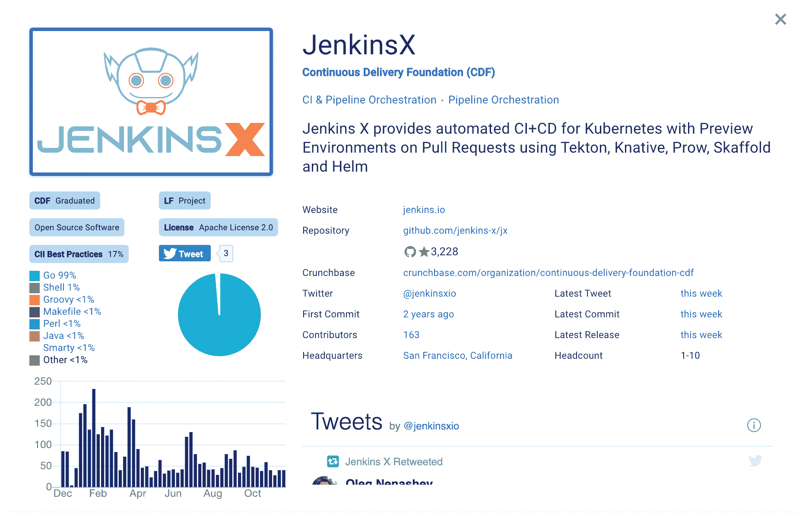
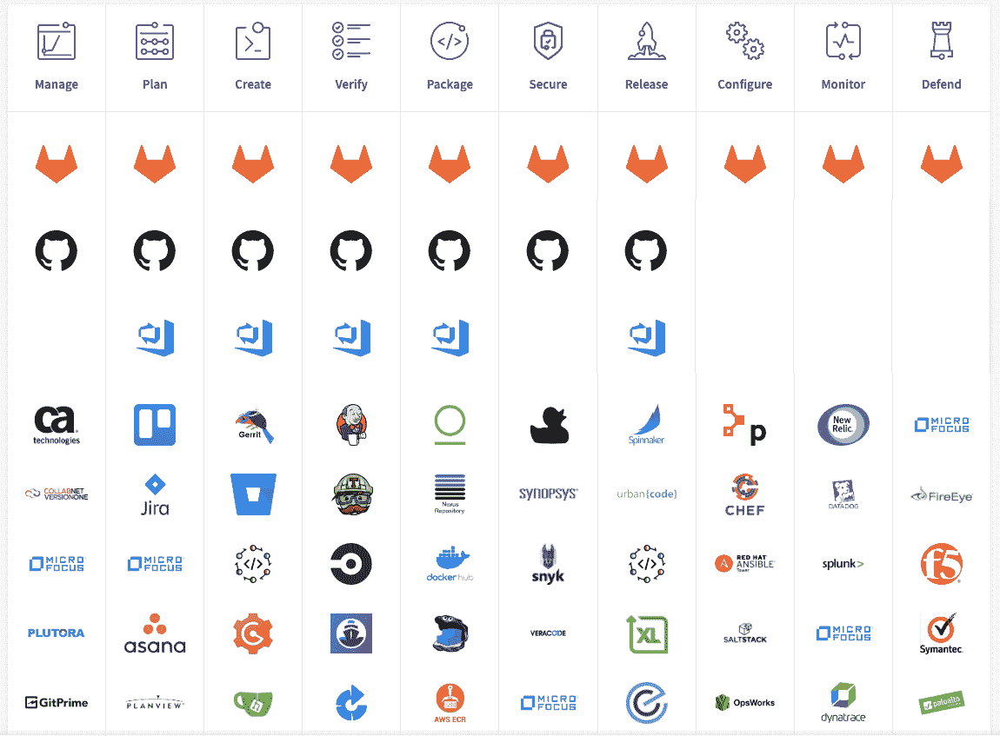
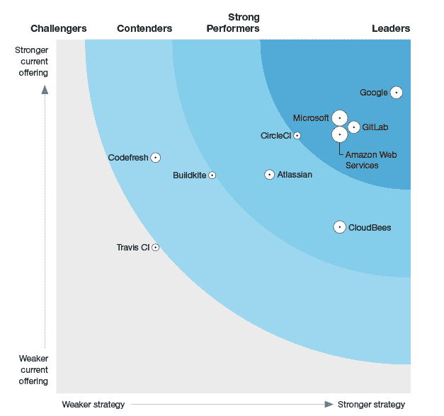
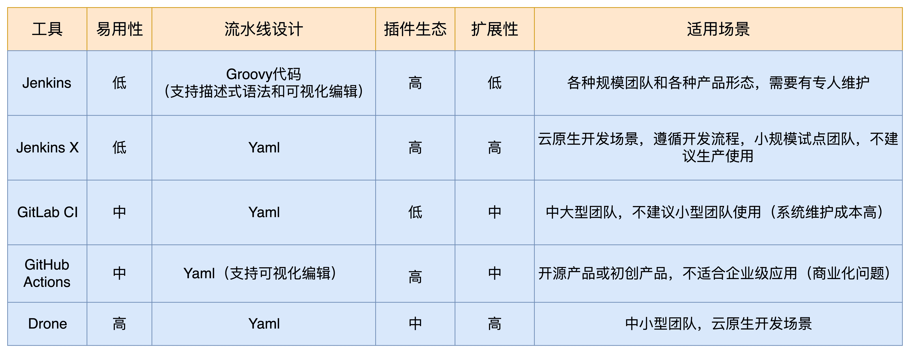

# 期末总结 | 在云时代，如何选择一款合适的流水线工具？

 

你好，我是石雪峰。今天是期末总结，我们来聊一聊，在云时代，如何选择一款合适的流水线工具。

在过去的几年里，我一直专注于软件持续交付的工程实践领域。我发现，越来越多的公司（无论规模大小）开始重视软件持续交付能力的建设了，基本上每家公司都有自己的流水线平台。

以前提到 CI/CD 工具，基本上就默认是 Jenkins，也没什么其他太好的选项。但是最近两年，随着云容器技术的快速发展，在 CI/CD 流水线领域，新工具和解决方案出现了爆发式的增长。比如不甘寂寞的 GitLab CI、轻量级的容器化解决方案 Drone。最近一段时间，GitHub 的 Actions 也火了一把。可见，作为软件交付主路径上的核心工具，**流水线**是每一家企业都不愿意错过的领域。

对于行业发展来说，这当然是好事情。老牌工具 Jenkins 自己都开始反省：“在云容器时代，是不是过于保守？十几年的老架构是否已经难以支撑云时代的快速发展了？”于是他们就另辟蹊径，孵化出了 Jenkins X 项目。

但是，对于用户来说，选择工具时就很为难：“这些工具看起来大同小异，要解决的也是类似的问题，到底应该选择哪个呢？”

今天，我就来给你梳理一下流行的 CI/CD 工具，并给你提供一些选择建议。我挑选了 5 个工具，分为 3 组介绍，分别是 Jenkins 系的 Jenkins 和 Jenkins X、版本控制系统系的 GitLab CI 和 GitHub Actions，以及新兴的、正在快速普及的云原生解决方案 Drone。我会从 5 个方面入手，对它们进行对比和介绍，包括工具的易用性、流水线设计、插件生态、扩展性配置以及适用场景。

## Jenkins/Jenkins X

关于 Jenkins，我想已经不需要做太多介绍了。在过去的 15 年里面，Jenkins 一直都在为无数的软件开发者默默服务。从一组数字中，我们就能看出来它的影响力：官方能统计到的集群数有 26 万多个、插件将近 1700 个、执行的任务数超过 3000 万次，这还不包括大量公司自建、本地电脑运行的节点信息。另外，一年两次的 Jenkins 全球大会往往能够吸引上千人参与，这对于国外的技术大会来说，已经是超大规模的盛会了。

当然，Jenkins 的优缺点也很明显。

1. 优点：普及率高，搞过开发的基本应该都接触过；插件生态成熟且丰富，可以适用于任何场景。
2. 缺点：软件架构和 UI 设计风格有些过时，配置操作比较复杂；插件的安全性、通用性方面也存在很多问题，最重要的是，在云容器领域，多少有些格格不入。

我重点说说 Jenkins X。很多人都不清楚 Jenkins 和 Jenkins X 是什么关系，这就好比刚开始我们很难说清楚 Java 和 JavaScript 的关系一样。实际上，JavaScript 除了名字上带有“Java”字眼，蹭了个热度之外，本质上它们之间并没有什么关系。而对于 Jenkins 和 Jenkins X 来说，虽然并不能说二者一点关系没有，但其实它们面对的场景和要解决的问题是不同的。所以，并不能说 Jenkins X 就是下一代 Jenkins，或者是 Jenkins 迟早会迁移到 Jenkins X 上面。

Jenkins X 最开始的确是作为 Jenkins 的子项目存在的，但是发展到现在，它已经有了独立的品牌和 Logo，并且和 Jenkins 一起作为 CDF（持续交付基金会）的初始项目。Jenkins X 想要解决的核心问题是 **Kubernetes 上的原生 CI/CD 解决方案**。所以，Jenkins X 和 Kubernetes 是强绑定的关系，**它致力于通过一系列的自动化工具和最佳实践，来降低云原生环境下的研发配置和使用 CI/CD 的成本，并尽可能地做成开箱即用的状态**。

而 Jenkins 更像一个百宝箱，你可以通过插件扩展来解决各种各样的问题，并没有一定之规。

我给你举个例子，来形象地对比一下 Jenkins 和 Jenkins X 这两个项目。

Jenkins 就好比你在开车，你知道目的地，但是走哪条路，开多快，中间要不要休息一下，什么时候加油，这些都是你自己来决定的。当然，灵活性带来的就是多变性，你并不知道是不是下一秒就封路了或者是汽车突然坏了。

而 Jenkins X 更像是一辆高速列车，你只要上对了车，列车会把你安全、快速地送往目的地，而你并不需要关心这个车是怎么设计的，时速应该是多少，甚至你在哪里能够下车，它都规定好了。

Jenkins X 项目中内建了大量的开源工具和解决方案，可以说是开源工具的理想国和试验田，核心目的就是为了简单、快速、开箱即用。比如对 Tekton 的集成，就被视为对 Jenkins 自身的颠覆，因为这彻底改变了 Jenkins 流水线调度机制。因为在 Jenkins X 看来，Jenkins 只不过是 Jenkins X 中的一个应用，是一个黑盒子，编排通过 Tekton 来实现，换句话说，即便你想用其他应用来取代 Jenkins，也不是不可能的。

值得注意的是，Jenkins X 中有很多约束，比如你必须使用 GitOps 的方案来完成应用的晋级和部署，没有其他的选择。**如果你没有使用 Helm 管理应用，也不想使用 GitOps，那就现阶段来说，Jenkins X 对你就不是一个可选项**。

我们来总结一下 Jenkins X 项目：

1. **工具的易用性**：采用了开箱即用的设计，提供大量的模板来降低新应用上手 CI/CD 的成本。虽然安装复杂，但是目前已经提供了 JX Boot 工具，通过初始化向导帮你完成环境搭建。而且，随着云服务商的引入，环境方面应该都是可以默认提供的，就像你不需要操心如何搭建 Kubernetes 一样，因为会有人以服务的形式把 Jenkins X 提供出来。
2. **流水线设计**：Tekton 取代了 Jenkins，成为了流水线的默认引擎，作为 Kubernetes 的原生解决方案，这也是未来的发展趋势。在编排方面，它采用了 yaml 方式，继承了原有 Jenkinsfile 的语法特征，并对 Tekton 的资源进行隐藏和抽象，通过描述式的语言，以代码化的方式实现，可以说是当前的通用解决方案。不过，它目前并没有提供可视化的编排界面。
3. **插件生态**：继承了 Jenkins 丰富的插件生态，以及庞大的开发者社区。
4. **扩展性配置**：采用容器化的解决方案，对于 Tekton 来说更是如此。每个步骤都在容器中完成，可扩展性非常强。
5. **适用场景**：我认为，Jenkins X 项目现在还处于快速开发的阶段，适用于原型产品验证。对于那些没有固有模式，想要沿用 Jenkins X 的设计流程的项目来说，可以尝试使用。不过由于云服务商的接入度不足，目前应该还存在很多挑战，你可以保持学习和跟进。毕竟，这个项目中的很多工具和设计思路都是非常有价值的。

## GitLab CI/GitHub Actions

除了 Jenkins，国内使用比较多的应该当属 GitLab CI 了。前些年也有过社区的讨论，到底应该使用 GitLab CI，还是 Jenkins？很显然，这样的讨论并不能达成共识，毕竟“萝卜白菜，各有所爱”。而 GitHub Actions 的推出，也是看中了流水线编排领域的“蛋糕”。曾经，GitHub 和 TravisCI 是珠联璧合，可以说是“开源双碧”。GitHub 也一再强调，**自己只想把代码托管服务做到极致，其他领域都交给合作伙伴完成**。但是今天的 Package 功能和 Actions 功能都体现出了 GitHub 自建生态的野心。

其实，这两个产品有很多相似之处，因为它们都是依托于一个成熟的代码托管平台衍生出来的原生流水线功能。

对于软件开发而言，最重要的无疑就是源代码。之前，我有个同事就说过，只要掌握了源代码，你就可以为所欲为了。比如，基于代码拓展代码评审工具、内建各类静态动态代码检查功能、增加包管理和依赖管理工具等，这些是代码编译之前和编译之后的必备功能。增加内建的持续集成功能，也有助于在代码评审的时候做到机器辅助。

当这些功能都集成到代码托管系统中时，你就会发现，它不再是一个简单的版本控制系统了，而是一整套 DevOps 平台。它们的设计理念是，一个平台解决所有 DevOps 的工具问题。这一点在 GitLab 的路线图规划中，也体现得淋漓尽致，GitLab 对主流工具都进行了对比，并提供了一个工具的全景图。可以说在行业对标方面，GitLab 是做到极致了。你可以参考一下下面这张全景图和他们自己写的对比文章。

> 图片来源：https://about.gitlab.com/devops-tools/

回到流水线方面，GitLab CI 和 GitHub Actions 都和版本控制系统进行了深度集成。我们还是从五个方面来整体看一下。

**1. 工具的易用性**

1. **易于上手**：由于是内建功能，GitLab CI/GitHub Actions 使用起来都非常简单，你并不需要单独构建和维护一个独立的 CI 服务器来实现这个功能。
2. **原生体验**：由于是原生功能，所以无论是在流水线状态展示方面，还是在代码评审流程的集成方面，它们都做到了原生化的体验，显示的信息和丰富程度是外部独立的 CI 工具所无法比拟的。
3. **一体化协同平台**：工具链繁多、集成配置复杂、信息分散，都是 DevOps 工具方面的痛点问题。而一体化的研发协同平台的价值就在于能够集中解决这些问题。开发者不需要在各种工具系统中跳来跳去，可以在一个地方解决所有问题，在一个地方看到所有有用的数据。
4. **在线文档**：GitLab 的文档和示例都非常丰富，GitHub 就相对薄弱一些，不过两者的文档基本都够用。

**2. 流水线设计**

1. **流水线描述**：GitLab CI 和 GitHub Actions 都采用了 yaml 形式的流水线过程描述文件，二者的语法规则虽然不同，但基本上大同小异。但相对来说，GitHub 的语法规则更加符合当前 Kubernetes 的资源描述风格。关于这两个产品的语法风格，你可以看下这两份资料：GitHub Actions，GitLab CI
2. **流水线编辑**：两个产品都支持在线编辑流水线文件，GitHub 在这方面更加人性化一些。当你打开 Actions 的时候，系统会给你推荐一些模板，你可以直接选择生成 Actions 配置。如果想自己编辑 Actions 文件的话，系统的右侧也提供了很多示例代码片段，让你可以通过简单的复制、粘贴完成这项工作。另外，GitHub 新版本提供了在线的可视化编辑器，毕竟 GitHub Actions 是全新设计的，集合了各方面的优势。

**3. 插件生态**

1. **GitLab 生态**：作为一个开源软件，GitLab 的优势也恰恰在于开源，官方对于社区 PR 和 feature 的响应也是非常及时的。但是，由于 GitLab 是基于 Ruby 语言、Rails 框架开发的，这个语言就成了比较大的瓶颈，毕竟，熟练掌握 Ruby 语言的国内开发者相对还是比较少的，所以 GitLab 的插件生态并没有做起来。
2. **GitHub 生态**：GitHub 有建设 Marketplace 的长期经验，再加上开源贡献者众多，所以，在短短一年左右的时间里，他们已经积累了 1700 多个 Actions 组件，可以帮助你快速地搭建自己的流水线。从扩展性和生态丰富性方面来说，GitHub 更胜一筹。
3. **使用成本**：必须要强调的是，GitHub 是商业软件，虽然对待开源项目采用免费策略，**但是如果企业级使用的话，成本也是必须要考虑的因素之一**，而自建 GitLab 如果采用社区版本，就没有这么多限制了，这也是优势之一。

**4. 扩展性配置**

它们都支持多种环境类型。GitLab 很早就提供了对容器和 Kubernetes 的支持，GitHub 在这方面自然也不会落后，官方提供了 Linux、Windows 和 Mac 环境的支持，你也可以自建节点并注册到 GitHub 中。不过必须强调一点，GitHub 如果是非企业版本的话，是不支持私有化部署的，这也就意味着，如果你想把企业内部的资源注册到 GitHub 上，那么就意味着这些资源必须对外可见。

**5. 适用场景**

由于国内 GitLab 自建服务的普及，如果你对 CI 的功能要求没有那么高，那么 GitLab CI 就足够了。但是，在功能广度方面，由于缺少庞大的插件生态，很多功能还是更多地依赖于你自己实现，所以，如果软件交付流程非常复杂，依赖于多种环境，GitLab CI 就不是那么适用了。

而 GitHub 在企业中的使用场景就更加有限了，一方面是成本问题，另一方面，SaaS 化服务依赖于内部开放性。所以，如果是开源项目，或者创业项目不希望自己维护一套很重的研发基础设施，那么我建议你考虑使用 GitHub 的方案。

在最新发布的 2019 年 Forrester 的趋势报告中，GitLab 和 Jenkisn 都入选了云原生 CI 工具的榜单，并且处于行业领先地位，你可以看一下报告的图片。虽然图中没有写明 Jenkins，但是其背后的 CloudBees 公司，以及目前在云原生项目 Jenkins X 中有深度合作的 Google 公司都处于领先地位，由此可以看出，各大公司都已经开始在云原生领域布局了。

## Drone

这也是一个近来冉冉升起的 CI 工具领域的新星。在咱们专栏的留言中，有很多同学提到过这个工具，可见，**好工具是会自己说话的**。

Drone 主打的就是云原生 CI，整体设计非常轻量级，即便没有什么经验，一两天也能快速上手搭建。在我看来，Jenkins X 虽然也是主打云原生，但由于引入了大量组件和流程约束，整体还是略显笨重一些。相反，Drone 的实现非常优雅，无论是流水线的语法，还是环境的扩展性方面，都让人不由得赞叹。

作为一个开源软件，Drone 使用 Go 语言实现。在我看来，Go 就是为云原生而存在的，无论是 Docker、Kubernetes，还是我参与的 Jenkins X 项目，都是通过 Go 语言来实现的。所以，这个项目对于内部开发团队快速提升 Go 语言的 DevOps 平台建设能力，也是一个很好的参考学习案例。

对于 Drone 平台，我目前也在学习和探索阶段，我从下面这几个方面谈谈我个人的看法。

**1. 工具的易用性**

Drone 的搭建非常简单，你可以采用自建服务的形式，也可以使用 SaaS 服务。UI 风格设计体现了恰到好处的理念，整体非常清爽，同时也能跟其他工具（如 GitHub）进行集成。

**2. 流水线设计**

作为云原生的解决方案，流水线同样采用 yaml 形式、具备描述式表达和流水线即代码的功能。虽然没有过于复杂的语法，但是 Drone 的流水线语法风格是我个人最喜欢的，它的结构非常清晰。

**3. 插件生态**

Drone 也提供了插件机制，而且官方还提供了对主流版本控制系统和云服务商的集成支持。虽然数量远远比不上 Jenkins 生态，但是你能想到的基本都有了。比如常见的 Artifactory、SonarQube、Ansible 等工具，甚至还包含了对微信、钉钉这类国内流行的通讯软件的集成。由于它的开放特性，未来它也会提供更多的插件。

**4. 扩展性配置**

对于 Drone 来说，最大的特征就是容器优先。上面提到的这些工具虽然都支持容器，但是并没有把容器作为默认支持的第一选项。而在 Drone 中，容器则是标配，这也是典型的云原生 CI 工具的特征：**一切都在容器中运行**。也正因为如此，非容器化开发部署的项目如果采用 Drone 就不太合适了。另外，除了容器方式之外，Drone 也支持本地执行，这为一些特殊的场景提供了可能性（比如绑定设备的自动化测试等）。

**5. 适用场景**

我认为，**Drone 在云原生 CI/CD 方面的设计代表了未来的趋势**。对于基于容器开发交付的产品来说，如果你在寻找一个对应的云原生解决方案，那么我推荐你用 Drone。它也比较适合于中小型团队、初创公司想要快速受益于 CI/CD，又不想投入太多精力的场景。同时，作为一款 Go 语言开发的开源软件，随着业务扩展，你大可以自建插件，满足差异化的需求。

## 总结

最后，为了方便你理解和进行对比学习，我把这五个云原生流水线工具的特征汇总了图片里。

到此为止，这几款主流的流水线工具，我就介绍完了。在文章的最后，我还想再补充两点：

1. **工具并非决定性的因素**，不要轻易陷入“工具决定论”的思想之中，就好比真正的编程高手可能都不需要 IDE，选择好的工具，并不代表就有好的结果。
2. 工具是“存在即合理”的，它们都有各自擅长的领域，**没有绝对意义上的最好，只有最适合的场景**。另外，即便是同一个工具，在不同的人手中发挥的作用也不一样，选择自己最熟悉的工具，一般都不会有错。比如你要问我选择什么工具的话，我肯定推荐 Jenkins。但这并不是因为 Jenkins 完美无缺，而仅仅是因为我用得顺手而已。

## 思考题

对于 Drone 这款工具在生产环境的应用，你有哪些实际的经验，又踩过哪些“坑”呢？

欢迎在留言区写下你的思考和答案，我们一起讨论，共同学习进步。如果你觉得这篇文章对你有所帮助，也欢迎你把文章分享给你的朋友。
