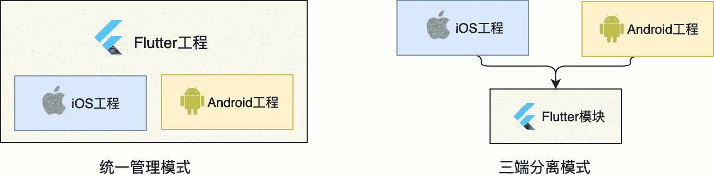
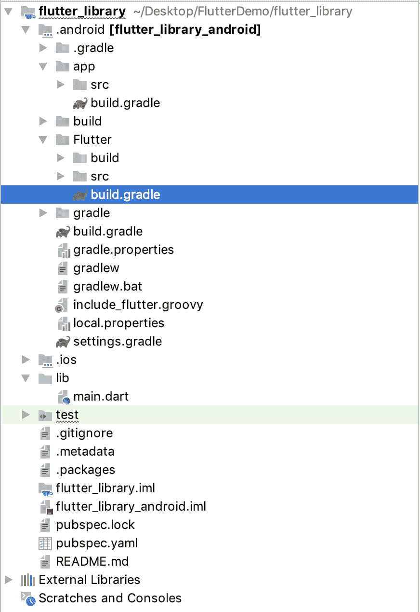
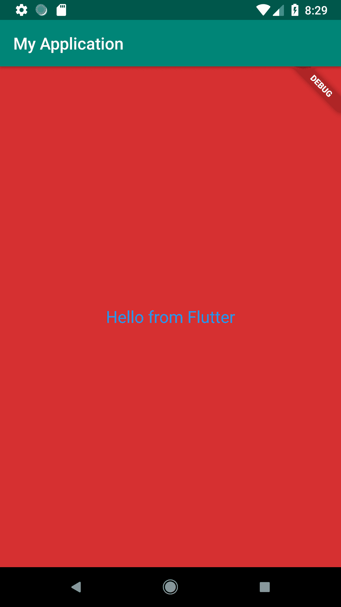

# 28 | 如何在原生应用中混编Flutter工程？

 

你好，我是陈航。今天，我来和你聊聊如何在原生应用中接入 Flutter。

在前面两篇文章中，我与你分享了如何在 Dart 层引入 Android/iOS 平台特定的能力，来提升 App 的功能体验。

使用 Flutter 从头开始写一个 App，是一件轻松惬意的事情。但，对于成熟产品来说，完全摒弃原有 App 的历史沉淀，而全面转向 Flutter 并不现实。用 Flutter 去统一 iOS/Android 技术栈，把它作为已有原生 App 的扩展能力，通过逐步试验有序推进从而提升终端开发效率，可能才是现阶段 Flutter 最具吸引力的地方。

那么，Flutter 工程与原生工程该如何组织管理？不同平台的 Flutter 工程打包构建产物该如何抽取封装？封装后的产物该如何引入原生工程？原生工程又该如何使用封装后的 Flutter 能力？

这些问题使得在已有原生 App 中接入 Flutter 看似并不是一件容易的事情。那接下来，我就和你介绍下如何在原生 App 中以最自然的方式接入 Flutter。

## 准备工作

既然是要在原生应用中混编 Flutter，相信你一定已经准备好原生应用工程来实施今天的改造了。如果你还没有准备好也没关系，我会以一个最小化的示例和你演示这个改造过程。

首先，我们分别用 Xcode 与 Android Studio 快速建立一个只有首页的基本工程，工程名分别为 iOSDemo 与 AndroidDemo。

这时，Android 工程就已经准备好了；而对于 iOS 工程来说，由于基本工程并不支持以组件化的方式管理项目，因此我们还需要多做一步，将其改造成使用 CocoaPods 管理的工程，也就是要在 iOSDemo 根目录下创建一个只有基本信息的 Podfile 文件：

```
use_frameworks!platform :ios, '8.0'target 'iOSDemo' do#todoend
```

然后，在命令行输入 pod install 后，会自动生成一个 iOSDemo.xcworkspace 文件，这时我们就完成了 iOS 工程改造。

## Flutter 混编方案介绍

如果你想要在已有的原生 App 里嵌入一些 Flutter 页面，有两个办法：

 
- 将原生工程作为 Flutter 工程的子工程，由 Flutter 统一管理。这种模式，就是统一管理模式。 
- 将 Flutter 工程作为原生工程共用的子模块，维持原有的原生工程管理方式不变。这种模式，就是三端分离模式。 



图 1 Flutter 混编工程管理方式

由于 Flutter 早期提供的混编方式能力及相关资料有限，国内较早使用 Flutter 混合开发的团队大多使用的是统一管理模式。但是，随着功能迭代的深入，这种方案的弊端也随之显露，不仅三端（Android、iOS、Flutter）代码耦合严重，相关工具链耗时也随之大幅增长，导致开发效率降低。

所以，后续使用 Flutter 混合开发的团队陆续按照三端代码分离的模式来进行依赖治理，实现了 Flutter 工程的轻量级接入。

除了可以轻量级接入，三端代码分离模式把 Flutter 模块作为原生工程的子模块，还可以快速实现 Flutter 功能的“热插拔”，降低原生工程的改造成本。而 Flutter 工程通过 Android Studio 进行管理，无需打开原生工程，可直接进行 Dart 代码和原生代码的开发调试。

**三端工程分离模式的关键是抽离 Flutter 工程，将不同平台的构建产物依照标准组件化的形式进行管理**，即 Android 使用 aar、iOS 使用 pod。换句话说，接下来介绍的混编方案会将 Flutter 模块打包成 aar 和 pod，这样原生工程就可以像引用其他第三方原生组件库那样快速接入 Flutter 了。

听起来是不是很兴奋？接下来，我们就开始正式采用三端分离模式来接入 Flutter 模块吧。

## 集成 Flutter

我曾在前面的文章中提到，Flutter 的工程结构比较特殊，包括 Flutter 工程和原生工程的目录（即 iOS 和 Android 两个目录）。在这种情况下，原生工程就会依赖于 Flutter 相关的库和资源，从而无法脱离父目录进行独立构建和运行。

原生工程对 Flutter 的依赖主要分为两部分：

 
- Flutter 库和引擎，也就是 Flutter 的 Framework 库和引擎库； 
- Flutter 工程，也就是我们自己实现的 Flutter 模块功能，主要包括 Flutter 工程 lib 目录下的 Dart 代码实现的这部分功能。 

在已经有原生工程的情况下，我们需要在同级目录创建 Flutter 模块，构建 iOS 和 Android 各自的 Flutter 依赖库。这也很好实现，Flutter 就为我们提供了这样的命令。我们只需要在原生项目的同级目录下，执行 Flutter 命令创建名为 Flutter_library 的模块即可：

```
Flutter create -t module Flutter_library
```

这里的 Flutter 模块，也是 Flutter 工程，我们用 Android Studio 打开它，其目录如下图所示：



图 2 Flutter 模块工程结构

可以看到，和传统的 Flutter 工程相比，Flutter 模块工程也有内嵌的 Android 工程与 iOS 工程，因此我们可以像普通工程一样使用 Android Studio 进行开发调试。

仔细查看可以发现，**Flutter 模块有一个细微的变化**：Android 工程下多了一个 Flutter 目录，这个目录下的 build.gradle 配置就是我们构建 aar 的打包配置。这就是模块工程既能像 Flutter 传统工程一样使用 Android Studio 开发调试，又能打包构建 aar 与 pod 的秘密。

实际上，iOS 工程的目录结构也有细微变化，但这个差异并不影响打包构建，因此我就不再展开了。

然后，我们打开 main.dart 文件，将其逻辑更新为以下代码逻辑，即一个写着“Hello from Flutter”的全屏红色的 Flutter Widget：

```
import 'package:flutter/material.dart';import 'dart:ui'; void main() => runApp(_widgetForRoute(window.defaultRouteName));// 独立运行传入默认路由 Widget _widgetForRoute(String route) {  switch (route) {    default:      return MaterialApp(        home: Scaffold(          backgroundColor: const Color(0xFFD63031),//ARGB 红色          body: Center(            child: Text(              'Hello from Flutter', // 显示的文字              textDirection: TextDirection.ltr,              style: TextStyle(                fontSize: 20.0,                color: Colors.blue,              ),            ),          ),        ),      );  }}
```

注意：我们创建的 Widget 实际上是包在一个 switch-case 语句中的。这是因为封装的 Flutter 模块一般会有多个页面级 Widget，原生 App 代码则会通过传入路由标识字符串，告诉 Flutter 究竟应该返回何种 Widget。为了简化案例，在这里我们忽略标识字符串，统一返回一个 MaterialApp。

接下来，我们要做的事情就是把这段代码编译打包，构建出对应的 Android 和 iOS 依赖库，实现原生工程的接入。

现在，我们首先来看看 Android 工程如何接入。

### Android 模块集成

之前我们提到原生工程对 Flutter 的依赖主要分为两部分，对应到 Android 平台，这两部分分别是：

 
- Flutter 库和引擎，也就是 icudtl.dat、libFlutter.so，还有一些 class 文件。这些文件都封装在 Flutter.jar 中。 
- Flutter 工程产物，主要包括应用程序数据段 isolate_snapshot_data、应用程序指令段 isolate_snapshot_instr、虚拟机数据段 vm_snapshot_data、虚拟机指令段 vm_snapshot_instr、资源文件 Flutter_assets。 

搞清楚 Flutter 工程的 Android 编译产物之后，我们对 Android 的 Flutter 依赖抽取步骤如下：

首先在 Flutter_library 的根目录下，执行 aar 打包构建命令：

```
Flutter build apk --debug
```

这条命令的作用是编译工程产物，并将 Flutter.jar 和工程产物编译结果封装成一个 aar。你很快就会想到，如果是构建 release 产物，只需要把 debug 换成 release 就可以了。

**其次**，打包构建的 flutter-debug.aar 位于.android/Flutter/build/outputs/aar/ 目录下，我们把它拷贝到原生 Android 工程 AndroidDemo 的 app/libs 目录下，并在 App 的打包配置 build.gradle 中添加对它的依赖:

```
...repositories {    flatDir {        dirs 'libs'   // aar 目录    }}android {    ...    compileOptions {        sourceCompatibility 1.8 //Java 1.8        targetCompatibility 1.8 //Java 1.8    }    ...} dependencies {    ...    implementation(name: 'flutter-debug', ext: 'aar')//Flutter 模块 aar    ...}
```

Sync 一下，Flutter 模块就被添加到了 Android 项目中。

再次，我们试着改一下 MainActivity.java 的代码，把它的 contentView 改成 Flutter 的 widget：

```
protected void onCreate(Bundle savedInstanceState) {    super.onCreate(savedInstanceState);    View FlutterView = Flutter.createView(this, getLifecycle(), "defaultRoute"); // 传入路由标识符    setContentView(FlutterView);// 用 FlutterView 替代 Activity 的 ContentView}
```

最后点击运行，可以看到一个写着“Hello from Flutter”的全屏红色的 Flutter Widget 就展示出来了。至此，我们完成了 Android 工程的接入。



图 3 Android 工程接入示例

### iOS 模块集成

iOS 工程接入的情况要稍微复杂一些。在 iOS 平台，原生工程对 Flutter 的依赖分别是：

 
- Flutter 库和引擎，即 Flutter.framework； 
- Flutter 工程的产物，即 App.framework。 

iOS 平台的 Flutter 模块抽取，实际上就是通过打包命令生成这两个产物，并将它们封装成一个 pod 供原生工程引用。

类似地，首先我们在 Flutter_library 的根目录下，执行 iOS 打包构建命令：

```
Flutter build ios --debug
```

这条命令的作用是编译 Flutter 工程生成两个产物：Flutter.framework 和 App.framework。同样，把 debug 换成 release 就可以构建 release 产物（当然，你还需要处理一下签名问题）。

**其次**，在 iOSDemo 的根目录下创建一个名为 FlutterEngine 的目录，并把这两个 framework 文件拷贝进去。iOS 的模块化产物工作要比 Android 多一个步骤，因为我们需要把这两个产物手动封装成 pod。因此，我们还需要在该目录下创建 FlutterEngine.podspec，即 Flutter 模块的组件定义：

```
Pod::Spec.new do |s|  s.name             = 'FlutterEngine'  s.version          = '0.1.0'  s.summary          = 'XXXXXXX'  s.description      = <<-DESCTODO: Add long description of the pod here.                       DESC  s.homepage         = 'https://github.com/xx/FlutterEngine'  s.license          = { :type => 'MIT', :file => 'LICENSE' }  s.author           = { 'chenhang' => 'hangisnice@gmail.com' }  s.source       = { :git => "", :tag => "#{s.version}" }  s.ios.deployment_target = '8.0'  s.ios.vendored_frameworks = 'App.framework', 'Flutter.framework'end
```

pod lib lint 一下，Flutter 模块组件就已经做好了。趁热打铁，我们再修改 Podfile 文件把它集成到 iOSDemo 工程中：

```
...target 'iOSDemo' do    pod 'FlutterEngine', :path => './'end
```

pod install 一下，Flutter 模块就集成进 iOS 原生工程中了。

再次，我们试着修改一下 AppDelegate.m 的代码，把 window 的 rootViewController 改成 FlutterViewController：

```
- (BOOL)application:(UIApplication *)application didFinishLaunchingWithOptions:(NSDictionary *)launchOptions {    self.window = [[UIWindow alloc] initWithFrame:[UIScreen mainScreen].bounds];    FlutterViewController *vc = [[FlutterViewController alloc]init];    [vc setInitialRoute:@"defaultRoute"]; // 路由标识符    self.window.rootViewController = vc;    [self.window makeKeyAndVisible];    return YES;}
```

最后点击运行，一个写着“Hello from Flutter”的全屏红色的 Flutter Widget 也展示出来了。至此，iOS 工程的接入我们也顺利搞定了。


图 4 iOS 工程接入示例

## 总结

通过分离 Android、iOS 和 Flutter 三端工程，抽离 Flutter 库和引擎及工程代码为组件库，以 Android 和 iOS 平台最常见的 aar 和 pod 形式接入原生工程，我们就可以低成本地接入 Flutter 模块，愉快地使用 Flutter 扩展原生 App 的边界了。

但，我们还可以做得更好。

如果每次通过构建 Flutter 模块工程，都是手动搬运 Flutter 编译产物，那很容易就会因为工程管理混乱导致 Flutter 组件库被覆盖，从而引发难以排查的 Bug。而要解决此类问题的话，我们可以引入 CI 自动构建框架，把 Flutter 编译产物构建自动化，原生工程通过接入不同版本的构建产物，实现更优雅的三端分离模式。

而关于自动化构建，我会在后面的文章中和你详细介绍，这里就不再赘述了。

接下来，我们简单回顾一下今天的内容。

原生工程混编 Flutter 的方式有两种。一种是，将 Flutter 工程内嵌 Android 和 iOS 工程，由 Flutter 统一管理的集中模式；另一种是，将 Flutter 工程作为原生工程共用的子模块，由原生工程各自管理的三端工程分离模式。目前，业界采用的基本都是第二种方式。

而对于三端工程分离模式最主要的则是抽离 Flutter 工程，将不同平台的构建产物依照标准组件化的形式进行管理，即：针对 Android 平台打包构建生成 aar，通过 build.gradle 进行依赖管理；针对 iOS 平台打包构建生成 framework，将其封装成独立的 pod，并通过 podfile 进行依赖管理。

我把今天分享所涉及到的知识点打包到了 GitHub（[flutter_module_page](https://github.com/cyndibaby905/28_module_page)、[iOS_demo](https://github.com/cyndibaby905/28_iOSDemo)、[Android_Demo](https://github.com/cyndibaby905/28_AndroidDemo)）中，你可以下载下来，反复运行几次，加深理解与记忆。

## 思考题

最后，我给你下留一个思考题吧。

对于有资源依赖的 Flutter 模块工程而言，其打包构建的产物，以及抽离 Flutter 组件库的过程会有什么不同吗？

欢迎你在评论区给我留言分享你的观点，我会在下一篇文章中等待你！感谢你的收听，也欢迎你把这篇文章分享给更多的朋友一起阅读。


