# 31 | 如何实现原生推送能力？

 

你好，我是陈航。

在上一篇文章中，我与你分享了如何使用 Provider 去维护 Flutter 组件共用的数据状态。在 Flutter 中状态即数据，通过数据资源封装、注入和读写这三步，我们不仅可以实现跨组件之间的数据共享，还能精确控制 UI 刷新粒度，避免无关组件的刷新。

其实，数据共享不仅存在于客户端内部，同样也存在于服务端与客户端之间。比如，有新的微博评论，或者是发生了重大新闻，我们都需要在服务端把这些状态变更的消息实时推送到客户端，提醒用户有新的内容。有时，我们还会针对特定的用户画像，通过推送实现精准的营销信息触达。

可以说，消息推送是增强用户黏性，促进用户量增长的重要手段。那么，消息推送的流程是什么样的呢？

## 消息推送流程

手机推送每天那么多，导致在我们看来这很简单啊。但其实，消息推送是一个横跨业务服务器、第三方推送服务托管厂商、操作系统长连接推送服务、用户终端、手机应用五方的复杂业务应用场景。

在 iOS 上，苹果推送服务（APNs）接管了系统所有应用的消息通知需求；而 Android 原生，则提供了类似 Firebase 的云消息传递机制（FCM），可以实现统一的推送托管服务。

当某应用需要发送消息通知时，这则消息会由应用的服务器先发给苹果或 Google，经由 APNs 或 FCM 被发送到设备，设备操作系统在完成解析后，最终把消息转给所属应用。这个流程的示意图，如下所示。

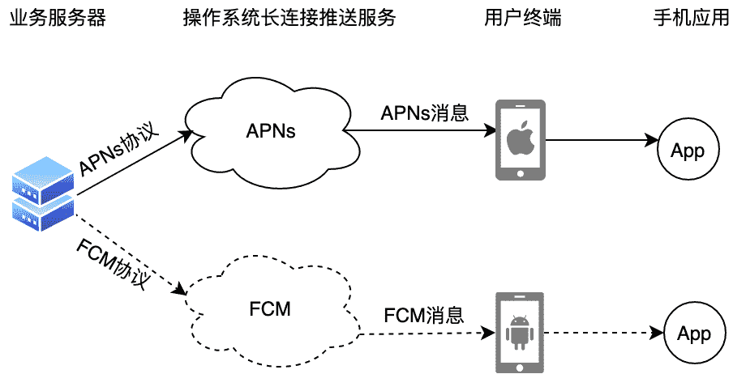

图 1 原生消息推送流程

不过，Google 服务在大陆地区使用并不稳定，因此国行 Android 手机通常会把 Google 服务换成自己的服务，定制一套推送标准。而这对开发者来说，无疑是增大了适配负担。所以针对 Android 端，我们通常会使用第三方推送服务，比如极光推送、友盟推送等。

虽然这些第三方推送服务使用自建的长连接，无法享受操作系统底层的优化，但它们会对所有使用推送服务的 App 共享推送通道，只要有一个使用第三方推送服务的应用没被系统杀死，就可以让消息及时送达。

而另一方面，这些第三方服务简化了业务服务器与手机推送服务建立连接的操作，使得我们的业务服务器通过简单的 API 调用就可以完成消息推送。

而为了保持 Android/iOS 方案的统一，在 iOS 上我们也会使用封装了 APNs 通信的第三方推送服务。

第三方推送的服务流程，如下图所示。

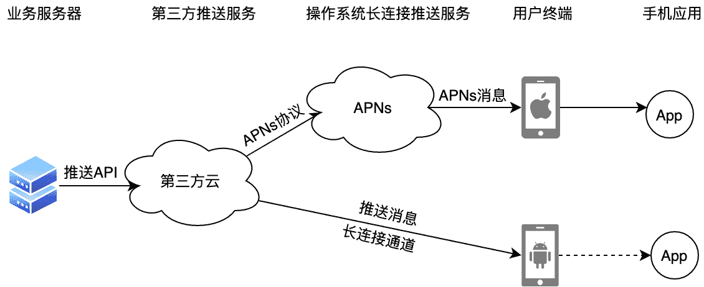

图 2 第三方推送服务流程

这些第三方推送服务厂商提供的能力和接入流程大都一致，考虑到极光的社区和生态相对活跃，所以今天我们就以极光为例，来看看在 Flutter 应用中如何才能引用原生的推送能力。

## 原生推送接入流程

要想在 Flutter 中接收推送消息，我们需要把原生的推送能力暴露给 Flutter 应用，即在原生代码宿主实现推送能力（极光 SDK）的接入，并通过方法通道提供给 Dart 层感知推送消息的机制。

### 插件工程

在[第 26 篇](https://time.geekbang.org/column/article/127601)文章中，我们学习了如何在原生工程中的 Flutter 应用入口注册原生代码宿主回调，从而实现 Dart 层调用原生接口的方案。这种方案简单直接，适用于 Dart 层与原生接口之间交互代码量少、数据流动清晰的场景。

但对于推送这种涉及 Dart 与原生多方数据流转、代码量大的模块，这种与工程耦合的方案就不利于独立开发维护了。这时，我们需要使用 Flutter 提供的插件工程对其进行单独封装。

Flutter 的插件工程与普通的应用工程类似，都有 android 和 ios 目录，这也是我们完成平台相关逻辑代码的地方，而 Flutter 工程插件的注册，则仍会在应用的入口完成。除此之外，插件工程还内嵌了一个 example 工程，这是一个引用了插件代码的普通 Flutter 应用工程。我们通过 example 工程，可以直接调试插件功能。

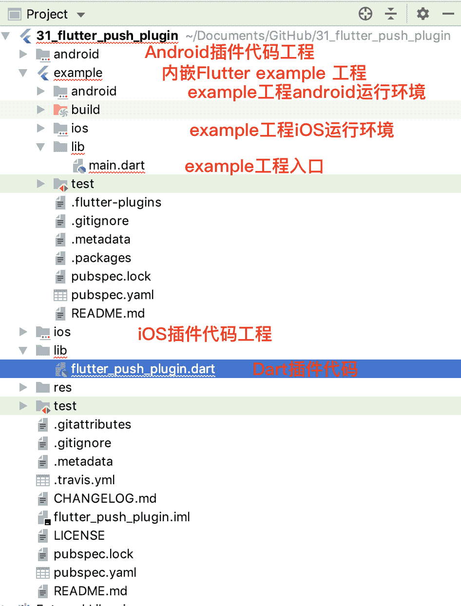

图 3 插件工程目录结构

在了解了整体工程的目录结构之后，接下来我们需要去 Dart 插件代码所在的 flutter_push_plugin.dart 文件，实现 Dart 层的推送接口封装。

### Dart 接口实现

为了实现消息的准确触达，我们需要提供一个可以标识手机上 App 的地址，即 token 或 id。一旦完成地址的上报，我们就可以等待业务服务器给我们发消息了。

因为我们需要使用极光这样的第三方推送服务，所以还得进行一些前置的应用信息关联绑定，以及 SDK 的初始化工作。可以看到，对于一个应用而言，接入推送的过程可以拆解为以下三步：

 
1. 初始化极光 SDK； 
2. 获取地址 id； 
3. 注册消息通知。 

这三步对应着在 Dart 层需要封装的 3 个原生接口调用：setup、registrationID 和 setOpenNotificationHandler。

前两个接口是在方法通道上调用原生代码宿主提供的方法，而注册消息通知的回调函数 setOpenNotificationHandler 则相反，是原生代码宿主在方法通道上调用 Dart 层所提供的事件回调，因此我们需要在方法通道上为原生代码宿主注册反向回调方法，让原生代码宿主收到消息后可以直接通知它。

另外，考虑到推送是整个应用共享的能力，因此我们将 FlutterPushPlugin 这个类封装成了单例：

```
//Flutter Push 插件class FlutterPushPlugin  {  // 单例  static final FlutterPushPlugin _instance = new FlutterPushPlugin.private(const MethodChannel('flutter_push_plugin'));  // 方法通道  final MethodChannel _channel;  // 消息回调  EventHandler _onOpenNotification;  // 构造方法  FlutterPushPlugin.private(MethodChannel channel) : _channel = channel {    // 注册原生反向回调方法，让原生代码宿主可以执行 onOpenNotification 方法    _channel.setMethodCallHandler(_handleMethod);  }  // 初始化极光 SDK  setupWithAppID(String appID) {    _channel.invokeMethod("setup", appID);  }  // 注册消息通知  setOpenNotificationHandler(EventHandler onOpenNotification) {    _onOpenNotification = onOpenNotification;  }   // 注册原生反向回调方法，让原生代码宿主可以执行 onOpenNotification 方法  Future<Null> _handleMethod(MethodCall call) {    switch (call.method) {      case "onOpenNotification":        return _onOpenNotification(call.arguments);      default:        throw new UnsupportedError("Unrecognized Event");    }  }  // 获取地址 id  Future<String> get registrationID async {    final String regID = await _channel.invokeMethod('getRegistrationID');    return regID;  }}
```

Dart 层是原生代码宿主的代理，可以看到这一层的接口设计算是简单。接下来，我们分别去接管推送的 Android 和 iOS 平台上完成相应的实现。

### Android 接口实现

考虑到 Android 平台的推送配置工作相对较少，因此我们先用 Android Studio 打开 example 下的 android 工程进行插件开发工作。需要注意的是，由于 android 子工程的运行依赖于 Flutter 工程编译构建产物，所以在打开 android 工程进行开发前，你需要确保整个工程代码至少 build 过一次，否则 IDE 会报错。

>  
> 备注：以下操作步骤参考[极光 Android SDK 集成指南](https://docs.jiguang.cn//jpush/client/Android/android_guide/)。
 

首先，我们需要在插件工程下的 build.gradle 引入极光 SDK，即 jpush 与 jcore：

```
dependencies {    implementation 'cn.jiguang.sdk:jpush:3.3.4'    implementation 'cn.jiguang.sdk:jcore:2.1.2'}
```

然后，在原生接口 FlutterPushPlugin 类中，依次把 Dart 层封装的 3 个接口调用，即 setup、getRegistrationID 与 onOpenNotification，提供极光 Android SDK 的实现版本。

需要注意的是，由于极光 Android SDK 的信息绑定是在应用的打包配置里设置，并不需要通过代码完成（iOS 才需要），因此 setup 方法的 Android 版本是一个空实现：

```
public class FlutterPushPlugin implements MethodCallHandler {  // 注册器，通常为 MainActivity  public final Registrar registrar;  // 方法通道  private final MethodChannel channel;  // 插件实例  public static FlutterPushPlugin instance;  // 注册插件  public static void registerWith(Registrar registrar) {    // 注册方法通道    final MethodChannel channel = new MethodChannel(registrar.messenger(), "flutter_push_plugin");    instance = new FlutterPushPlugin(registrar, channel);    channel.setMethodCallHandler(instance);    // 把初始化极光 SDK 提前至插件注册时    JPushInterface.setDebugMode(true);    JPushInterface.init(registrar.activity().getApplicationContext());  }  // 私有构造方法  private FlutterPushPlugin(Registrar registrar, MethodChannel channel) {    this.registrar = registrar;    this.channel = channel;  }  // 方法回调  @Override  public void onMethodCall(MethodCall call, Result result) {    if (call.method.equals("setup")) {      // 极光 Android SDK 的初始化工作需要在 App 工程中配置，因此不需要代码实现      result.success(0);    }    else if (call.method.equals("getRegistrationID")) {      // 获取极光推送地址标识符        result.success(JPushInterface.getRegistrationID(registrar.context()));    } else {      result.notImplemented();    }  }   public void callbackNotificationOpened(NotificationMessage message) {    // 将推送消息回调给 Dart 层      channel.invokeMethod("onOpenNotification",message.notificationContent);  }}
```

可以看到，我们的 FlutterPushPlugin 类中，仅提供了 callbackNotificationOpened 这个工具方法，用于推送消息参数回调给 Dart，但这个类本身并没有去监听极光 SDK 的推送消息。

为了获取推送消息，我们分别需要继承极光 SDK 提供的两个类：JCommonService 和 JPushMessageReceiver。

 
- JCommonService 是一个后台 Service，实际上是极光共享长连通道的核心，可以在多手机平台上使得推送通道更稳定。 
- JPushMessageReceiver 则是一个 BroadcastReceiver，推送消息的获取都是通过它实现的。我们可以通过覆盖其 onNotifyMessageOpened 方法，从而在用户点击系统推送消息时获取到通知。 

作为 BroadcastReceiver 的 JPushMessageReceiver，可以长期在后台存活，监听远端推送消息，但 Flutter 可就不行了，操作系统会随时释放掉后台应用所占用的资源。因此，**在用户点击推送时，我们在收到相应的消息回调后，需要做的第一件事情不是立刻通知 Flutter，而是应该启动应用的 MainActivity。**在确保 Flutter 已经完全初始化后，才能通知 Flutter 有新的推送消息。

因此在下面的代码中，我们在打开 MainActivity 后，等待了 1 秒，才执行相应的 Flutter 回调通知：

```
//JPushXCustomService.java// 长连通道核心，可以使推送通道更稳定public class JPushXCustomService extends JCommonService {} //JPushXMessageReceiver.java// 获取推送消息的 Receiverpublic class JPushXMessageReceiver extends JPushMessageReceiver {    // 用户点击推送消息回调    @Override    public void onNotifyMessageOpened(Context context, final NotificationMessage message) {        try {            // 找到 MainActivity            String mainClassName = context.getApplicationContext().getPackageName() + ".MainActivity";            Intent i = new Intent(context, Class.forName(mainClassName));            i.addFlags(Intent.FLAG_ACTIVITY_NEW_TASK | Intent.FLAG_ACTIVITY_SINGLE_TOP);            // 启动主 Activity            context.startActivity(i);        } catch (Exception e) {            Log.e("tag"," 找不到 MainActivity");        }        new Timer().schedule(new TimerTask() {            @Override            public void run() {                FlutterPushPlugin.instance.callbackNotificationOpened(message);            }        },1000); // 延迟 1 秒通知 Dart    }}
```

最后，我们还需要在插件工程的 AndroidManifest.xml 中，分别声明 receiver JPushXMessageReceiver 和 service JPushXCustomService，完成对系统的注册：

```
...<application>    <!-- 注册推送消息接收类 -->    <receiver android:name=".JPushXMessageReceiver">        <intent-filter>            <action android:name="cn.jpush.android.intent.RECEIVE_MESSAGE" />            <category android:name="${applicationId}" />        </intent-filter>    </receiver>    <!-- 注册长连通道 Service -->    <service android:name=".JPushXCustomService"        android:enabled="true"        android:exported="false"        android:process=":pushcore">        <intent-filter>            <action android:name="cn.jiguang.user.service.action" />        </intent-filter>    </service></application>...
```

接收消息和回调消息的功能完成后，FlutterPushPlugin 插件的 Android 部分就搞定了。接下来，我们去开发插件的 iOS 部分。

### iOS 接口实现

与 Android 类似，我们需要使用 Xcode 打开 example 下的 ios 工程进行插件开发工作。同样，在打开 ios 工程前，你需要确保整个工程代码至少 build 过一次，否则 IDE 会报错。

>  
> 备注：以下操作步骤参考[极光 iOS SDK 集成指南](https://docs.jiguang.cn//jpush/client/iOS/ios_guide_new/)
 

首先，我们需要在插件工程下的 flutter_push_plugin.podspec 文件中引入极光 SDK，即 jpush。这里，我们选用了不使用广告 id 的版本：

```
Pod::Spec.new do |s|  ...  s.dependency 'JPush', '3.2.2-noidfa'end
```

然后，在原生接口 FlutterPushPlugin 类中，同样依次为 setup、getRegistrationID 与 onOpenNotification，提供极光 iOS SDK 的实现版本。

需要注意的是，APNs 的推送消息是在 ApplicationDelegate 中回调的，所以我们需要在注册插件时，为插件提供同名的回调函数，让极光 SDK 把推送消息转发到插件的回调函数中。

与 Android 类似，在极光 SDK 收到推送消息时，我们的应用可能处于后台，因此在用户点击了推送消息，把 Flutter 应用唤醒时，我们应该在确保 Flutter 已经完全初始化后，才能通知 Flutter 有新的推送消息。

因此在下面的代码中，我们在用户点击了推送消息后也等待了 1 秒，才执行相应的 Flutter 回调通知：

```
@implementation FlutterPushPlugin// 注册插件+ (void)registerWithRegistrar:(NSObject<FlutterPluginRegistrar>*)registrar {    // 注册方法通道    FlutterMethodChannel* channel = [FlutterMethodChannel methodChannelWithName:@"flutter_push_plugin" binaryMessenger:[registrar messenger]];    // 初始化插件实例，绑定方法通道     FlutterPushPlugin* instance = [[FlutterPushPlugin alloc] init];    instance.channel = channel;    // 为插件提供 ApplicationDelegate 回调方法     [registrar addApplicationDelegate:instance];    // 注册方法通道回调函数    [registrar addMethodCallDelegate:instance channel:channel];}// 处理方法调用- (void)handleMethodCall:(FlutterMethodCall*)call result:(FlutterResult)result {    if([@"setup" isEqualToString:call.method]) {        // 极光 SDK 初始化方法        [JPUSHService setupWithOption:self.launchOptions appKey:call.arguments channel:@"App Store" apsForProduction:YES advertisingIdentifier:nil];    } else if ([@"getRegistrationID" isEqualToString:call.method]) {        // 获取极光推送地址标识符        [JPUSHService registrationIDCompletionHandler:^(int resCode, NSString *registrationID) {            result(registrationID);        }];    } else {        // 方法未实现        result(FlutterMethodNotImplemented);  }}// 应用程序启动回调-(BOOL)application:(UIApplication *)application didFinishLaunchingWithOptions:(NSDictionary *)launchOptions {    // 初始化极光推送服务    JPUSHRegisterEntity * entity = [[JPUSHRegisterEntity alloc] init];    // 设置推送权限    entity.types = JPAuthorizationOptionAlert|JPAuthorizationOptionBadge|JPAuthorizationOptionSound;    // 请求推送服务    [JPUSHService registerForRemoteNotificationConfig:entity delegate:self];    // 存储 App 启动状态，用于后续初始化调用    self.launchOptions = launchOptions;    return YES;}// 推送 token 回调- (void)application:(UIApplication *)application didRegisterForRemoteNotificationsWithDeviceToken:(NSData *)deviceToken {    /// 注册 DeviceToken，换取极光推送地址标识符    [JPUSHService registerDeviceToken:deviceToken];}// 推送被点击回调- (void)jpushNotificationCenter:(UNUserNotificationCenter *)center didReceiveNotificationResponse:(UNNotificationResponse *)response withCompletionHandler:(void(^)(void))completionHandler {    // 获取推送消息    NSDictionary * userInfo = response.notification.request.content.userInfo;    NSString *content = userInfo[@"aps"][@"alert"];    if ([content isKindOfClass:[NSDictionary class]]) {        content = userInfo[@"aps"][@"alert"][@"body"];    }    // 延迟 1 秒通知 Flutter，确保 Flutter 应用已完成初始化    dispatch_after(dispatch_time(DISPATCH_TIME_NOW, (int64_t)(1 * NSEC_PER_SEC)), dispatch_get_main_queue(), ^{        [self.channel invokeMethod:@"onOpenNotification" arguments:content];    });    // 清除应用的小红点    UIApplication.sharedApplication.applicationIconBadgeNumber = 0;    // 通知系统，推送回调处理完毕    completionHandler(); }// 前台应用收到了推送消息- (void)jpushNotificationCenter:(UNUserNotificationCenter *)center willPresentNotification:(UNNotification *)notification withCompletionHandler:(void (^)(NSInteger options))completionHandler {    // 通知系统展示推送消息提示    completionHandler(UNNotificationPresentationOptionAlert); }@end
```

至此，在完成了极光 iOS SDK 的接口封装之后，FlutterPushPlugin 插件的 iOS 部分也搞定了。

FlutterPushPlugin 插件为 Flutter 应用提供了原生推送的封装，不过要想 example 工程能够真正地接收到推送消息，我们还需要对 exmaple 工程进行最后的配置，即：为它提供应用推送证书，并关联极光应用配置。

### 应用工程配置

在单独为 Android/iOS 应用进行推送配置之前，我们首先需要去[极光的官方网站](https://www.jiguang.cn/dev2/#/overview/appCardList)，为 example 应用注册一个唯一标识符（即 AppKey）：

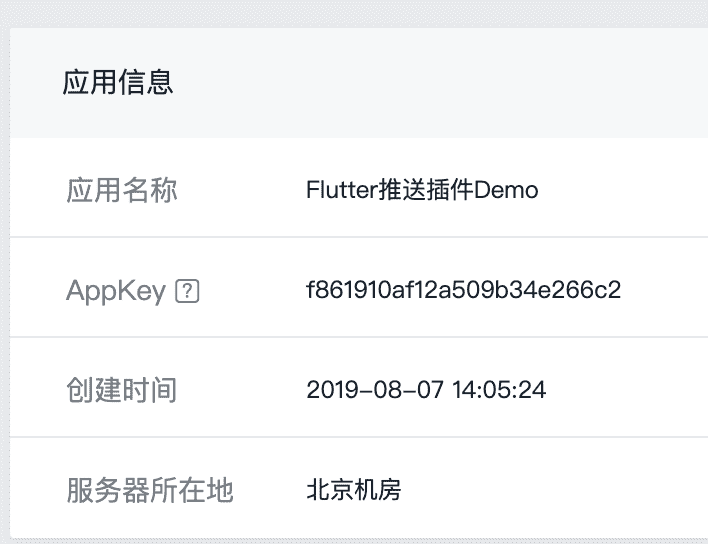

图 4 极光应用注册

在得到了 AppKey 之后，我们需要**依次进行 Android 与 iOS 的配置工作**。

Android 的配置工作相对简单，整个配置过程完全是应用与极光 SDK 的关联工作。

首先，根据 example 的 Android 工程包名，完成 Android 工程的推送注册：

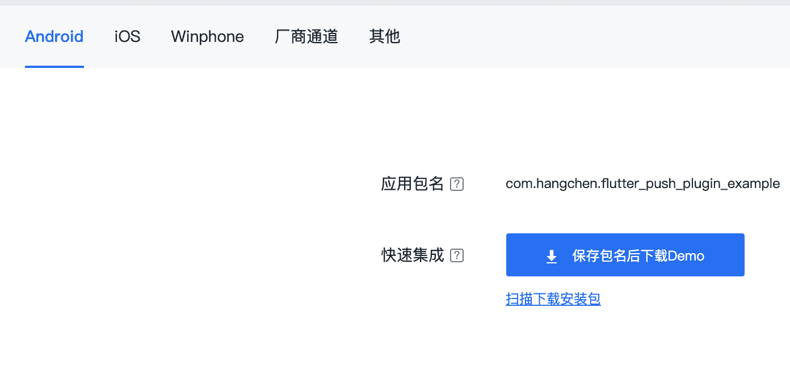

图 5 example Android 推送注册

然后，通过 AppKey，在 app 的 build.gradle 文件中实现极光信息的绑定：

```
defaultConfig {   ...   //ndk 支持架构     ndk {        abiFilters 'armeabi', 'armeabi-v7a', 'arm64-v8a'    }        manifestPlaceholders = [            JPUSH_PKGNAME : applicationId, // 包名            JPUSH_APPKEY : "f861910af12a509b34e266c2", //JPush 上注册的包名对应的 Appkey            JPUSH_CHANNEL : "developer-default", // 填写默认值即可    ]}
```

至此，Android 部分的所有配置工作和接口实现都已经搞定了。接下来，我们再来看看 iOS 的配置实现。

**iOS 的应用配置相对 Android 会繁琐一些**，因为整个配置过程涉及应用、苹果 APNs 服务、极光三方之间的信息关联。

除了需要在应用内绑定极光信息之外（即 handleMethodCall 中的 setup 方法），还需要在[苹果的开发者官网](https://developer.apple.com/)提前申请苹果的推送证书。关于申请证书，苹果提供了.p12 证书和 APNs Auth Key 两种鉴权方式。

这里，我推荐使用更为简单的 Auth Key 方式。申请推送证书的过程，极光官网提供了详细的[注册步骤](https://docs.jiguang.cn//jpush/client/iOS/ios_cer_guide/)，这里我就不再赘述了。需要注意的是，申请 iOS 的推送证书时，你只能使用付费的苹果开发者账号。

在拿到了 APNs Auth Key 之后，我们同样需要去极光官网，根据 Bundle ID 进行推送设置，并把 Auth Key 上传至极光进行托管，由它完成与苹果的鉴权工作：

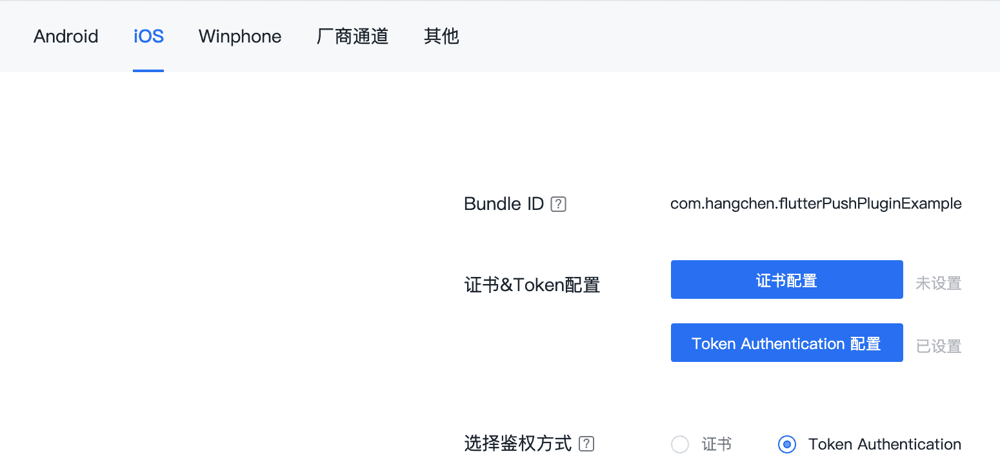

图 6 example iOS 推送注册

通过上面的步骤，我们已经完成了将推送证书与极光信息绑定的操作，接下来，我们**回到 Xcode 打开的 example 工程，进行最后的配置工作**。

首先，我们需要为 example 工程开启 Application Target 的 Capabilities->Push Notifications 选项，启动应用的推送能力支持，如下图所示：

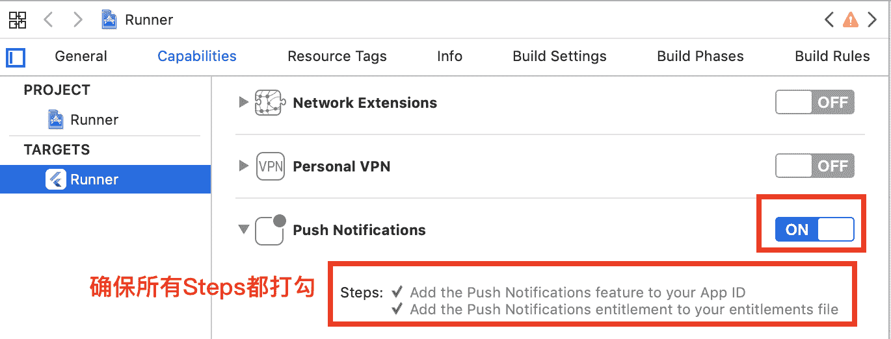

图 7 example iOS 推送配置

然后，我们需要切换到 Application Target 的 Info 面板，手动配置 NSAppTransportSecurity 键值对，以支持极光 SDK 非 https 域名服务：

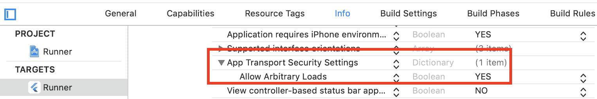

图 8 example iOS 支持 Http 配置

最后，在 Info tab 下的 Bundle identifier 项，把我们刚刚在极光官网注册的 Bundle ID 显式地更新进去：

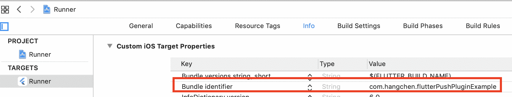

图 9 Bundle ID 配置

至此，example 工程运行所需的所有原生配置工作和接口实现都已经搞定了。接下来，我们就可以在 example 工程中的 main.dart 文件中，使用 FlutterPushPlugin 插件来实现原生推送能力了。

在下面的代码中，我们在 main 函数的入口，使用插件单例注册了极光推送服务，随后在应用 State 初始化时，获取了极光推送地址，并设置了消息推送回调：

```
// 获取推送插件单例FlutterPushPlugin fpush = FlutterPushPlugin();void main() {  // 使用 AppID 注册极光推送服务 (仅针对 iOS 平台)  fpush.setupWithAppID("f861910af12a509b34e266c2");  runApp(MyApp());} class MyApp extends StatefulWidget {  @override  _MyAppState createState() => _MyAppState();} class _MyAppState extends State<MyApp> {  // 极光推送地址 regID  String _regID = 'Unknown';  // 接收到的推送消息  String _notification = "";   @override  initState() {    super.initState();    // 注册推送消息回调    fpush.setOpenNotificationHandler((String message) async {      // 刷新界面状态，展示推送消息      setState(() {        _notification = message;      });    });    // 获取推送地址 regID    initPlatformState();  }    initPlatformState() async {    // 调用插件封装的 regID    String regID = await fpush.registrationID;    // 刷新界面状态，展示 regID    setState(() {      _regID = regID;    });  }   @override  Widget build(BuildContext context) {    return MaterialApp(      home: Scaffold(        body: Center(          child: Column(            children: <Widget>[              // 展示 regID，以及收到的消息              Text('Running on: $_regID\n'),              Text('Notification Received: $_notification')            ],          ),        ),      ),    );  }}
```

点击运行，可以看到，我们的应用已经可以获取到极光推送地址了：

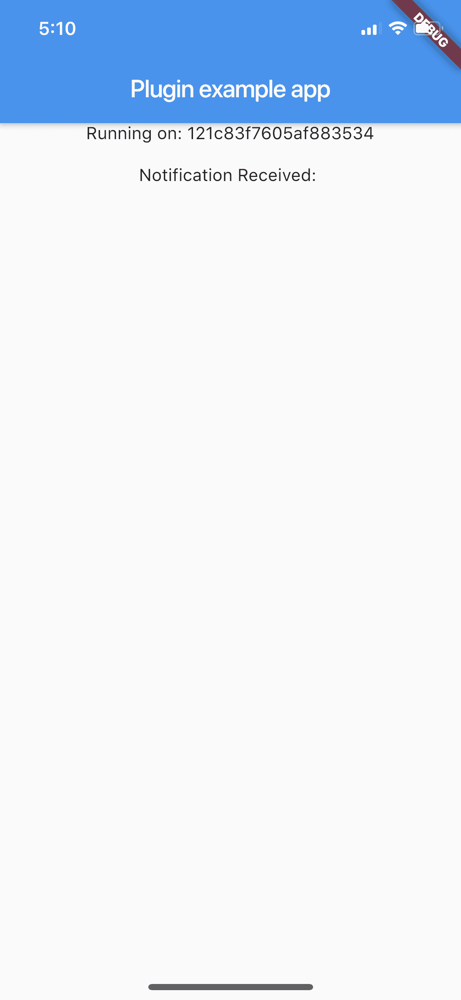

图 10 iOS 运行示例

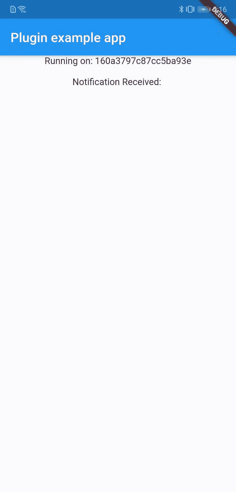

图 11 Android 运行示例

接下来，我们再去[极光开发者服务后台](https://www.jiguang.cn/dev2/#/overview/appCardList)发一条真实的推送消息。在服务后台选择我们的 App，随后进入极光推送控制台。这时，我们就可以进行消息推送测试了。

在发送通知一栏，我们把通知标题改为“测试”，通知内容设置为“极光推送测试”；在目标人群一栏，由于是测试账号，我们可以直接选择“广播所有人”，如果你希望精确定位到接收方，也可以提供在应用中获取到的极光推送地址（即 Registration ID）：

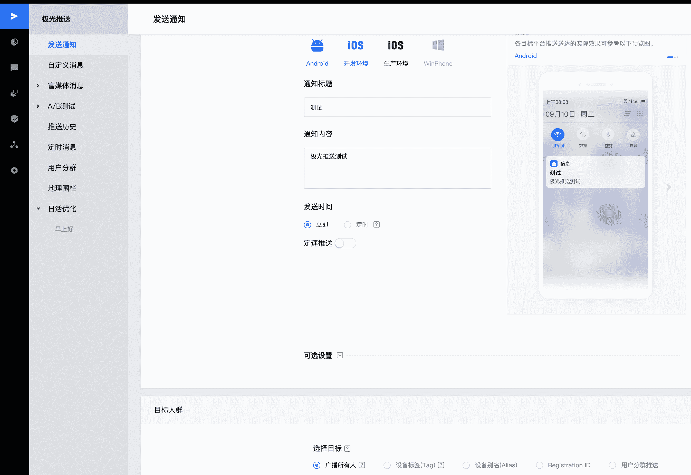

图 12 极光推送后台

点击发送预览并确认，可以看到，我们的应用不仅可以被来自极光的推送消息唤醒，还可以在 Flutter 应用内收到来自原生宿主转发的消息内容：

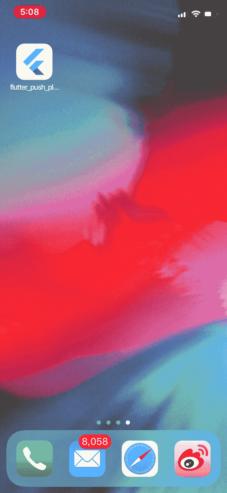

图13 iOS 推送消息

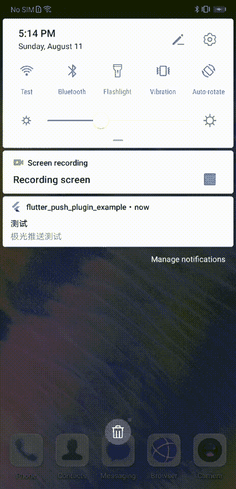

图 14 Android 推送消息

## 总结

好了，今天的分享就到这里。我们一起来小结一下吧。

我们以 Flutter 插件工程的方式，为极光 SDK 提供了一个 Dart 层的封装。插件工程同时提供了 iOS 和 Android 目录，我们可以在这两个目录下完成原生代码宿主封装，不仅可以为 Dart 层提供接口正向回调（比如，初始化、获取极光推送地址），还可以通过方法通道以反向回调的方式将推送消息转发给 Dart。

今天，我和你分享了很多原生代码宿主的配置、绑定、注册的逻辑。不难发现，推送过程链路长、涉众多、配置复杂，要想在 Flutter 完全实现原生推送能力，工作量主要集中在原生代码宿主，Dart 层能做的事情并不多。

我把今天分享所改造的[Flutter_Push_Plugin](https://github.com/cyndibaby905/31_flutter_push_plugin)放到了 GitHub 中，你可以把插件工程下载下来，多运行几次，体会插件工程与普通 Flutter 工程的异同，并加深对消息推送全流程的认识。其中，Flutter_Push_Plugin 提供了实现原生推送功能的最小集合，你可以根据实际需求完善这个插件。

需要注意的是，我们今天的实际工程演示是通过内嵌的 example 工程示例所完成的，如果你有一个独立的 Flutter 工程（比如[Flutter_Push_Demo](https://github.com/cyndibaby905/31_flutter_push_demo)）需要接入 Flutter_Push_Plugin，其配置方式与 example 工程并无不同，唯一的区别是，需要在 pubspec.yaml 文件中将对插件的依赖显示地声明出来而已：

```
dependencies:  flutter_push_plugin:    git:      url: https://github.com/cyndibaby905/31_flutter_push_plugin.git
```

## 思考题

在 Flutter_Push_Plugin 的原生实现中，用户点击了推送消息把 Flutter 应用唤醒时，为了确保 Flutter 完成初始化，我们等待了 1 秒才执行相应的 Flutter 回调通知。这段逻辑有需要优化的地方吗？为了让 Flutter 代码能够更快地收到推送消息，你会如何优化呢？

欢迎你在评论区给我留言分享你的观点，我会在下一篇文章中等待你！感谢你的收听，也欢迎你把这篇文章分享给更多的朋友一起阅读。


