# 42 | 如何构建高效的Flutter App打包发布环境？

 

你好，我是陈航。今天，我们来聊一聊 Flutter 应用的交付这个话题。

软件项目的交付是一个复杂的过程，任何原因都有可能导致交付过程失败。中小型研发团队经常遇到的一个现象是，App 在开发测试时没有任何异常，但一到最后的打包构建交付时就问题频出。所以，每到新版本发布时，大家不仅要等候打包结果，还经常需要加班修复临时出现的问题。如果没有很好地线上应急策略，即使打包成功，交付完成后还是非常紧张。

可以看到，产品交付不仅是一个令工程师头疼的过程，还是一个高风险动作。其实，失败并不可怕，可怕的是每次失败的原因都不一样。所以，为了保障可靠交付，我们需要关注从源代码到发布的整个流程，提供一种可靠的发布支撑，确保 App 是以一种可重复的、自动化的方式构建出来的。同时，我们还应该将打包过程提前，将构建频率加快，因为这样不仅可以尽早发现问题，修复成本也会更低，并且能更好地保证代码变更能够顺利发布上线。

其实，这正是持续交付的思路。

所谓持续交付，指的是建立一套自动监测源代码变更，并自动实施构建、测试、打包和相关操作的流程链机制，以保证软件可以持续、稳定地保持在随时可以发布的状态。 持续交付可以让软件的构建、测试与发布变得更快、更频繁，更早地暴露问题和风险，降低软件开发的成本。

你可能会觉得，大型软件工程里才会用到持续交付。其实不然，通过运用一些免费的工具和平台，中小型项目也能够享受到开发任务自动化的便利。而 Travis CI 就是这类工具之中，市场份额最大的一个。所以接下来，我就以 Travis CI 为例，与你分享如何为 Flutter 工程引入持续交付的能力。

## Travis CI

Travis CI 是在线托管的持续交付服务，用 Travis 来进行持续交付，不需要自己搭服务器，在网页上点几下就好，非常方便。

Travis 和 GitHub 是一对配合默契的工作伙伴，只要你在 Travis 上绑定了 GitHub 上的项目，后续任何代码的变更都会被 Travis 自动抓取。然后，Travis 会提供一个运行环境，执行我们预先在配置文件中定义好的测试和构建步骤，并最终把这次变更产生的构建产物归档到 GitHub Release 上，如下所示：

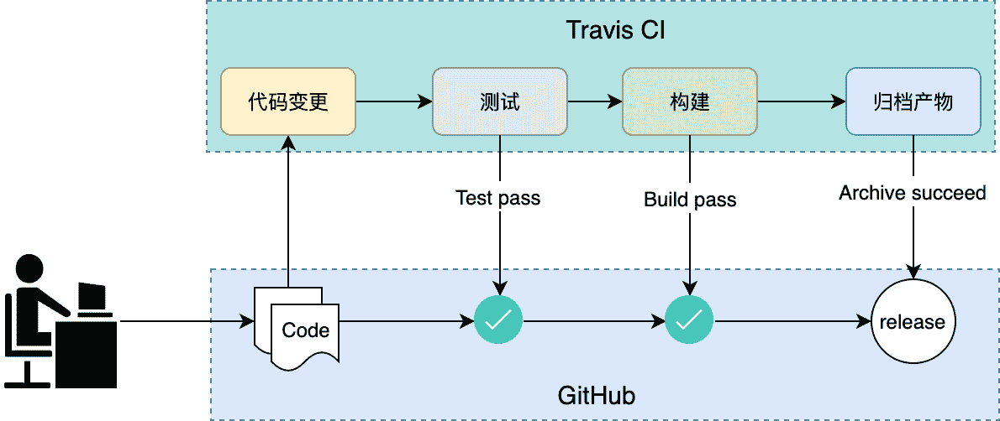

图 1 Travis CI 持续交付流程示意图

可以看到，通过 Travis 提供的持续构建交付能力，我们可以直接看到每次代码的更新的变更结果，而不需要累积到发布前再做打包构建。这样不仅可以更早地发现错误，定位问题也会更容易。

要想为项目提供持续交付的能力，我们首先需要在 Travis 上绑定 GitHub。我们打开[Travis 官网](https://travis-ci.com/)，使用自己的 GitHub 账号授权登陆就可以了。登录完成后页面中会出现一个“Activate”按钮，点击按钮会跳回到 GitHub 中进行项目访问权限设置。我们保留默认的设置，点击“Approve&Install”即可。

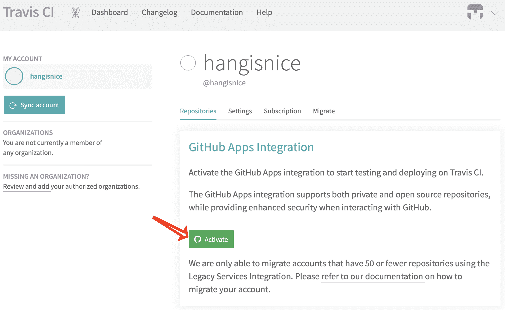

图 2 激活 Github 集成

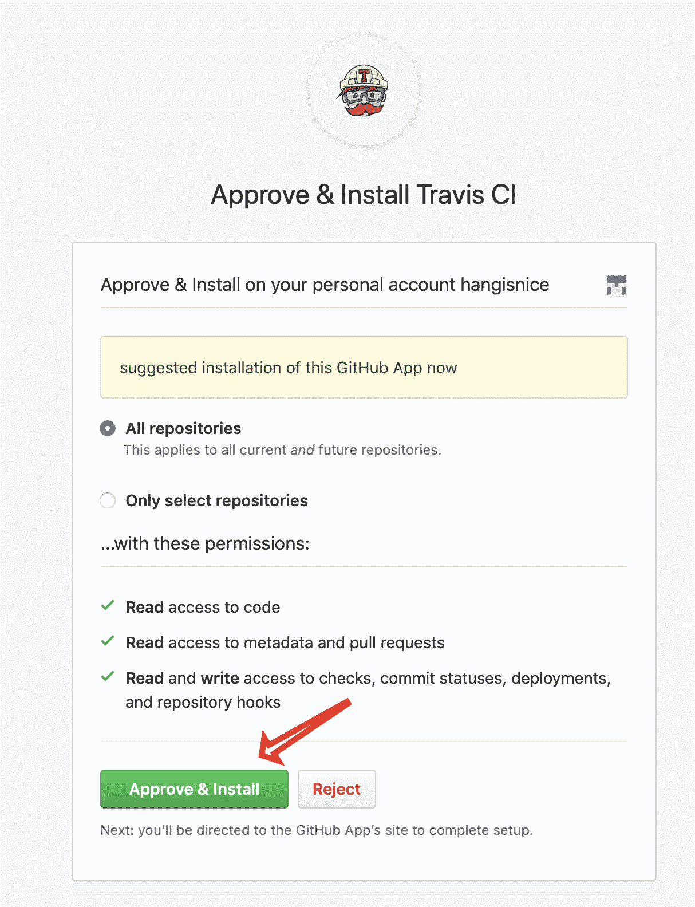

图 3 授权 Travis 读取项目变更记录

完成授权之后，页面会跳转到 Travis。Travis 主页上会列出 GitHub 上你的所有仓库，以及你所属于的组织，如下图所示：

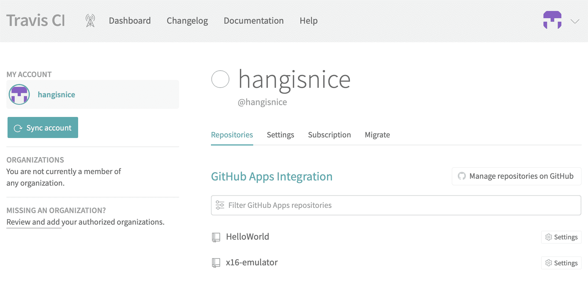

图 4 完成 Github 项目绑定

完成项目绑定后，接下来就是**为项目增加 Travis 配置文件**了。配置的方法也很简单，只要在项目的根目录下放一个名为.travis.yaml 的文件就可以了。

.travis.yaml 是 Travis 的配置文件，指定了 Travis 应该如何应对代码变更。代码 commit 上去之后，一旦 Travis 检测到新的变更，Travis 就会去查找这个文件，根据项目类型（language）确定执行环节，然后按照依赖安装（install）、构建命令（script）和发布（deploy）这三大步骤，依次执行里面的命令。一个 Travis 构建任务流程如下所示：

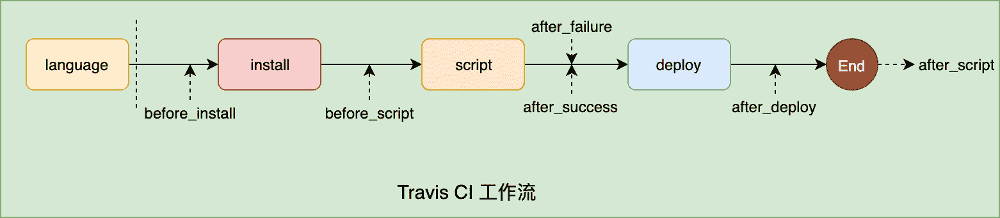

图 5 Travis 工作流

可以看到，为了更精细地控制持续构建过程，Travis 还为 install、script 和 deploy 提供了对应的钩子（before_install、before_script、after_failure、after_success、before_deploy、after_deploy、after_script），可以前置或后置地执行一些特殊操作。

如果你的项目比较简单，没有其他的第三方依赖，也不需要发布到 GitHub Release 上，只是想看看构建会不会失败，那么你可以省略配置文件中的 install 和 deploy。

## 如何为项目引入 Travis？

可以看到，一个最简单的配置文件只需要提供两个字段，即 language 和 script，就可以让 Travis 帮你自动构建了。下面的例子演示了如何为一个 Dart 命令行项目引入 Travis。在下面的配置文件中，我们将 language 字段设置为 Dart，并在 script 字段中，将 dart_sample.dart 定义为程序入口启动运行：

```
#.travis.yamllanguage: dartscript:  - dart dart_sample.dart
```

将这个文件提交至项目中，我们就完成了 Travis 的配置工作。

Travis 会在每次代码提交时自动运行配置文件中的命令，如果所有命令都返回 0，就表示验证通过，完全没有问题，你的提交记录就会被标记上一个绿色的对勾。反之，如果命令运行过程中出现了异常，则表示验证失败，你的提交记录就会被标记上一个红色的叉，这时我们就要点击红勾进入 Travis 构建详情，去查看失败原因并尽快修复问题了。

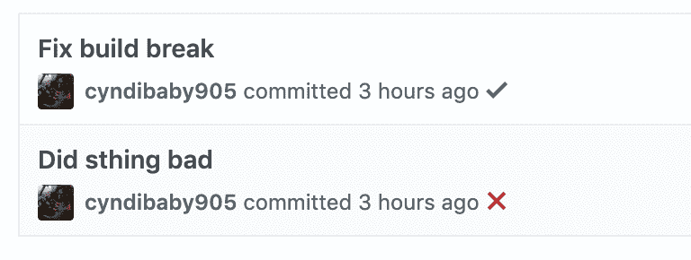

图 6 代码变更验证

可以看到，为一个工程引入自动化任务的能力，只需要提炼出能够让工程自动化运行需要的命令就可以了。

在[第 38 篇文章](https://time.geekbang.org/column/article/140079)中，我与你介绍了 Flutter 工程运行自动化测试用例的命令，即 flutter test，所以如果我们要为一个 Flutter 工程配置自动化测试任务，直接把这个命令放置在 script 字段就可以了。

但需要注意的是，Travis 并没有内置 Flutter 运行环境，所以我们还需要在 install 字段中，为自动化任务安装 Flutter SDK。下面的例子演示了**如何为一个 Flutter 工程配置自动化测试能力**。在下面的配置文件中，我们将 os 字段设置为 osx，在 install 字段中 clone 了 Flutter SDK，并将 Flutter 命令设置为环境变量。最后，我们在 script 字段中加上 flutter test 命令，就完成了配置工作：

```
os:  - osxinstall:  - git clone https://github.com/flutter/flutter.git  - export PATH="$PATH:`pwd`/flutter/bin"script:  - flutter doctor && flutter test
```

其实，为 Flutter 工程的代码变更引入自动化测试能力相对比较容易，但考虑到 Flutter 的跨平台特性，**要想在不同平台上验证工程自动化构建的能力（即 iOS 平台构建出 ipa 包、Android 平台构建出 apk 包）又该如何处理呢**？

我们都知道 Flutter 打包构建的命令是 flutter build，所以同样的，我们只需要把构建 iOS 的命令和构建 Android 的命令放到 script 字段里就可以了。但考虑到这两条构建命令执行时间相对较长，所以我们可以利用 Travis 提供的并发任务选项 matrix，来把 iOS 和 Android 的构建拆开，分别部署在独立的机器上执行。

下面的例子演示了如何使用 matrix 分拆构建任务。在下面的代码中，我们定义了两个并发任务，即运行在 Linux 上的 Android 构建任务执行 flutter build apk，和运行在 OS X 上的 iOS 构建任务 flutter build ios。

考虑到不同平台的构建任务需要提前准备运行环境，比如 Android 构建任务需要设置 JDK、安装 Android SDK 和构建工具、接受相应的开发者协议，而 iOS 构建任务则需要设置 Xcode 版本，因此我们分别在这两个并发任务中提供对应的配置选项。

最后需要注意的是，由于这两个任务都需要依赖 Flutter 环境，所以 install 字段并不需要拆到各自任务中进行重复设置：

```
matrix:  include:    # 声明 Android 运行环境    - os: linux      language: android      dist: trusty      licenses:        - 'android-sdk-preview-license-.+'        - 'android-sdk-license-.+'        - 'google-gdk-license-.+'      # 声明需要安装的 Android 组件      android:        components:          - tools          - platform-tools          - build-tools-28.0.3          - android-28          - sys-img-armeabi-v7a-google_apis-28          - extra-android-m2repository          - extra-google-m2repository          - extra-google-android-support      jdk: oraclejdk8      sudo: false      addons:        apt:          sources:            - ubuntu-toolchain-r-test           packages:            - libstdc++6            - fonts-droid      # 确保 sdkmanager 是最新的      before_script:        - yes | sdkmanager --update      script:        - yes | flutter doctor --android-licenses        - flutter doctor && flutter -v build apk     # 声明 iOS 的运行环境    - os: osx      language: objective-c      osx_image: xcode10.2      script:        - flutter doctor && flutter -v build ios --no-codesigninstall:    - git clone https://github.com/flutter/flutter.git    - export PATH="$PATH:`pwd`/flutter/bin"
```

## 如何将打包好的二进制文件自动发布出来？

在这个案例中，我们构建任务的命令是打包，那打包好的二进制文件可以自动发布出来吗？

答案是肯定的。我们只需要为这两个构建任务增加 deploy 字段，设置 skip_cleanup 字段告诉 Travis 在构建完成后不要清除编译产物，然后通过 file 字段把要发布的文件指定出来，最后就可以通过 GitHub 提供的 API token 上传到项目主页了。

下面的示例演示了 deploy 字段的具体用法，在下面的代码中，我们获取到了 script 字段构建出的 app-release.apk，并通过 file 字段将其指定为待发布的文件。考虑到并不是每次构建都需要自动发布，所以我们在下面的配置中，增加了 on 选项，告诉 Travis 仅在对应的代码更新有关联 tag 时，才自动发布一个 release 版本：

```
...# 声明构建需要执行的命令script:  - yes | flutter doctor --android-licenses  - flutter doctor && flutter -v build apk# 声明部署的策略，即上传 apk 至 github releasedeploy:  provider: releases  api_key: xxxxx  file:    - build/app/outputs/apk/release/app-release.apk  skip_cleanup: true  on:    tags: true...
```

需要注意的是，由于我们的项目是开源库，因此 GitHub 的 API token 不能明文放到配置文件中，需要在 Travis 上配置一个 API token 的环境变量，然后把这个环境变量设置到配置文件中。

我们先打开 GitHub，点击页面右上角的个人头像进入 Settings，随后点击 Developer Settings 进入开发者设置。

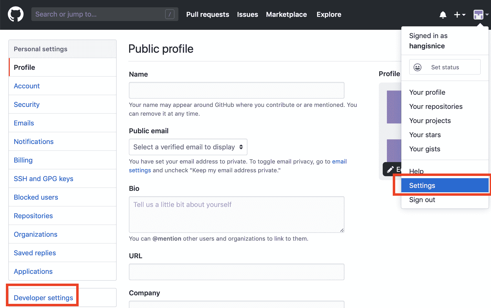

图 7 进入开发者设置

在开发者设置页面中，我们点击左下角的 Personal access tokens 选项，生成访问 token。token 设置页面提供了比较丰富的访问权限控制，比如仓库限制、用户限制、读写限制等，这里我们选择只访问公共的仓库，填好 token 名称 cd_demo，点击确认之后，GitHub 会将 token 的内容展示在页面上。

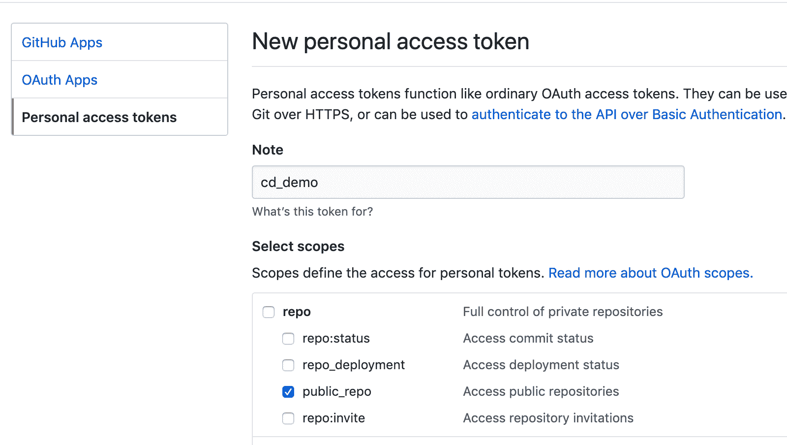

图 8 生成访问 token

需要注意的是，这个 token 你只会在 GitHub 上看到一次，页面关了就再也找不到了，所以我们先把这个 token 复制下来。

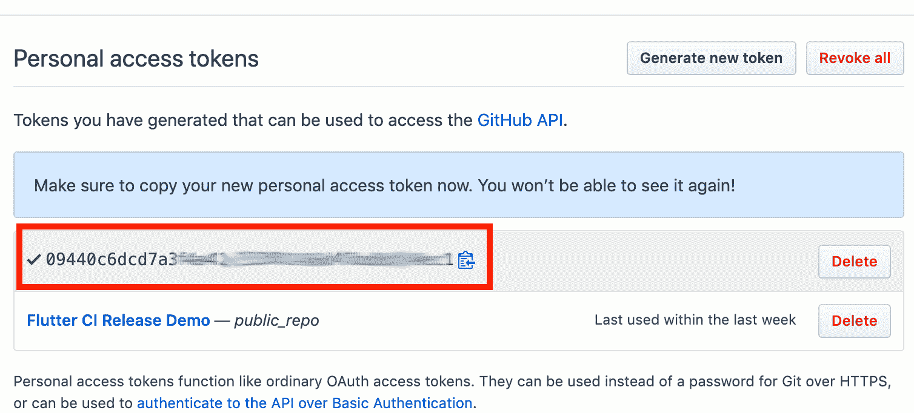

图 9 访问 token 界面

接下来，我们打开 Travis 主页，找到我们希望配置自动发布的项目，然后点击右上角的 More options 选择 Settings 打开项目配置页面。

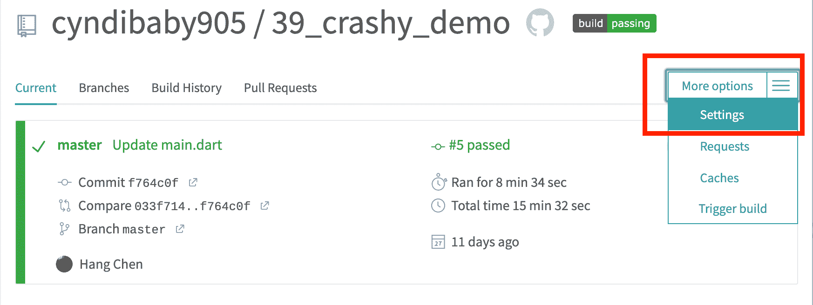

图 10 打开 Travis 项目设置

在 Environment Variable 里，把刚刚复制的 token 改名为 GITHUB_TOKEN，加到环境变量即可。

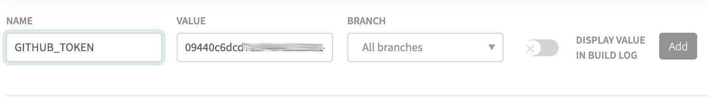

图 11 加入 Travis 环境变量

最后，我们只要把配置文件中的 api_key 替换成 ${GITHUB_TOKEN}就可以了。

```
...deploy:  api_key: ${GITHUB_TOKEN}...
```

这个案例介绍的是 Android 的构建产物 apk 发布。而对于 iOS 而言，我们还需要对其构建产物 app 稍作加工，让其变成更通用的 ipa 格式之后才能发布。这里我们就需要用到 deploy 的钩子 before_deploy 字段了，这个字段能够在正式发布前，执行一些特定的产物加工工作。

下面的例子演示了**如何通过 before_deploy 字段加工构建产物**。由于 ipa 格式是在 app 格式之上做的一层包装，所以我们把 app 文件拷贝到 Payload 后再做压缩，就完成了发布前的准备工作，接下来就可以在 deploy 阶段指定要发布的文件，正式进入发布环节了：

```
...# 对发布前的构建产物进行预处理，打包成 ipabefore_deploy:  - mkdir app && mkdir app/Payload  - cp -r build/ios/iphoneos/Runner.app app/Payload  - pushd app && zip -r -m app.ipa Payload  && popd# 将 ipa 上传至 github releasedeploy:  provider: releases  api_key: ${GITHUB_TOKEN}  file:    - app/app.ipa  skip_cleanup: true  on:    tags: true...
```

将更新后的配置文件提交至 GitHub，随后打一个 tag。等待 Travis 构建完毕后可以看到，我们的工程已经具备自动发布构建产物的能力了。

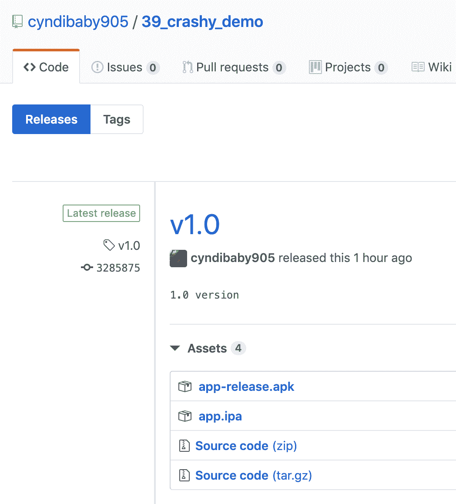

图 12 Flutter App 发布构建产物

## 如何为 Flutter Module 工程引入自动发布能力？

这个例子介绍的是传统的 Flutter App 工程（即纯 Flutter 工程），**如果我们想为 Flutter Module 工程（即混合开发的 Flutter 工程）引入自动发布能力又该如何设置呢？**

其实也并不复杂。Module 工程的 Android 构建产物是 aar，iOS 构建产物是 Framework。Android 产物的自动发布比较简单，我们直接复用 apk 的发布，把 file 文件指定为 aar 文件即可；iOS 的产物自动发布稍繁琐一些，需要将 Framework 做一些简单的加工，将它们转换成 Pod 格式。

下面的例子演示了 Flutter Module 的 iOS 产物是如何实现自动发布的。由于 Pod 格式本身只是在 App.Framework 和 Flutter.Framework 这两个文件的基础上做的封装，所以我们只需要把它们拷贝到统一的目录 FlutterEngine 下，并将声明了组件定义的 FlutterEngine.podspec 文件放置在最外层，最后统一压缩成 zip 格式即可。

```
...# 对构建产物进行预处理，压缩成 zip 格式的组件before_deploy:  - mkdir .ios/Outputs && mkdir .ios/Outputs/FlutterEngine  - cp FlutterEngine.podspec .ios/Outputs/  - cp -r .ios/Flutter/App.framework/ .ios/Outputs/FlutterEngine/App.framework/  - cp -r .ios/Flutter/engine/Flutter.framework/ .ios/Outputs/FlutterEngine/Flutter.framework/  - pushd .ios/Outputs && zip -r FlutterEngine.zip  ./ && popddeploy:  provider: releases  api_key: ${GITHUB_TOKEN}  file:    - .ios/Outputs/FlutterEngine.zip  skip_cleanup: true  on:    tags: true...
```

将这段代码提交后可以看到，Flutter Module 工程也可以自动的发布原生组件了。

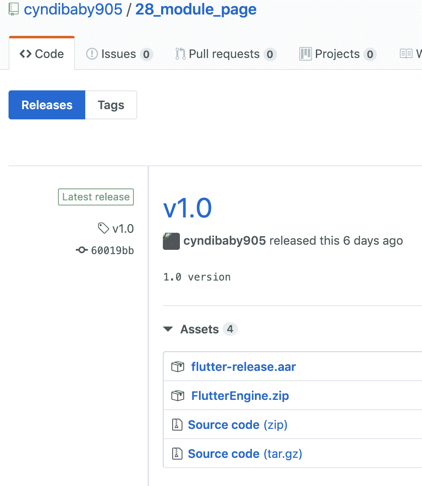

图 13 Flutter Module 工程发布构建产物

通过这些例子我们可以看到，**任务配置的关键在于提炼出项目自动化运行需要的命令集合，并确认它们的执行顺序。**只要把这些命令集合按照 install、script 和 deploy 三个阶段安置好，接下来的事情就交给 Travis 去完成，我们安心享受持续交付带来的便利就可以了。

## 总结

俗话说，“90% 的故障都是由变更引起的”，这凸显了持续交付对于发布稳定性保障的价值。通过建立持续交付流程链机制，我们可以将代码变更与自动化手段关联起来，让测试和发布变得更快、更频繁，不仅可以提早暴露风险，还能让软件可以持续稳定地保持在随时可发布的状态。

在今天的分享中，我与你介绍了如何通过 Travis CI，为我们的项目引入持续交付能力。Travis 的自动化任务的工作流依靠.travis.yaml 配置文件驱动，我们可以在确认好构建任务需要的命令集合后，在这个配置文件中依照 install、script 和 deploy 这 3 个步骤拆解执行过程。完成项目的配置之后，一旦 Travis 检测到代码变更，就可以自动执行任务了。

简单清晰的发布流程是软件可靠性的前提。如果我们同时发布了 100 个代码变更，导致 App 性能恶化了，我们可能需要花费大量时间和精力，去定位究竟是哪些变更影响了 App 性能，以及它们是如何影响的。而如果以持续交付的方式发布 App，我们能够以更小的粒度去测量和理解代码变更带来的影响，是改善还是退化，从而可以更早地找到问题，更有信心进行更快的发布。

**需要注意的是，**在今天的示例分析中，我们构建的是一个未签名的 ipa 文件，这意味着我们需要先完成签名之后，才能在真实的 iOS 设备上运行，或者发布到 App Store。

iOS 的代码签名涉及私钥和多重证书的校验，以及对应的加解密步骤，是一个相对繁琐的过程。如果我们希望在 Travis 上部署自动化签名操作，需要导出发布证书、私钥和描述文件，并提前将这些文件打包成一个压缩包后进行加密，上传至仓库。

然后，我们还需要在 before_install 时，将这个压缩包进行解密，并把证书导到 Travis 运行环境的钥匙串中，这样构建脚本就可以使用临时钥匙串对二进制文件进行签名了。完整的配置，你可以参考手机内侧服务厂商蒲公英提供的[集成文档](https://www.pgyer.com/doc/view/travis_ios)了解进一步的细节。

如果你不希望将发布证书、私钥暴露给 Travis，也可以把未签名的 ipa 包下载下来，解压后通过 codesign 命令，分别对 App.Framework、Flutter.Framework 以及 Runner 进行重签名操作，然后重新压缩成 ipa 包即可。[这篇文章](https://www.yangshebing.com/2018/01/06/iOS%E9%80%86%E5%90%91%E5%BF%85%E5%A4%87%E7%BB%9D%E6%8A%80%E4%B9%8Bipa%E9%87%8D%E7%AD%BE%E5%90%8D/)介绍了详细的操作步骤，这里我们也不再赘述了。

我把今天分享涉及的 Travis 配置上传到了 GitHub，你可以把这几个项目[Dart_Sample](https://github.com/cyndibaby905/08_Dart_Sample)、[Module_Page](https://github.com/cyndibaby905/28_module_page)、[Crashy_Demo](https://github.com/cyndibaby905/39_crashy_demo)下载下来，观察它们的配置文件，并在 Travis 网站上查看对应的构建过程，从而加深理解与记忆。

## 思考题

最后，我给你留一道思考题吧。

在 Travis 配置文件中，如何选用特定的 Flutter SDK 版本（比如 v1.5.4-hotfix.2）呢？

欢迎你在评论区给我留言分享你的观点，我会在下一篇文章中等待你！感谢你的收听，也欢迎你把这篇文章分享给更多的朋友一起阅读。


