# 03｜Mutex：4种易错场景大盘点

 

你好，我是鸟窝。

上一讲，我带你一起领略了 Mutex 的架构演进之美，现在我们已经清楚 Mutex 的实现细节了。当前 Mutex 的实现貌似非常复杂，其实主要还是针对饥饿模式和公平性问题，做了一些额外处理。但是，我们在第一讲中已经体验过了，Mutex 使用起来还是非常简单的，毕竟，它只有 Lock 和 Unlock 两个方法，使用起来还能复杂到哪里去？

正常使用 Mutex 时，确实是这样的，很简单，基本不会有什么错误，即使出现错误，也是在一些复杂的场景中，比如跨函数调用 Mutex 或者是在重构或者修补 Bug 时误操作。但是，我们使用 Mutex 时，确实会出现一些 Bug，比如说忘记释放锁、重入锁、复制已使用了的 Mutex 等情况。那在这一讲中，我们就一起来看看使用 Mutex 常犯的几个错误，做到“Bug 提前知，后面早防范”。

# 常见的 4 种错误场景

我总结了一下，使用 Mutex 常见的错误场景有 4 类，分别是 Lock/Unlock 不是成对出现、Copy 已使用的 Mutex、重入和死锁。下面我们一一来看。

## Lock/Unlock 不是成对出现

Lock/Unlock 没有成对出现，就意味着会出现死锁的情况，或者是因为 Unlock 一个未加锁的 Mutex 而导致 panic。

我们先来看看缺少 Unlock 的场景，常见的有三种情况：

1. 代码中有太多的 if-else 分支，可能在某个分支中漏写了 Unlock；
2. 在重构的时候把 Unlock 给删除了；
3. Unlock 误写成了 Lock。

在这种情况下，锁被获取之后，就不会被释放了，这也就意味着，其它的 goroutine 永远都没机会获取到锁。

我们再来看缺少 Lock 的场景，这就很简单了，一般来说就是误操作删除了 Lock。 比如先前使用 Mutex 都是正常的，结果后来其他人重构代码的时候，由于对代码不熟悉，或者由于开发者的马虎，把 Lock 调用给删除了，或者注释掉了。比如下面的代码，mu.Lock() 一行代码被删除了，直接 Unlock 一个未加锁的 Mutex 会 panic：

```
func foo() {  
    var mu sync.Mutex  
    defer mu.Unlock()  
    fmt.Println("hello world!")  
}
```

运行的时候 panic：

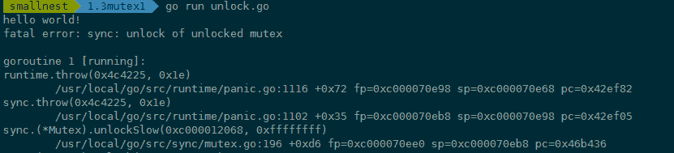

## Copy 已使用的 Mutex

第二种误用是 Copy 已使用的 Mutex。在正式分析这个错误之前，我先交代一个小知识点，那就是 Package sync 的同步原语在使用后是不能复制的。我们知道 Mutex 是最常用的一个同步原语，那它也是不能复制的。为什么呢？

原因在于，Mutex 是一个有状态的对象，它的 state 字段记录这个锁的状态。如果你要复制一个已经加锁的 Mutex 给一个新的变量，那么新的刚初始化的变量居然被加锁了，这显然不符合你的期望，因为你期望的是一个零值的 Mutex。关键是在并发环境下，你根本不知道要复制的 Mutex 状态是什么，因为要复制的 Mutex 是由其它 goroutine 并发访问的，状态可能总是在变化。

当然，你可能说，你说的我都懂，你的警告我都记下了，但是实际在使用的时候，一不小心就踩了这个坑，我们来看一个例子。

```
type Counter struct {  
    sync.Mutex  
    Count int  
}  
  
  
func main() {  
    var c Counter  
    c.Lock()  
    defer c.Unlock()  
    c.Count++  
    foo(c) // 复制锁  
}  
  
// 这里Counter的参数是通过复制的方式传入的  
func foo(c Counter) {  
    c.Lock()  
    defer c.Unlock()  
    fmt.Println("in foo")  
}
```

第 12 行在调用 foo 函数的时候，调用者会复制 Mutex 变量 c 作为 foo 函数的参数，不幸的是，复制之前已经使用了这个锁，这就导致，复制的 Counter 是一个带状态 Counter。

怎么办呢？Go 在运行时，有**死锁的检查机制**（checkdead() 方法），它能够发现死锁的 goroutine。这个例子中因为复制了一个使用了的 Mutex，导致锁无法使用，程序处于死锁的状态。程序运行的时候，死锁检查机制能够发现这种死锁情况并输出错误信息，如下图中错误信息以及错误堆栈：

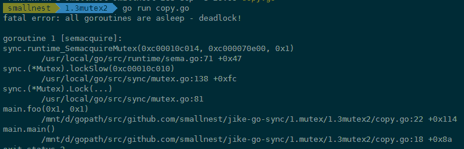

你肯定不想运行的时候才发现这个因为复制 Mutex 导致的死锁问题，那么你怎么能够及时发现问题呢？可以使用 **vet 工具**，把检查写在 Makefile 文件中，在持续集成的时候跑一跑，这样可以及时发现问题，及时修复。我们可以使用 go vet 检查这个 Go 文件：

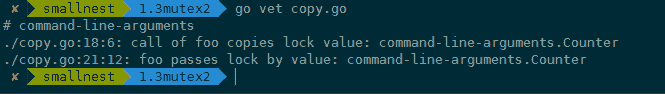

你看，使用这个工具就可以发现 Mutex 复制的问题，错误信息显示得很清楚，是在调用 foo 函数的时候发生了 lock value 复制的情况，还告诉我们出问题的代码行数以及 copy lock 导致的错误。

那么，vet 工具是怎么发现 Mutex 复制使用问题的呢？我带你简单分析一下。

检查是通过copylock分析器静态分析实现的。这个分析器会分析函数调用、range 遍历、复制、声明、函数返回值等位置，有没有锁的值 copy 的情景，以此来判断有没有问题。可以说，只要是实现了 Locker 接口，就会被分析。我们看到，下面的代码就是确定什么类型会被分析，其实就是实现了 Lock/Unlock 两个方法的 Locker 接口：

```
var lockerType *types.Interface  
    
  // Construct a sync.Locker interface type.  
  func init() {  
    nullary := types.NewSignature(nil, nil, nil, false) // func()  
    methods := []*types.Func{  
      types.NewFunc(token.NoPos, nil, "Lock", nullary),  
      types.NewFunc(token.NoPos, nil, "Unlock", nullary),  
    }  
    lockerType = types.NewInterface(methods, nil).Complete()  
  }
```

其实，有些没有实现 Locker 接口的同步原语（比如 WaitGroup），也能被分析。我先卖个关子，后面我们会介绍这种情况是怎么实现的。

## 重入

接下来，我们来讨论“重入”这个问题。在说这个问题前，我先解释一下个概念，叫“可重入锁”。

如果你学过 Java，可能会很熟悉 ReentrantLock，就是可重入锁，这是 Java 并发包中非常常用的一个同步原语。它的基本行为和互斥锁相同，但是加了一些扩展功能。

如果你没接触过 Java，也没关系，这里只是提一下，帮助会 Java 的同学对比来学。那下面我来具体讲解可重入锁是咋回事儿。

当一个线程获取锁时，如果没有其它线程拥有这个锁，那么，这个线程就成功获取到这个锁。之后，如果其它线程再请求这个锁，就会处于阻塞等待的状态。但是，如果拥有这把锁的线程再请求这把锁的话，不会阻塞，而是成功返回，所以叫可重入锁（有时候也叫做递归锁）。只要你拥有这把锁，你可以可着劲儿地调用，比如通过递归实现一些算法，调用者不会阻塞或者死锁。

了解了可重入锁的概念，那我们来看 Mutex 使用的错误场景。划重点了：**Mutex 不是可重入的锁。**

想想也不奇怪，因为 Mutex 的实现中没有记录哪个 goroutine 拥有这把锁。理论上，任何 goroutine 都可以随意地 Unlock 这把锁，所以没办法计算重入条件，毕竟，“臣妾做不到啊”！

所以，一旦误用 Mutex 的重入，就会导致报错。下面是一个误用 Mutex 的重入例子：

```
func foo(l sync.Locker) {  
    fmt.Println("in foo")  
    l.Lock()  
    bar(l)  
    l.Unlock()  
}  
  
  
func bar(l sync.Locker) {  
    l.Lock()  
    fmt.Println("in bar")  
    l.Unlock()  
}  
  
  
func main() {  
    l := &sync.Mutex{}  
    foo(l)  
}
```

写完这个 Mutex 重入的例子后，运行一下，你会发现类似下面的错误。程序一直在请求锁，但是一直没有办法获取到锁，结果就是 Go 运行时发现死锁了，没有其它地方能够释放锁让程序运行下去，你通过下面的错误堆栈信息就能定位到哪一行阻塞请求锁：

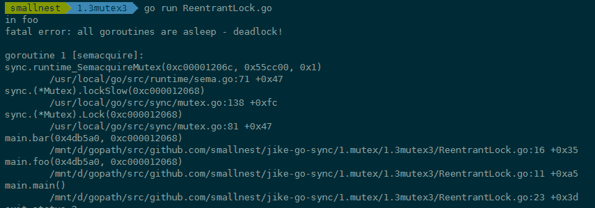

学到这里，你可能要问了，虽然标准库 Mutex 不是可重入锁，但是如果我就是想要实现一个可重入锁，可以吗？

可以，那我们就自己实现一个。这里的关键就是，实现的锁要能记住当前是哪个 goroutine 持有这个锁。我来提供两个方案。

1. 方案一：通过 hacker 的方式获取到 goroutine id，记录下获取锁的 goroutine id，它可以实现 Locker 接口。
2. 方案二：调用 Lock/Unlock 方法时，由 goroutine 提供一个 token，用来标识它自己，而不是我们通过 hacker 的方式获取到 goroutine id，但是，这样一来，就不满足 Locker 接口了。

可重入锁（递归锁）解决了代码重入或者递归调用带来的死锁问题，同时它也带来了另一个好处，就是我们可以要求，只有持有锁的 goroutine 才能 unlock 这个锁。这也很容易实现，因为在上面这两个方案中，都已经记录了是哪一个 goroutine 持有这个锁。

下面我们具体来看这两个方案怎么实现。

**方案一**：**goroutine id**

这个方案的关键第一步是获取 goroutine id，方式有两种，分别是简单方式和 hacker 方式。

简单方式，就是通过 runtime.Stack 方法获取栈帧信息，栈帧信息里包含 goroutine id。你可以看看上面 panic 时候的贴图，goroutine id 明明白白地显示在那里。runtime.Stack 方法可以获取当前的 goroutine 信息，第二个参数为 true 会输出所有的 goroutine 信息，信息的格式如下：

```
goroutine 1 [running]:  
main.main()  
        ....../main.go:19 +0xb1
```

第一行格式为 goroutine xxx，其中 xxx 就是 goroutine id，你只要解析出这个 id 即可。解析的方法可以采用下面的代码：

```
func GoID() int {  
    var buf [64]byte  
    n := runtime.Stack(buf[:], false)  
    // 得到id字符串  
    idField := strings.Fields(strings.TrimPrefix(string(buf[:n]), "goroutine "))[0]  
    id, err := strconv.Atoi(idField)  
    if err != nil {  
        panic(fmt.Sprintf("cannot get goroutine id: %v", err))  
    }  
    return id  
}
```

了解了简单方式，接下来我们来看 hacker 的方式，这也是我们方案一采取的方式。

首先，我们获取运行时的 g 指针，反解出对应的 g 的结构。每个运行的 goroutine 结构的 g 指针保存在当前 goroutine 的一个叫做 TLS 对象中。

第一步：我们先获取到 TLS 对象；

第二步：再从 TLS 中获取 goroutine 结构的 g 指针；

第三步：再从 g 指针中取出 goroutine id。

需要注意的是，不同 Go 版本的 goroutine 的结构可能不同，所以需要根据 Go 的不同版本进行调整。当然了，如果想要搞清楚各个版本的 goroutine 结构差异，所涉及的内容又过于底层而且复杂，学习成本太高。怎么办呢？我们可以重点关注一些库。我们没有必要重复发明轮子，直接使用第三方的库来获取 goroutine id 就可以了。

好消息是现在已经有很多成熟的方法了，可以支持多个 Go 版本的 goroutine id，给你推荐一个常用的库：petermattis/goid。

知道了如何获取 goroutine id，接下来就是最后的关键一步了，我们实现一个可以使用的可重入锁：

```
// RecursiveMutex 包装一个Mutex,实现可重入  
type RecursiveMutex struct {  
    sync.Mutex  
    owner     int64 // 当前持有锁的goroutine id  
    recursion int32 // 这个goroutine 重入的次数  
}  
  
func (m *RecursiveMutex) Lock() {  
    gid := goid.Get()  
    // 如果当前持有锁的goroutine就是这次调用的goroutine,说明是重入  
    if atomic.LoadInt64(&m.owner) == gid {  
        m.recursion++  
        return  
    }  
    m.Mutex.Lock()  
    // 获得锁的goroutine第一次调用，记录下它的goroutine id,调用次数加1  
    atomic.StoreInt64(&m.owner, gid)  
    m.recursion = 1  
}  
  
func (m *RecursiveMutex) Unlock() {  
    gid := goid.Get()  
    // 非持有锁的goroutine尝试释放锁，错误的使用  
    if atomic.LoadInt64(&m.owner) != gid {  
        panic(fmt.Sprintf("wrong the owner(%d): %d!", m.owner, gid))  
    }  
    // 调用次数减1  
    m.recursion--  
    if m.recursion != 0 { // 如果这个goroutine还没有完全释放，则直接返回  
        return  
    }  
    // 此goroutine最后一次调用，需要释放锁  
    atomic.StoreInt64(&m.owner, -1)  
    m.Mutex.Unlock()  
}
```

上面这段代码你可以拿来即用。我们一起来看下这个实现，真是非常巧妙，它相当于给 Mutex 打一个补丁，解决了记录锁的持有者的问题。可以看到，我们用 owner 字段，记录当前锁的拥有者 goroutine 的 id；recursion 是辅助字段，用于记录重入的次数。

有一点，我要提醒你一句，尽管拥有者可以多次调用 Lock，但是也必须调用相同次数的 Unlock，这样才能把锁释放掉。这是一个合理的设计，可以保证 Lock 和 Unlock 一一对应。

**方案二**：**token**

方案一是用 goroutine id 做 goroutine 的标识，我们也可以让 goroutine 自己来提供标识。不管怎么说，Go 开发者不期望你利用 goroutine id 做一些不确定的东西，所以，他们没有暴露获取 goroutine id 的方法。

下面的代码是第二种方案。调用者自己提供一个 token，获取锁的时候把这个 token 传入，释放锁的时候也需要把这个 token 传入。通过用户传入的 token 替换方案一中 goroutine id，其它逻辑和方案一一致。

```
// Token方式的递归锁  
type TokenRecursiveMutex struct {  
    sync.Mutex  
    token     int64  
    recursion int32  
}  
  
// 请求锁，需要传入token  
func (m *TokenRecursiveMutex) Lock(token int64) {  
    if atomic.LoadInt64(&m.token) == token { //如果传入的token和持有锁的token一致，说明是递归调用  
        m.recursion++  
        return  
    }  
    m.Mutex.Lock() // 传入的token不一致，说明不是递归调用  
    // 抢到锁之后记录这个token  
    atomic.StoreInt64(&m.token, token)  
    m.recursion = 1  
}  
  
// 释放锁  
func (m *TokenRecursiveMutex) Unlock(token int64) {  
    if atomic.LoadInt64(&m.token) != token { // 释放其它token持有的锁  
        panic(fmt.Sprintf("wrong the owner(%d): %d!", m.token, token))  
    }  
    m.recursion-- // 当前持有这个锁的token释放锁  
    if m.recursion != 0 { // 还没有回退到最初的递归调用  
        return  
    }  
    atomic.StoreInt64(&m.token, 0) // 没有递归调用了，释放锁  
    m.Mutex.Unlock()  
}  

## 死锁

接下来，我们来看第四种错误场景：死锁。
```

我先解释下什么是死锁。两个或两个以上的进程（或线程，goroutine）在执行过程中，因争夺共享资源而处于一种互相等待的状态，如果没有外部干涉，它们都将无法推进下去，此时，我们称系统处于死锁状态或系统产生了死锁。

我们来分析一下死锁产生的必要条件。如果你想避免死锁，只要破坏这四个条件中的一个或者几个，就可以了。

1. **互斥**： 至少一个资源是被排他性独享的，其他线程必须处于等待状态，直到资源被释放。
2. **持有和等待**：goroutine 持有一个资源，并且还在请求其它 goroutine 持有的资源，也就是咱们常说的“吃着碗里，看着锅里”的意思。
3. **不可剥夺**：资源只能由持有它的 goroutine 来释放。
4. **环路等待**：一般来说，存在一组等待进程，P={P1，P2，…，PN}，P1 等待 P2 持有的资源，P2 等待 P3 持有的资源，依此类推，最后是 PN 等待 P1 持有的资源，这就形成了一个环路等待的死结。


你看，死锁问题还真是挺有意思的，所以有很多人研究这个事儿。一个经典的死锁问题就是哲学家就餐问题，我不做介绍了，你可以点击链接进一步了解。其实，死锁问题在现实生活中也比比皆是。

举个例子。有一次我去派出所开证明，派出所要求物业先证明我是本物业的业主，但是，物业要我提供派出所的证明，才能给我开物业证明，结果就陷入了死锁状态。你可以把派出所和物业看成两个 goroutine，派出所证明和物业证明是两个资源，双方都持有自己的资源而要求对方的资源，而且自己的资源自己持有，不可剥夺。

这是一个最简单的只有两个 goroutine 相互等待的死锁的例子，转化成代码如下：

```
package main  
  
  
import (  
    "fmt"  
    "sync"  
    "time"  
)  
  
  
func main() {  
    // 派出所证明  
    var psCertificate sync.Mutex  
    // 物业证明  
    var propertyCertificate sync.Mutex  
  
  
    var wg sync.WaitGroup  
    wg.Add(2) // 需要派出所和物业都处理  
  
  
    // 派出所处理goroutine  
    go func() {  
        defer wg.Done() // 派出所处理完成  
  
  
        psCertificate.Lock()  
        defer psCertificate.Unlock()  
  
  
        // 检查材料  
        time.Sleep(5 * time.Second)  
        // 请求物业的证明  
        propertyCertificate.Lock()  
        propertyCertificate.Unlock()  
    }()  
  
  
    // 物业处理goroutine  
    go func() {  
        defer wg.Done() // 物业处理完成  
  
  
        propertyCertificate.Lock()  
        defer propertyCertificate.Unlock()  
  
  
        // 检查材料  
        time.Sleep(5 * time.Second)  
        // 请求派出所的证明  
        psCertificate.Lock()  
        psCertificate.Unlock()  
    }()  
  
  
    wg.Wait()  
    fmt.Println("成功完成")  
}
```

这个程序没有办法运行成功，因为派出所的处理和物业的处理是一个环路等待的死结。

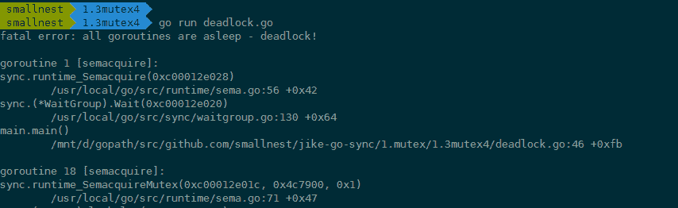

Go 运行时，有死锁探测的功能，能够检查出是否出现了死锁的情况，如果出现了，这个时候你就需要调整策略来处理了。

你可以引入一个第三方的锁，大家都依赖这个锁进行业务处理，比如现在政府推行的一站式政务服务中心。或者是解决持有等待问题，物业不需要看到派出所的证明才给开物业证明，等等。

好了，到这里，我给你讲了使用 Mutex 常见的 4 类问题。你是不是觉得，哎呀，这几类问题也太不应该了吧，真的会有人犯这么基础的错误吗？

还真是有。虽然 Mutex 使用起来很简单，但是，仍然可能出现使用错误的问题。而且，就连一些经验丰富的开发人员，也会出现一些 Mutex 使用的问题。接下来，我就带你围观几个非常流行的 Go 开发项目，看看这些错误是怎么产生和修复的。

# 流行的 Go 开发项目踩坑记

## Docker

Docker 容器是一个开源的应用容器引擎，开发者可以以统一的方式，把他们的应用和依赖包打包到一个可移植的容器中，然后发布到任何安装了 docker 引擎的服务器上。

Docker 是使用 Go 开发的，也算是 Go 的一个杀手级产品了，它的 Mutex 相关的 Bug 也不少，我们来看几个典型的 Bug。

### issue 36114

Docker 的issue 36114 是一个死锁问题。

原因在于，hotAddVHDsAtStart 方法执行的时候，执行了加锁 svm 操作。但是，在其中调用 hotRemoveVHDsAtStart 方法时，这个 hotRemoveVHDsAtStart 方法也是要加锁 svm 的。很不幸，Go 标准库中的 Mutex 是不可重入的，所以，代码执行到这里，就出现了死锁的现象。

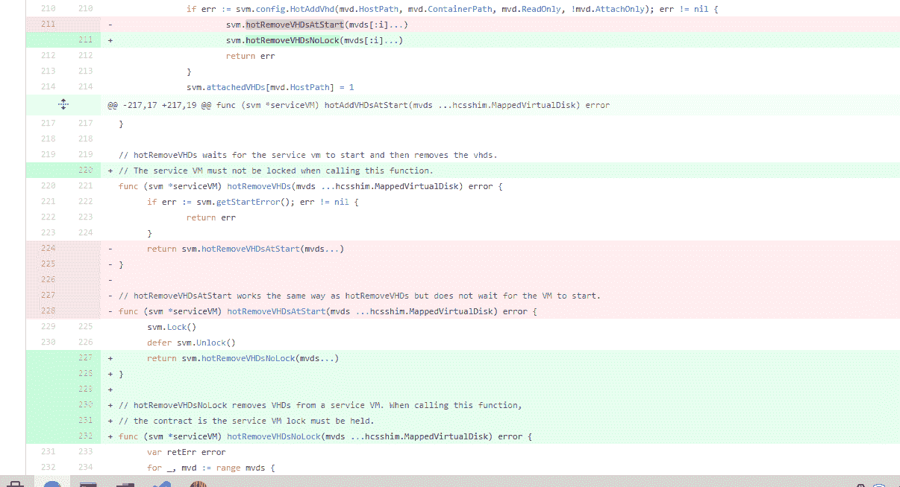

针对这个问题，解决办法就是，再提供一个不需要锁的 hotRemoveVHDsNoLock 方法，避免 Mutex 的重入。

### issue 34881

issue 34881本来是修复 Docker 的一个简单问题，如果节点在初始化的时候，发现自己不是一个 swarm mananger，就快速返回，这个修复就几行代码，你看出问题来了吗？

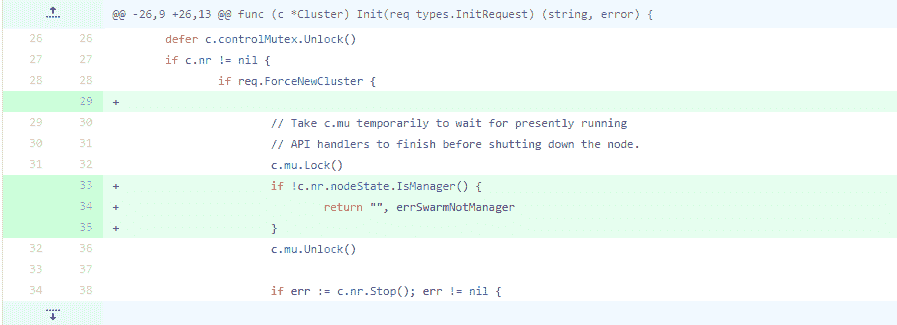

在第 34 行，节点发现不满足条件就返回了，但是，c.mu 这个锁没有释放！为什么会出现这个问题呢？其实，这是在重构或者添加新功能的时候经常犯的一个错误，因为不太了解上下文，或者是没有仔细看函数的逻辑，从而导致锁没有被释放。现在的 Docker 当然已经没有这个问题了。

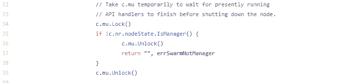

这样的 issue 还有很多，我就不一一列举了。我给你推荐几个关于 Mutex 的 issue 或者 pull request，你可以关注一下，分别是 36840、37583、35517、35482、33305、32826、30696、29554、29191、28912、26507 等。

## Kubernetes

### issue 72361

issue 72361 增加 Mutex 为了保护资源。这是为了解决 data race 问题而做的一个修复，修复方法也很简单，使用互斥锁即可，这也是我们解决 data race 时常用的方法。

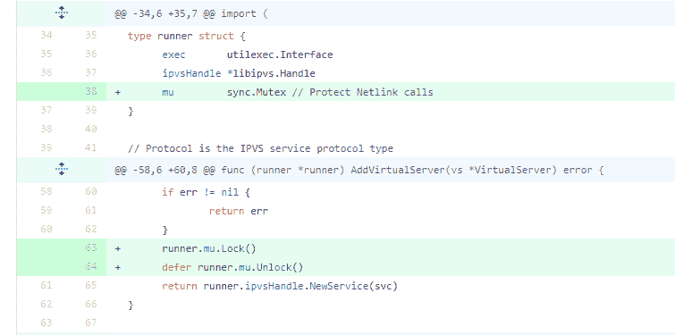

### issue 45192

issue 45192也是一个返回时忘记 Unlock 的典型例子，和 docker issue 34881 犯的错误都是一样的。

两大知名项目的开发者都犯了这个错误，所以，你就可以知道，引入这个 Bug 是多么容易，记住晁老师这句话：**保证 Lock/Unlock 成对出现，尽可能采用 defer mutex.Unlock 的方式，把它们成对、紧凑地写在一起**。

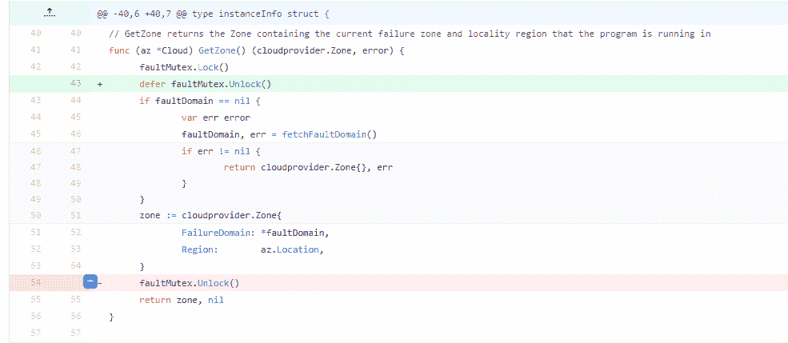

除了这些，我也建议你关注一下其它的 Mutex 相关的 issue，比如 71617、70605 等。

## gRPC

gRPC 是 Google 发起的一个开源远程过程调用 （Remote procedure call）系统。该系统基于 HTTP/2 协议传输，使用 Protocol Buffers 作为接口描述语言。它提供 Go 语言的实现。

即使是 Google 官方出品的系统，也有一些 Mutex 的 issue。

### issue 795

issue 795是一个你可能想不到的 bug，那就是将 Unlock 误写成了 Lock。

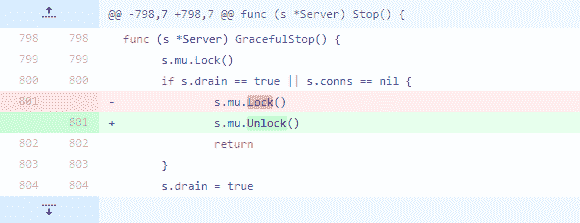

关于这个项目，还有一些其他的为了保护共享资源而添加 Mutex 的 issue，比如 1318、2074、2542 等。

## etcd

etcd 是一个非常知名的分布式一致性的 key-value 存储技术， 被用来做配置共享和服务发现。

## issue 10419

issue 10419是一个锁重入导致的问题。 Store 方法内对请求了锁，而调用的 Compact 的方法内又请求了锁，这个时候，会导致死锁，一直等待，解决办法就是提供不需要加锁的 Compact 方法。

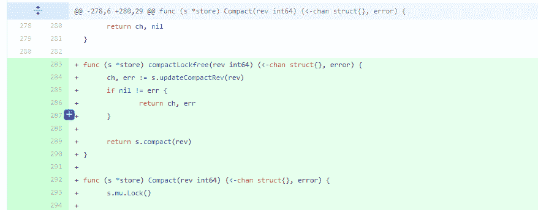

# 总结

这节课，我们学习了 Mutex 的一些易错场景，而且，我们还分析了流行的 Go 开源项目的错误，我也给你分享了我自己在开发中的经验总结。需要强调的是，**手误和重入导致的死锁，是最常见的使用 Mutex 的 Bug**。

Go 死锁探测工具只能探测整个程序是否因为死锁而冻结了，不能检测出一组 goroutine 死锁导致的某一块业务冻结的情况。你还可以通过 Go 运行时自带的死锁检测工具，或者是第三方的工具（比如go-deadlock、go-tools）进行检查，这样可以尽早发现一些死锁的问题。不过，有些时候，死锁在某些特定情况下才会被触发，所以，如果你的测试或者短时间的运行没问题，不代表程序一定不会有死锁问题。

并发程序最难跟踪调试的就是很难重现，因为并发问题不是按照我们指定的顺序执行的，由于计算机调度的问题和事件触发的时机不同，死锁的 Bug 可能会在极端的情况下出现。通过搜索日志、查看日志，我们能够知道程序有异常了，比如某个流程一直没有结束。这个时候，可以通过 Go pprof 工具分析，它提供了一个 block profiler 监控阻塞的 goroutine。除此之外，我们还可以查看全部的 goroutine 的堆栈信息，通过它，你可以查看阻塞的 groutine 究竟阻塞在哪一行哪一个对象上了。

# 思考题

查找知名的数据库系统 TiDB 的 issue，看看有没有 Mutex 相关的 issue，看看它们都是哪些相关的 Bug。

欢迎在留言区写下你的思考和答案，我们一起交流讨论。如果你觉得有所收获，也欢迎你把今天的内容分享给你的朋友或同事。
