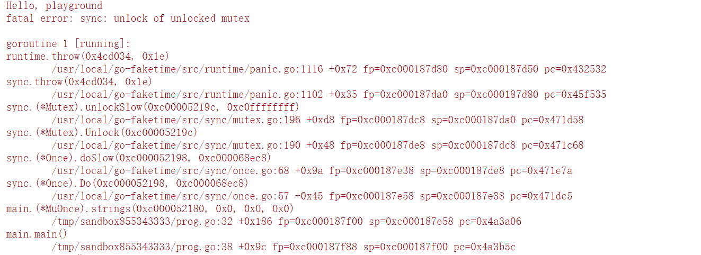
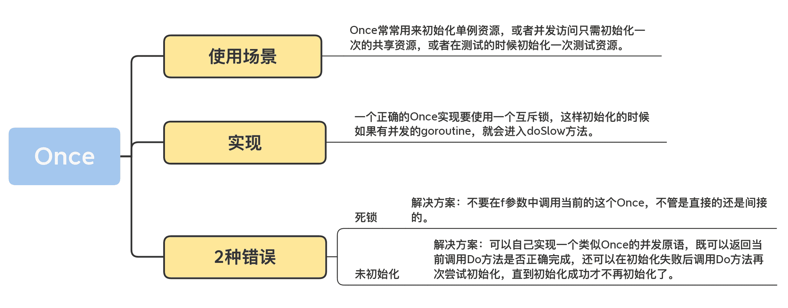

# 08 | Once：一个简约而不简单的并发原语

 

你好，我是鸟窝。

这一讲我来讲一个简单的并发原语：Once。为什么要学习 Once 呢？我先给你答案：**Once 可以用来执行且仅仅执行一次动作，常常用于单例对象的初始化场景。**

那这节课，我们就从对单例对象进行初始化这件事儿说起。

初始化单例资源有很多方法，比如定义 package 级别的变量，这样程序在启动的时候就可以初始化：

```
package abc  
  
import time  
  
var startTime = time.Now()
```

或者在 init 函数中进行初始化：

```
package abc  
  
var startTime time.Time  
  
func init() {  
  startTime = time.Now()  
}  

```

又或者在 main 函数开始执行的时候，执行一个初始化的函数：

```
package abc  
  
var startTime time.Tim  
  
func initApp() {  
    startTime = time.Now()  
}  
func main() {  
  initApp()  
}
```

这三种方法都是线程安全的，并且后两种方法还可以根据传入的参数实现定制化的初始化操作。

但是很多时候我们是要延迟进行初始化的，所以有时候单例资源的初始化，我们会使用下面的方法：

```
package main  
  
import (  
    "net"  
    "sync"  
    "time"  
)  
  
// 使用互斥锁保证线程(goroutine)安全  
var connMu sync.Mutex  
var conn net.Conn  
  
func getConn() net.Conn {  
    connMu.Lock()  
    defer connMu.Unlock()  
  
    // 返回已创建好的连接  
    if conn != nil {  
        return conn  
    }  
  
    // 创建连接  
    conn, _ = net.DialTimeout("tcp", "baidu.com:80", 10*time.Second)  
    return conn  
}  
  
// 使用连接  
func main() {  
    conn := getConn()  
    if conn == nil {  
        panic("conn is nil")  
    }  
}
```

这种方式虽然实现起来简单，但是有性能问题。一旦连接创建好，每次请求的时候还是得竞争锁才能读取到这个连接，这是比较浪费资源的，因为连接如果创建好之后，其实就不需要锁的保护了。怎么办呢？

这个时候就可以使用这一讲要介绍的 Once 并发原语了。接下来我会详细介绍 Once 的使用、实现和易错场景。

# Once 的使用场景

**sync.Once 只暴露了一个方法 Do，你可以多次调用 Do 方法，但是只有第一次调用 Do 方法时 f 参数才会执行，这里的 f 是一个无参数无返回值的函数。**

```
func (o *Once) Do(f func())
```

因为当且仅当第一次调用 Do 方法的时候参数 f 才会执行，即使第二次、第三次、第 n 次调用时 f 参数的值不一样，也不会被执行，比如下面的例子，虽然 f1 和 f2 是不同的函数，但是第二个函数 f2 就不会执行。

```
package main  
  
  
import (  
    "fmt"  
    "sync"  
)  
  
func main() {  
    var once sync.Once  
  
    // 第一个初始化函数  
    f1 := func() {  
        fmt.Println("in f1")  
    }  
    once.Do(f1) // 打印出 in f1  
  
    // 第二个初始化函数  
    f2 := func() {  
        fmt.Println("in f2")  
    }  
    once.Do(f2) // 无输出  
}
```

因为这里的 f 参数是一个无参数无返回的函数，所以你可能会通过闭包的方式引用外面的参数，比如：

```
    var addr = "baidu.com"  
  
    var conn net.Conn  
    var err error  
  
    once.Do(func() {  
        conn, err = net.Dial("tcp", addr)  
    })
```

而且在实际的使用中，绝大多数情况下，你会使用闭包的方式去初始化外部的一个资源。

你看，Once 的使用场景很明确，所以，在标准库内部实现中也常常能看到 Once 的身影。

比如标准库内部cache的实现上，就使用了 Once 初始化 Cache 资源，包括 defaultDir 值的获取：

```
    func Default() *Cache { // 获取默认的Cache  
    defaultOnce.Do(initDefaultCache) // 初始化cache  
    return defaultCache  
  }  
    
    // 定义一个全局的cache变量，使用Once初始化，所以也定义了一个Once变量  
  var (  
    defaultOnce  sync.Once  
    defaultCache *Cache  
  )  
  
    func initDefaultCache() { //初始化cache,也就是Once.Do使用的f函数  
    ......  
    defaultCache = c  
  }  
  
    // 其它一些Once初始化的变量，比如defaultDir  
    var (  
    defaultDirOnce sync.Once  
    defaultDir     string  
    defaultDirErr  error  
  )  
  

```

还有一些测试的时候初始化测试的资源（export_windows_test）：

```
    // 测试window系统调用时区相关函数  
    func ForceAusFromTZIForTesting() {  
    ResetLocalOnceForTest()  
        // 使用Once执行一次初始化  
    localOnce.Do(func() { initLocalFromTZI(&aus) })  
  }
```

除此之外，还有保证只调用一次 copyenv 的 envOnce，strings 包下的 Replacer，time 包中的测试，Go 拉取库时的proxy，net.pipe，crc64，Regexp，…，数不胜数。我给你重点介绍一下很值得我们学习的 math/big/sqrt.go 中实现的一个数据结构，它通过 Once 封装了一个只初始化一次的值：

```
   // 值是3.0或者0.0的一个数据结构  
   var threeOnce struct {  
    sync.Once  
    v *Float  
  }  
    
    // 返回此数据结构的值，如果还没有初始化为3.0，则初始化  
  func three() *Float {  
    threeOnce.Do(func() { // 使用Once初始化  
      threeOnce.v = NewFloat(3.0)  
    })  
    return threeOnce.v  
  }
```

它将 sync.Once 和 *Float 封装成一个对象，提供了只初始化一次的值 v。 你看它的 three 方法的实现，虽然每次都调用 threeOnce.Do 方法，但是参数只会被调用一次。

当你使用 Once 的时候，你也可以尝试采用这种结构，将值和 Once 封装成一个新的数据结构，提供只初始化一次的值。

总结一下 Once 并发原语解决的问题和使用场景：**Once 常常用来初始化单例资源，或者并发访问只需初始化一次的共享资源，或者在测试的时候初始化一次测试资源**。

了解了 Once 的使用场景，那应该怎样实现一个 Once 呢？

# 如何实现一个 Once？

很多人认为实现一个 Once 一样的并发原语很简单，只需使用一个 flag 标记是否初始化过即可，最多是用 atomic 原子操作这个 flag，比如下面的实现：

```
type Once struct {  
    done uint32  
}  
  
func (o *Once) Do(f func()) {  
    if !atomic.CompareAndSwapUint32(&o.done, 0, 1) {  
        return  
    }  
    f()  
}
```

这确实是一种实现方式，但是，这个实现有一个很大的问题，就是如果参数 f 执行很慢的话，后续调用 Do 方法的 goroutine 虽然看到 done 已经设置为执行过了，但是获取某些初始化资源的时候可能会得到空的资源，因为 f 还没有执行完。

所以，**一个正确的 Once 实现要使用一个互斥锁，****这样初始化的时候如果有并发的 goroutine，就会进入****doSlow 方法**。互斥锁的机制保证只有一个 goroutine 进行初始化，同时利用**双检查的机制**（double-checking），再次判断 o.done 是否为 0，如果为 0，则是第一次执行，执行完毕后，就将 o.done 设置为 1，然后释放锁。

即使此时有多个 goroutine 同时进入了 doSlow 方法，因为双检查的机制，后续的 goroutine 会看到 o.done 的值为 1，也不会再次执行 f。

这样既保证了并发的 goroutine 会等待 f 完成，而且还不会多次执行 f。

```
type Once struct {  
    done uint32  
    m    Mutex  
}  
  
func (o *Once) Do(f func()) {  
    if atomic.LoadUint32(&o.done) == 0 {  
        o.doSlow(f)  
    }  
}  
  
  
func (o *Once) doSlow(f func()) {  
    o.m.Lock()  
    defer o.m.Unlock()  
    // 双检查  
    if o.done == 0 {  
        defer atomic.StoreUint32(&o.done, 1)  
        f()  
    }  
}
```

好了，到这里我们就了解了 Once 的使用场景，很明确，同时呢，也感受到 Once 的实现也是相对简单的。在实践中，其实很少会出现错误使用 Once 的情况，但是就像墨菲定律说的，凡是可能出错的事就一定会出错。使用 Once 也有可能出现两种错误场景，尽管非常罕见。我这里提前讲给你，咱打个预防针。

# 使用 Once 可能出现的 2 种错误

## 第一种错误：死锁

你已经知道了 Do 方法会执行一次 f，但是如果 f 中再次调用这个 Once 的 Do 方法的话，就会导致死锁的情况出现。这还不是无限递归的情况，而是的的确确的 Lock 的递归调用导致的死锁。

```
func main() {  
    var once sync.Once  
    once.Do(func() {  
        once.Do(func() {  
            fmt.Println("初始化")  
        })  
    })  
}
```

当然，想要避免这种情况的出现，就不要在 f 参数中调用当前的这个 Once，不管是直接的还是间接的。

## 第二种错误：未初始化

如果 f 方法执行的时候 panic，或者 f 执行初始化资源的时候失败了，这个时候，Once 还是会认为初次执行已经成功了，即使再次调用 Do 方法，也不会再次执行 f。

比如下面的例子，由于一些防火墙的原因，googleConn 并没有被正确的初始化，后面如果想当然认为既然执行了 Do 方法 googleConn 就已经初始化的话，会抛出空指针的错误：

```
func main() {  
    var once sync.Once  
    var googleConn net.Conn // 到Google网站的一个连接  
  
    once.Do(func() {  
        // 建立到google.com的连接，有可能因为网络的原因，googleConn并没有建立成功，此时它的值为nil  
        googleConn, _ = net.Dial("tcp", "google.com:80")  
    })  
    // 发送http请求  
    googleConn.Write([]byte("GET / HTTP/1.1\r\nHost: google.com\r\n Accept: */*\r\n\r\n"))  
    io.Copy(os.Stdout, googleConn)  
}
```

既然执行过 Once.Do 方法也可能因为函数执行失败的原因未初始化资源，并且以后也没机会再次初始化资源，那么这种初始化未完成的问题该怎么解决呢？

这里我来告诉你一招独家秘笈，我们可以**自己实现一个类似 Once 的并发原语**，既可以返回当前调用 Do 方法是否正确完成，还可以在初始化失败后调用 Do 方法再次尝试初始化，直到初始化成功才不再初始化了。

```
// 一个功能更加强大的Once  
type Once struct {  
    m    sync.Mutex  
    done uint32  
}  
// 传入的函数f有返回值error，如果初始化失败，需要返回失败的error  
// Do方法会把这个error返回给调用者  
func (o *Once) Do(f func() error) error {  
    if atomic.LoadUint32(&o.done) == 1 { //fast path  
        return nil  
    }  
    return o.slowDo(f)  
}  
// 如果还没有初始化  
func (o *Once) slowDo(f func() error) error {  
    o.m.Lock()  
    defer o.m.Unlock()  
    var err error  
    if o.done == 0 { // 双检查，还没有初始化  
        err = f()  
        if err == nil { // 初始化成功才将标记置为已初始化  
            atomic.StoreUint32(&o.done, 1)  
        }  
    }  
    return err  
}
```

我们所做的改变就是 Do 方法和参数 f 函数都会返回 error，如果 f 执行失败，会把这个错误信息返回。

对 slowDo 方法也做了调整，如果 f 调用失败，我们不会更改 done 字段的值，这样后续 degoroutine 还会继续调用 f。如果 f 执行成功，才会修改 done 的值为 1。

可以说，真是一顿操作猛如虎，我们使用 Once 有点得心应手的感觉了。等等，还有个问题，我们怎么查询是否初始化过呢？

目前的 Once 实现可以保证你调用任意次数的 once.Do 方法，它只会执行这个方法一次。但是，有时候我们需要打一个标记。如果初始化后我们就去执行其它的操作，标准库的 Once 并不会告诉你是否初始化完成了，只是让你放心大胆地去执行 Do 方法，所以，**你还需要一个辅助变量，自己去检查是否初始化过了**，比如通过下面的代码中的 inited 字段：

```
type AnimalStore struct {once   sync.Once;inited uint32}  
func (a *AnimalStore) Init() // 可以被并发调用  
  a.once.Do(func() {  
    longOperationSetupDbOpenFilesQueuesEtc()  
    atomic.StoreUint32(&a.inited, 1)  
  })  
}  
func (a *AnimalStore) CountOfCats() (int, error) { // 另外一个goroutine  
  if atomic.LoadUint32(&a.inited) == 0 { // 初始化后才会执行真正的业务逻辑  
    return 0, NotYetInitedError  
  }  
        //Real operation  
}
```

当然，通过这段代码，我们可以解决这类问题，但是，如果官方的 Once 类型有 Done 这样一个方法的话，我们就可以直接使用了。这是有人在 Go 代码库中提出的一个 issue(#41690)。对于这类问题，一般都会被建议采用其它类型，或者自己去扩展。我们可以尝试扩展这个并发原语：

```
// Once 是一个扩展的sync.Once类型，提供了一个Done方法  
type Once struct {  
    sync.Once  
}  
  
// Done 返回此Once是否执行过  
// 如果执行过则返回true  
// 如果没有执行过或者正在执行，返回false  
func (o *Once) Done() bool {  
    return atomic.LoadUint32((*uint32)(unsafe.Pointer(&o.Once))) == 1  
}  
  
func main() {  
    var flag Once  
    fmt.Println(flag.Done()) //false  
  
    flag.Do(func() {  
        time.Sleep(time.Second)  
    })  
  
    fmt.Println(flag.Done()) //true  
}
```

好了，到这里关于并发原语 Once 的内容我讲得就差不多了。最后呢，和你分享一个 Once 的踩坑案例。

其实啊，使用 Once 真的不容易犯错，想犯错都很困难，因为很少有人会傻傻地在初始化函数 f 中递归调用 f，这种死锁的现象几乎不会发生。另外如果函数初始化不成功，我们一般会 panic，或者在使用的时候做检查，会及早发现这个问题，在初始化函数中加强代码。

所以查看大部分的 Go 项目，几乎找不到 Once 的错误使用场景，不过我还是发现了一个。这个 issue 先从另外一个需求 (go#25955) 谈起。

# Once 的踩坑案例

go#25955 有网友提出一个需求，希望 Once 提供一个 Reset 方法，能够将 Once 重置为初始化的状态。比如下面的例子，St 通过两个 Once 控制它的 Open/Close 状态。但是在 Close 之后再调用 Open 的话，不会再执行 init 函数，因为 Once 只会执行一次初始化函数。

```
type St struct {  
    openOnce *sync.Once  
    closeOnce *sync.Once  
}  
  
func(st *St) Open(){  
    st.openOnce.Do(func() { ... }) // init  
    ...  
}  
  
func(st *St) Close(){  
    st.closeOnce.Do(func() { ... }) // deinit  
    ...  
}
```

所以提交这个 Issue 的开发者希望 Once 增加一个 Reset 方法，Reset 之后再调用 once.Do 就又可以初始化了。

Go 的核心开发者 Ian Lance Taylor 给他了一个简单的解决方案。在这个例子中，只使用一个 ponce *sync.Once 做初始化，Reset 的时候给 ponce 这个变量赋值一个新的 Once 实例即可 (ponce = new(sync.Once))。Once 的本意就是执行一次，所以 Reset 破坏了这个并发原语的本意。

这个解决方案一点都没问题，可以很好地解决这位开发者的需求。Docker 较早的版本（1.11.2）中使用了它们的一个网络库 libnetwork，这个网络库在使用 Once 的时候就使用 Ian Lance Taylor 介绍的方法，但是不幸的是，它的 Reset 方法中又改变了 Once 指针的值，导致程序 panic 了。原始逻辑比较复杂，一个简化版可重现的代码如下：

```
package main  
  
import (  
  "fmt"  
  "sync"  
  "time"  
)  
  
// 一个组合的并发原语  
type MuOnce struct {  
  sync.RWMutex  
  sync.Once  
  mtime time.Time  
  vals  []string  
}  
  
// 相当于reset方法，会将m.Once重新复制一个Once  
func (m *MuOnce) refresh() {  
  m.Lock()  
  defer m.Unlock()  
  m.Once = sync.Once{}  
  m.mtime = time.Now()  
  m.vals = []string{m.mtime.String()}  
}  
  
// 获取某个初始化的值，如果超过某个时间，会reset Once  
func (m *MuOnce) strings() []string {  
  now := time.Now()  
  m.RLock()  
  if now.After(m.mtime) {  
    defer m.Do(m.refresh) // 使用refresh函数重新初始化  
  }  
  vals := m.vals  
  m.RUnlock()  
  return vals  
}  
  
func main() {  
  fmt.Println("Hello, playground")  
  m := new(MuOnce)  
  fmt.Println(m.strings())  
  fmt.Println(m.strings())  
}
```

如果你执行这段代码就会 panic:



原因在于第 31 行执行 m.Once.Do 方法的时候，使用的是 m.Once 的指针，然后调用 m.refresh，在执行 m.refresh 的时候 Once 内部的 Mutex 首先会加锁（可以再翻看一下这一讲的 Once 的实现原理）， 但是，在 refresh 中更改了 Once 指针的值之后，结果在执行完 refresh 释放锁的时候，释放的是一个刚初始化未加锁的 Mutex，所以就 panic 了。

如果你还不太明白，我再给你简化成一个更简单的例子：

```
package main  
  
  
import (  
    "sync"  
)  
  
type Once struct {  
    m sync.Mutex  
}  
  
func (o *Once) doSlow() {  
    o.m.Lock()  
    defer o.m.Unlock()  
  
    // 这里更新的o指针的值!!!!!!!, 会导致上一行Unlock出错  
    *o = Once{}  
}  
  
func main() {  
    var once Once  
    once.doSlow()  
}
```

doSlow 方法就演示了这个错误。Ian Lance Taylor 介绍的 Reset 方法没有错误，但是你在使用的时候千万别再初始化函数中 Reset 这个 Once，否则势必会导致 Unlock 一个未加锁的 Mutex 的错误。

总的来说，这还是对 Once 的实现机制不熟悉，又进行复杂使用导致的错误。不过最新版的 libnetwork 相关的地方已经去掉了 Once 的使用了。所以，我带你一起来看这个案例，主要目的还是想巩固一下我们对 Once 的理解。

# 总结

今天我们一起学习了 Once，我们常常使用它来实现单例模式。

单例是 23 种设计模式之一，也是常常引起争议的设计模式之一，甚至有人把它归为反模式。为什么说它是反模式呢，我拿标准库中的单例模式给你介绍下。

因为 Go 没有 immutable 类型，导致我们声明的全局变量都是可变的，别的地方或者第三方库可以随意更改这些变量。比如 package io 中定义了几个全局变量，比如 io.EOF：

```
var EOF = errors.New("EOF")
```

因为它是一个 package 级别的变量，我们可以在程序中偷偷把它改了，这会导致一些依赖 io.EOF 这个变量做判断的代码出错。

```
io.EOF = errors.New("我们自己定义的EOF")
```

从我个人的角度来说，一些单例（全局变量）的确很方便，比如 Buffer 池或者连接池，所以有时候我们也不要谈虎色变。虽然有人把单例模式称之为反模式，但毕竟只能代表一部分开发者的观点，否则也不会把它列在 23 种设计模式中了。

如果你真的担心这个 package 级别的变量被人修改，你可以不把它们暴露出来，而是提供一个只读的 GetXXX 的方法，这样别人就不会进行修改了。

而且，Once 不只应用于单例模式，一些变量在也需要在使用的时候做延迟初始化，所以也是可以使用 Once 处理这些场景的。

总而言之，Once 的应用场景还是很广泛的。**一旦你遇到只需要初始化一次的场景，首先想到的就应该是 Once 并发原语。**



# 思考题

1. 我已经分析了几个并发原语的实现，你可能注意到总是有些 slowXXXX 的方法，从 XXXX 方法中单独抽取出来，你明白为什么要这么做吗，有什么好处？
2. Once 在第一次使用之后，还能复制给其它变量使用吗？

欢迎在留言区写下你的思考和答案，我们一起交流讨论。如果你觉得有所收获，也欢迎你把今天的内容分享给你的朋友或同事。
