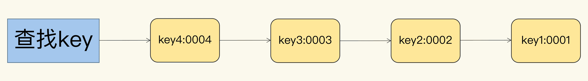
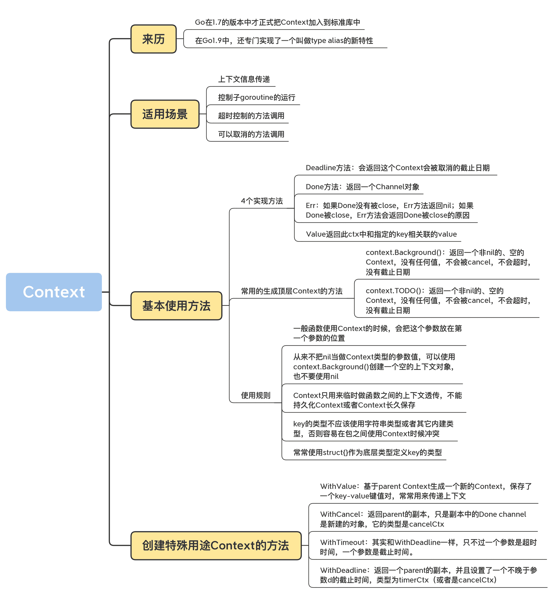

# 11 | Context：信息穿透上下文

 

你好，我是鸟窝。

在这节课正式开始之前，我想先带你看一个工作中的场景。

假设有一天你进入办公室，突然同事们都围住你，然后大喊“小王小王你最帅”，此时你可能一头雾水，只能尴尬地笑笑。为啥呢？因为你缺少上下文的信息，不知道之前发生了什么。

但是，如果同事告诉你，由于你业绩突出，一天之内就把云服务化的主要架构写好了，因此被评为 9 月份的工作之星，总经理还特意给你发 1 万元的奖金，那么，你心里就很清楚了，原来同事恭喜你，是因为你的工作被表扬了，还获得了奖金。同事告诉你的这些前因后果，就是上下文信息，他把上下文传递给你，你接收后，就可以获取之前不了解的信息。

你看，上下文（Context）就是这么重要。在我们的开发场景中，上下文也是不可或缺的，缺少了它，我们就不能获取完整的程序信息。那到底啥是上下文呢？其实，这就是指，在 API 之间或者方法调用之间，所传递的除了业务参数之外的额外信息。

比如，服务端接收到客户端的 HTTP 请求之后，可以把客户端的 IP 地址和端口、客户端的身份信息、请求接收的时间、Trace ID 等信息放入到上下文中，这个上下文可以在后端的方法调用中传递，后端的业务方法除了利用正常的参数做一些业务处理（如订单处理）之外，还可以从上下文读取到消息请求的时间、Trace ID 等信息，把服务处理的时间推送到 Trace 服务中。Trace 服务可以把同一 Trace ID 的不同方法的调用顺序和调用时间展示成流程图，方便跟踪。

不过，Go 标准库中的 Context 功能还不止于此，它还提供了超时（Timeout）和取消（Cancel）的机制，下面就让我一一道来。

# Context 的来历

在学习 Context 的功能之前呢，我先带你了解下它的来历。毕竟，知道了它的来龙去脉，我们才能应用得更加得心应手一些。

Go 在 1.7 的版本中才正式把 Context 加入到标准库中。在这之前，很多 Web 框架在定义自己的 handler 时，都会传递一个自定义的 Context，把客户端的信息和客户端的请求信息放入到 Context 中。Go 最初提供了 golang.org/x/net/context 库用来提供上下文信息，最终还是在 Go1.7 中把此库提升到标准库 context 包中。

为啥呢？这是因为，在 Go1.7 之前，有很多库都依赖 golang.org/x/net/context 中的 Context 实现，这就导致 Go 1.7 发布之后，出现了标准库 Context 和 golang.org/x/net/context 并存的状况。新的代码使用标准库 Context 的时候，没有办法使用这个标准库的 Context 去调用旧有的使用 x/net/context 实现的方法。

所以，在 Go1.9 中，还专门实现了一个叫做 type alias 的新特性，然后把 x/net/context 中的 Context 定义成标准库 Context 的别名，以解决新旧 Context 类型冲突问题，你可以看一下下面这段代码：

```
    // +build go1.9  
  package context  
    
  import "context"  
    
  type Context = context.Context  
  type CancelFunc = context.CancelFunc
```

Go 标准库的 Context 不仅提供了上下文传递的信息，还提供了 cancel、timeout 等其它信息，这些信息貌似和 context 这个包名没关系，但是还是得到了广泛的应用。所以，你看，context 包中的 Context 不仅仅传递上下文信息，还有 timeout 等其它功能，是不是“名不副实”呢？

其实啊，这也是这个 Context 的一个问题，比较容易误导人，Go 布道师 Dave Cheney 还专门写了一篇文章讲述这个问题：Context isn’t for cancellation。

同时，也有一些批评者针对 Context 提出了批评：Context should go away for Go 2，这篇文章把 Context 比作病毒，病毒会传染，结果把所有的方法都传染上了病毒（加上 Context 参数），绝对是视觉污染。

Go 的开发者也注意到了“关于 Context，存在一些争议”这件事儿，所以，Go 核心开发者 Ian Lance Taylor 专门开了一个issue 28342，用来记录当前的 Context 的问题：

1. Context 包名导致使用的时候重复 ctx context.Context；
2. Context.WithValue 可以接受任何类型的值，非类型安全；
3. Context 包名容易误导人，实际上，Context 最主要的功能是取消 goroutine 的执行；
4. Context 漫天飞，函数污染。

尽管有很多的争议，但是，在很多场景下，使用 Context 其实会很方便，所以现在它已经在 Go 生态圈中传播开来了，包括很多的 Web 应用框架，都切换成了标准库的 Context。标准库中的 database/sql、os/exec、net、net/http 等包中都使用到了 Context。而且，如果我们遇到了下面的一些场景，也可以考虑使用 Context：

1. 上下文信息传递 （request-scoped），比如处理 http 请求、在请求处理链路上传递信息；
2. 控制子 goroutine 的运行；
3. 超时控制的方法调用；
4. 可以取消的方法调用。

所以，我们需要掌握 Context 的具体用法，这样才能在不影响主要业务流程实现的时候，实现一些通用的信息传递，或者是能够和其它 goroutine 协同工作，提供 timeout、cancel 等机制。

# Context 基本使用方法

首先，我们来学习一下 Context 接口包含哪些方法，这些方法都是干什么用的。

包 context 定义了 Context 接口，Context 的具体实现包括 4 个方法，分别是 Deadline、Done、Err 和 Value，如下所示：

```
type Context interface {  
    Deadline() (deadline time.Time, ok bool)  
    Done() <-chan struct{}  
    Err() error  
    Value(key interface{}) interface{}  
}
```

下面我来具体解释下这 4 个方法。

**Deadline** 方法会返回这个 Context 被取消的截止日期。如果没有设置截止日期，ok 的值是 false。后续每次调用这个对象的 Deadline 方法时，都会返回和第一次调用相同的结果。

**Done** 方法返回一个 Channel 对象。在 Context 被取消时，此 Channel 会被 close，如果没被取消，可能会返回 nil。后续的 Done 调用总是返回相同的结果。当 Done 被 close 的时候，你可以通过 ctx.Err 获取错误信息。Done 这个方法名其实起得并不好，因为名字太过笼统，不能明确反映 Done 被 close 的原因，因为 cancel、timeout、deadline 都可能导致 Done 被 close，不过，目前还没有一个更合适的方法名称。

关于 Done 方法，你必须要记住的知识点就是：如果 Done 没有被 close，Err 方法返回 nil；如果 Done 被 close，Err 方法会返回 Done 被 close 的原因。

**Value** 返回此 ctx 中和指定的 key 相关联的 value。

Context 中实现了 2 个常用的生成顶层 Context 的方法。

1. context.Background()：返回一个非 nil 的、空的 Context，没有任何值，不会被 cancel，不会超时，没有截止日期。一般用在主函数、初始化、测试以及创建根 Context 的时候。
2. context.TODO()：返回一个非 nil 的、空的 Context，没有任何值，不会被 cancel，不会超时，没有截止日期。当你不清楚是否该用 Context，或者目前还不知道要传递一些什么上下文信息的时候，就可以使用这个方法。

官方文档是这么讲的，你可能会觉得像没说一样，因为界限并不是很明显。其实，你根本不用费脑子去考虑，可以直接使用 context.Background。事实上，它们两个底层的实现是一模一样的：

```
var (  
    background = new(emptyCtx)  
    todo       = new(emptyCtx)  
)  
  
func Background() Context {  
    return background  
}  
  
func TODO() Context {  
    return todo  
}
```

在使用 Context 的时候，有一些约定俗成的规则。

1. 一般函数使用 Context 的时候，会把这个参数放在第一个参数的位置。
2. 从来不把 nil 当做 Context 类型的参数值，可以使用 context.Background() 创建一个空的上下文对象，也不要使用 nil。
3. Context 只用来临时做函数之间的上下文透传，不能持久化 Context 或者把 Context 长久保存。把 Context 持久化到数据库、本地文件或者全局变量、缓存中都是错误的用法。
4. key 的类型不应该是字符串类型或者其它内建类型，否则容易在包之间使用 Context 时候产生冲突。使用 WithValue 时，key 的类型应该是自己定义的类型。
5. 常常使用 struct{}作为底层类型定义 key 的类型。对于 exported key 的静态类型，常常是接口或者指针。这样可以尽量减少内存分配。

其实官方的文档也是比较搞笑的，文档中强调 key 的类型不要使用 string，结果接下来的例子中就是用 string 类型作为 key 的类型。你自己把握住这个要点就好，如果你能保证别人使用你的 Context 时不会和你定义的 key 冲突，那么 key 的类型就比较随意，因为你自己保证了不同包的 key 不会冲突，否则建议你尽量采用保守的 unexported 的类型。

# 创建特殊用途 Context 的方法

接下来，我会介绍标准库中几种创建特殊用途 Context 的方法：WithValue、WithCancel、WithTimeout 和 WithDeadline，包括它们的功能以及实现方式。

## WithValue

WithValue 基于 parent Context 生成一个新的 Context，保存了一个 key-value 键值对。它常常用来传递上下文。

WithValue 方法其实是创建了一个类型为 valueCtx 的 Context，它的类型定义如下：

```
type valueCtx struct {  
    Context  
    key, val interface{}  
}
```

它持有一个 key-value 键值对，还持有 parent 的 Context。它覆盖了 Value 方法，优先从自己的存储中检查这个 key，不存在的话会从 parent 中继续检查。

Go 标准库实现的 Context 还实现了链式查找。如果不存在，还会向 parent Context 去查找，如果 parent 还是 valueCtx 的话，还是遵循相同的原则：valueCtx 会嵌入 parent，所以还是会查找 parent 的 Value 方法的。

```
ctx = context.TODO()  
ctx = context.WithValue(ctx, "key1", "0001")  
ctx = context.WithValue(ctx, "key2", "0001")  
ctx = context.WithValue(ctx, "key3", "0001")  
ctx = context.WithValue(ctx, "key4", "0004")  
  
fmt.Println(ctx.Value("key1"))
```



## WithCancel

WithCancel 方法返回 parent 的副本，只是副本中的 Done Channel 是新建的对象，它的类型是 cancelCtx。

我们常常在一些需要主动取消长时间的任务时，创建这种类型的 Context，然后把这个 Context 传给长时间执行任务的 goroutine。当需要中止任务时，我们就可以 cancel 这个 Context，这样长时间执行任务的 goroutine，就可以通过检查这个 Context，知道 Context 已经被取消了。

WithCancel 返回值中的第二个值是一个 cancel 函数。其实，这个返回值的名称（cancel）和类型（Cancel）也非常迷惑人。

记住，不是只有你想中途放弃，才去调用 cancel，只要你的任务正常完成了，就需要调用 cancel，这样，这个 Context 才能释放它的资源（通知它的 children 处理 cancel，从它的 parent 中把自己移除，甚至释放相关的 goroutine）。很多同学在使用这个方法的时候，都会忘记调用 cancel，切记切记，而且一定尽早释放。

我们来看下 WithCancel 方法的实现代码：

```
func WithCancel(parent Context) (ctx Context, cancel CancelFunc) {  
    c := newCancelCtx(parent)  
    propagateCancel(parent, &c)// 把c朝上传播  
    return &c, func() { c.cancel(true, Canceled) }  
}  
  
// newCancelCtx returns an initialized cancelCtx.  
func newCancelCtx(parent Context) cancelCtx {  
    return cancelCtx{Context: parent}  
}
```

代码中调用的 propagateCancel 方法会顺着 parent 路径往上找，直到找到一个 cancelCtx，或者为 nil。如果不为空，就把自己加入到这个 cancelCtx 的 child，以便这个 cancelCtx 被取消的时候通知自己。如果为空，会新起一个 goroutine，由它来监听 parent 的 Done 是否已关闭。

当这个 cancelCtx 的 cancel 函数被调用的时候，或者 parent 的 Done 被 close 的时候，这个 cancelCtx 的 Done 才会被 close。

cancel 是向下传递的，如果一个 WithCancel 生成的 Context 被 cancel 时，如果它的子 Context（也有可能是孙，或者更低，依赖子的类型）也是 cancelCtx 类型的，就会被 cancel，但是不会向上传递。parent Context 不会因为子 Context 被 cancel 而 cancel。

cancelCtx 被取消时，它的 Err 字段就是下面这个 Canceled 错误：

```
var Canceled = errors.New("context canceled")

## WithTimeout

WithTimeout 其实是和 WithDeadline 一样，只不过一个参数是超时时间，一个参数是截止时间。超时时间加上当前时间，其实就是截止时间，因此，WithTimeout 的实现是：
```

```
func WithTimeout(parent Context, timeout time.Duration) (Context, CancelFunc) {  
    // 当前时间+timeout就是deadline  
    return WithDeadline(parent, time.Now().Add(timeout))  
}

## WithDeadline

WithDeadline 会返回一个 parent 的副本，并且设置了一个不晚于参数 d 的截止时间，类型为 timerCtx（或者是 cancelCtx）。
```

如果它的截止时间晚于 parent 的截止时间，那么就以 parent 的截止时间为准，并返回一个类型为 cancelCtx 的 Context，因为 parent 的截止时间到了，就会取消这个 cancelCtx。

如果当前时间已经超过了截止时间，就直接返回一个已经被 cancel 的 timerCtx。否则就会启动一个定时器，到截止时间取消这个 timerCtx。

综合起来，timerCtx 的 Done 被 Close 掉，主要是由下面的某个事件触发的：

1. 截止时间到了；
2. cancel 函数被调用；
3. parent 的 Done 被 close。

下面的代码是 WithDeadline 方法的实现：

```
func WithDeadline(parent Context, d time.Time) (Context, CancelFunc) {  
    // 如果parent的截止时间更早，直接返回一个cancelCtx即可  
    if cur, ok := parent.Deadline(); ok && cur.Before(d) {  
        return WithCancel(parent)  
    }  
    c := &timerCtx{  
        cancelCtx: newCancelCtx(parent),  
        deadline:  d,  
    }  
    propagateCancel(parent, c) // 同cancelCtx的处理逻辑  
    dur := time.Until(d)  
    if dur <= 0 { //当前时间已经超过了截止时间，直接cancel  
        c.cancel(true, DeadlineExceeded)  
        return c, func() { c.cancel(false, Canceled) }  
    }  
    c.mu.Lock()  
    defer c.mu.Unlock()  
    if c.err == nil {  
        // 设置一个定时器，到截止时间后取消  
        c.timer = time.AfterFunc(dur, func() {  
            c.cancel(true, DeadlineExceeded)  
        })  
    }  
    return c, func() { c.cancel(true, Canceled) }  
}
```

和 cancelCtx 一样，WithDeadline（WithTimeout）返回的 cancel 一定要调用，并且要尽可能早地被调用，这样才能尽早释放资源，不要单纯地依赖截止时间被动取消。正确的使用姿势是啥呢？我们来看一个例子。

```
func slowOperationWithTimeout(ctx context.Context) (Result, error) {  
  ctx, cancel := context.WithTimeout(ctx, 100*time.Millisecond)  
  defer cancel() // 一旦慢操作完成就立马调用cancel  
  return slowOperation(ctx)  
}

# 总结

我们经常使用 Context 来取消一个 goroutine 的运行，这是 Context 最常用的场景之一，Context 也被称为 goroutine 生命周期范围（goroutine-scoped）的 Context，把 Context 传递给 goroutine。但是，goroutine 需要尝试检查 Context 的 Done 是否关闭了：
```

```
func main() {  
    ctx, cancel := context.WithCancel(context.Background())  
  
    go func() {  
        defer func() {  
            fmt.Println("goroutine exit")  
        }()  
  
        for {  
            select {  
            case <-ctx.Done():  
                return  
            default:  
                time.Sleep(time.Second)  
            }  
        }  
    }()  
  
    time.Sleep(time.Second)  
    cancel()  
    time.Sleep(2 * time.Second)  
}
```

如果你要为 Context 实现一个带超时功能的调用，比如访问远程的一个微服务，超时并不意味着你会通知远程微服务已经取消了这次调用，大概率的实现只是避免客户端的长时间等待，远程的服务器依然还执行着你的请求。

所以，有时候，Context 并不会减少对服务器的请求负担。如果在 Context 被 cancel 的时候，你能关闭和服务器的连接，中断和数据库服务器的通讯、停止对本地文件的读写，那么，这样的超时处理，同时能减少对服务调用的压力，但是这依赖于你对超时的底层处理机制。



# 思考题

使用 WithCancel 和 WithValue 写一个级联的使用 Context 的例子，验证一下 parent Context 被 cancel 后，子 conext 是否也立刻被 cancel 了。

欢迎在留言区写下你的思考和答案，我们一起交流讨论。如果你觉得有所收获，也欢迎你把今天的内容分享给你的朋友或同事。
