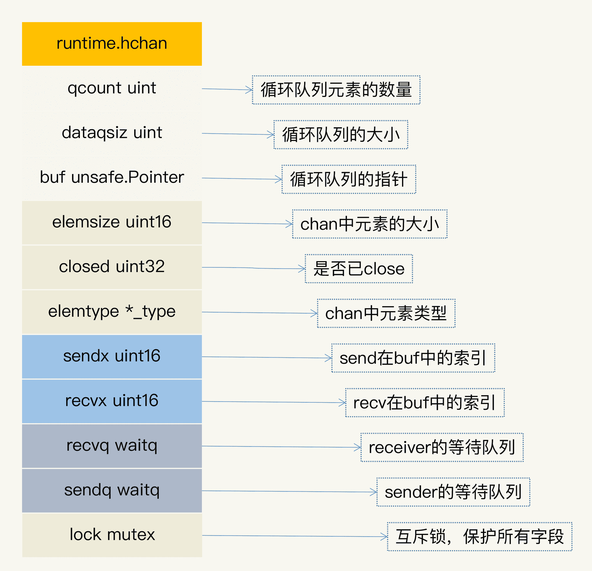
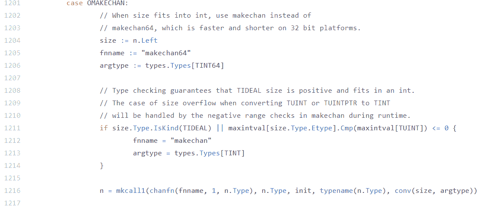
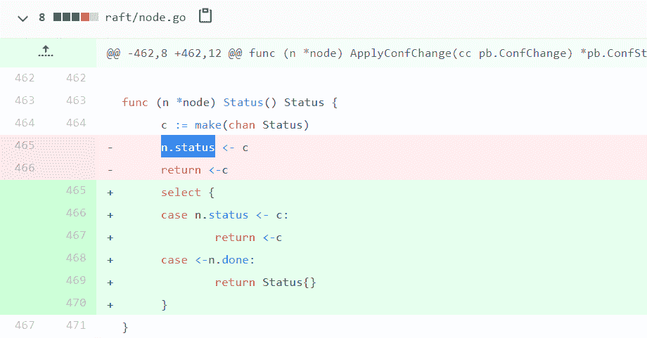
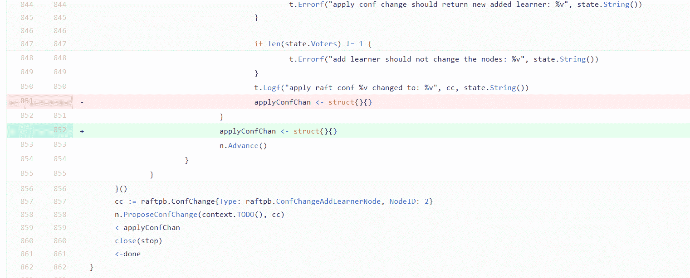
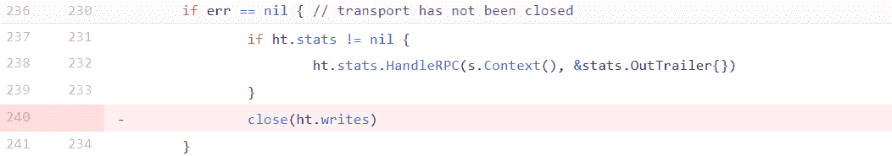
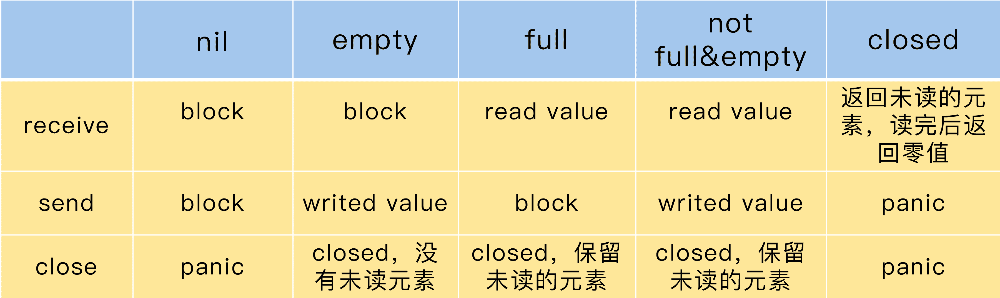

# 13 | Channel：另辟蹊径，解决并发问题

 

你好，我是鸟窝。

Channel 是 Go 语言内建的 first-class 类型，也是 Go 语言与众不同的特性之一。Go 语言的 Channel 设计精巧简单，以至于也有人用其它语言编写了类似 Go 风格的 Channel 库，比如docker/libchan、tylertreat/chan，但是并不像 Go 语言一样把 Channel 内置到了语言规范中。从这一点，你也可以看出来，Channel 的地位在编程语言中的地位之高，比较罕见。

所以，这节课，我们就来学习下 Channel。

# Channel 的发展

要想了解 Channel 这种 Go 编程语言中的特有的数据结构，我们要追溯到 CSP 模型，学习一下它的历史，以及它对 Go 创始人设计 Channel 类型的影响。

CSP 是 Communicating Sequential Process 的简称，中文直译为通信顺序进程，或者叫做交换信息的循序进程，是用来描述并发系统中进行交互的一种模式。

CSP 最早出现于计算机科学家 Tony Hoare 在 1978 年发表的论文中（你可能不熟悉 Tony Hoare 这个名字，但是你一定很熟悉排序算法中的 Quicksort 算法，他就是 Quicksort 算法的作者，图灵奖的获得者）。最初，论文中提出的 CSP 版本在本质上不是一种进程演算，而是一种并发编程语言，但之后又经过了一系列的改进，最终发展并精炼出 CSP 的理论。**CSP 允许使用进程组件来描述系统，它们独立运行，并且只通过消息传递的方式通信。**

就像 Go 的创始人之一 Rob Pike 所说的：“每一个计算机程序员都应该读一读 Tony Hoare 1978 年的关于 CSP 的论文。”他和 Ken Thompson 在设计 Go 语言的时候也深受此论文的影响，并将 CSP 理论真正应用于语言本身（Russ Cox 专门写了一篇文章记录这个历史），通过引入 Channel 这个新的类型，来实现 CSP 的思想。

**Channel 类型是 Go 语言内置的类型，你无需引入某个包，就能使用它**。虽然 Go 也提供了传统的并发原语，但是它们都是通过库的方式提供的，你必须要引入 sync 包或者 atomic 包才能使用它们，而 Channel 就不一样了，它是内置类型，使用起来非常方便。

Channel 和 Go 的另一个独特的特性 goroutine 一起为并发编程提供了优雅的、便利的、与传统并发控制不同的方案，并演化出很多并发模式。接下来，我们就来看一看 Channel 的应用场景。

# Channel 的应用场景

首先，我想先带你看一条 Go 语言中流传很广的谚语：

> Don’t communicate by sharing memory, share memory by communicating.

> Go Proverbs by Rob Pike

这是 Rob Pike 在 2015 年的一次 Gopher 会议中提到的一句话，虽然有一点绕，但也指出了使用 Go 语言的哲学，我尝试着来翻译一下：“**执行业务处理的 goroutine 不要通过共享内存的方式通信，而是要通过 Channel 通信的方式分享数据。**”

“communicate by sharing memory”和“share memory by communicating”是两种不同的并发处理模式。“communicate by sharing memory”是传统的并发编程处理方式，就是指，共享的数据需要用锁进行保护，goroutine 需要获取到锁，才能并发访问数据。

“share memory by communicating”则是类似于 CSP 模型的方式，通过通信的方式，一个 goroutine 可以把数据的“所有权”交给另外一个 goroutine（虽然 Go 中没有“所有权”的概念，但是从逻辑上说，你可以把它理解为是所有权的转移）。

从 Channel 的历史和设计哲学上，我们就可以了解到，Channel 类型和基本并发原语是有竞争关系的，它应用于并发场景，涉及到 goroutine 之间的通讯，可以提供并发的保护，等等。

综合起来，我把 Channel 的应用场景分为五种类型。这里你先有个印象，这样你可以有目的地去学习 Channel 的基本原理。下节课我会借助具体的例子，来带你掌握这几种类型。

1. **数据交流**：当作并发的 buffer 或者 queue，解决生产者 - 消费者问题。多个 goroutine 可以并发当作生产者（Producer）和消费者（Consumer）。
2. **数据传递**：一个 goroutine 将数据交给另一个 goroutine，相当于把数据的拥有权 (引用) 托付出去。
3. **信号通知**：一个 goroutine 可以将信号 (closing、closed、data ready 等) 传递给另一个或者另一组 goroutine 。
4. **任务编排**：可以让一组 goroutine 按照一定的顺序并发或者串行的执行，这就是编排的功能。
5. **锁**：利用 Channel 也可以实现互斥锁的机制。

下面，我们来具体学习下 Channel 的基本用法。

# Channel 基本用法

你可以往 Channel 中发送数据，也可以从 Channel 中接收数据，所以，Channel 类型（为了说起来方便，我们下面都把 Channel 叫做 chan）分为**只能接收**、**只能发送**、**既可以接收又可以发送**三种类型。下面是它的语法定义：

```
ChannelType = ( "chan" | "chan" "<-" | "<-" "chan" ) ElementType .
```

相应地，Channel 的正确语法如下：

```
chan string          // 可以发送接收string  
chan<- struct{}      // 只能发送struct{}  
<-chan int           // 只能从chan接收int
```

我们把既能接收又能发送的 chan 叫做双向的 chan，把只能发送和只能接收的 chan 叫做单向的 chan。其中，“<-”表示单向的 chan，如果你记不住，我告诉你一个简便的方法：**这个箭头总是射向左边的，元素类型总在最右边。如果箭头指向 chan，就表示可以往 chan 中塞数据；如果箭头远离 chan，就表示 chan 会往外吐数据**。

chan 中的元素是任意的类型，所以也可能是 chan 类型，我来举个例子，比如下面的 chan 类型也是合法的：

```
chan<- chan int     
chan<- <-chan int    
<-chan <-chan int  
chan (<-chan int)
```

可是，怎么判定箭头符号属于哪个 chan 呢？其实，“<-”有个规则，总是尽量和左边的 chan 结合（The `<-` operator associates with the leftmost `chan` possible:），因此，上面的定义和下面的使用括号的划分是一样的：

```
chan<- （chan int） // <- 和第一个chan结合  
chan<- （<-chan int） // 第一个<-和最左边的chan结合，第二个<-和左边第二个chan结合  
<-chan （<-chan int） // 第一个<-和最左边的chan结合，第二个<-和左边第二个chan结合   
chan (<-chan int) // 因为括号的原因，<-和括号内第一个chan结合
```

通过 make，我们可以初始化一个 chan，未初始化的 chan 的零值是 nil。你可以设置它的容量，比如下面的 chan 的容量是 9527，我们把这样的 chan 叫做 buffered chan；如果没有设置，它的容量是 0，我们把这样的 chan 叫做 unbuffered chan。

```
make(chan int, 9527)
```

如果 chan 中还有数据，那么，从这个 chan 接收数据的时候就不会阻塞，如果 chan 还未满（“满”指达到其容量），给它发送数据也不会阻塞，否则就会阻塞。unbuffered chan 只有读写都准备好之后才不会阻塞，这也是很多使用 unbuffered chan 时的常见 Bug。

还有一个知识点需要你记住：nil 是 chan 的零值，是一种特殊的 chan，对值是 nil 的 chan 的发送接收调用者总是会阻塞。

下面，我来具体给你介绍几种基本操作，分别是发送数据、接收数据，以及一些其它操作。学会了这几种操作，你就能真正地掌握 Channel 的用法了。

**1. 发送数据**

往 chan 中发送一个数据使用“ch<-”，发送数据是一条语句:

```
ch <- 2000
```

这里的 ch 是 chan int 类型或者是 chan <-int。

**2. 接收数据**

从 chan 中接收一条数据使用“<-ch”，接收数据也是一条语句：

```
  x := <-ch // 把接收的一条数据赋值给变量x  
  foo(<-ch) // 把接收的一个的数据作为参数传给函数  
  <-ch // 丢弃接收的一条数据
```

这里的 ch 类型是 chan T 或者 <-chan T。

接收数据时，还可以返回两个值。第一个值是返回的 chan 中的元素，很多人不太熟悉的是第二个值。第二个值是 bool 类型，代表是否成功地从 chan 中读取到一个值，如果第二个参数是 false，chan 已经被 close 而且 chan 中没有缓存的数据，这个时候，第一个值是零值。所以，如果从 chan 读取到一个零值，可能是 sender 真正发送的零值，也可能是 closed 的并且没有缓存元素产生的零值。

**3. 其它操作**

Go 内建的函数 close、cap、len 都可以操作 chan 类型：close 会把 chan 关闭掉，cap 返回 chan 的容量，len 返回 chan 中缓存的还未被取走的元素数量。

send 和 recv 都可以作为 select 语句的 case clause，如下面的例子：

```
func main() {  
    var ch = make(chan int, 10)  
    for i := 0; i < 10; i++ {  
        select {  
        case ch <- i:  
        case v := <-ch:  
            fmt.Println(v)  
        }  
    }  
}
```

chan 还可以应用于 for-range 语句中，比如：

```
    for v := range ch {  
        fmt.Println(v)  
    }
```

或者是忽略读取的值，只是清空 chan：

```
    for range ch {  
    }
```

好了，到这里，Channel 的基本用法，我们就学完了。下面我从代码实现的角度分析 chan 类型的实现。毕竟，只有掌握了原理，你才能真正地用好它。

# Channel 的实现原理

接下来，我会给你介绍 chan 的数据结构、初始化的方法以及三个重要的操作方法，分别是 send、recv 和 close。通过学习 Channel 的底层实现，你会对 Channel 的功能和异常情况有更深的理解。

## chan 数据结构

chan 类型的数据结构如下图所示，它的数据类型是runtime.hchan。



下面我来具体解释各个字段的意义。

1. qcount：代表 chan 中已经接收但还没被取走的元素的个数。内建函数 len 可以返回这个字段的值。
2. dataqsiz：队列的大小。chan 使用一个循环队列来存放元素，循环队列很适合这种生产者 - 消费者的场景（我很好奇为什么这个字段省略 size 中的 e）。
3. buf：存放元素的循环队列的 buffer。
4. elemtype 和 elemsize：chan 中元素的类型和 size。因为 chan 一旦声明，它的元素类型是固定的，即普通类型或者指针类型，所以元素大小也是固定的。
5. sendx：处理发送数据的指针在 buf 中的位置。一旦接收了新的数据，指针就会加上 elemsize，移向下一个位置。buf 的总大小是 elemsize 的整数倍，而且 buf 是一个循环列表。
6. recvx：处理接收请求时的指针在 buf 中的位置。一旦取出数据，此指针会移动到下一个位置。
7. recvq：chan 是多生产者多消费者的模式，如果消费者因为没有数据可读而被阻塞了，就会被加入到 recvq 队列中。
8. sendq：如果生产者因为 buf 满了而阻塞，会被加入到 sendq 队列中。

## 初始化

Go 在编译的时候，会根据容量的大小选择调用 makechan64，还是 makechan。

下面的代码是处理 make chan 的逻辑，它会决定是使用 makechan 还是 makechan64 来实现 chan 的初始化：



**我们只关注 makechan 就好了，因为 makechan64 只是做了 size 检查，底层还是调用 makechan 实现的**。makechan 的目标就是生成 hchan 对象。

那么，接下来，就让我们来看一下 makechan 的主要逻辑。主要的逻辑我都加上了注释，它会根据 chan 的容量的大小和元素的类型不同，初始化不同的存储空间：

```
func makechan(t *chantype, size int) *hchan {  
    elem := t.elem  
    
        // 略去检查代码  
        mem, overflow := math.MulUintptr(elem.size, uintptr(size))  
          
    //  
    var c *hchan  
    switch {  
    case mem == 0:  
      // chan的size或者元素的size是0，不必创建buf  
      c = (*hchan)(mallocgc(hchanSize, nil, true))  
      c.buf = c.raceaddr()  
    case elem.ptrdata == 0:  
      // 元素不是指针，分配一块连续的内存给hchan数据结构和buf  
      c = (*hchan)(mallocgc(hchanSize+mem, nil, true))  
            // hchan数据结构后面紧接着就是buf  
      c.buf = add(unsafe.Pointer(c), hchanSize)  
    default:  
      // 元素包含指针，那么单独分配buf  
      c = new(hchan)  
      c.buf = mallocgc(mem, elem, true)  
    }  
    
        // 元素大小、类型、容量都记录下来  
    c.elemsize = uint16(elem.size)  
    c.elemtype = elem  
    c.dataqsiz = uint(size)  
    lockInit(&c.lock, lockRankHchan)  
  
    return c  
  }
```

最终，针对不同的容量和元素类型，这段代码分配了不同的对象来初始化 hchan 对象的字段，返回 hchan 对象。

## send

Go 在编译发送数据给 chan 的时候，会把 send 语句转换成 chansend1 函数，chansend1 函数会调用 chansend，我们分段学习它的逻辑：

```
func chansend1(c *hchan, elem unsafe.Pointer) {  
    chansend(c, elem, true, getcallerpc())  
}  
func chansend(c *hchan, ep unsafe.Pointer, block bool, callerpc uintptr) bool {  
        // 第一部分  
    if c == nil {  
      if !block {  
        return false  
      }  
      gopark(nil, nil, waitReasonChanSendNilChan, traceEvGoStop, 2)  
      throw("unreachable")  
    }  
      ......  
  }
```

最开始，第一部分是进行判断：如果 chan 是 nil 的话，就把调用者 goroutine park（阻塞休眠）， 调用者就永远被阻塞住了，所以，第 11 行是不可能执行到的代码。

```
  // 第二部分，如果chan没有被close,并且chan满了，直接返回  
    if !block && c.closed == 0 && full(c) {  
      return false  
  }
```

第二部分的逻辑是当你往一个已经满了的 chan 实例发送数据时，并且想不阻塞当前调用，那么这里的逻辑是直接返回。chansend1 方法在调用 chansend 的时候设置了阻塞参数，所以不会执行到第二部分的分支里。

```
  // 第三部分，chan已经被close的情景  
    lock(&c.lock) // 开始加锁  
    if c.closed != 0 {  
      unlock(&c.lock)  
      panic(plainError("send on closed channel"))  
  }
```

第三部分显示的是，如果 chan 已经被 close 了，再往里面发送数据的话会 panic。

```
      // 第四部分，从接收队列中出队一个等待的receiver  
        if sg := c.recvq.dequeue(); sg != nil {  
      //   
      send(c, sg, ep, func() { unlock(&c.lock) }, 3)  
      return true  
    }
```

第四部分，如果等待队列中有等待的 receiver，那么这段代码就把它从队列中弹出，然后直接把数据交给它（通过 memmove(dst, src, t.size)），而不需要放入到 buf 中，速度可以更快一些。

```
    // 第五部分，buf还没满  
      if c.qcount < c.dataqsiz {  
      qp := chanbuf(c, c.sendx)  
      if raceenabled {  
        raceacquire(qp)  
        racerelease(qp)  
      }  
      typedmemmove(c.elemtype, qp, ep)  
      c.sendx++  
      if c.sendx == c.dataqsiz {  
        c.sendx = 0  
      }  
      c.qcount++  
      unlock(&c.lock)  
      return true  
    }
```

第五部分说明当前没有 receiver，需要把数据放入到 buf 中，放入之后，就成功返回了。

```
      // 第六部分，buf满。  
        // chansend1不会进入if块里，因为chansend1的block=true  
        if !block {  
      unlock(&c.lock)  
      return false  
    }  
        ......
```

第六部分是处理 buf 满的情况。如果 buf 满了，发送者的 goroutine 就会加入到发送者的等待队列中，直到被唤醒。这个时候，数据或者被取走了，或者 chan 被 close 了。

## recv

在处理从 chan 中接收数据时，Go 会把代码转换成 chanrecv1 函数，如果要返回两个返回值，会转换成 chanrecv2，chanrecv1 函数和 chanrecv2 会调用 chanrecv。我们分段学习它的逻辑：

```
    func chanrecv1(c *hchan, elem unsafe.Pointer) {  
    chanrecv(c, elem, true)  
  }  
  func chanrecv2(c *hchan, elem unsafe.Pointer) (received bool) {  
    _, received = chanrecv(c, elem, true)  
    return  
  }  
  
    func chanrecv(c *hchan, ep unsafe.Pointer, block bool) (selected, received bool) {  
        // 第一部分，chan为nil  
    if c == nil {  
      if !block {  
        return  
      }  
      gopark(nil, nil, waitReasonChanReceiveNilChan, traceEvGoStop, 2)  
      throw("unreachable")  
    }
```

chanrecv1 和 chanrecv2 传入的 block 参数的值是 true，都是阻塞方式，所以我们分析 chanrecv 的实现的时候，不考虑 block=false 的情况。

第一部分是 chan 为 nil 的情况。和 send 一样，从 nil chan 中接收（读取、获取）数据时，调用者会被永远阻塞。

```
  // 第二部分, block=false且c为空  
    if !block && empty(c) {  
      ......  
    }
```

第二部分你可以直接忽略，因为不是我们这次要分析的场景。

```
        // 加锁，返回时释放锁  
      lock(&c.lock)  
      // 第三部分，c已经被close,且chan为空empty  
    if c.closed != 0 && c.qcount == 0 {  
      unlock(&c.lock)  
      if ep != nil {  
        typedmemclr(c.elemtype, ep)  
      }  
      return true, false  
    }
```

第三部分是 chan 已经被 close 的情况。如果 chan 已经被 close 了，并且队列中没有缓存的元素，那么返回 true、false。

```
      // 第四部分，如果sendq队列中有等待发送的sender  
        if sg := c.sendq.dequeue(); sg != nil {  
      recv(c, sg, ep, func() { unlock(&c.lock) }, 3)  
      return true, true  
    }
```

第四部分是处理 sendq 队列中有等待者的情况。这个时候，如果 buf 中有数据，优先从 buf 中读取数据，否则直接从等待队列中弹出一个 sender，把它的数据复制给这个 receiver。

```
      // 第五部分, 没有等待的sender, buf中有数据  
    if c.qcount > 0 {  
      qp := chanbuf(c, c.recvx)  
      if ep != nil {  
        typedmemmove(c.elemtype, ep, qp)  
      }  
      typedmemclr(c.elemtype, qp)  
      c.recvx++  
      if c.recvx == c.dataqsiz {  
        c.recvx = 0  
      }  
      c.qcount--  
      unlock(&c.lock)  
      return true, true  
    }  
  
    if !block {  
      unlock(&c.lock)  
      return false, false  
    }  
  
        // 第六部分， buf中没有元素，阻塞  
        ......
```

第五部分是处理没有等待的 sender 的情况。这个是和 chansend 共用一把大锁，所以不会有并发的问题。如果 buf 有元素，就取出一个元素给 receiver。

第六部分是处理 buf 中没有元素的情况。如果没有元素，那么当前的 receiver 就会被阻塞，直到它从 sender 中接收了数据，或者是 chan 被 close，才返回。

## close

通过 close 函数，可以把 chan 关闭，编译器会替换成 closechan 方法的调用。

下面的代码是 close chan 的主要逻辑。如果 chan 为 nil，close 会 panic；如果 chan 已经 closed，再次 close 也会 panic。否则的话，如果 chan 不为 nil，chan 也没有 closed，就把等待队列中的 sender（writer）和 receiver（reader）从队列中全部移除并唤醒。

下面的代码就是 close chan 的逻辑:

```
    func closechan(c *hchan) {  
    if c == nil { // chan为nil, panic  
      panic(plainError("close of nil channel"))  
    }  
    
    lock(&c.lock)  
    if c.closed != 0 {// chan已经closed, panic  
      unlock(&c.lock)  
      panic(plainError("close of closed channel"))  
    }  
  
    c.closed = 1    
  
    var glist gList  
  
    // 释放所有的reader  
    for {  
      sg := c.recvq.dequeue()  
      ......  
      gp := sg.g  
      ......  
      glist.push(gp)  
    }  
    
    // 释放所有的writer (它们会panic)  
    for {  
      sg := c.sendq.dequeue()  
      ......  
      gp := sg.g  
      ......  
      glist.push(gp)  
    }  
    unlock(&c.lock)  
    
    for !glist.empty() {  
      gp := glist.pop()  
      gp.schedlink = 0  
      goready(gp, 3)  
    }  
  }
```

掌握了 Channel 的基本用法和实现原理，下面我再来给你讲一讲容易犯的错误。你一定要认真看，毕竟，这些可都是帮助你避坑的。

# 使用 Channel 容易犯的错误

根据 2019 年第一篇全面分析 Go 并发 Bug 的论文，那些知名的 Go 项目中使用 Channel 所犯的 Bug 反而比传统的并发原语的 Bug 还要多。主要有两个原因：一个是，Channel 的概念还比较新，程序员还不能很好地掌握相应的使用方法和最佳实践；第二个是，Channel 有时候比传统的并发原语更复杂，使用起来很容易顾此失彼。

**使用 Channel 最常见的错误是 panic 和 goroutine 泄漏**。

首先，我们来总结下会 panic 的情况，总共有 3 种：

1. close 为 nil 的 chan；
2. send 已经 close 的 chan；
3. close 已经 close 的 chan。

goroutine 泄漏的问题也很常见，下面的代码也是一个实际项目中的例子：

```
func process(timeout time.Duration) bool {  
    ch := make(chan bool)  
  
    go func() {  
        // 模拟处理耗时的业务  
        time.Sleep((timeout + time.Second))  
        ch <- true // block  
        fmt.Println("exit goroutine")  
    }()  
    select {  
    case result := <-ch:  
        return result  
    case <-time.After(timeout):  
        return false  
    }  
}
```

在这个例子中，process 函数会启动一个 goroutine，去处理需要长时间处理的业务，处理完之后，会发送 true 到 chan 中，目的是通知其它等待的 goroutine，可以继续处理了。

我们来看一下第 10 行到第 15 行，主 goroutine 接收到任务处理完成的通知，或者超时后就返回了。这段代码有问题吗？

如果发生超时，process 函数就返回了，这就会导致 unbuffered 的 chan 从来就没有被读取。我们知道，unbuffered chan 必须等 reader 和 writer 都准备好了才能交流，否则就会阻塞。超时导致未读，结果就是子 goroutine 就阻塞在第 7 行永远结束不了，进而导致 goroutine 泄漏。

解决这个 Bug 的办法很简单，就是将 unbuffered chan 改成容量为 1 的 chan，这样第 7 行就不会被阻塞了。

Go 的开发者极力推荐使用 Channel，不过，这两年，大家意识到，Channel 并不是处理并发问题的“银弹”，有时候使用并发原语更简单，而且不容易出错。所以，我给你提供一套选择的方法:

1. 共享资源的并发访问使用传统并发原语；
2. 复杂的任务编排和消息传递使用 Channel；
3. 消息通知机制使用 Channel，除非只想 signal 一个 goroutine，才使用 Cond；
4. 简单等待所有任务的完成用 WaitGroup，也有 Channel 的推崇者用 Channel，都可以；
5. 需要和 Select 语句结合，使用 Channel；
6. 需要和超时配合时，使用 Channel 和 Context。

# 它们踩过的坑

接下来，我带你围观下知名 Go 项目的 Channel 相关的 Bug。

etcd issue 6857是一个程序 hang 住的问题：在异常情况下，没有往 chan 实例中填充所需的元素，导致等待者永远等待。具体来说，Status 方法的逻辑是生成一个 chan Status，然后把这个 chan 交给其它的 goroutine 去处理和写入数据，最后，Status 返回获取的状态信息。

不幸的是，如果正好节点停止了，没有 goroutine 去填充这个 chan，会导致方法 hang 在返回的那一行上（下面的截图中的第 466 行）。解决办法就是，在等待 status chan 返回元素的同时，也检查节点是不是已经停止了（done 这个 chan 是不是 close 了）。

当前的 etcd 的代码就是修复后的代码，如下所示：



其实，我感觉这个修改还是有问题的。问题就在于，如果程序执行了 466 行，成功地把 c 写入到 Status 待处理队列后，执行到第 467 行时，如果停止了这个节点，那么，这个 Status 方法还是会阻塞在第 467 行。你可以自己研究研究，看看是不是这样。

etcd issue 5505 虽然没有任何的 Bug 描述，但是从修复内容上看，它是一个往已经 close 的 chan 写数据导致 panic 的问题。

etcd issue 11256 是因为 unbuffered chan goroutine 泄漏的问题。TestNodeProposeAddLearnerNode 方法中一开始定义了一个 unbuffered 的 chan，也就是 applyConfChan，然后启动一个子 goroutine，这个子 goroutine 会在循环中执行业务逻辑，并且不断地往这个 chan 中添加一个元素。TestNodeProposeAddLearnerNode 方法的末尾处会从这个 chan 中读取一个元素。

这段代码在 for 循环中就往此 chan 中写入了一个元素，结果导致 TestNodeProposeAddLearnerNode 从这个 chan 中读取到元素就返回了。悲剧的是，子 goroutine 的 for 循环还在执行，阻塞在下图中红色的第 851 行，并且一直 hang 在那里。

这个 Bug 的修复也很简单，只要改动一下 applyConfChan 的处理逻辑就可以了：只有子 goroutine 的 for 循环中的主要逻辑完成之后，才往 applyConfChan 发送一个元素，这样，TestNodeProposeAddLearnerNode 收到通知继续执行，子 goroutine 也不会被阻塞住了。



etcd issue 9956 是往一个已 close 的 chan 发送数据，其实它是 grpc 的一个 bug（grpc issue 2695），修复办法就是不 close 这个 chan 就好了：



# 总结

chan 的值和状态有多种情况，而不同的操作（send、recv、close）又可能得到不同的结果，这是使用 chan 类型时经常让人困惑的地方。

为了帮助你快速地了解不同状态下各种操作的结果，我总结了一个表格，你一定要特别关注下那些 panic 的情况，另外还要掌握那些会 block 的场景，它们是导致死锁或者 goroutine 泄露的罪魁祸首。

还有一个值得注意的点是，只要一个 chan 还有未读的数据，即使把它 close 掉，你还是可以继续把这些未读的数据消费完，之后才是读取零值数据。



# 思考题

1. 有一道经典的使用 Channel 进行任务编排的题，你可以尝试做一下：有四个 goroutine，编号为 1、2、3、4。每秒钟会有一个 goroutine 打印出它自己的编号，要求你编写一个程序，让输出的编号总是按照 1、2、3、4、1、2、3、4、……的顺序打印出来。
2. chan T 是否可以给 <- chan T 和 chan<- T 类型的变量赋值？反过来呢？

欢迎在留言区写下你的思考和答案，我们一起交流讨论。如果你觉得有所收获，也欢迎你把今天的内容分享给你的朋友或同事。
