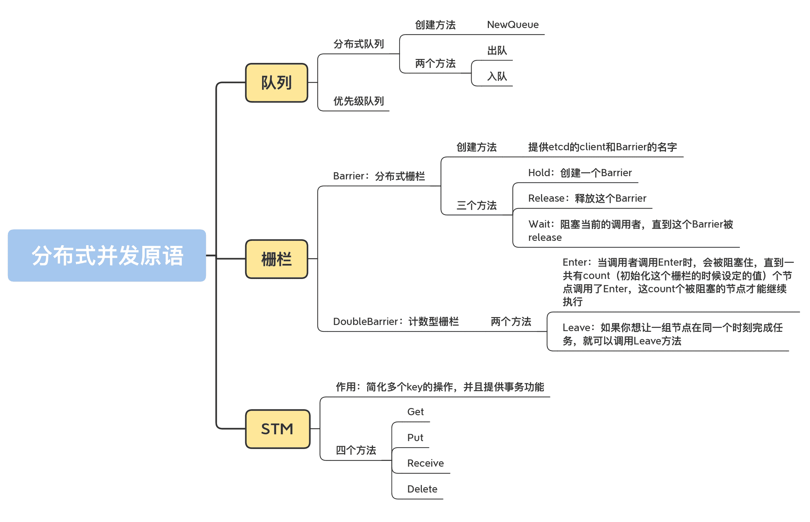

# 20 | 在分布式环境中，队列、栅栏和STM该如何实现？

 

你好，我是鸟窝。

上一讲，我已经带你认识了基于 etcd 实现的 Leader 选举、互斥锁和读写锁，今天，我们来学习下基于 etcd 的分布式队列、栅栏和 STM。

只要你学过计算机算法和数据结构相关的知识， 队列这种数据结构你一定不陌生，它是一种先进先出的类型，有出队（dequeue）和入队（enqueue）两种操作。在第 12 讲中，我专门讲到了一种叫做 lock-free 的队列。队列在单机的应用程序中常常使用，但是在分布式环境中，多节点如何并发地执行入队和出队的操作呢？这一讲，我会带你认识一下基于 etcd 实现的分布式队列。

除此之外，我还会讲用分布式栅栏编排一组分布式节点同时执行的方法，以及简化多个 key 的操作并且提供事务功能的 STM（Software Transactional Memory，软件事务内存）。

# 分布式队列和优先级队列

前一讲我也讲到，我们并不是从零开始实现一个分布式队列，而是站在 etcd 的肩膀上，利用 etcd 提供的功能实现分布式队列。

etcd 集群的可用性由 etcd 集群的维护者来保证，我们不用担心网络分区、节点宕机等问题。我们可以把这些通通交给 etcd 的运维人员，把我们自己的关注点放在使用上。

下面，我们就来了解下 etcd 提供的分布式队列。etcd 通过 github.com/coreos/etcd/contrib/recipes 包提供了分布式队列这种数据结构。

创建分布式队列的方法非常简单，只有一个，即 NewQueue，你只需要传入 etcd 的 client 和这个队列的名字，就可以了。代码如下：

```
func NewQueue(client *v3.Client, keyPrefix string) *Queue
```

**这个队列只有两个方法，分别是出队和入队，队列中的元素是字符串类型**。这两个方法的签名如下所示：

```
// 入队  
func (q *Queue) Enqueue(val string) error  
//出队  
func (q *Queue) Dequeue() (string, error)
```

需要注意的是，如果这个分布式队列当前为空，调用 Dequeue 方法的话，会被阻塞，直到有元素可以出队才返回。

既然是分布式的队列，那就意味着，我们可以在一个节点将元素放入队列，在另外一个节点把它取出。

在我接下来讲的例子中，你就可以启动两个节点，一个节点往队列中放入元素，一个节点从队列中取出元素，看看是否能正常取出来。etcd 的分布式队列是一种多读多写的队列，所以，你也可以启动多个写节点和多个读节点。

下面我们来借助代码，看一下如何实现分布式队列。

首先，我们启动一个程序，它会从命令行读取你的命令，然后执行。你可以输入`push <value>`，将一个元素入队，输入`pop`，将一个元素弹出。另外，你还可以使用这个程序启动多个实例，用来模拟分布式的环境：

```
package main  
  
  
import (  
    "bufio"  
    "flag"  
    "fmt"  
    "log"  
    "os"  
    "strings"  
  
  
    "github.com/coreos/etcd/clientv3"  
    recipe "github.com/coreos/etcd/contrib/recipes"  
)  
  
  
var (  
    addr      = flag.String("addr", "http://127.0.0.1:2379", "etcd addresses")  
    queueName = flag.String("name", "my-test-queue", "queue name")  
)  
  
  
func main() {  
    flag.Parse()  
  
  
    // 解析etcd地址  
    endpoints := strings.Split(*addr, ",")  
  
  
    // 创建etcd的client  
    cli, err := clientv3.New(clientv3.Config{Endpoints: endpoints})  
    if err != nil {  
        log.Fatal(err)  
    }  
    defer cli.Close()  
  
  
    // 创建/获取队列  
    q := recipe.NewQueue(cli, *queueName)  
  
  
    // 从命令行读取命令  
    consolescanner := bufio.NewScanner(os.Stdin)  
    for consolescanner.Scan() {  
        action := consolescanner.Text()  
        items := strings.Split(action, " ")  
        switch items[0] {  
        case "push": // 加入队列  
            if len(items) != 2 {  
                fmt.Println("must set value to push")  
                continue  
            }  
            q.Enqueue(items[1]) // 入队  
        case "pop": // 从队列弹出  
            v, err := q.Dequeue() // 出队  
            if err != nil {  
                log.Fatal(err)  
            }  
            fmt.Println(v) // 输出出队的元素  
        case "quit", "exit": //退出  
            return  
        default:  
            fmt.Println("unknown action")  
        }  
    }  
}
```

我们可以打开两个终端，分别执行这个程序。在第一个终端中执行入队操作，在第二个终端中执行出队操作，并且观察一下出队、入队是否正常。

除了刚刚说的分布式队列，etcd 还提供了优先级队列（PriorityQueue）。

它的用法和队列类似，也提供了出队和入队的操作，只不过，在入队的时候，除了需要把一个值加入到队列，我们还需要提供 uint16 类型的一个整数，作为此值的优先级，优先级高的元素会优先出队。

优先级队列的测试程序如下，你可以在一个节点输入一些不同优先级的元素，在另外一个节点读取出来，看看它们是不是按照优先级顺序弹出的：

```
package main  
  
  
import (  
    "bufio"  
    "flag"  
    "fmt"  
    "log"  
    "os"  
    "strconv"  
    "strings"  
  
  
    "github.com/coreos/etcd/clientv3"  
    recipe "github.com/coreos/etcd/contrib/recipes"  
)  
  
  
var (  
    addr      = flag.String("addr", "http://127.0.0.1:2379", "etcd addresses")  
    queueName = flag.String("name", "my-test-queue", "queue name")  
)  
  
  
func main() {  
    flag.Parse()  
  
  
    // 解析etcd地址  
    endpoints := strings.Split(*addr, ",")  
  
  
    // 创建etcd的client  
    cli, err := clientv3.New(clientv3.Config{Endpoints: endpoints})  
    if err != nil {  
        log.Fatal(err)  
    }  
    defer cli.Close()  
  
  
    // 创建/获取队列  
    q := recipe.NewPriorityQueue(cli, *queueName)  
  
  
    // 从命令行读取命令  
    consolescanner := bufio.NewScanner(os.Stdin)  
    for consolescanner.Scan() {  
        action := consolescanner.Text()  
        items := strings.Split(action, " ")  
        switch items[0] {  
        case "push": // 加入队列  
            if len(items) != 3 {  
                fmt.Println("must set value and priority to push")  
                continue  
            }  
            pr, err := strconv.Atoi(items[2]) // 读取优先级  
            if err != nil {  
                fmt.Println("must set uint16 as priority")  
                continue  
            }  
            q.Enqueue(items[1], uint16(pr)) // 入队  
        case "pop": // 从队列弹出  
            v, err := q.Dequeue() // 出队  
            if err != nil {  
                log.Fatal(err)  
            }  
            fmt.Println(v) // 输出出队的元素  
        case "quit", "exit": //退出  
            return  
        default:  
            fmt.Println("unknown action")  
        }  
    }  
}
```

你看，利用 etcd 实现分布式队列和分布式优先队列，就是这么简单。所以，在实际项目中，如果有这类需求的话，你就可以选择用 etcd 实现。

不过，在使用分布式并发原语时，除了需要考虑可用性和数据一致性，还需要考虑分布式设计带来的性能损耗问题。所以，在使用之前，你一定要做好性能的评估。

# 分布式栅栏

在第 17 讲中，我们学习了循环栅栏 CyclicBarrier，它和第 6 讲的标准库中的 WaitGroup，本质上是同一类并发原语，都是等待同一组 goroutine 同时执行，或者是等待同一组 goroutine 都完成。

在分布式环境中，我们也会遇到这样的场景：一组节点协同工作，共同等待一个信号，在信号未出现前，这些节点会被阻塞住，而一旦信号出现，这些阻塞的节点就会同时开始继续执行下一步的任务。

etcd 也提供了相应的分布式并发原语。

1. **Barrier：分布式栅栏**。如果持有 Barrier 的节点释放了它，所有等待这个 Barrier 的节点就不会被阻塞，而是会继续执行。
2. **DoubleBarrier：计数型栅栏**。在初始化计数型栅栏的时候，我们就必须提供参与节点的数量，当这些数量的节点都 Enter 或者 Leave 的时候，这个栅栏就会放开。所以，我们把它称为计数型栅栏。

## Barrier：分布式栅栏

我们先来学习下分布式 Barrier。

分布式 Barrier 的创建很简单，你只需要提供 etcd 的 Client 和 Barrier 的名字就可以了，如下所示：

```
func NewBarrier(client *v3.Client, key string) *Barrier
```

Barrier 提供了三个方法，分别是 Hold、**Release 和 Wait，**代码如下：

```
func (b *Barrier) Hold() error  
func (b *Barrier) Release() error  
func (b *Barrier) Wait() error
```

1. **Hold 方法**是创建一个 Barrier。如果 Barrier 已经创建好了，有节点调用它的 Wait 方法，就会被阻塞。
2. **Release 方法**是释放这个 Barrier，也就是打开栅栏。如果使用了这个方法，所有被阻塞的节点都会被放行，继续执行。
3. **Wait 方法**会阻塞当前的调用者，直到这个 Barrier 被 release。如果这个栅栏不存在，调用者不会被阻塞，而是会继续执行。

**学习并发原语最好的方式就是使用它**。下面我们就来借助一个例子，来看看 Barrier 该怎么用。

你可以在一个终端中运行这个程序，执行"hold""release"命令，模拟栅栏的持有和释放。在另外一个终端中运行这个程序，不断调用"wait"方法，看看是否能正常地跳出阻塞继续执行：

```
package main  
  
  
import (  
    "bufio"  
    "flag"  
    "fmt"  
    "log"  
    "os"  
    "strings"  
  
  
    "github.com/coreos/etcd/clientv3"  
    recipe "github.com/coreos/etcd/contrib/recipes"  
)  
  
  
var (  
    addr        = flag.String("addr", "http://127.0.0.1:2379", "etcd addresses")  
    barrierName = flag.String("name", "my-test-queue", "barrier name")  
)  
  
  
func main() {  
    flag.Parse()  
  
  
    // 解析etcd地址  
    endpoints := strings.Split(*addr, ",")  
  
  
    // 创建etcd的client  
    cli, err := clientv3.New(clientv3.Config{Endpoints: endpoints})  
    if err != nil {  
        log.Fatal(err)  
    }  
    defer cli.Close()  
  
  
    // 创建/获取栅栏  
    b := recipe.NewBarrier(cli, *barrierName)  
  
  
    // 从命令行读取命令  
    consolescanner := bufio.NewScanner(os.Stdin)  
    for consolescanner.Scan() {  
        action := consolescanner.Text()  
        items := strings.Split(action, " ")  
        switch items[0] {  
        case "hold": // 持有这个barrier  
            b.Hold()  
            fmt.Println("hold")  
        case "release": // 释放这个barrier  
            b.Release()  
            fmt.Println("released")  
        case "wait": // 等待barrier被释放  
            b.Wait()  
            fmt.Println("after wait")  
        case "quit", "exit": //退出  
            return  
        default:  
            fmt.Println("unknown action")  
        }  
    }  
}

## DoubleBarrier：计数型栅栏

etcd 还提供了另外一种栅栏，叫做 DoubleBarrier，这也是一种非常有用的栅栏。这个栅栏初始化的时候需要提供一个计数 count，如下所示：
```

```
func NewDoubleBarrier(s *concurrency.Session, key string, count int) *DoubleBarrier
```

同时，它还提供了两个方法，分别是 Enter 和 Leave，代码如下：

```
func (b *DoubleBarrier) Enter() error  
func (b *DoubleBarrier) Leave() error
```

我来解释下这两个方法的作用。

当调用者调用 Enter 时，会被阻塞住，直到一共有 count（初始化这个栅栏的时候设定的值）个节点调用了 Enter，这 count 个被阻塞的节点才能继续执行。所以，你可以利用它编排一组节点，让这些节点在同一个时刻开始执行任务。

同理，如果你想让一组节点在同一个时刻完成任务，就可以调用 Leave 方法。节点调用 Leave 方法的时候，会被阻塞，直到有 count 个节点，都调用了 Leave 方法，这些节点才能继续执行。

我们再来看一下 DoubleBarrier 的使用例子。你可以起两个节点，同时执行 Enter 方法，看看这两个节点是不是先阻塞，之后才继续执行。然后，你再执行 Leave 方法，也观察一下，是不是先阻塞又继续执行的。

```
package main  
  
  
import (  
    "bufio"  
    "flag"  
    "fmt"  
    "log"  
    "os"  
    "strings"  
  
  
    "github.com/coreos/etcd/clientv3"  
    "github.com/coreos/etcd/clientv3/concurrency"  
    recipe "github.com/coreos/etcd/contrib/recipes"  
)  
  
  
var (  
    addr        = flag.String("addr", "http://127.0.0.1:2379", "etcd addresses")  
    barrierName = flag.String("name", "my-test-doublebarrier", "barrier name")  
    count       = flag.Int("c", 2, "")  
)  
  
  
func main() {  
    flag.Parse()  
  
  
    // 解析etcd地址  
    endpoints := strings.Split(*addr, ",")  
  
  
    // 创建etcd的client  
    cli, err := clientv3.New(clientv3.Config{Endpoints: endpoints})  
    if err != nil {  
        log.Fatal(err)  
    }  
    defer cli.Close()  
    // 创建session  
    s1, err := concurrency.NewSession(cli)  
    if err != nil {  
        log.Fatal(err)  
    }  
    defer s1.Close()  
  
  
    // 创建/获取栅栏  
    b := recipe.NewDoubleBarrier(s1, *barrierName, *count)  
  
  
    // 从命令行读取命令  
    consolescanner := bufio.NewScanner(os.Stdin)  
    for consolescanner.Scan() {  
        action := consolescanner.Text()  
        items := strings.Split(action, " ")  
        switch items[0] {  
        case "enter": // 持有这个barrier  
            b.Enter()  
            fmt.Println("enter")  
        case "leave": // 释放这个barrier  
            b.Leave()  
            fmt.Println("leave")  
        case "quit", "exit": //退出  
            return  
        default:  
            fmt.Println("unknown action")  
        }  
    }  
}
```

好了，我们先来简单总结一下。我们在第 17 讲学习的循环栅栏，控制的是同一个进程中的不同 goroutine 的执行，而**分布式栅栏和计数型栅栏控制的是不同节点、不同进程的执行**。当你需要协调一组分布式节点在某个时间点同时运行的时候，可以考虑 etcd 提供的这组并发原语。

# STM

提到事务，你肯定不陌生。在开发基于数据库的应用程序的时候，我们经常用到事务。事务就是要保证一组操作要么全部成功，要么全部失败。

在学习 STM 之前，我们要先了解一下 etcd 的事务以及它的问题。

etcd 提供了在一个事务中对多个 key 的更新功能，这一组 key 的操作要么全部成功，要么全部失败。etcd 的事务实现方式是基于 CAS 方式实现的，融合了 Get、Put 和 Delete 操作。

etcd 的事务操作如下，分为条件块、成功块和失败块，条件块用来检测事务是否成功，如果成功，就执行 Then(...)，如果失败，就执行 Else(...)：

```
Txn().If(cond1, cond2, ...).Then(op1, op2, ...,).Else(op1’, op2’, …)
```

我们来看一个利用 etcd 的事务实现转账的小例子。我们从账户 from 向账户 to 转账 amount，代码如下：

```
func doTxnXfer(etcd *v3.Client, from, to string, amount uint) (bool, error) {  
    // 一个查询事务  
    getresp, err := etcd.Txn(ctx.TODO()).Then(OpGet(from), OpGet(to)).Commit()  
    if err != nil {  
         return false, err  
    }  
    // 获取转账账户的值  
    fromKV := getresp.Responses[0].GetRangeResponse().Kvs[0]  
    toKV := getresp.Responses[1].GetRangeResponse().Kvs[1]  
    fromV, toV := toUInt64(fromKV.Value), toUint64(toKV.Value)  
    if fromV < amount {  
        return false, fmt.Errorf(“insufficient value”)  
    }  
    // 转账事务  
    // 条件块  
    txn := etcd.Txn(ctx.TODO()).If(  
        v3.Compare(v3.ModRevision(from), “=”, fromKV.ModRevision),  
        v3.Compare(v3.ModRevision(to), “=”, toKV.ModRevision))  
    // 成功块  
    txn = txn.Then(  
        OpPut(from, fromUint64(fromV - amount)),  
        OpPut(to, fromUint64(toV + amount))  
    //提交事务   
    putresp, err := txn.Commit()  
    // 检查事务的执行结果  
    if err != nil {  
        return false, err  
    }  
    return putresp.Succeeded, nil  
}
```

从刚刚的这段代码中，我们可以看到，虽然可以利用 etcd 实现事务操作，但是逻辑还是比较复杂的。

因为事务使用起来非常麻烦，所以 etcd 又在这些基础 API 上进行了封装，新增了一种叫做 STM 的操作，提供了更加便利的方法。

下面我们来看一看 STM 怎么用。

要使用 STM，你需要先编写一个 apply 函数，这个函数的执行是在一个事务之中的：

```
apply func(STM) error
```

这个方法包含一个 STM 类型的参数，它提供了对 key 值的读写操作。

STM 提供了 4 个方法，分别是 Get、Put、Receive 和 Delete，代码如下：

```
type STM interface {  
  Get(key ...string) string  
  Put(key, val string, opts ...v3.OpOption)  
  Rev(key string) int64  
  Del(key string)  
}
```

使用 etcd STM 的时候，我们只需要定义一个 apply 方法，比如说转账方法 exchange，然后通过 concurrency.NewSTM(cli, exchange)，就可以完成转账事务的执行了。

STM 咋用呢？我们还是借助一个例子来学习下。

下面这个例子创建了 5 个银行账号，然后随机选择一些账号两两转账。在转账的时候，要把源账号一半的钱要转给目标账号。这个例子启动了 10 个 goroutine 去执行这些事务，每个 goroutine 要完成 100 个事务。

为了确认事务是否出错了，我们最后要校验每个账号的钱数和总钱数。总钱数不变，就代表执行成功了。这个例子的代码如下：

```
package main  
  
  
import (  
    "context"  
    "flag"  
    "fmt"  
    "log"  
    "math/rand"  
    "strings"  
    "sync"  
  
  
    "github.com/coreos/etcd/clientv3"  
    "github.com/coreos/etcd/clientv3/concurrency"  
)  
  
  
var (  
    addr = flag.String("addr", "http://127.0.0.1:2379", "etcd addresses")  
)  
  
  
func main() {  
    flag.Parse()  
  
  
    // 解析etcd地址  
    endpoints := strings.Split(*addr, ",")  
  
  
    cli, err := clientv3.New(clientv3.Config{Endpoints: endpoints})  
    if err != nil {  
        log.Fatal(err)  
    }  
    defer cli.Close()  
  
  
    // 设置5个账户，每个账号都有100元，总共500元  
    totalAccounts := 5  
    for i := 0; i < totalAccounts; i++ {  
        k := fmt.Sprintf("accts/%d", i)  
        if _, err = cli.Put(context.TODO(), k, "100"); err != nil {  
            log.Fatal(err)  
        }  
    }  
  
  
    // STM的应用函数，主要的事务逻辑  
    exchange := func(stm concurrency.STM) error {  
        // 随机得到两个转账账号  
        from, to := rand.Intn(totalAccounts), rand.Intn(totalAccounts)  
        if from == to {  
            // 自己不和自己转账  
            return nil  
        }  
        // 读取账号的值  
        fromK, toK := fmt.Sprintf("accts/%d", from), fmt.Sprintf("accts/%d", to)  
        fromV, toV := stm.Get(fromK), stm.Get(toK)  
        fromInt, toInt := 0, 0  
        fmt.Sscanf(fromV, "%d", &fromInt)  
        fmt.Sscanf(toV, "%d", &toInt)  
  
  
        // 把源账号一半的钱转账给目标账号  
        xfer := fromInt / 2  
        fromInt, toInt = fromInt-xfer, toInt+xfer  
  
  
        // 把转账后的值写回  
        stm.Put(fromK, fmt.Sprintf("%d", fromInt))  
        stm.Put(toK, fmt.Sprintf("%d", toInt))  
        return nil  
    }  
  
  
    // 启动10个goroutine进行转账操作  
    var wg sync.WaitGroup  
    wg.Add(10)  
    for i := 0; i < 10; i++ {  
        go func() {  
            defer wg.Done()  
            for j := 0; j < 100; j++ {  
                if _, serr := concurrency.NewSTM(cli, exchange); serr != nil {  
                    log.Fatal(serr)  
                }  
            }  
        }()  
    }  
    wg.Wait()  
  
  
    // 检查账号最后的数目  
    sum := 0  
    accts, err := cli.Get(context.TODO(), "accts/", clientv3.WithPrefix()) // 得到所有账号  
    if err != nil {  
        log.Fatal(err)  
    }  
    for _, kv := range accts.Kvs { // 遍历账号的值  
        v := 0  
        fmt.Sscanf(string(kv.Value), "%d", &v)  
        sum += v  
        log.Printf("account %s: %d", kv.Key, v)  
    }  
  
  
    log.Println("account sum is", sum) // 总数  
}
```

总结一下，当你利用 etcd 做存储时，是可以利用 STM 实现事务操作的，一个事务可以包含多个账号的数据更改操作，事务能够保证这些更改要么全成功，要么全失败。

# 总结

如果我们把眼光放得更宽广一些，其实并不只是 etcd 提供了这些并发原语，比如我上节课一开始就提到了，Zookeeper 很早也提供了类似的并发原语，只不过只提供了 Java 的库，并没有提供合适的 Go 库。另外，根据 Consul 官方的反馈，他们并没有开发这些并发原语的计划，所以，从目前来看，etcd 是个不错的选择。

当然，也有一些其它不太知名的分布式原语库，但是活跃度不高，可用性低，所以我们也不需要去了解了。

其实，你也可以使用 Redis 实现分布式锁，或者是基于 MySQL 实现分布式锁，这也是常用的选择。对于大厂来说，选择起来是非常简单的，只需要看看厂内提供了哪个基础服务，哪个更稳定些。对于没有 etcd、Redis 这些基础服务的公司来说，很重要的一点，就是自己搭建一套这样的基础服务，并且运维好，这就需要考察你们对 etcd、Redis、MySQL 的技术把控能力了，哪个用得更顺手，就用哪个。

一般来说，我不建议你自己去实现分布式原语，最好是直接使用 etcd、Redis 这些成熟的软件提供的功能，这也意味着，我们将程序的风险转嫁到了这些基础服务上，这些基础服务必须要能够提供足够的服务保障。



# 思考题

1. 部署一个 3 节点的 etcd 集群，测试一下分布式队列的性能。
2. etcd 提供的 STM 是分布式事务吗？

欢迎在留言区写下你的思考和答案，我们一起交流讨论。如果你觉得有所收获，也欢迎你把今天的内容分享给你的朋友或同事。
