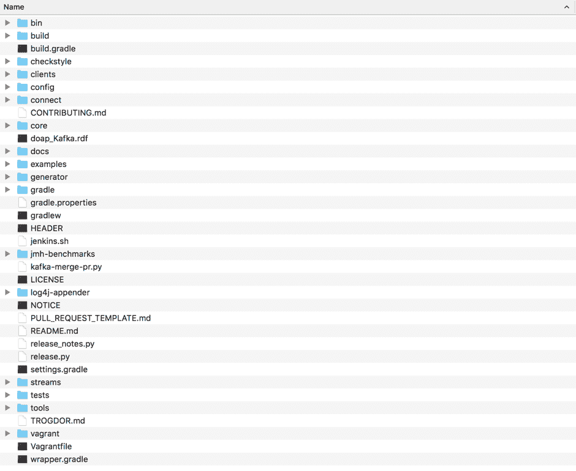
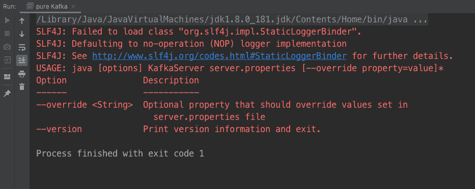
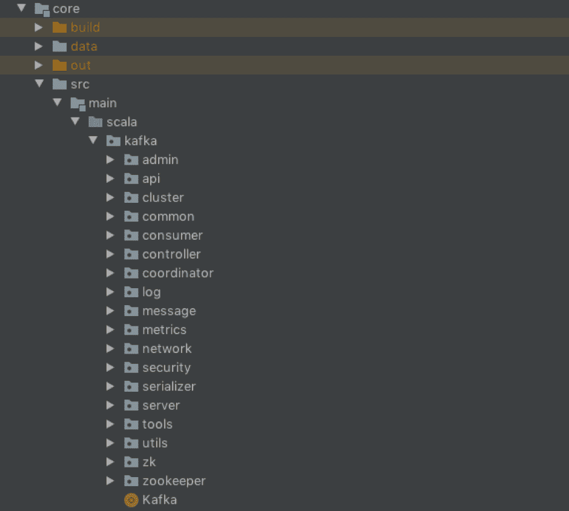

# 导读 | 构建Kafka工程和源码阅读环境、Scala语言热身

 

你好，我是胡夕。

从今天开始，我们就要正式走入 Kafka 源码的世界了。既然咱们这个课程是教你阅读 Kafka 源码的，那么，你首先就得掌握如何在自己的电脑上搭建 Kafka 的源码环境，甚至是知道怎么对它们进行调试。在这一讲，我展示了很多实操步骤，建议你都操作一遍，否则很难会有特别深刻的认识。

话不多说，现在，我们就先来搭建源码环境吧。

## 环境准备

在阅读 Kafka 源码之前，我们要先做一些必要的环境准备工作：你至少要提前安装好 Java、Gradle、Scala、IDE 和 Git 等软件。

咱们专栏统一使用下面几个版本进行 Kafka 源码讲解。

1. Oracle Java 8：专栏使用的是 Oracle 的 JDK 及 Hotspot JVM。如果你青睐于其他厂商或开源的 Java 版本（比如 OpenJDK），你可以选择安装不同厂商的 JVM 版本。
2. Gradle 5.0：我在专栏里带你阅读的 Kafka 源码是社区的 Trunk 分支。Trunk 分支目前演进到了 2.4.0 版本，还不支持 Gradle 6.0，因此，你需要安装 **Gradle 5.x 版本。**
3. Scala 2.12：当前社区编译 Kafka 支持 3 个 Scala 版本，分别是 2.11、2.12 和 2.13。2.11 应该很快就会不支持了，而 2.13 又是刚刚推出的版本，因此我推荐你安装 Scala 2.12 版本。
4. IDEA + Scala 插件：本专栏使用 IDEA 作为 IDE 来阅读和配置源码。我对 Eclipse 充满敬意，只是我个人比较习惯使用 IDEA。另外，你需要为 IDEA 安装 Scala 插件，这样可以方便你阅读 Scala 源码。
5. Git：安装 Git 主要是为了管理 Kafka 源码版本。如果你要成为一名社区代码贡献者，Git 管理工具是必不可少的。

## 构建 Kafka 工程

等你准备好以上这些之后，我们就可以来构建 Kafka 工程了。

首先，我们下载 Kafka 源代码。方法很简单，找一个干净的源码路径，然后执行下列命令去下载社区的 Trunk 代码即可：

```
$ git clone https://github.com/apache/kafka.git
```

在漫长的等待之后，你的路径上会新增一个名为 kafka 的子目录，它就是 Kafka 项目的根目录。如果在你的环境中，上面这条命令无法执行的话，你可以在浏览器中输入https://codeload.github.com/apache/kafka/zip/trunk下载源码 ZIP 包并解压，只是这样你就失去了 Git 管理，你要手动链接到远程仓库，具体方法可以参考这篇Git 文档。

下载完成后，你要进入工程所在的路径内，手动运行以下命令来构建 Kafka 工程：

```
$ gradle  
$ ./gradlew jar
```

第一条命令是用来下载和更新 Gradle 套件（Gradle Wrapper）的，第二条命令则是用 Gradle 套件构建 Kafka 工程，生成 Jar 文件。

下图展示了 Kafka 工程的各个目录以及文件：



这里我再简单介绍一些主要的组件路径。

1. **bin 目录**：保存 Kafka 工具行脚本，我们熟知的 kafka-server-start 和 kafka-console-producer 等脚本都存放在这里。
2. **clients 目录**：保存 Kafka 客户端代码，比如生产者和消费者的代码都在该目录下。
3. **config 目录**：保存 Kafka 的配置文件，其中比较重要的配置文件是 server.properties。
4. **connect 目录**：保存 Connect 组件的源代码。我在开篇词里提到过，Kafka Connect 组件是用来实现 Kafka 与外部系统之间的实时数据传输的。
5. **core 目录**：保存 Broker 端代码。Kafka 服务器端代码全部保存在该目录下。
6. **streams 目录**：保存 Streams 组件的源代码。Kafka Streams 是实现 Kafka 实时流处理的组件。

其他的目录要么不太重要，要么和配置相关，这里我就不展开讲了。

除了上面的 gradlew jar 命令之外，我再介绍一些常用的构建命令，帮助你调试 Kafka 工程。

我们先看一下测试相关的命令。Kafka 源代码分为 4 大部分：Broker 端代码、Clients 端代码、Connect 端代码和 Streams 端代码。如果你想要测试这 4 个部分的代码，可以分别运行以下 4 条命令：

```
$ ./gradlew core:test  
$ ./gradlew clients:test  
$ ./gradlew connect:[submodule]:test  
$ ./gradlew streams:test
```

你可能注意到了，在这 4 条命令中，Connect 组件的测试方法不太一样。这是因为 Connect 工程下细分了多个子模块，比如 api、runtime 等，所以，你需要显式地指定要测试的子模块名才能进行测试。

如果你要单独对某一个具体的测试用例进行测试，比如单独测试 Broker 端 core 包的 LogTest 类，可以用下面的命令：

```
$ ./gradlew core:test --tests kafka.log.LogTest
```

另外，如果你要构建整个 Kafka 工程并打包出一个可运行的二进制环境，就需要运行下面的命令：

```
$ ./gradlew clean releaseTarGz
```

成功运行后，core、clients 和 streams 目录下就会分别生成对应的二进制发布包，它们分别是：

1. **kafka-2.12-2.5.0-SNAPSHOT.tgz**。它是 Kafka 的 Broker 端发布包，把该文件解压之后就是标准的 Kafka 运行环境。该文件位于 core 路径的 /build/distributions 目录。
2. **kafka-clients-2.5.0-SNAPSHOT.jar**。该 Jar 包是 Clients 端代码编译打包之后的二进制发布包。该文件位于 clients 目录下的 /build/libs 目录。
3. **kafka-streams-2.5.0-SNAPSHOT.jar**。该 Jar 包是 Streams 端代码编译打包之后的二进制发布包。该文件位于 streams 目录下的 /build/libs 目录。

## 搭建源码阅读环境

刚刚我介绍了如何使用 Gradle 工具来构建 Kafka 项目工程，现在我来带你看一下如何利用 IDEA 搭建 Kafka 源码阅读环境。实际上，整个过程非常简单。我们打开 IDEA，点击“文件”，随后点击“打开”，选择上一步中的 Kafka 文件路径即可。

项目工程被导入之后，IDEA 会对项目进行自动构建，等构建完成之后，你可以找到 core 目录源码下的 Kafka.scala 文件。打开它，然后右键点击 Kafka，你应该就能看到这样的输出结果了：



这就是无参执行 Kafka 主文件的运行结果。通过这段输出，我们能够学会启动 Broker 所必需的参数，即指定 server.properties 文件的地址。这也是启动 Kafka Broker 的标准命令。

在开篇中我也说了，这个课程会聚焦于讲解 Kafka Broker 端源代码。因此，我先和你简要介绍一下 Broker 端源码的组织架构。下图展示了 Kafka core 包的代码架构：



我来给你解释几个比较关键的代码包。

1. controller 包：保存了 Kafka 控制器（Controller）代码，而控制器组件是 Kafka 的核心组件，后面我们会针对这个包的代码进行详细分析。
2. coordinator 包：保存了**消费者端的 GroupCoordinator 代码**和**用于事务的 TransactionCoordinator 代码**。对 coordinator 包进行分析，特别是对消费者端的 GroupCoordinator 代码进行分析，是我们弄明白 Broker 端协调者组件设计原理的关键。
3. log 包：保存了 Kafka 最核心的日志结构代码，包括日志、日志段、索引文件等，专栏后面会有详细介绍。另外，该包下还封装了 Log Compaction 的实现机制，是非常重要的源码包。
4. network 包：封装了 Kafka 服务器端网络层的代码，特别是 SocketServer.scala 这个文件，是 Kafka 实现 Acceptor 模式的具体操作类，非常值得一读。
5. server 包：顾名思义，它是 Kafka 的服务器端主代码，里面的类非常多，很多关键的 Kafka 组件都存放在这里，比如专栏后面要讲到的状态机、Purgatory 延时机制等。

在专栏后续的课程中，我会挑选 Kafka 最主要的代码类进行详细分析，帮助你深入了解 Kafka Broker 端重要组件的实现原理。

另外，虽然这次专栏不会涵盖测试用例的代码分析，但在我看来，**弄懂测试用例是帮助你快速了解 Kafka 组件的最有效的捷径之一**。如果时间允许的话，我建议你多读一读 Kafka 各个组件下的测试用例，它们通常都位于代码包的 src/test 目录下。拿 Kafka 日志源码 Log 来说，它对应的 LogTest.scala 测试文件就写得非常完备，里面多达几十个测试用例，涵盖了 Log 的方方面面，你一定要读一下。

## Scala 语言热身

因为 Broker 端的源码完全是基于 Scala 的，所以在开始阅读这部分源码之前，我还想花一点时间快速介绍一下 Scala 语言的语法特点。我先拿几个真实的 Kafka 源码片段来帮你热热身。

先来看第一个：

```
_def sizeInBytes(segments: Iterable[LogSegment]): Long =_  
  
_segments.map(_.size.toLong).sum_
```

这是一个典型的 Scala 方法，方法名是 sizeInBytes。它接收一组 LogSegment 对象，返回一个长整型。LogSegment 对象就是我们后面要谈到的日志段。你在 Kafka 分区目录下看到的每一个.log 文件本质上就是一个 LogSegment。从名字上来看，这个方法计算的是这组 LogSegment 的总字节数。具体方法是遍历每个输入 LogSegment，调用其 size 方法并将其累加求和之后返回。

再来看一个：

```
val firstOffset: Option[Long] = ......  
  
  
def numMessages: Long = {  
    firstOffset match {  
      case Some(firstOffsetVal) if (firstOffsetVal >= 0 && lastOffset >= 0) => (lastOffset - firstOffsetVal + 1)  
      case _ => 0  
    }  
  }
```

该方法是 LogAppendInfo 对象的一个方法，统计的是 Broker 端一次性批量写入的消息数。这里你需要重点关注 **match** 和 **case** 这两个关键字，你可以近似地认为它们等同于 Java 中的 switch，但它们的功能要强大得多。该方法统计写入消息数的逻辑是：如果 firstOffsetVal 和 lastOffset 值都大于 0，则写入消息数等于两者的差值 +1；如果不存在 firstOffsetVal，则无法统计写入消息数，简单返回 0 即可。

倘若对你而言，弄懂上面这两段代码有些吃力，我建议你去快速地学习一下 Scala 语言。重点学什么呢？我建议你重点学习下 Scala 中对于**集合的遍历语法**，以及**基于 match 的模式匹配用法**。

另外，由于 Scala 具有的函数式编程风格，你至少**要理解 Java 中 Lambda 表达式的含义**，这会在很大程度上帮你扫清阅读障碍。

相反地，如果上面的代码对你来讲很容易理解，那么，读懂 Broker 端 80% 的源码应该没有什么问题。你可能还会关心，剩下的那晦涩难懂的 20% 源码怎么办呢？其实没关系，你可以等慢慢精通了 Scala 语言之后再进行阅读，它们不会对你熟练掌握核心源码造成影响的。另外，后面涉及到比较难的 Scala 语法特性时，我还会再具体给你解释的，所以，还是那句话，你完全不用担心语言的问题！

## 总结

今天是我们开启 Kafka 源码分析的“热身课”，我给出了构建 Kafka 工程以及搭建 Kafka 源码阅读环境的具体方法。我建议你对照上面的内容完整地走一遍流程，亲身体会一下 Kafka 工程的构建与源码工程的导入。毕竟，这些都是后面阅读具体 Kafka 代码的前提条件。

最后我想再强调一下，阅读任何一个大型项目的源码都不是一件容易的事情，我希望你在任何时候都不要轻言放弃。很多时候，碰到读不懂的代码你就多读几遍，也许稍后就会有醍醐灌顶的感觉。

## 课后讨论

熟悉 Kafka 的话，你一定听说过 kafka-console-producer.sh 脚本。我前面提到过，该脚本位于工程的 bin 目录下，你能找到它对应的 Java 类是哪个文件吗？这个搜索过程能够给你一些寻找 Kafka 所需类文件的好思路，你不妨去试试看。

欢迎你在留言区畅所欲言，跟我交流讨论，也欢迎你把文章分享给你的朋友。
