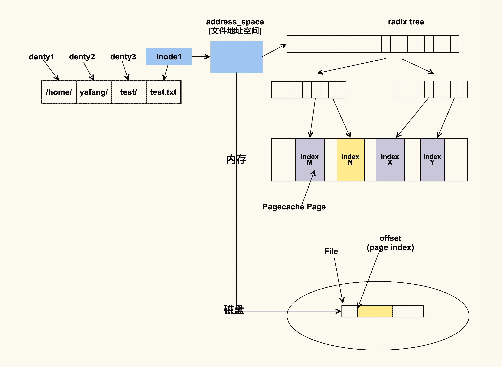
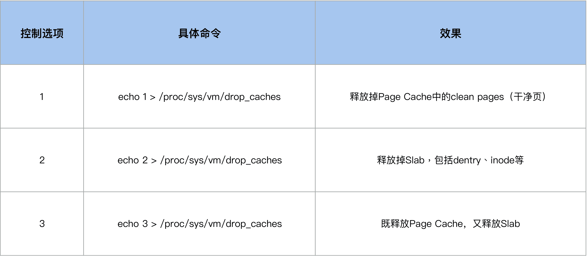
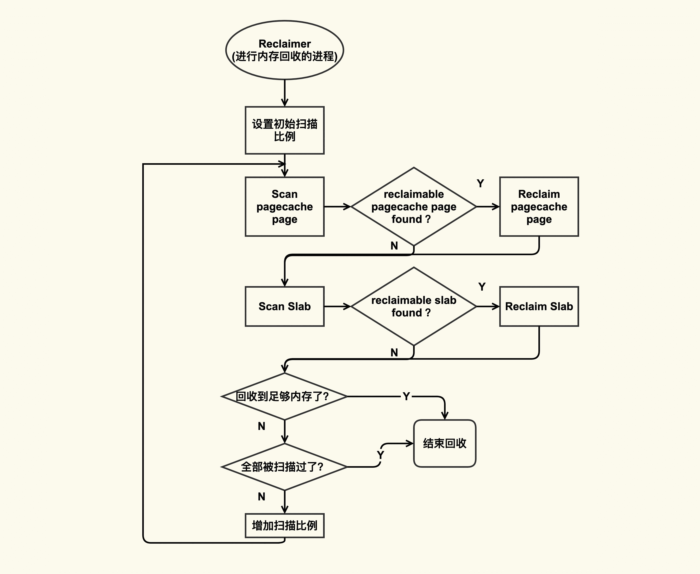
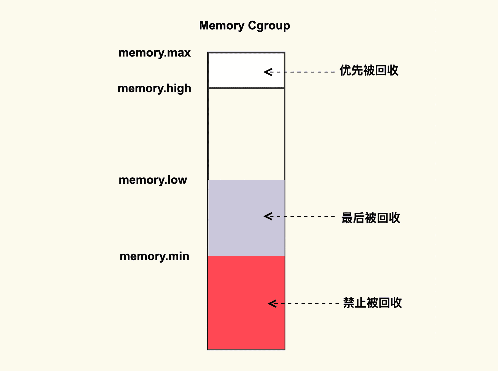

# 04 案例篇 | 如何处理Page Cache容易回收引起的业务性能问题？

 

你好，我是邵亚方。我们在前一节课讲了 Page Cache 难以回收导致的 load 飙高问题，这类问题是很直观的，相信很多人都遭遇过。这节课，我们则是来讲相反的一些问题，即 Page Cache 太容易回收而引起的一些问题。

这类问题因为不直观所以陷阱会很多，应用开发者和运维人员会更容易踩坑，也正因为这类问题不直观，所以他们往往是一而再再而三地中招之后，才搞清楚问题到底是怎么回事。

我把大家经常遇到的这类问题做个总结，大致可以分为两方面：

1. 误操作而导致 Page Cache 被回收掉，进而导致业务性能下降明显；
2. 内核的一些机制导致业务 Page Cache 被回收，从而引起性能下降。

如果你的业务对 Page Cache 比较敏感，比如说你的业务数据对延迟很敏感，或者再具体一点，你的业务指标对 TP99（99 分位）要求较高，那你对于这类性能问题应该多多少少有所接触。当然，这并不意味着业务对延迟不敏感，你就不需要关注这些问题了，关注这类问题会让你对业务行为理解更深刻。

言归正传，我们来看下发生在生产环境中的案例。

## 对 Page Cache 操作不当产生的业务性能下降

我们先从一个相对简单的案例说起，一起分析下误操作导致 Page Cache 被回收掉的情况，它具体是怎样发生的。

我们知道，对于 Page Cache 而言，是可以通过 drop_cache 来清掉的，很多人在看到系统中存在非常多的 Page Cache 时会习惯使用 drop_cache 来清理它们，但是这样做是会有一些负面影响的，比如说这些 Page Cache 被清理掉后可能会引起系统性能下降。为什么？

其实这和 inode 有关，那 inode 是什么意思呢？inode 是内存中对磁盘文件的索引，进程在查找或者读取文件时就是通过 inode 来进行操作的，我们用下面这张图来表示一下这种关系：



如上图所示，进程会通过 inode 来找到文件的地址空间（address_space），然后结合文件偏移（会转换成 page index）来找具体的 Page。如果该 Page 存在，那就说明文件内容已经被读取到了内存；如果该 Page 不存在那就说明不在内存中，需要到磁盘中去读取。你可以理解为 inode 是 Pagecache Page（页缓存的页）的宿主（host），如果 inode 不存在了，那么 PageCache Page 也就不存在了。

如果你使用过 drop_cache 来释放 inode 的话，应该会清楚它有几个控制选项，我们可以通过写入不同的数值来释放不同类型的 cache（用户数据 Page Cache，内核数据 Slab，或者二者都释放），这些选项你可以去看Kernel Documentation 的描述。



于是这样就引入了一个容易被我们忽略的问题：**当我们执行 echo 2 来 drop slab 的时候****，****它也会把 Page Cache 给 drop 掉**，很多运维人员都会忽视掉这一点。

在系统内存紧张的时候，运维人员或者开发人员会想要通过 drop_caches 的方式来释放一些内存，但是由于他们清楚 Page Cache 被释放掉会影响业务性能，所以就期望只去 drop slab 而不去 drop pagecache。于是很多人这个时候就运行 echo 2 > /proc/sys/vm/drop_caches，但是结果却出乎了他们的意料：Page Cache 也被释放掉了，业务性能产生了明显的下降。

很多人都遇到过这个场景：系统正在运行着，忽然 Page Cache 被释放掉了，由于不清楚释放的原因，所以很多人就会怀疑，是不是由其他人 / 程序执行了 drop_caches 导致的。那有没有办法来观察这个 inode 释放引起 Page Cache 被释放的行为呢？答案是有的。关于这一点，我们在下一节课会讲到。我们先来分析下如何观察是否有人或者有程序执行过 drop_caches。

由于 drop_caches 是一种内存事件，内核会在 /proc/vmstat 中来记录这一事件，所以我们可以通过 /proc/vmstat 来判断是否有执行过 drop_caches。

```
$ grep drop /proc/vmstat  
drop_pagecache 3  
drop_slab 2
```

如上所示，它们分别意味着 pagecache 被 drop 了 3 次（通过 echo 1 或者 echo 3），slab 被 drop 了 2 次（通过 echo 2 或者 echo 3）。如果这两个值在问题发生前后没有变化，那就可以排除是有人执行了 drop_caches；否则可以认为是因为 drop_caches 引起的 Page Cache 被回收。

针对这类问题，你除了在执行 drop cache 前三思而后行之外，还有其他的一些根治的解决方案。在讲这些解决方案之前，我们先来看一个更加复杂一点的案例，它们有一些共性，解决方案也类似，只是接下来这个案例涉及的内核机制更加复杂。

## 内核机制引起 Page Cache 被回收而产生的业务性能下降

我们在前面已经提到过，在内存紧张的时候会触发内存回收，内存回收会尝试去回收 reclaimable（可以被回收的）内存，这部分内存既包含 Page Cache 又包含 reclaimable kernel memory(比如 slab)。我们可以用下图来简单描述这个过程：



我简单来解释一下这个图。Reclaimer 是指回收者，它可以是内核线程（包括 kswapd）也可以是用户线程。回收的时候，它会依次来扫描 pagecache page 和 slab page 中有哪些可以被回收的，如果有的话就会尝试去回收，如果没有的话就跳过。在扫描可回收 page 的过程中回收者一开始扫描的较少，然后逐渐增加扫描比例直至全部都被扫描完。这就是内存回收的大致过程。

接下来我所要讲述的案例就发生在“relcaim slab”中，我们从前一个案例已然知道，如果 inode 被回收的话，那么它对应的 Page Cache 也都会被回收掉，所以如果业务进程读取的文件对应的 inode 被回收了，那么该文件所有的 Page Cache 都会被释放掉，这也是容易引起性能问题的地方。

那这个行为是否有办法观察？这同样也是可以通过 /proc/vmstat 来观察的，/proc/vmstat 简直无所不能（这也是为什么我会在之前说内核开发者更习惯去观察 /proc/vmstat）。

```
 $ grep inodesteal /proc/vmstat   
 pginodesteal 114341  
 kswapd_inodesteal 1291853
```

这个行为对应的事件是 inodesteal，就是上面这两个事件，其中 kswapd_inodesteal 是指在 kswapd 回收的过程中，因为回收 inode 而释放的 pagecache page 个数；pginodesteal 是指 kswapd 之外其他线程在回收过程中，因为回收 inode 而释放的 pagecache page 个数。所以在你发现业务的 Page Cache 被释放掉后，你可以通过观察来发现是否因为该事件导致的。

在明白了 Page Cache 被回收掉是如何发生的，以及知道了该如何观察之后，我们来看下该如何解决这类问题。

## 如何避免 Page Cache 被回收而引起的性能问题？

我们在分析一些问题时，往往都会想这个问题是我的模块有问题呢，还是别人的模块有问题。也就是说，是需要修改我的模块来解决问题还是需要修改其他模块来解决问题。与此类似，避免 Page Cache 里相对比较重要的数据被回收掉的思路也是有两种：

1. 从应用代码层面来优化；
2. 从系统层面来调整。

从应用程序代码层面来解决是相对比较彻底的方案，因为应用更清楚哪些 Page Cache 是重要的，哪些是不重要的，所以就可以明确地来对读写文件过程中产生的 Page Cache 区别对待。比如说，对于重要的数据，可以通过 mlock(2) 来保护它，防止被回收以及被 drop；对于不重要的数据（比如日志），那可以通过 madvise(2) 告诉内核来立即释放这些 Page Cache。

我们来看一个通过 mlock(2) 来保护重要数据防止被回收或者被 drop 的例子：

```
#include <sys/mman.h>  
#include <sys/types.h>  
#include <sys/stat.h>  
#include <unistd.h>  
#include <string.h>  
#include <fcntl.h>  
  
  
#define FILE_NAME "/home/yafang/test/mmap/data"  
#define SIZE (1024*1000*1000)  
  
  
int main()  
{  
        int fd;   
        char *p;   
        int ret;  
  
  
        fd = open(FILE_NAME, O_CREAT|O_RDWR, S_IRUSR|S_IWUSR);  
        if (fd < 0)  
                return -1;   
  
  
        /* Set size of this file */  
        ret = ftruncate(fd, SIZE);  
        if (ret < 0)  
                return -1;   
  
  
        /* The current offset is 0, so we don't need to reset the offset. */  
        /* lseek(fd, 0, SEEK_CUR); */  
  
  
        /* Mmap virtual memory */  
        p = mmap(0, SIZE, PROT_READ|PROT_WRITE, MAP_FILE|MAP_SHARED, fd, 0);   
        if (!p)  
                return -1;   
  
  
        /* Alloc physical memory */  
        memset(p, 1, SIZE);  
  
  
        /* Lock these memory to prevent from being reclaimed */  
        mlock(p, SIZE);  
  
  
        /* Wait until we kill it specifically */  
        while (1) {  
                sleep(10);  
        }  
  
  
        /*  
         * Unmap the memory.  
         * Actually the kernel will unmap it automatically after the  
         * process exits, whatever we call munamp() specifically or not.  
         */  
        munmap(p, SIZE);  
  
        return 0;  
}
```

在这个例子中，我们通过 mlock(2) 来锁住了读 FILE_NAME 这个文件内容对应的 Page Cache。在运行上述程序之后，我们来看下该如何来观察这种行为：确认这些 Page Cache 是否被保护住了，被保护了多大。这同样可以通过 /proc/meminfo 来观察:

```
$ egrep "Unevictable|Mlocked" /proc/meminfo   
Unevictable:     1000000 kB  
Mlocked:         1000000 kB
```

然后你可以发现，drop_caches 或者内存回收是回收不了这些内容的，我们的目的也就达到了。

在有些情况下，对应用程序而言，修改源码是件比较麻烦的事，如果可以不修改源码来达到目的那就最好不过了。Linux 内核同样实现了这种不改应用程序的源码而从系统层面调整来保护重要数据的机制，这个机制就是 memory cgroup protection。

它大致的思路是，将需要保护的应用程序使用 memory cgroup 来保护起来，这样该应用程序读写文件过程中所产生的 Page Cache 就会被保护起来不被回收或者最后被回收。memory cgroup protection 大致的原理如下图所示：



如上图所示，memory cgroup 提供了几个内存水位控制线 memory.{min, low, high, max} 。

1. **memory.max**

这是指 memory cgroup 内的进程最多能够分配的内存，如果不设置的话，就默认不做内存大小的限制。

2. **memory.high**

如果设置了这一项，当 memory cgroup 内进程的内存使用量超过了该值后就会立即被回收掉，所以这一项的目的是为了尽快的回收掉不活跃的 Page Cache。

3. **memory.low**

这一项是用来保护重要数据的，当 memory cgroup 内进程的内存使用量低于了该值后，在内存紧张触发回收后就会先去回收不属于该 memory cgroup 的 Page Cache，等到其他的 Page Cache 都被回收掉后再来回收这些 Page Cache。

4. **memory.min**

这一项同样是用来保护重要数据的，只不过与 memoy.low 有所不同的是，当 memory cgroup 内进程的内存使用量低于该值后，即使其他不在该 memory cgroup 内的 Page Cache 都被回收完了也不会去回收这些 Page Cache，可以理解为这是用来保护最高优先级的数据的。

那么，**如果你想要保护你的 Page Cache 不被回收，你就可以考虑将你的业务进程放在一个 memory cgroup 中，然后设置 memory.{min,low} 来进行保护；与之相反，如果你想要尽快释放你的 Page Cache，那你可以考虑设置 memory.high 来及时的释放掉不活跃的 Page Cache。**

更加细节性的一些设置我们就不在这里讨论了，我建议你可以自己动手来设置后观察一下，这样你理解会更深刻。

## 课堂总结

我们在前一篇讲到了 Page Cache 回收困难引起的 load 飙高问题，这也是很直观的一类问题；在这一篇讲述的则是一类相反的问题，即 Page Cache 太容易被回收而引起的一些问题，这一类问题是不那么直观的一类问题。

对于很直观的问题，我们相对比较容易去观察分析，而且由于它们比较容易观察，所以也相对能够得到重视；对于不直观的问题，则不是那么容易观察分析，相对而言它们也容易被忽视。

外在的特征不明显，并不意味着它产生的影响不严重，就好比皮肤受伤流血了，我们知道需要立即止血这个伤病也能很容易得到控制；如果是内伤，比如心肝脾肺肾有了问题，则容易被忽视，但是这些问题一旦积压久了往往造成很严重的后果。所以对于这类不直观的问题，我们还是需要去重视它，而且尽量做到提前预防，比如说：

1. 如果你的业务对 Page Cache 所造成的延迟比较敏感，那你最好可以去保护它，比如通过 mlock 或者 memory cgroup 来对它们进行保护；
2. 在你不明白 Page Cache 是因为什么原因被释放时，你可以通过 /proc/vmstat 里面的一些指标来观察，找到具体的释放原因然后再对症下药的去做优化。

## 课后作业

这节课给你布置的作业是与 mlock 相关的，请你思考下，进程调用 mlock() 来保护内存，然后进程没有运行 munlock() 就退出了，在进程退出后，这部分内存还被保护吗，为什么？欢迎在留言区分享你的看法。

感谢你的阅读，如果你认为这节课的内容有收获，也欢迎把它分享给你的朋友，我们下一讲见。
