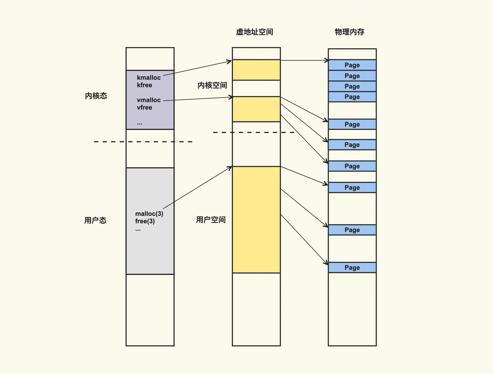
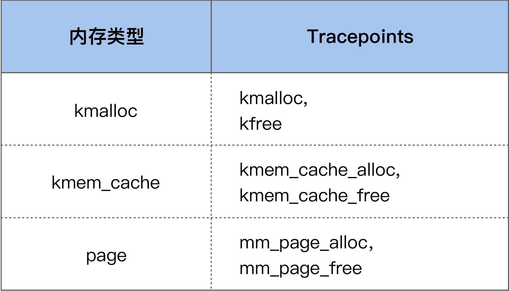

# 09 分析篇 | 如何对内核内存泄漏做些基础的分析？

 

你好，我是邵亚方。

如果你是一名应用开发者，那你对应用程序引起的内存泄漏应该不会陌生。但是，你有没有想过，内存泄漏也可能是由操作系统（内核）自身的问题引起的呢？这是很多应用开发者以及运维人员容易忽视的地方，或者是相对陌生的领域。

然而陌生的领域不代表不会有问题，如果在陌生的领域发生了问题，而你总是习惯于分析应用程序自身，那你可能要浪费很多的分析时间，却依然一无所获。所以，对于应用开发者或者运维人员而言，掌握基本的内核内存泄漏分析方法也是必需的，这样在它发生问题时，你可以有一个初步的判断，而不至于一筹莫展。

内核内存泄漏往往都会是很严重的问题，这通常意味着要重启服务器来解决了，我们肯定并不希望只能靠重启服务器来解决它，不然那就只能没完没了地重启了。我们希望的应该是，在发生了内存泄漏后，能够判断出来是不是内核引起的问题，以及能够找到引起问题的根因，或者是向更专业的内核开发者求助来找到问题根因，从而彻底解决掉它，以免再次重启服务器。

那么，我们该如何判断内存泄漏是否是内核导致的呢？这节课我们就来讲一讲内核内存泄漏的基础分析方法。

## 内核内存泄漏是什么？

在进行具体的分析之前，我们需要先对内核内存泄漏有个初步的概念，究竟内核内存泄漏是指什么呢？这得从内核空间内存分配的基本方法说起。

我们在06 基础篇里讲过，进程的虚拟地址空间（address space）既包括用户地址空间，也包括内核地址空间。这可以简单地理解为，进程运行在用户态申请的内存，对应的是用户地址空间，进程运行在内核态申请的内存，对应的是内核地址空间，如下图所示：



应用程序可以通过 malloc() 和 free() 在用户态申请和释放内存，与之对应，可以通过 kmalloc()/kfree() 以及 vmalloc()/vfree() 在内核态申请和释放内存。当然，还有其他申请和释放内存的方法，但大致可以分为这两类。

从最右侧的物理内存中你可以看出这两类内存申请方式的主要区别，kmalloc() 内存的物理地址是连续的，而 vmalloc() 内存的物理地址则是不连续的。这两种不同类型的内存也是可以通过 /proc/meminfo 来观察的：

```
$ cat /proc/meminfo  
...  
Slab:            2400284 kB  
SReclaimable:      47248 kB  
SUnreclaim:      2353036 kB  
...  
VmallocTotal:   34359738367 kB  
VmallocUsed:     1065948 kB  
...
```

其中 vmalloc 申请的内存会体现在 VmallocUsed 这一项中，即已使用的 Vmalloc 区大小；而 kmalloc 申请的内存则是体现在 Slab 这一项中，它又分为两部分，其中 SReclaimable 是指在内存紧张的时候可以被回收的内存，而 SUnreclaim 则是不可以被回收只能主动释放的内存。

内核之所以将 kmalloc 和 vmalloc 的信息通过 /proc/meminfo 给导出来，也是为了在它们引起问题的时候，让我们可以有方法来进行排查。在讲述具体的案例以及排查方法之前，我们先以一个简单的程序来看下内核空间是如何进行内存申请和释放的。

```
/* kmem_test */  
#include <linux/init.h>  
#include <linux/vmalloc.h>  
  
#define SIZE (1024 * 1024 * 1024)  
  
char *kaddr;  
  
char *kmem_alloc(unsigned long size)  
{  
        char *p;  
        p = vmalloc(size);  
        if (!p)  
                pr_info("[kmem_test]: vmalloc failed\n");  
        return p;  
}  
  
void kmem_free(const void *addr)  
{  
        if (addr)  
                vfree(addr);  
}  
  
  
int __init kmem_init(void)  
{  
        pr_info("[kmem_test]: kernel memory init\n");  
        kaddr = kmem_alloc(SIZE);  
        return 0;  
}  
  
  
void __exit kmem_exit(void)  
{  
        kmem_free(kaddr);  
        pr_info("[kmem_test]: kernel memory exit\n");  
}  
  
module_init(kmem_init)  
module_exit(kmem_exit)  
  
MODULE_LICENSE("GPLv2");
```

这是一个典型的内核模块，在这个内核模块中，我们使用 vmalloc 来分配了 1G 的内存空间，然后在模块退出的时候使用 vfree 释放掉它。这在形式上跟应用申请 / 释放内存其实是一致的，只是申请和释放内存的接口函数不一样而已。

我们需要使用 Makefile 来编译这个内核模块：

```
obj-m = kmem_test.o  
  
all:  
        make -C /lib/modules/`uname -r`/build M=`pwd`  
clean:  
        rm -f *.o *.ko *.mod.c *.mod *.a modules.order Module.symvers
```

执行 make 命令后就会生成一个 kmem_test 的内核模块，接着执行下面的命令就可以安装该模块了：

```
$ insmod kmem_test
```

用 rmmod 命令则可以把它卸载掉：

```
$ rmmod kmem_test
```

这个示例程序就是内核空间内存分配的基本方法。你可以在插入 / 卸载模块前后观察 VmallocUsed 的变化，以便于你更好地理解这一项的含义。

那么，在什么情况下会发生内核空间的内存泄漏呢？

跟用户空间的内存泄漏类似，内核空间的内存泄漏也是指只申请内存而不去释放该内存的情况，比如说，如果我们不在 kmem_exit() 这个函数中调用 kmem_free()，就会产生内存泄漏问题。

那么，内核空间的内存泄漏与用户空间的内存泄漏有什么不同呢？我们知道，用户空间内存的生命周期与用户进程是一致的，进程退出后这部分内存就会自动释放掉。但是，内核空间内存的生命周期是与内核一致的，却不是跟内核模块一致的，也就是说，在内核模块退出时，不会自动释放掉该内核模块申请的内存，只有在内核重启（即服务器重启）时才会释放掉这部分内存。

总之，一旦发生内核内存泄漏，你很难有很好的方法来优雅地解决掉它，很多时候唯一的解决方案就是重启服务器，这显然是件很严重的问题。同样地，我也建议你来观察下这个行为，但是你需要做好重启服务器的心理准备。

kmalloc 的用法跟 vmalloc 略有不同，你可以参考kmalloc API和kfree API来修改一下上面的测试程序，然后观察下 kmalloc 内存和 /proc/meminfo 中那几项的关系，我在这里就不做演示了，留给你作为课后作业。

内核内存泄漏的问题往往会发生在一些驱动程序中，比如说网卡驱动，SSD 卡驱动等，以及我们自己开发的一些驱动，因为这类驱动不像 Linux 内核那样经历过大规模的功能验证和测试，所以相对容易出现一些隐藏很深的问题。

我们在生产环境上就遇到过很多起这类第三方驱动引发的内存泄漏问题，排查起来往往也比较费时。作为一个解决过很多这类问题的过来人，我对你的建议是，当你发现内核内存泄漏时，首先需要去质疑的就是你们系统中的第三方驱动程序，以及你们自己开发的驱动程序。

那么，我们该如何来观察内核内存泄漏呢？

## 如何观察内核内存泄漏？

在前面已经讲过，我们可以通过 /proc/meminfo 来观察内核内存的分配情况，这提供了一个观察内核内存的简便方法：

1. 如果 /proc/meminfo 中内核内存（比如 VmallocUsed 和 SUnreclaim）太大，那很有可能发生了内核内存泄漏；
2. 另外，你也可以周期性地观察 VmallocUsed 和 SUnreclaim 的变化，如果它们持续增长而不下降，也可能是发生了内核内存泄漏。

/proc/meminfo 只是提供了系统内存的整体使用情况，如果我们想要看具体是什么模块在使用内存，那该怎么办呢？

这也可以通过 /proc 来查看，所以再次强调一遍，当你不清楚该如何去分析时，你可以试着去查看 /proc 目录下的文件。以上面的程序为例，安装 kmem_test 这个内核模块后，我们可以通过 /proc/vmallocinfo 来看到该模块的内存使用情况：

```
$ cat /proc/vmallocinfo | grep kmem_test  
0xffffc9008a003000-0xffffc900ca004000 1073745920 kmem_alloc+0x13/0x30 [kmem_test] pages=262144 vmalloc vpages N0=262144
```

可以看到，在[kmem_test]这个模块里，通过 kmem_alloc 这个函数申请了 262144 个 pages，即总共 1G 大小的内存。假设我们怀疑 kmem_test 这个模块存在问题，我们就可以去看看 kmem_alloc 这个函数里申请的内存有没有释放的地方。

上面这个测试程序相对比较简单一些，所以根据 /proc/vmallocinfo 里面的信息就能够简单地看出来是否有问题。但是，生产环境中运行的一些驱动或者内核模块，在逻辑上会复杂得多，很难一眼就看出来是否存在内存泄漏，这往往需要大量的分析。

那对于这种复杂场景下的内核内存泄漏问题，基本的分析思路是什么样的呢？

## 复杂场景下内核内存泄漏问题分析思路

如果我们想要对内核内存泄漏做些基础的分析，最好借助一些内核内存泄漏分析工具，其中最常用的分析工具就是kmemleak。

kmemleak 是内核内存泄漏检查的利器，但是，它的使用也存在一些不便性，因为打开该特性会给性能带来一些损耗，所以生产环境中的内核都会默认关闭该特性。该特性我们一般只用在测试环境中，然后在测试环境中运行需要分析的驱动程序以及其他内核模块。

与其他内存泄漏检查工具类似，kmemleak 也是通过检查内核内存的申请和释放，来判断是否存在申请的内存不再使用也不释放的情况。如果存在，就认为是内核内存泄漏，然后把这些泄漏的信息通过 /sys/kernel/debug/kmemleak 这个文件导出给用户分析。同样以我们上面的程序为例，检查结果如下：

```
unreferenced object 0xffffc9008a003000 (size 1073741824):  
  comm "insmod", pid 11247, jiffies 4344145825 (age 3719.606s)  
  hex dump (first 32 bytes):  
    38 40 18 ba 80 88 ff ff 00 00 00 00 00 00 00 00  8@..............  
    f0 13 c9 73 80 88 ff ff 18 40 18 ba 80 88 ff ff  ...s.....@......  
  backtrace:  
    [<00000000fbd7cb65>] __vmalloc_node_range+0x22f/0x2a0  
    [<000000008c0afaef>] vmalloc+0x45/0x50  
    [<000000004f3750a2>] 0xffffffffa0937013  
    [<0000000078198a11>] 0xffffffffa093c01a  
    [<000000002041c0ec>] do_one_initcall+0x4a/0x200  
    [<000000008d10d1ed>] do_init_module+0x60/0x220  
    [<000000003c285703>] load_module+0x156c/0x17f0  
    [<00000000c428a5fe>] __do_sys_finit_module+0xbd/0x120  
    [<00000000bc613a5a>] __x64_sys_finit_module+0x1a/0x20  
    [<000000004b0870a2>] do_syscall_64+0x52/0x90  
    [<000000002f458917>] entry_SYSCALL_64_after_hwframe+0x44/0xa9
```

由于该程序通过 vmalloc 申请的内存以后再也没有使用，所以被 kmemleak 标记为了“unreferenced object”，我们需要在使用完该内存空间后就释放它以节省内存。

如果我们想在生产环境上来观察内核内存泄漏，就无法使用 kmemleak 了，那还有没有其他的方法呢？

我们可以使用内核提供的内核内存申请释放的 tracepoint，来动态观察内核内存使用情况：



当我们使能这些 tracepoints 后，就可以观察内存的动态申请和释放情况了，只是这个分析过程不如 kmemleak 那么高效。

当我们想要观察某些内核结构体的申请和释放时，可能没有对应的 tracepiont。这个时候就需要使用 kprobe 或者 systemtap，来针对具体的内核结构体申请释放函数进行追踪了。下面就是我们在生产环境中的一个具体案例。

业务方反馈说 docker 里面的可用内存越来越少，不清楚是什么状况，在我们通过 /proc 下面的文件（/proc/slabinfo）判断出来是 dentry 消耗内存过多后，写了一个 systemtap 脚本来观察 dentry 的申请和释放：

```
# dalloc_dfree.stp  
# usage : stap -x pid dalloc_dfree.stp  
global free = 0;  
global alloc = 0;  
  
probe kernel.function("d_free") {  
        if (target() == pid()) {  
                free++;  
        }     
}  
  
probe kernel.function("d_alloc").return {  
        if (target() == pid()) {  
                alloc++;  
        }     
}  
  
probe end {  
        printf("alloc %d free %d\n", alloc, free);  
}
```

我们使用该工具进行了多次统计，都发现是 dentry 的申请远大于它的释放：

```
alloc 2041 free 1882  
alloc 18137 free 6852  
alloc 22505 free 10834  
alloc 33118 free 20531
```

于是，我们判断在容器环境中 dentry 的回收存在问题，最终定位出这是 3.10 版本内核的一个 Bug： 如果 docker 内部内存使用达到了 limit，但是全局可用内存还很多，那就无法去回收 docker 内部的 slab 了。当然，这个 Bug 在新版本内核上已经 fix 了。

好了，我们这节课就讲到这里。

## 课堂总结

这节课我们讲了一种更难分析以及引起危害更大的内存泄漏：内核内存泄漏。我们还讲了针对这种内存泄漏的常用分析方法：

1. 你可以通过 /proc/meminfo 里面的信息来看内核内存的使用情况，然后根据这里面的信息来做一些基本的判断：如果内核太大那就值得怀疑；
2. kmemleak 是内核内存分析的利器，但是一般只在测试环境上使用它，因为它对性能会有比较明显的影响；
3. 在生产环境中可以使用 tracepoint 或者 kprobe，来追踪特定类型内核内存的申请和释放，从而帮助我们判断是否存在内存泄漏。但这往往需要专业的知识，你在不明白的时候可以去请教一些内核专家；
4. 内核内存泄漏通常都是第三方驱动或者自己写的一些内核模块导致的，在出现内核内存泄漏时，你可以优先去排查它们。

## 课后作业

我们这节课讲的内容对应用开发者会有些难度，对于运维人员而言也是需要掌握的。所以我们的课后作业主要是针对运维人员或者内核初学者的：请写一个 systemtap 脚本来追踪内核内存的申请和释放。欢迎你在留言区与我讨论。

感谢你的阅读，如果你认为这节课的内容有收获，也欢迎把它分享给你的朋友，我们下一讲见。
