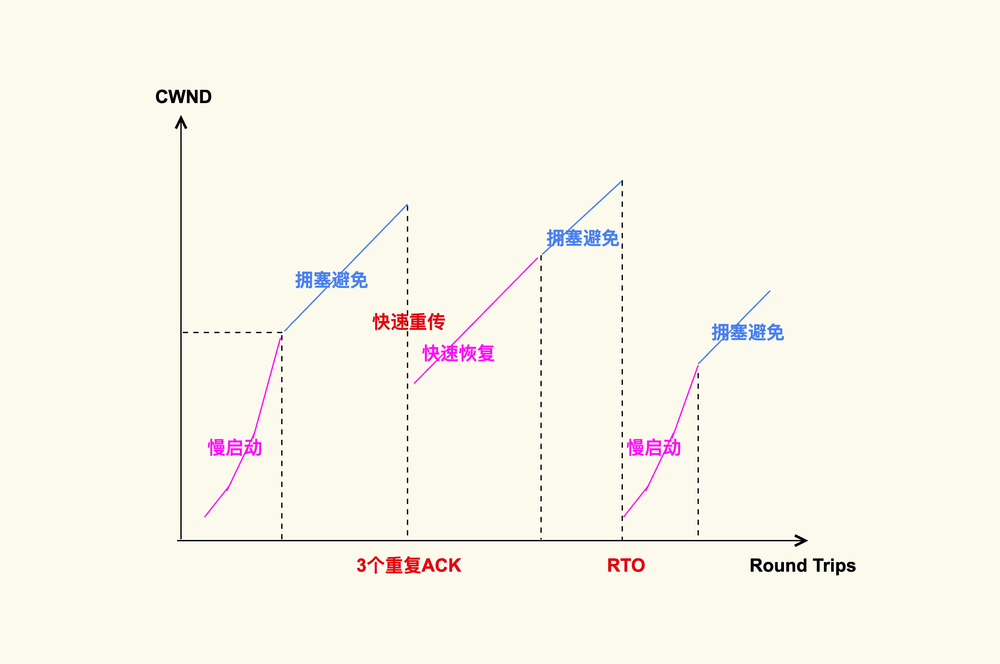
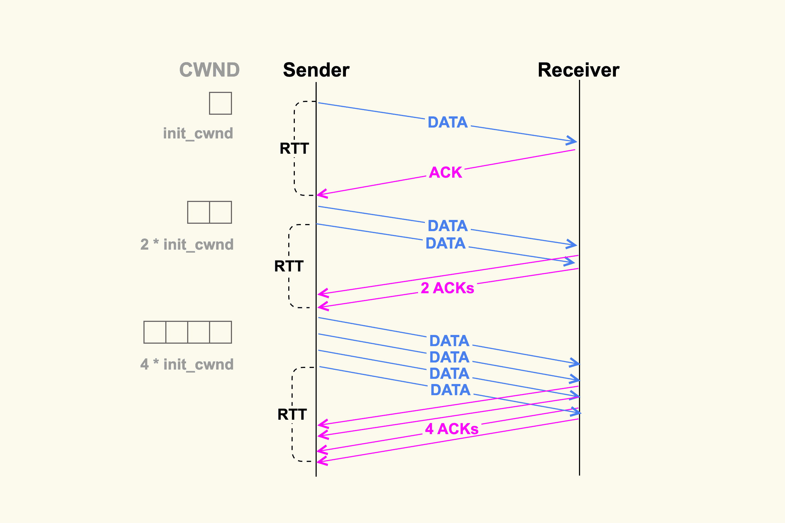
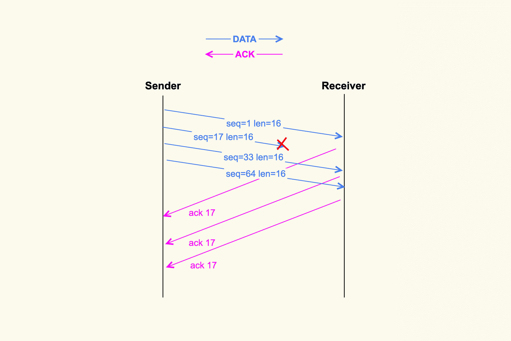
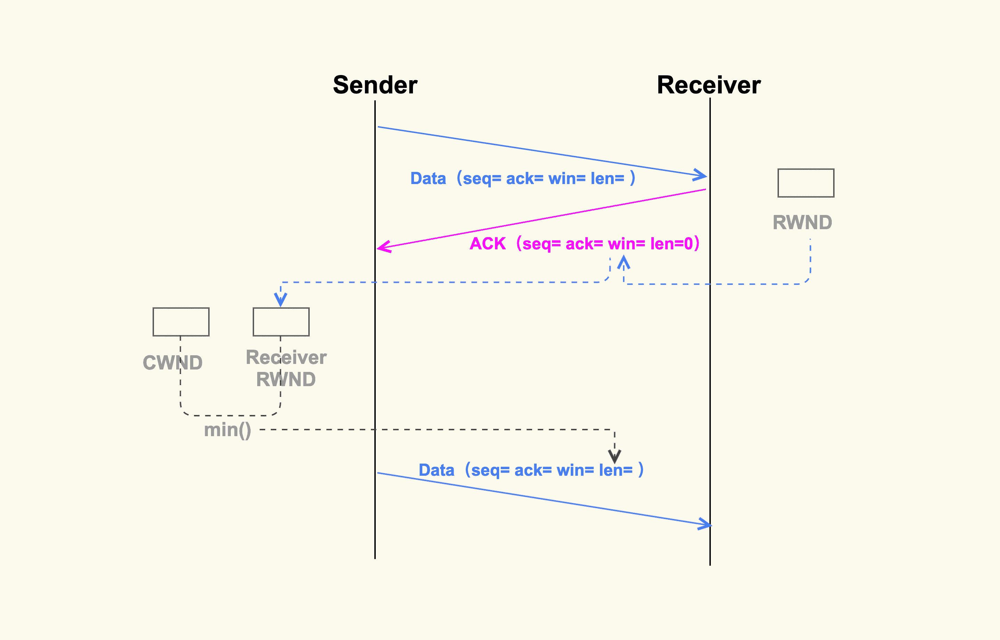

# 13 案例篇 | TCP拥塞控制是如何导致业务性能抖动的？

 

你好，我是邵亚方。这节课我来跟大家分享 TCP 拥塞控制与业务性能抖动之间的关系。

TCP 拥塞控制是 TCP 协议的核心，而且是一个非常复杂的过程。如果你不了解 TCP 拥塞控制的话，那么就相当于不理解 TCP 协议。这节课的目的是通过一些案例，介绍在 TCP 拥塞控制中我们要避免踩的一些坑，以及针对 TCP 性能调优时需要注意的一些点。

因为在 TCP 传输过程中引起问题的案例有很多，所以我不会把这些案例拿过来具体去一步步分析，而是希望能够对这些案例做一层抽象，把这些案例和具体的知识点结合起来，这样会更有系统性。并且，在你明白了这些知识点后，案例的分析过程就相对简单了。

我们在前两节课（第 11 讲和第 12 讲）中讲述了单机维度可能需要注意的问题点。但是，网络传输是一个更加复杂的过程，这中间涉及的问题会更多，而且更加不好分析。相信很多人都有过这样的经历：

1. 等电梯时和别人聊着微信，进入电梯后微信消息就发不出去了；
2. 和室友共享同一个网络，当玩网络游戏玩得正开心时，游戏忽然卡得很厉害，原来是室友在下载电影；
3. 使用 ftp 上传一个文件到服务器上，没想到要上传很久；
4. ……

在这些问题中，TCP 的拥塞控制就在发挥着作用。

## TCP 拥塞控制是如何对业务网络性能产生影响的 ？

我们先来看下 TCP 拥塞控制的大致原理。



TCP拥塞控制

上图就是 TCP 拥塞控制的简单图示，它大致分为四个阶段。

#### 1. 慢启动

TCP 连接建立好后，发送方就进入慢速启动阶段，然后逐渐地增大发包数量（TCP Segments）。这个阶段每经过一个 RTT（round-trip time），发包数量就会翻倍。如下图所示：



TCP Slow Start示意图

初始发送数据包的数量是由 init_cwnd（初始拥塞窗口）来决定的，该值在 Linux 内核中被设置为 10（TCP_INIT_CWND），这是由 Google 的研究人员总结出的一个经验值，这个经验值也被写入了RFC6928。并且，Linux 内核在 2.6.38 版本中也将它从默认值 3 修改为了 Google 建议的 10，你感兴趣的话可以看下这个 commit： tcp: Increase the initial congestion window to 10。

增大 init_cwnd 可以显著地提升网络性能，因为这样在初始阶段就可以一次性发送很多 TCP Segments，更加细节性的原因你可以参考RFC6928的解释。

如果你的内核版本比较老（低于 CentOS-6 的内核版本），那不妨考虑增加 init_cwnd 到 10。如果你想要把它增加到一个更大的值，也不是不可以，但是你需要根据你的网络状况多做一些实验，从而得到一个较为理想的值。因为如果初始拥塞窗口设置得过大的话，可能会引起很高的 TCP 重传率。当然，你也可以通过 ip route 的方式来更加灵活地调整该值，甚至将它配置为一个 sysctl 控制项。

增大 init_cwnd 的值对于提升短连接的网络性能会很有效，特别是数据量在慢启动阶段就能发送完的短连接，比如针对 http 这种服务，http 的短连接请求数据量一般不大，通常在慢启动阶段就能传输完，这些都可以通过 tcpdump 来进行观察。

在慢启动阶段，当拥塞窗口（cwnd）增大到一个阈值（ ssthresh，慢启动阈值）后，TCP 拥塞控制就进入了下一个阶段：拥塞避免（Congestion Avoidance）。

#### 2. 拥塞避免

在这个阶段 cwnd 不再成倍增加，而是一个 RTT 增加 1，即缓慢地增加 cwnd，以防止网络出现拥塞。网络出现拥塞是难以避免的，由于网络链路的复杂性，甚至会出现乱序（Out of Order）报文。乱序报文产生原因之一如下图所示：



TCP乱序报文

在上图中，发送端一次性发送了 4 个 TCP segments，但是第 2 个 segment 在传输过程中被丢弃掉了，那么接收方就接收不到该 segment 了。然而第 3 个 TCP segment 和第 4 个 TCP segment 能够被接收到，此时 3 和 4 就属于乱序报文，它们会被加入到接收端的 ofo queue（乱序队列）里。

丢包这类问题在移动网络环境中比较容易出现，特别是在一个网络状况不好的环境中，比如在电梯里丢包率就会很高，而丢包率高就会导致网络响应特别慢。在数据中心内部的服务上很少会有数据包在网络链路中被丢弃的情况，我说的这类丢包问题主要是针对网关服务这种和外部网络有连接的服务上。

针对我们的网关服务，我们自己也做过一些 TCP 单边优化工作，主要是优化 Cubic 拥塞控制算法，以缓解丢包引起的网络性能下降问题。另外，Google 前几年开源的一个新的拥塞控制算法 BBR在理论上也可以很好地缓解 TCP 丢包问题，但是在我们的实践中，BBR 的效果并不好，因此我们最终也没有使用它。

我们再回到上面这张图，因为接收端没有接收到第 2 个 segment，因此接收端每次收到一个新的 segment 后都会去 ack 第 2 个 segment，即 ack 17。紧接着，发送端就会接收到三个相同的 ack（ack 17）。连续出现了 3 个响应的 ack 后，发送端会据此判断数据包出现了丢失，于是就进入了下一个阶段：快速重传。

#### 3. 快速重传和快速恢复

快速重传和快速恢复是一起工作的，它们是为了应对丢包这种行为而做的优化，在这种情况下，由于网络并没有出现拥塞，所以拥塞窗口不必恢复到初始值。判断丢包的依据就是收到 3 个相同的 ack。

Google 的工程师同样对 TCP 快速重传提出了一个改进策略：tcp early retrans，它允许一些情况下的 TCP 连接可以绕过重传延时（RTO）来进行快速重传。3.6 版本以后的内核都支持了这个特性，因此，如果你还在使用 CentOS-6，那么就享受不到它带来的网络性能提升了，你可以将你的操作系统升级为 CentOS-7 或者最新的 CentOS-8。 另外，再多说一句，Google 在网络方面的技术实力是其他公司没法比的，Linux 内核 TCP 子系统的 maintainer 也是 Google 的工程师（Eric Dumazet）。

除了快速重传外，还有一种重传机制是超时重传。不过，这是非常糟糕的一种情况。如果发送出去一个数据包，超过一段时间（RTO）都收不到它的 ack，那就认为是网络出现了拥塞。这个时候就需要将 cwnd 恢复为初始值，再次从慢启动开始调整 cwnd 的大小。

RTO 一般发生在网络链路有拥塞的情况下，如果某一个连接数据量太大，就可能会导致其他连接的数据包排队，从而出现较大的延迟。我们在开头提到的，下载电影影响到别人玩网络游戏的例子就是这个原因。

关于 RTO，它也是一个优化点。如果 RTO 过大的话，那么业务就可能要阻塞很久，所以在 3.1 版本的内核里引入了一种改进来将 RTO 的初始值从 3s 调整为 1s，这可以显著节省业务的阻塞时间。不过，RTO=1s 在某些场景下还是有些大了，特别是在数据中心内部这种网络质量相对比较稳定的环境中。

我们在生产环境中发生过这样的案例：业务人员反馈说业务 RT 抖动得比较厉害，我们使用 strace 初步排查后发现，进程阻塞在了 send() 这类发包函数里。然后我们使用 tcpdump 来抓包，发现发送方在发送数据后，迟迟不能得到对端的响应，一直到 RTO 时间再次重传。与此同时，我们还尝试了在对端也使用 tcpdump 来抓包，发现对端是过了很长时间后才收到数据包。因此，我们判断是网络发生了拥塞，从而导致对端没有及时收到数据包。

那么，针对这种网络拥塞引起业务阻塞时间太久的情况，有没有什么解决方案呢？一种解决方案是，创建 TCP 连接，使用 SO_SNDTIMEO 来设置发送超时时间，以防止应用在发包的时候阻塞在发送端太久，如下所示：

> ret = setsockopt(sockfd, SOL_SOCKET, SO_SNDTIMEO, &timeout, len);

当业务发现该 TCP 连接超时后，就会主动断开该连接，然后尝试去使用其他的连接。

这种做法可以针对某个 TCP 连接来设置 RTO 时间，那么，有没有什么方法能够设置全局的 RTO 时间（设置一次，所有的 TCP 连接都能生效）呢？答案是有的，这就需要修改内核。针对这类需求，我们在生产环境中的实践是：将 TCP RTO min、TCP RTO max、TCP RTO init 更改为可以使用 sysctl 来灵活控制的变量，从而根据实际情况来做调整，比如说针对数据中心内部的服务器，我们可以适当地调小这几个值，从而减少业务阻塞时间。

上述这 4 个阶段是 TCP 拥塞控制的基础，总体来说，拥塞控制就是根据 TCP 的数据传输状况来灵活地调整拥塞窗口，从而控制发送方发送数据包的行为。换句话说，拥塞窗口的大小可以表示网络传输链路的拥塞情况。TCP 连接 cwnd 的大小可以通过 ss 这个命令来查看：

```
$ ss -nipt  
State       Recv-Q Send-Q                        Local Address:Port                                       Peer Address:Port           
ESTAB       0      36                             172.23.245.7:22                                        172.30.16.162:60490        
users:(("sshd",pid=19256,fd=3))  
   cubic wscale:5,7 rto:272 rtt:71.53/1.068 ato:40 mss:1248 rcvmss:1248 advmss:1448 cwnd:10 bytes_acked:19591 bytes_received:2817 segs_out:64 segs_in:80 data_segs_out:57 data_segs_in:28 send 1.4Mbps lastsnd:6 lastrcv:6 lastack:6 pacing_rate 2.8Mbps delivery_rate 1.5Mbps app_limited busy:2016ms unacked:1 rcv_space:14600 minrtt:69.402
```

通过该命令，我们可以发现这个 TCP 连接的 cwnd 为 10。

如果你想要追踪拥塞窗口的实时变化信息，还有另外一个更好的办法：通过 tcp_probe 这个 tracepoint 来追踪：

```
/sys/kernel/debug/tracing/events/tcp/tcp_probe
```

但是这个 tracepoint 只有 4.16 以后的内核版本才支持，如果你的内核版本比较老，你也可以使用 tcp_probe 这个内核模块（net/ipv4/tcp_probe.c）来进行追踪。

除了网络状况外，发送方还需要知道接收方的处理能力。如果接收方的处理能力差，那么发送方就必须要减缓它的发包速度，否则数据包都会挤压在接收方的缓冲区里，甚至被接收方给丢弃掉。接收方的处理能力是通过另外一个窗口——rwnd（接收窗口）来表示的。那么，接收方的 rwnd 又是如何影响发送方的行为呢？

## 接收方是如何影响发送方发送数据的？

同样地，我也画了一张简单的图，来表示接收方的 rwnd 是如何影响发送方的：



rwnd与cwnd

如上图所示，接收方在收到数据包后，会给发送方回一个 ack，然后把自己的 rwnd 大小写入到 TCP 头部的 win 这个字段，这样发送方就能根据这个字段来知道接收方的 rwnd 了。接下来，发送方在发送下一个 TCP segment 的时候，会先对比发送方的 cwnd 和接收方的 rwnd，得出这二者之间的较小值，然后控制发送的 TCP segment 个数不能超过这个较小值。

关于接收方的 rwnd 对发送方发送行为的影响，我们曾经遇到过这样的案例：业务反馈说 Server 向 Client 发包很慢，但是 Server 本身并不忙，而且网络看起来也没有问题，所以不清楚是什么原因导致的。对此，我们使用 tcpdump 在 server 上抓包后发现，Client 响应的 ack 里经常出现 win 为 0 的情况，也就是 Client 的接收窗口为 0。于是我们就去 Client 上排查，最终发现是 Client 代码存在 bug，从而导致无法及时读取收到的数据包。

对于这种行为，我同样给 Linux 内核写了一个 patch 来监控它：tcp: add SNMP counter for zero-window drops 。这个 patch 里增加了一个新的 SNMP 计数：TCPZeroWindowDrop。如果系统中发生了接收窗口太小而无法收包的情况，就会产生该事件，然后该事件可以通过 /proc/net/netstat 里的 TCPZeroWindowDrop 这个字段来查看。

因为 TCP 头部大小是有限制的，而其中的 win 这个字段只有 16bit，win 能够表示的大小最大只有 65535（64K），所以如果想要支持更大的接收窗口以满足高性能网络，我们就需要打开下面这个配置项，系统中也是默认打开了该选项：

> net.ipv4.tcp_window_scaling = 1

关于该选项更加详细的设计，你如果想了解的话，可以去参考RFC1323。

好了，关于 TCP 拥塞控制对业务网络性能的影响，我们就先讲到这里。

## 课堂总结

TCP 拥塞控制是一个非常复杂的行为，我们在这节课里讲到的内容只是其中一些基础部分，希望这些基础知识可以让你对 TCP 拥塞控制有个大致的了解。我来总结一下这节课的重点：

1. 网络拥塞状况会体现在 TCP 连接的拥塞窗口（cwnd）中，该拥塞窗口会影响发送方的发包行为；
2. 接收方的处理能力同样会反馈给发送方，这个处理是通过 rwnd 来表示的。rwnd 和 cwnd 会共同作用于发送方，来决定发送方最大能够发送多少 TCP 包；
3. TCP 拥塞控制的动态变化，可以通过 tcp_probe 这个 tracepoint（对应 4.16+ 的内核版本）或者是 tcp_probe 这个内核模块（对应 4.16 之前的内核版本）来进行实时观察，通过 tcp_probe 你能够很好地观察到 TCP 连接的数据传输状况。

## 课后作业

通过 ssh 登录到服务器上，然后把网络关掉，过几秒后再打开，请问这个 ssh 连接还正常吗？为什么？欢迎你在留言区与我讨论。

感谢你的阅读，如果你认为这节课的内容有收获，也欢迎把它分享给你的朋友，我们下一讲见。
