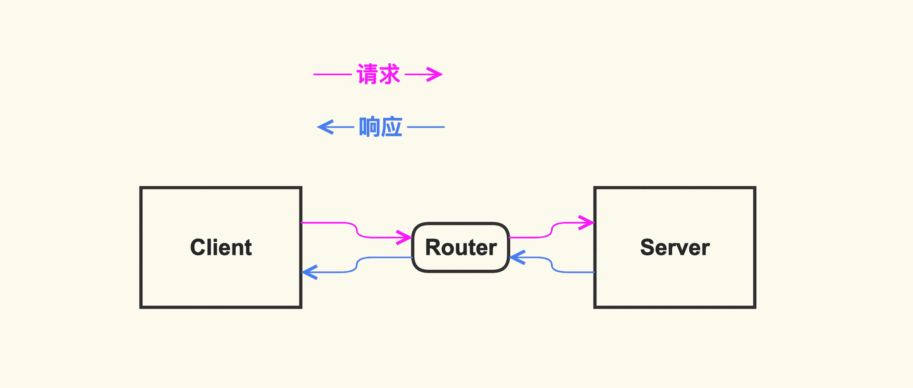
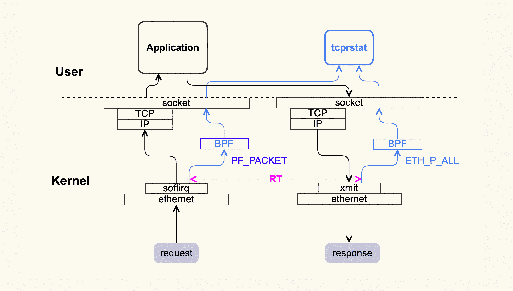
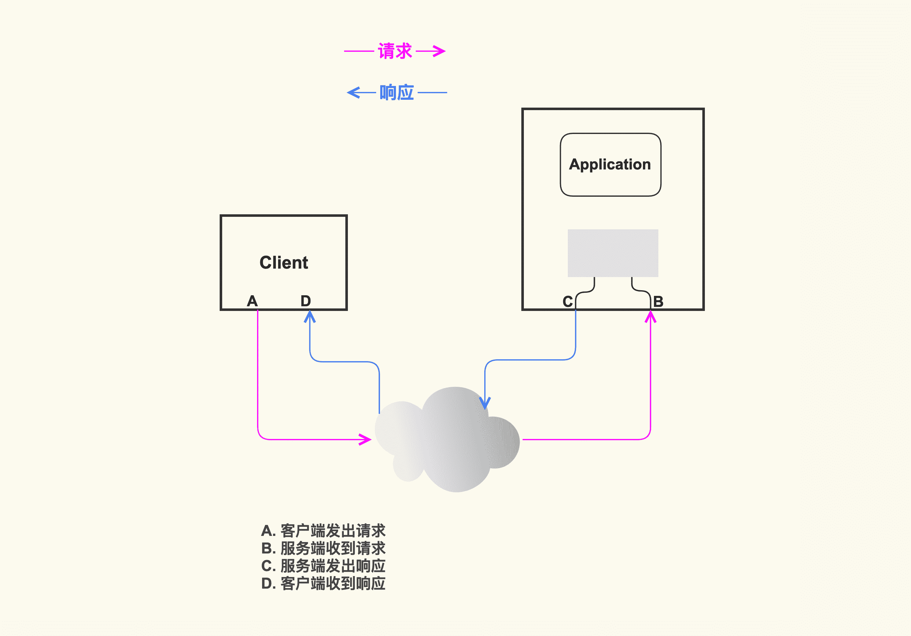
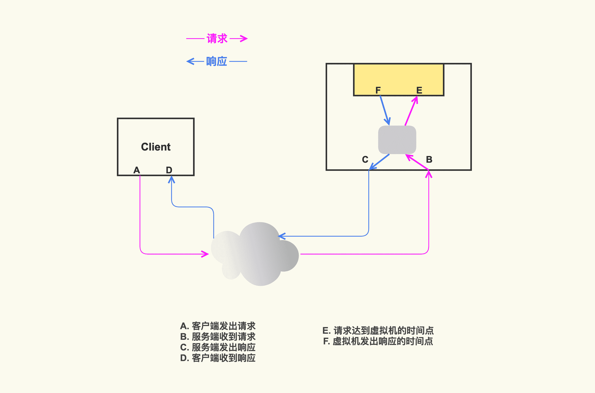

# 14 案例篇 | TCP端到端时延变大，怎样判断是哪里出现了问题？

 

你好，我是邵亚方。

如果你是一名互联网从业者，那你对下面这个场景应该不会陌生：客户端发送请求给服务端，服务端将请求处理完后，再把响应数据发送回客户端，这就是典型的 C/S（Client/Server）架构。对于这种请求 - 响应式的服务，我们不得不面对的问题是：

1. 如果客户端收到的响应时间变大了，那么这是客户端自身的问题呢，还是因为服务端处理得慢呢，又或者是因为网络有抖动呢？
2. 即使我们已经明确了是服务端或者客户端的问题，那么究竟是应用程序自身引起的问题呢，还是内核导致的问题呢？
3. 而且很多时候，这种问题往往是一天可能最多抖动一两次，我们很难去抓现场信息。

为了更好地处理这类折磨人的问题，我也摸索了一些手段来进行实时追踪，既不会给应用程序和系统带来明显的开销，又可以在出现这些故障时能够把信息给抓取出来，从而帮助我们快速定位出问题所在。

因此，这节课我来分享下我在这方面的一些实践，以及解决过的一些具体案例。

当然，这些实践并不仅仅适用于这种 C/S 架构，对于其他应用程序，特别是对延迟比较敏感的应用程序，同样具备参考意义。比如说：

1. 如果我的业务运行在虚拟机里面，那怎么追踪呢？
2. 如果 Client 和 Server 之间还有一个 Proxy，那怎么判断是不是 Proxy 引起的问题呢？

那么，我们就先从生产环境中 C/S 架构的网络抖动案例说起。

## 如何分析 C/S 架构中的网络抖动问题？

典型的C/S架构

上图就是一个典型的 C/S 架构，Client 和 Server 之间可能经过了很复杂的网络，但是对于服务器开发者或者运维人员而言，这些中间网络可以理解为是一个黑盒，很难去获取这些网络的详细信息，更不用说到这些网络设备上去做 debug 了。所以，我在这里把它们都简化为了一个 Router（路由器），然后 Client 和 Server 通过这个路由器来相互通信。比如互联网场景中的数据库服务（像 MySQL）、http 服务等都是这种架构。而当时给我们提需求来诊断网络抖动问题的也是 MySQL 业务。因此，接下来我们就以 MySQL 为例来进行具体讲解。

MySQL 的业务方反馈说他们的请求偶尔会超时很长，但不清楚是什么原因引起了超时，对应到上图中，就是 D 点收到响应的时刻和 A 点发出请求的时刻，这个时间差会偶然性地有毛刺。在发生网络问题时，使用 tcpdump 来抓包是常用的分析手段，当你不清楚该如何来分析网络问题时，那就使用 tcpdump 先把事故现场保存下来吧。

如果你使用过 tcpdump 来分析问题，那你应该也吐槽过用 tcpdump 分析问题会很麻烦。如果你熟悉 wireshark 的话，就会相对容易一些了。但是对于大部分人而言呢，学习 wirkshark 的成本也是很高的，而且 wireshark 的命令那么多，把每一条命令都记清楚也是件很麻烦的事。

回到我们这个案例中，在 MySQL 发生抖动的时候，我们的业务人员也使用了 tcpdump 来抓包保存了现场，但是他们并不清楚该如何分析这些 tcpdump 信息。在我帮他们分析这些 tcpdump 信息的时候，也很难把 tcpdump 信息和业务抖动的时刻关联起来。这是因为虽然我们知道业务抖动发生的时刻，比如说 21:00:00.000 这个时刻，但是在这一时刻的附近可能会有非常多的 TCP 数据包，很难简单地依赖时间戳把二者关联起来。而且，更重要的原因是，我们知道 TCP 是数据流，上层业务的一个请求可能会被分为多个 TCP 包（TCP Segment），同样地，多个请求也可能被合并为一个 TCP 包。也就是说，TCP 流是很难和应用数据关联起来的。这就是用 tcpdump 分析业务请求和响应的难点。

针对 tcpdump 难以分析应用协议的问题，有一个思路是，在 tcpdump 的时候把数据也保存下来，然后使用 tcpdump 再进一步去解析这些应用协议。但是你会发现，用这种方式来处理生产环境中的抖动问题是很不现实的，因为在生产环境中的 TCP 连接动辄数百上千条，我们往往并不清楚抖动发生在哪个 TCP 连接上。如果把这些 TCP 流都 dump 出来，data 部分即使只 dump 与应用协议有关的数据，这对磁盘 I/O 也是个负担。那有什么好办法吗？

好办法还是需要和应用协议关联起来，不过我们可以把这些应用协议做一层抽象，从而可以更简单地来解析它们，甚至无需解析。对于 MySQL 而言呢，工具tcprstat就是来做这件事的。

tcprstat 的大致原理是利用 MySQL 的 request-response 特征来简化对协议内容的处理。request-response 是指一个请求到达 MySQL 后，MySQL 处理完该请求，然后回 response，Client 侧收到 response 后再去发下一个 request，然后 MySQL 收到下一个 request 并处理。也就是说这种模型是典型的串行方式，处理完了一个再去处理下一个。所以 tcprstat 就可以以数据包到达 MySQL Server 侧作为起始时间点，以 MySQL 将最后一个数据包发出去作为结束时间点，然后这二者的时间差就是 RT（Response Time），这个过程大致如下图所示：

tcprstat追踪RT抖动

tcprstat 会记录 request 的到达时间点，以及 request 发出去的时间点，然后计算出 RT 并记录到日志中。当时我们把 tcprstat 部署到 MySQL server 侧后，发现每一个 RT 值都很小，并没有延迟很大的情况，所以看起来服务端并没有问题。那么问题是否发生在 Client 这里呢？

在我们想要把 tcprstat 也部署在 Client 侧抓取信息时，发现它只支持在 Server 侧部署，所以我们对 tcprstat 做了一些改造，让它也可以部署在 Client 侧。

这种改造并不麻烦，因为在 Client 侧解析的也是 MySQL 协议，只是 TCP 流的方向跟 Server 侧相反，Client 侧是发请求收响应，而 Server 侧是收请求发响应。

在改造完成后，我们就开始部署 tcprstat 来抓取抖动现场了。在业务发生抖动时，通过我们抓取到的信息显示，Client 在收到响应包的时候就已经发生延迟了，也就是说问题同样也不是发生在 Client 侧。这就有些奇怪了，既然 Client 和 Server 都没有问题，难道是网络链路出现了问题？

为了明确这一点，我们就在业务低峰期使用 ping 包来检查网络是否存在问题。ping 了大概数小时后，我们发现 ping 响应时间忽然变得很大，从不到 1ms 的时间增大到了几十甚至上百 ms，然后很快又恢复正常。

根据这个信息，我们推断某个交换机可能存在拥塞，于是就联系交换机管理人员来分析交换机。在交换机管理人员对这个链路上的交换机逐一排查后，最终定位到一台接入交换机确实有问题，它会偶然地出现排队很长的情况。而之所以 MySQL 反馈有抖动，其他业务没有反馈，只是因为这个接入交换机上的其他业务并不关心抖动。在交换机厂商帮忙修复了这个问题后，就再也没有出现过这种偶发性的抖动了。

这个结果看似很简单，但是分析过程还是很复杂的。因为一开始我们并不清楚问题发生在哪里，只能一步步去排查，所以这个分析过程也花费了几天的时间。

交换机引起的网络抖动问题，只是我们分析过的众多抖动案例之一。除了这类问题外，我们还分析过很多抖动是由于 Client 侧存在问题或者 Server 侧存在问题。在分析了这么多抖动问题之后，我们就开始思考，能否针对这类问题来做一个自动化分析系统呢？而且我们部署运行 tcprstat 后，也发现它存在一些不足之处，主要是它的性能开销略大，特别是在 TCP 连接数较多的情况下，它的 CPU 利用率甚至能够超过 10%，这难以满足我们生产环境中长时间运行的需要。

tcprstat 会有这么高的 CPU 开销，原因其实与 tcpdump 是类似的，它在旁路采集数据后会拷贝到用户空间来处理，这个拷贝以及处理时间就比较消耗 CPU。

为了满足生产环境的需求，我们在 tcprstat 的基础上，做了一个更加轻量级的分析系统。

## 如何轻量级地判断抖动发生在哪里？

我们的目标是在 10Gb 网卡的高并发场景下尽量地降低监控开销，最好可以控制在 1% 以内，而且不能给业务带来明显延迟。要想降低 CPU 开销，很多工作就需要在内核里面来完成，就跟现在很流行的 eBPF 这个追踪框架类似：内核处理完所有的数据，然后将结果返回给用户空间。

能够达到这个目标的方案大致有两种：一种是使用内核模块，另一种是使用轻量级的内核追踪框架。

使用内核模块的缺点是它的安装部署会很不方便，特别是在线上内核版本非常多的情况下，比如说，我们的线上既有 CentOS-6 的操作系统，也有 CentOS-7 的操作系统，每个操作系统又各自有很多小版本，以及我们自己发布的版本。统一线上的内核版本是件很麻烦的事，这会涉及到很多变更，不太现实。所以这种现状也就决定了，使用内核模块的方式需要付出比较高的维护成本。而且内核模块的易用性也很差，这会导致业务人员和运维人员排斥使用它，从而增加它的推广难度。基于这些考虑，我们最终选择了基于 systemtap 这个追踪框架来开发。没有选择 eBPF 的原因是，它对内核版本要求较高，而我们线上很多都是 CentOS-7 的内核。

基于 systemtap 实现的追踪框架大致如下图所示：

TCP流的追踪

它会追踪每一个 TCP 流，TCP 流对应到内核里的实现就是一个 struct sock 实例，然后记录 TCP 流经过 A/B/C/D 这四个点的时刻，依据这几个时间点，我们就可以得到下面的结论：

1. 如果 C-B 的时间差较大，那就说明 Server 侧有抖动，否则是 Client 或网络的问题；
2. 如果 D-A 的时间差较小，那就说明是 Client 侧问题，否则是 Server 或者网络的问题。

这样在发生 RT 抖动时，我们就能够区分出抖动是发生在 Client，Server，还是网络中了，这会大大提升分析定位问题的效率。在定位到问题出在哪里后，你就可以使用我们在“11 讲”、“12 讲”和“13 讲”里讲到的知识点，再去进一步分析具体的原因是什么了。

在使用 systemtap 的过程中我们也踩了不少坑，在这里也分享给你，希望你可以避免：

1. systemtap 的加载过程是一个开销很大的过程，主要是 CPU 的开销。因为 systemtap 的加载会编译 systemtap 脚本，这会比较耗时。你可以提前将你的 systemtap 脚本编译为内核模块，然后直接加载该模块来避免 CPU 开销；
2. systemtap 有很多开销控制选项，你可以设置开销阈值来作为兜底方案，以防止异常情况下它占用太多 CPU；
3. systemtap 进程异常退出后可能不会卸载 systemtap 模块，在你发现 systemtap 进程退出后，你需要检查它是否也把对应的内核模块给卸载了。如果没有，那你需要手动卸载一下，以免产生不必要的问题。

C/S 架构是互联网服务中比较典型的场景，那针对其他场景我们该如何来分析问题呢？接下来我们以虚拟机这种场景为例来看一下。

## 虚拟机场景下该如何判断抖动是发生在宿主机上还是虚拟机里？

随着云计算的发展，越来越多的业务开始部署在云上，很多企业或者使用自己定制的私有云，或者使用公有云。我们也有很多业务部署在自己的私有云中，既有基于 KVM 的虚拟机，也有基于 Kubernetes 和 Docker 的容器。以虚拟机为例，在 Server 侧发生抖动的时候，业务人员还想进一步知道，抖动是发生在 Server 侧的虚拟机内部，还是发生在 Server 侧的宿主机上。要想实现这个需求，我们只需要进一步扩展，再增加新的 hook 点，去记录 TCP 流经过虚拟机的时间点就好了，如下图所示：

虚拟机场景下TCP流的追踪

这样我们就可以根据 F 和 E 的时间差来判断抖动是否发生在虚拟机内部。针对这个需求，我们对 tcprstat 也做了类似的改造，让它可以识别出抖动是否发生在虚拟机内部。这个改造也不复杂，tcprstat 默认只处理目标地址为本机的数据包，不会处理转发包，所以我们让它支持混杂模式，然后就可以处理转发包了。当然，虚拟机的具体网络配置是千差万别的，你需要根据你的实际虚拟网络配置来做调整。

总之，希望你可以举一反三，根据你的实际业务场景来做合理的数据分析，而不要局限于我们这节课所列举的这几个具体场景。

## 课堂总结

我们这堂课以典型的 C/S 架构为例，分析了 RT 发生抖动时，该如何高效地识别出问题发生在哪里。我来总结一下这节课的重点：

1. tcpdump 是分析网络问题必须要掌握的工具，但是用它分析问题并不容易。在你不清楚该如何分析网络问题时，你可以先使用 tcpdump 把现场信息保存下来；
2. TCP 是数据流，如何把 TCP 流和具体的业务请求 / 响应数据包关联起来，是分析具体应用问题的前提。你需要结合你的业务模型来做合理的关联；
3. RT 抖动问题是很棘手的，你需要结合你的业务模型来开发一些高效的问题分析工具。如果你使用的是 Redhat 或者 CentOS，那么你可以考虑使用 systemtap；如果是 Ubuntu，你可以考虑使用 lttng。

## 课后作业

结合这堂课的第一张图，在这张图中，请问是否可以用 TCP 流到达 B 点的时刻（到达 Server 这台主机的时间）减去 TCP 流经过 A 点的时刻（到达 Client 这台主机的时间）来做为网络耗时？为什么？

结合我们在“13 讲“里讲到的 RTT 这个往返时延，你还可以进一步思考：是否可以使用 RTT 来作为这次网络耗时？为什么？欢迎你在留言区与我讨论。

感谢你的阅读，如果你认为这节课的内容有收获，也欢迎把它分享给你的朋友，我们下一讲见。
