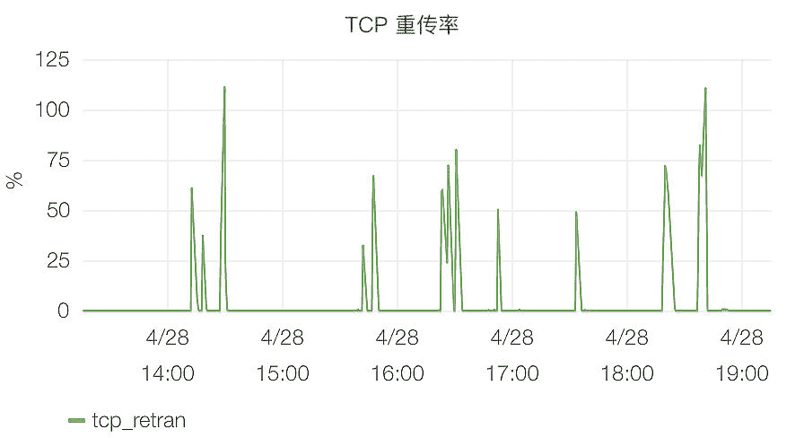
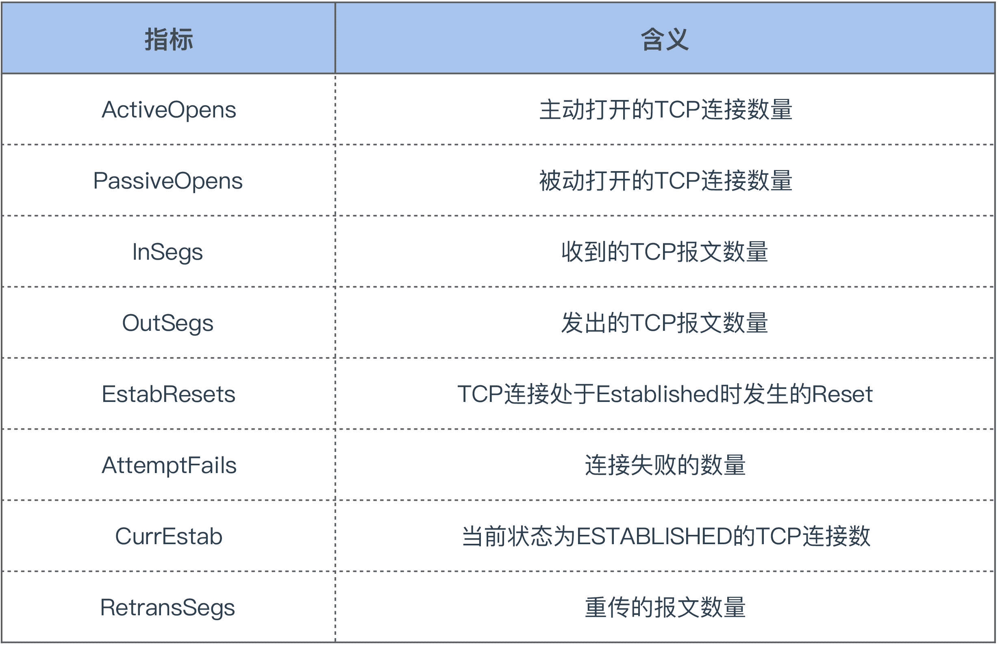
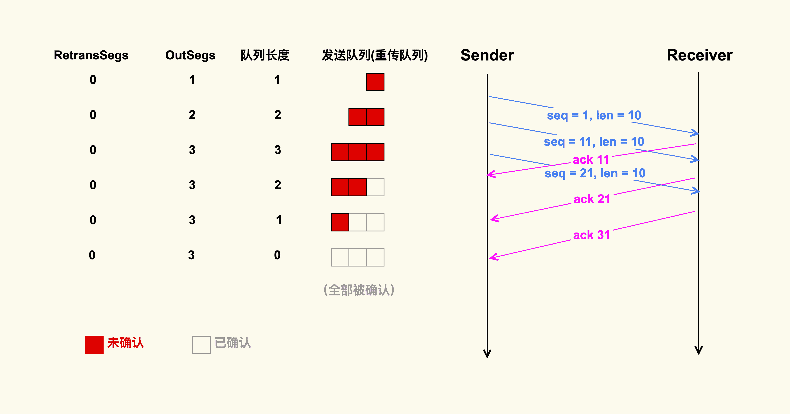
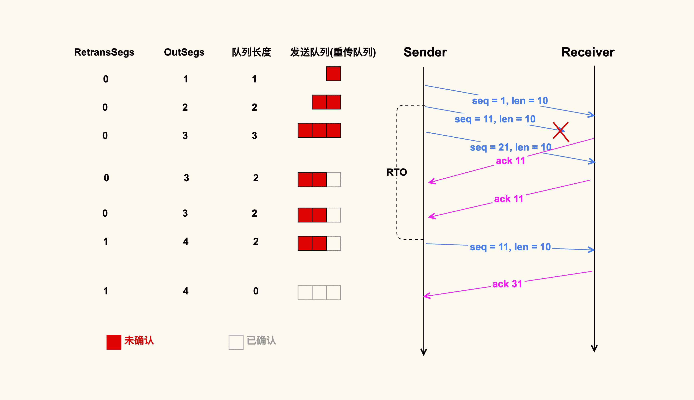
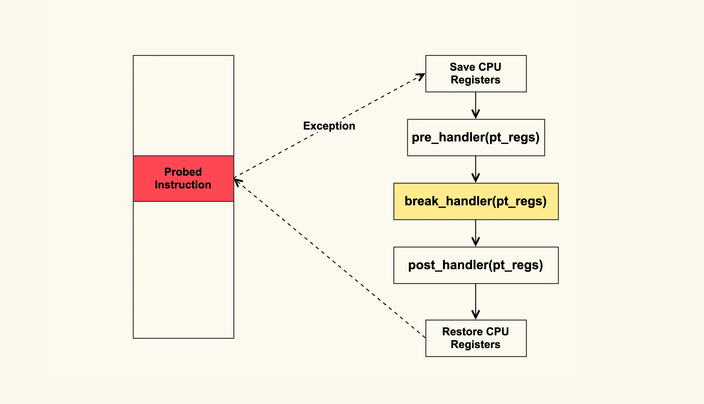

# 15 分析篇 | 如何高效地分析TCP重传问题？

 

你好，我是邵亚方。

我们在基础篇和案例篇里讲了很多问题，比如说 RT 抖动问题、丢包问题、无法建连问题等等。这些问题通常都会伴随着 TCP 重传，所以我们往往也会抓取 TCP 重传信息来辅助我们分析这些问题。

而且 TCP 重传也是一个信号，我们通常会利用这个信号来判断系统是否稳定。比如说，如果一台服务器的 TCP 重传率很高，那这个服务器肯定是存在问题的，需要我们及时采取措施，否则可能会产生更加严重的故障。

但是，TCP 重传率分析并不是一件很容易的事，比如说现在某台服务器的 TCP 重传率很高，那究竟是什么业务在进行 TCP 重传呢？对此，很多人并不懂得如何来分析。所以，在这节课中，我会带你来认识 TCP 重传是怎么回事，以及如何来高效地分析它。

## 什么是 TCP 重传 ？

我在“开篇词”中举过一个 TCP 重传率的例子，如下图所示：



这是互联网企业普遍都有的 TCP 重传率监控，它是服务器稳定性的一个指标，如果它太高，就像上图中的那些毛刺一样，往往就意味着服务器不稳定了。那 TCP 重传率究竟表示什么呢？

其实 TCP 重传率是通过解析 /proc/net/snmp 这个文件里的指标计算出来的，这个文件里面和 TCP 有关的关键指标如下：



TCP 重传率的计算公式如下：

> retrans = (RetransSegs－last RetransSegs) ／ (OutSegs－last OutSegs) * 100

也就是说，单位时间内 TCP 重传包的数量除以 TCP 总的发包数量，就是 TCP 重传率。那我们继续看下这个公式中的 RetransSegs 和 OutSegs 是怎么回事，我画了两张示例图来演示这两个指标的变化：



不存在重传的情况



存在重传的情况

通过这两个示例图，你可以发现，发送端在发送一个 TCP 数据包后，会把该数据包放在发送端的发送队列里，也叫重传队列。此时，OutSegs 会相应地加 1，队列长度也为 1。如果可以收到接收端对这个数据包的 ACK，该数据包就会在发送队列中被删掉，然后队列长度变为 0；如果收不到这个数据包的 ACK，就会触发重传机制，我们在这里演示的就是超时重传这种情况，也就是说发送端在发送数据包的时候，会启动一个超时重传定时器（RTO），如果超过了这个时间，发送端还没有收到 ACK，就会重传该数据包，然后 OutSegs 加 1，同时 RetransSegs 也会加 1。

这就是 OutSegs 和 RetransSegs 的含义：每发出去一个 TCP 包（包括重传包），OutSegs 会相应地加 1；每发出去一个重传包，RetransSegs 会相应地加 1。同时，我也在图中展示了重传队列的变化，你可以仔细看下。

除了上图中展示的超时重传外，还有快速重传机制。关于快速重传，你可以参考“13 讲”，我就不在这里详细描述了。

明白了 TCP 重传是如何定义的之后，我们继续来看下哪些情况会导致 TCP 重传。

引起 TCP 重传的情况在整体上可以分为如下两类。

1. **丢包**

TCP 数据包在网络传输过程中可能会被丢弃；接收端也可能会把该数据包给丢弃；接收端回的 ACK 也可能在网络传输过程中被丢弃；数据包在传输过程中发生错误而被接收端给丢弃……这些情况都会导致发送端重传该 TCP 数据包。

2. **拥塞**

TCP 数据包在网络传输过程中可能会在某个交换机 / 路由器上排队，比如臭名昭著的 Bufferbloat（缓冲膨胀）；TCP 数据包在网络传输过程中因为路由变化而产生的乱序；接收端回的 ACK 在某个交换机 / 路由器上排队……这些情况都会导致发送端再次重传该 TCP 数据包。

总之，TCP 重传可以很好地作为通信质量的信号，我们需要去重视它。

那么，当我们发现某个主机上 TCP 重传率很高时，该如何去分析呢？

## 分析 TCP 重传的常规手段

最常规的分析手段就是 tcpdump，我们可以使用它把进出某个网卡的数据包给保存下来：

```
$ tcpdump -s 0 -i eth0 -w tcpdumpfile
```

然后在 Linux 上我们可以使用 tshark 这个工具（wireshark 的 Linux 版本）来过滤出 TCP 重传包：

```
$ tshark -r tcpdumpfile -R tcp.analysis.retransmission
```

如果有重传包的话，就可以显示出来了，如下是一个 TCP 重传的示例：

```
3481  20.277303 10.17.130.20 -> 124.74.250.144 TCP 70 [TCP Retransmission] 35993 > https [SYN] Seq=0 Win=14600 Len=0 MSS=1460 SACK_PERM=1 TSval=3231504691 TSecr=0  
  
3659  22.277070 10.17.130.20 -> 124.74.250.144 TCP 70 [TCP Retransmission] 35993 > https [SYN] Seq=0 Win=14600 Len=0 MSS=1460 SACK_PERM=1 TSval=3231506691 TSecr=0  
  
8649  46.539393 58.216.21.165 -> 10.17.130.20 TLSv1 113 [TCP Retransmission] Change Cipher Spec, Encrypted Handshake Messag
```

借助 tcpdump，我们就可以看到 TCP 重传的详细情况。从上面这几个 TCP 重传信息中，我们可以看到，这是发生在 10.17.130.20:35993 - 124.74.250.144: 443 这个 TCP 连接上的重传；通过[SYN]这个 TCP 连接状态，可以看到这是发生在三次握手阶段的重传。依据这些信息，我们就可以继续去 124.74.250.144 这个主机上分析 https 这个服务为什么无法建立新的连接了。

但是，我们都知道 tcpdump 很重，如果直接在生产环境上进行采集的话，难免会对业务造成性能影响。那有没有更加轻量级的一些分析方法呢？

## 如何高效地分析 TCP 重传 ？

其实，就像应用程序实现一些功能需要调用对应的函数一样，TCP 重传也需要调用特定的内核函数。这个内核函数就是 tcp_retransmit_skb()。你可以把这个函数名字里的 skb 理解为是一个需要发送的网络包。那么，如果我们想要高效地追踪 TCP 重传情况，那么直接追踪该函数就可以了。

追踪内核函数最通用的方法是使用 Kprobe，Kprobe 的大致原理如下：



Kprobe基本原理

你可以实现一个内核模块，该内核模块中使用 Kprobe 在 tcp_retransmit_skb 这个函数入口插入一个 probe，然后注册一个 break_handler，这样在执行到 tcp_retransmit_skb 时就会异常跳转到注册的 break_handler 中，然后在 break_handler 中解析 TCP 报文（skb）就可以了，从而来判断是什么在重传。

如果你觉得实现内核模块比较麻烦，可以借助 ftrace 框架来使用 Kprobe。Brendan Gregg 实现的tcpretrans采用的就是这种方式，你也可以直接使用它这个工具来追踪 TCP 重传。不过，该工具也有一些缺陷，因为它是通过读取 /proc/net/tcp 这个文件来解析是什么在重传，所以它能解析的信息比较有限，而且如果 TCP 连接持续时间较短（比如短连接），那么该工具就无法解析出来了。另外，你在使用它时需要确保你的内核已经打开了 ftrace 的 tracing 功能，也就是 /sys/kernel/debug/tracing/tracing_on 中的内容需要为 1；在 CentOS-6 上，还需要 /sys/kernel/debug/tracing/tracing_enabled 也为 1。

```
$ cat /sys/kernel/debug/tracing/tracing_on   
1
```

如果为 0 的话，你需要打开它们，例如：

```
$ echo 1 > /sys/kernel/debug/tracing/tracing_on 
```

然后在追踪结束后，你需要来关闭他们：

```
$ echo 0 > /sys/kernel/debug/tracing/tracing_on 
```

由于 Kprobe 是通过异常（Exception）这种方式来工作的，所以它还是有一些性能开销的，在 TCP 发包快速路径上还是要避免使用 Kprobe。不过，由于重传路径是慢速路径，所以在重传路径上添加 Kprobe 也无需担心性能开销。

Kprobe 这种方式使用起来还是略有些不便，为了让 Linux 用户更方便地观察 TCP 重传事件，4.16 内核版本中专门添加了TCP tracepoint来解析 TCP 重传事件。如果你使用的操作系统是 CentOS-7 以及更老的版本，就无法使用该 Tracepoint 来观察了；如果你的版本是 CentOS-8 以及后续更新的版本，那你可以直接使用这个 Tracepoint 来追踪 TCP 重传，可以使用如下命令：

```
$ cd /sys/kernel/debug/tracing/events/  
$ echo 1 > tcp/tcp_retransmit_skb/enable
```

然后你就可以追踪 TCP 重传事件了：

```
$ cat trace_pipe  
<idle>-0     [007] ..s. 265119.290232: tcp_retransmit_skb: sport=22 dport=62264 saddr=172.23.245.8 daddr=172.30.18.225 saddrv6=::ffff:172.23.245.8 daddrv6=::ffff:172.30.18.225 state=TCP_ESTABLISHED
```

可以看到，当 TCP 重传发生时，该事件的基本信息就会被打印出来。多说一句，在最开始的版本中是没有“state=TCP_ESTABLISHED”这一项的。如果没有这一项，我们就无法识别该重传事件是不是发生在三次握手阶段了，所以我给内核贡献了一个 PATCH 来显示 TCP 连接状态，以便于问题分析，具体见tcp: expose sk_state in tcp_retransmit_skb tracepoint这个 commit。

追踪结束后呢，你需要将这个 Tracepoint 给关闭：

```
$ echo 0 > tcp/tcp_retransmit_skb/enable
```

Tracepoint 这种方式不仅使用起来更加方便，而且它的性能开销比 Kprobe 要小，所以我们在快速路径上也可以使用它。

因为 Tracepoint 对 TCP 重传事件的支持，所以 tcpretrans 这个工具也跟着进行了一次升级换代。它通过解析该 Tracepoint 实现了对 TCP 重传事件的追踪，而不再使用之前的 Kprobe 方式，具体你可以参考bcc tcpretrans。再多说一句，Brendan Gregg 在实现这些基于 ebpf 的 TCP 追踪工具之前也曾经跟我讨论过，所以我对他的这个工具才会这么熟悉。

我们针对 TCP 重传事件的分析就先讲到这里，希望能给你带来一些启发，去开发一些更加高效的工具来分析你遇到的 TCP 问题或者其他问题。

## 课堂总结

这堂课我们主要讲了 TCP 重传的一些知识，关于 TCP 重传你需要重点记住下面这几点：

1. TCP 重传率可以作为 TCP 通信质量的信号，如果它很高，那说明这个 TCP 连接很不稳定；
2. 产生 TCP 重传的问题主要是丢包和网络拥塞这两种情况；
3. TCP 重传时会调用特定的内核函数，我们可以追踪该函数的调用情况来追踪 TCP 重传事件；
4. Kprobe 是一个很通用的追踪工具，在低版本内核上，你可以使用这个方法来追踪 TCP 重传事件；
5. Tracepoint 是一个更加轻量级也更加方便的追踪 TCP 重传的工具，但是需要你的内核版本为 4.16+；
6. 如果你想要更简单些，那你可以直接使用 tcpretrans 这个工具。

## 课后作业

请问我们提到的 tracepoint 观察方式，或者 tcpretrans 这个工具，可以追踪收到的 TCP 重传包吗？为什么？欢迎你在留言区与我讨论。

感谢你的阅读，如果你认为这节课的内容有收获，也欢迎把它分享给你的朋友，我们下一讲见。
