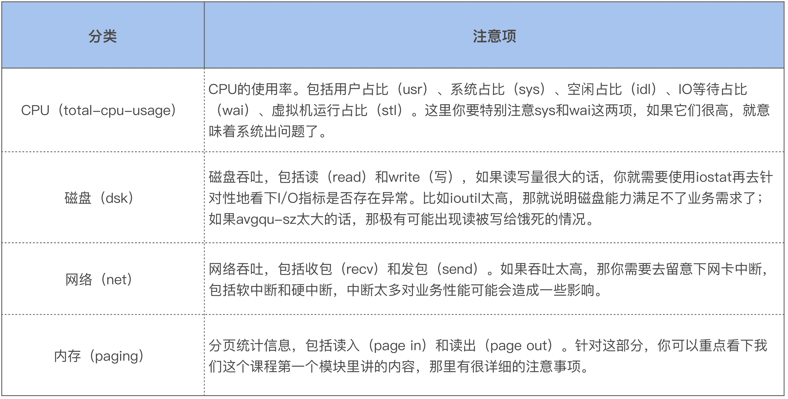
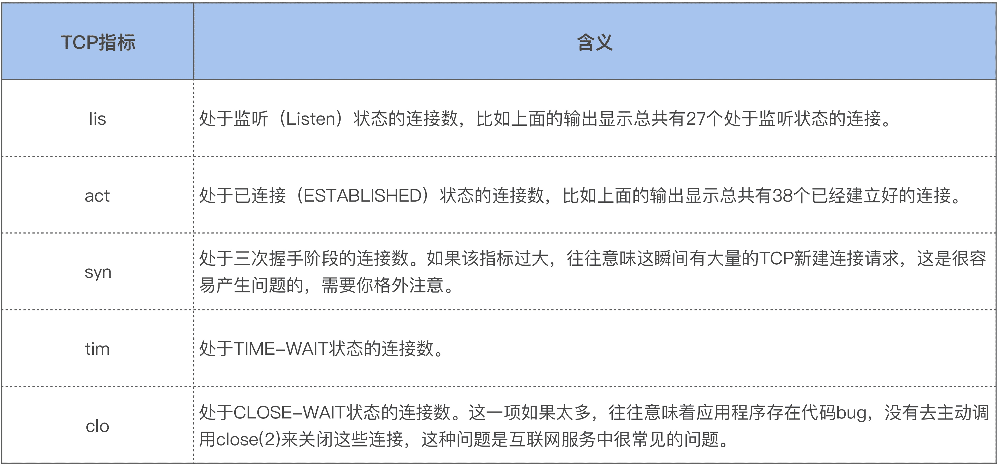
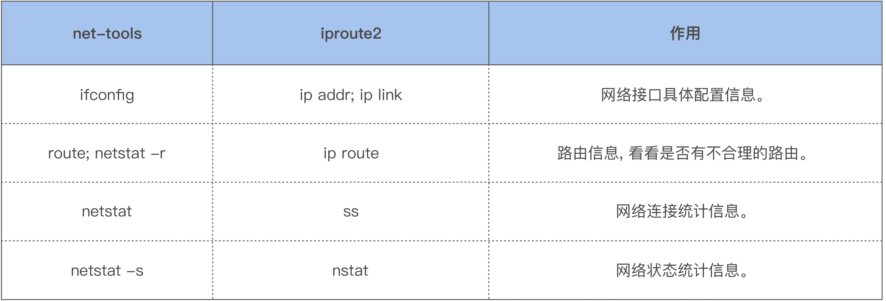
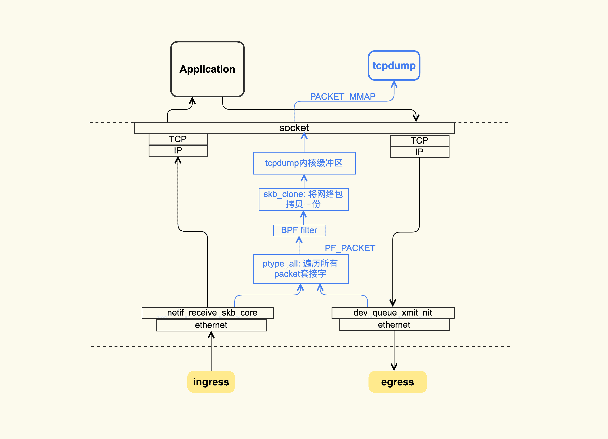
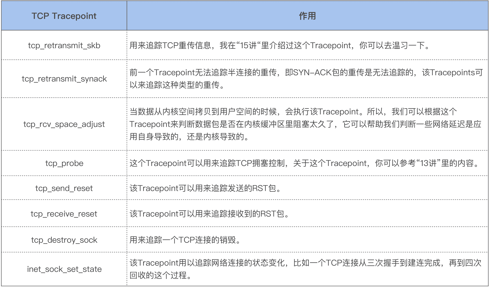

# 16 套路篇 | 如何分析常见的TCP问题？

 

你好，我是邵亚方。

对互联网服务而言， 网络问题是非常多的，而且很多问题的外在表现都是网络问题，这就需要我们从网络入手，分析清楚根本原因是什么。而要分析各种各样的网络问题，你必须掌握一些分析手段，这样在出现问题的时候，你就可以高效地找到原因。这节课我就带你来了解下 TCP 的常见问题，以及对应的分析套路。

## 在 Linux 上检查网络的常用工具

当服务器产生问题，而我们又不清楚问题和什么有关时，就需要运行一些工具来检查系统的整体状况。其中，dstat 是我们常用的一种检查工具：

```
$ dstat  
--total-cpu-usage-- -dsk/total- -net/total- ---paging-- ---system--  
usr sys idl wai stl| read  writ| recv  send|  in   out | int   csw   
  8   1  91   0   0|   0  4096B|7492B 7757B|   0     0 |4029  7399   
  8   1  91   0   0|   0     0 |7245B 7276B|   0     0 |4049  6967   
  8   1  91   0   0|   0   144k|7148B 7386B|   0     0 |3896  6971   
  9   2  89   0   0|   0     0 |7397B 7285B|   0     0 |4611  7426   
  8   1  91   0   0|   0     0 |7294B 7258B|   0     0 |3976  7062
```

如上所示，dstat 会显示四类系统资源的整体使用情况和两个关键的系统指标。这四类系统资源分别是：CPU、磁盘 I/O、 网络和内存。两个关键的系统指标是中断次数（int）和上下文切换次数（csw）。而每个系统资源又会输出它的一些关键指标，这里你需要注意以下几点：



如果你发现某一类系统资源对应的指标比较高，你就需要进一步针对该系统资源做更深入的分析。假设你发现网络吞吐比较高，那就继续观察网络的相关指标，你可以用 dstat -h 来查看，比如针对 TCP，就可以使用 dstat -tcp：

```
$ dstat --tcp  
------tcp-sockets-------  
lis  act  syn  tim  clo   
  27   38    0    0    0  
  27   38    0    0    0
```

它会统计并显示系统中所有的 TCP 连接状态，这些指标的含义如下：



在得到了 TCP 连接的整体状况后，如果你想要看 TCP 连接的详细信息，你可以使用 ss 这个命令来继续观察。通过 ss 你可以查看到每个 TCP 连接都是什么样的：

```
$ ss -natp  
State         Recv-Q         Send-Q                                       Local Address:Port                     Peer Address:Port                                                                          
LISTEN0      100                                  0.0.0.0:36457         0.0.0.0:*                                                                                users:(("test",pid=11307,fd=17))                                         
LISTEN0      5                                    0.0.0.0:33811         0.0.0.0:*                                                                                users:(("test",pid=11307,fd=19))                                         
ESTAB 0      0                                  127.0.0.1:57396       127.0.1.1:34751                                                                            users:(("test",pid=11307,fd=106))                                        
ESTAB 0      0                                  127.0.0.1:57384       127.0.1.1:34751                                                                            users:(("test",pid=11307,fd=100))                                                                          
```

如上所示，我们能查看到每个 TCP 连接的状态（State）、接收队列大小（Recv-Q）、发送队列大小（Send-Q）、本地 IP 和端口（Local Address:Port ）、远端 IP 和端口（Peer Address:Port）以及打开该 TCP 连接的进程信息。

除了 ss 命令外，你也可以使用 netstat 命令来查看所有 TCP 连接的详细信息：

```
$ netstat -natp
```

不过，我不建议你使用 netstat，最好还是用 ss。因为 netstat 不仅比 ss 慢，而且开销也大。netstat 是通过直接读取 /proc/net/ 下面的文件来解析网络连接信息的；而 ss 使用的是 netlink 方式，这种方式的效率会高很多。

netlink 在解析时会依赖内核的一些诊断模块，比如解析 TCP 信息就需要 tcp_diag 这个诊断模块。如果诊断模块不存在，那么 ss 就无法使用 netlink 这种方式了，这个时候它就会退化到和 netstat 一样，也就是使用解析 /proc/net/ 这种方式，当然了，它的效率也会相应变差。

另外，如果你去看 netstat 手册，通过 man netstat，你会发现这样一句话“This program is obsolete. Replacement for netstat is ss”。所以，以后在分析网络连接问题时，我们尽量还是使用 ss，而不是 netstat。

netstat 属于 net-tools 这个比较古老的工具集，而 ss 属于 iproute2 这个工具集。net-tools 中的常用命令，几乎都可以用 iproute2 中的新命令来代替，比如：



除了查看系统中的网络连接信息外，我们有时候还需要去查看系统的网络状态，比如说系统中是否存在丢包，以及是什么原因引起了丢包，这时候我们就需要 netstat -s 或者它的替代工具 nstat 了：

```
$ nstat -z | grep -i drop  
TcpExtLockDroppedIcmps          0                  0.0  
TcpExtListenDrops               0                  0.0  
TcpExtTCPBacklogDrop            0                  0.0  
TcpExtPFMemallocDrop            0                  0.0  
TcpExtTCPMinTTLDrop             0                  0.0  
TcpExtTCPDeferAcceptDrop        0                  0.0  
TcpExtTCPReqQFullDrop           0                  0.0  
TcpExtTCPOFODrop                0                  0.0  
TcpExtTCPZeroWindowDrop         0                  0.0  
TcpExtTCPRcvQDrop               0                  0.0
```

上面输出的这些信息就包括了常见的丢包原因，因为我的这台主机很稳定，所以你可以看到输出的结果都是 0。

假如你通过这些常规检查手段没有发现异常，那你就需要考虑使用网络分析的必备工具——tcpdump 了。

## 分析网络问题你必须要掌握的工具：tcpdump

tcpdump 的使用技巧有很多，在这里我们不讲述这些使用技巧，而是讲述一下它的工作原理，以便于你理解 tcpdump 到底在干什么，以及它能够分析什么样的问题。

tcpdump 的大致原理如下图所示：



tcpdump基本原理

tcpdump 抓包使用的是 libpacp 这种机制。它的大致原理是：在收发包时，如果该包符合 tcpdump 设置的规则（BPF filter），那么该网络包就会被拷贝一份到 tcpdump 的内核缓冲区，然后以 PACKET_MMAP 的方式将这部分内存映射到 tcpdump 用户空间，解析后就会把这些内容给输出了。

通过上图你也可以看到，在收包的时候，如果网络包已经被网卡丢弃了，那么 tcpdump 是抓不到它的；在发包的时候，如果网络包在协议栈里被丢弃了，比如因为发送缓冲区满而被丢弃，tcpdump 同样抓不到它。我们可以将 tcpdump 的能力范围简单地总结为：网卡以内的问题可以交给 tcpdump 来处理；对于网卡以外（包括网卡上）的问题，tcpdump 可能就捉襟见肘了。这个时候，你需要在对端也使用 tcpdump 来抓包。

你还需要知道一点，那就是 tcpdump 的开销比较大，这主要在于 BPF 过滤器。如果系统中存在非常多的 TCP 连接，那么这个过滤的过程是非常耗时的，所以在生产环境中要慎用。但是，在出现网络问题时，如果你真的没有什么排查思路，那就想办法使用 tcpdump 来抓一下包吧，也许它的输出会给你带来一些意外的惊喜。

如果生产环境上运行着很重要的业务，你不敢使用 tcpdump 来抓包，那你就得去研究一些更加轻量级的追踪方式了。接下来，我给你推荐的轻量级追踪方式是 TCP Tracepoints。

## TCP 疑难问题的轻量级分析手段：TCP Tracepoints

Tracepoint 是我分析问题常用的手段之一，在遇到一些疑难问题时，我通常都会把一些相关的 Tracepoint 打开，把 Tracepoint 输出的内容保存起来，然后再在线下环境中分析。通常，我会写一些 Python 脚本来分析这些内容，毕竟 Python 在数据分析上还是很方便的。

对于 TCP 的相关问题，我也习惯使用这些 TCP Tracepoints 来分析问题。要想使用这些 Tracepoints，你的内核版本需要为 4.16 及以上。这些常用的 TCP Tracepoints 路径位于 /sys/kernel/debug/tracing/events/tcp/ 和 /sys/kernel/debug/tracing/events/sock/，它们的作用如下表所示：



这里多说两句，表格里的 tcp_rcv_space_adjust 是我在分析 RT 抖动问题时贡献给内核的，具体你可以看net: introduce a new tracepoint for tcp_rcv_space_adjust这个 commit。还有 inet_sock_set_state，该 Tracepoint 也是我贡献给 Linux 内核的，具体可详见net: tracepoint: replace tcp_set_state tracepoint with inet_sock_set_state tracepoint。其实我对“inet_sock_set_state”这个名字不太满意，本来想使用“inet_sk_set_state”来命名的，因为后者更精炼，但是为了更好地匹配内核里的 struct inet_sock 结构体，我还是选择了现在这个略显臃肿的名字。

我们回到 TCP Tracepoints 这一轻量级的追踪方式。有一篇文章对它讲解得很好，就是 Brendan Gregg 写的TCP Tracepoints，这里面还详细介绍了基于 Tracepoints 的一些工具，如果你觉得用 Python 脚本解析 TCP Tracepoints 的输出有点麻烦，你可以直接使用里面推荐的那些工具。不过，你需要注意的是，这些工具都是基于 ebpf 来实现的，而 ebpf 有一个缺点，就是它在加载的时候 CPU 开销有些大。这是因为有一些编译工作比较消耗 CPU，所以你在使用这些命令时要先看下你的系统 CPU 使用情况。当 ebpf 加载起来后，CPU 开销就很小了，大致在 1% 以内。在停止 ebpf 工具的追踪时，也会有一些 CPU 开销，不过这个开销比加载时消耗的要小很多，但是你同样需要注意一下，以免影响到业务。

相比于 tcpdump 的臃肿，这些 TCP Tracepoints 就很轻量级了，你有必要用一用它们。

好了， 我们这节课就讲到这里。

## 课堂总结

我们讲了 TCP 问题分析的惯用套路，我再次强调一下这节课的重点：

1. 尽量不要使用 netstat 命令，而是多使用它的替代品 ss，因为 ss 的性能开销更小，运行也更快；
2. 当你面对网络问题一筹莫展时，可以考虑使用 tcpdump 抓包看看，当系统中的网络连接数较大时，它对系统性能会产生比较明显的影响，所以你需要想办法避免它给业务带来实质影响；
3. TCP Tracepoints 是比较轻量级的分析方案，你需要去了解它们，最好试着去用一下它们。

## 课后作业

请问 tcpdump 在解析内核缓冲区里的数据时，为什么使用 PACKET_MMAP 这种方式？你了解这种方式吗？这样做的好处是什么？欢迎你在留言区与我讨论。

感谢你的阅读，如果你认为这节课的内容有收获，也欢迎把它分享给你的朋友，我们下一讲见。
