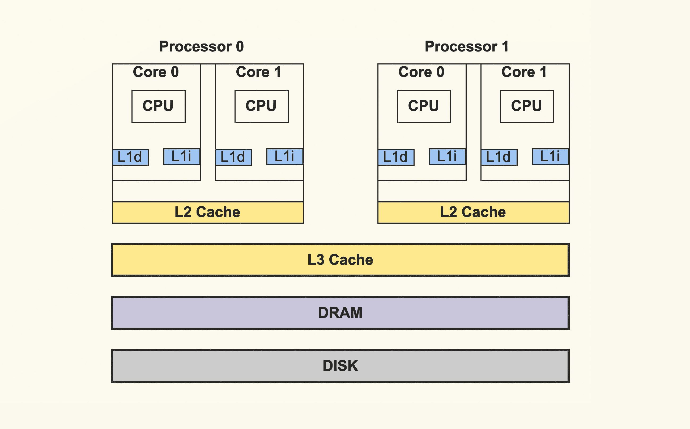
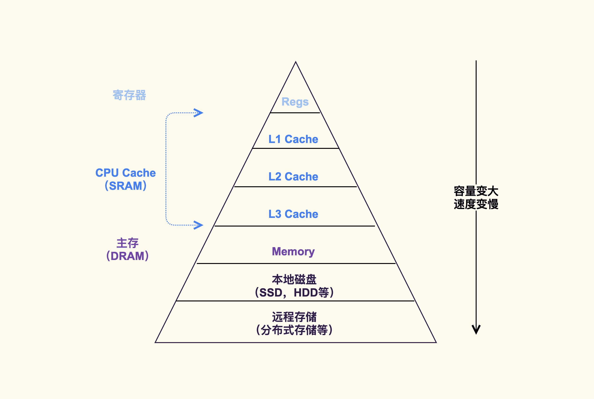
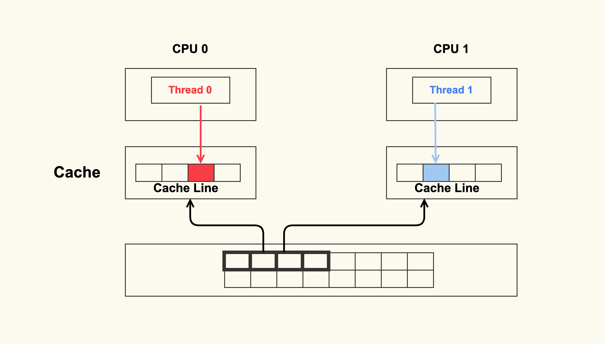
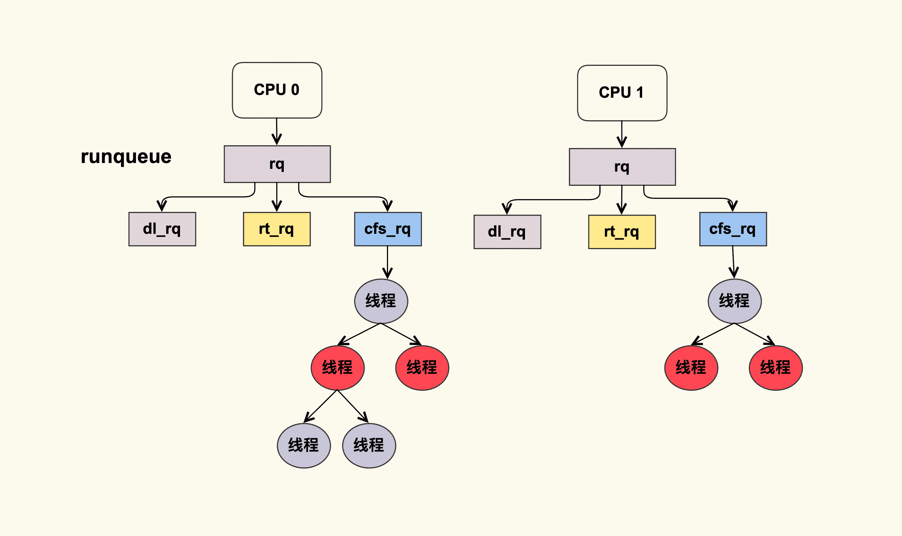
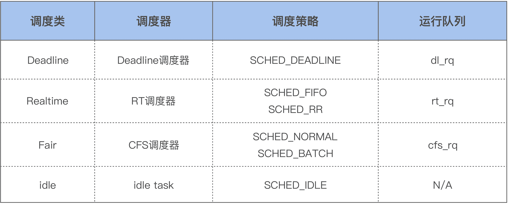

# 17 基础篇 | CPU是如何执行任务的？

 

你好，我是邵亚方。

如果你做过性能优化的话，你应该有过这些思考，比如说：

1. 如何让 CPU 读取数据更快一些？
2. 同样的任务，为什么有时候执行得快，有时候执行得慢？
3. 我的任务有些比较重要，CPU 如果有争抢时，我希望可以先执行这些任务，这该怎么办呢？
4. 多线程并行读写数据是如何保障同步的？
5. …

要想明白这些问题，你就需要去了解 CPU 是如何执行任务的，只有明白了 CPU 的执行逻辑，你才能更好地控制你的任务执行，从而获得更好的性能。

## CPU 是如何读写数据的 ？

我先带你来看下 CPU 的架构，因为你只有理解了 CPU 的架构，你才能更好地理解 CPU 是如何执行指令的。CPU 的架构图如下所示：



CPU架构

你可以直观地看到，对于现代处理器而言，一个实体 CPU 通常会有两个逻辑线程，也就是上图中的 Core 0 和 Core 1。每个 Core 都有自己的 L1 Cache，L1 Cache 又分为 dCache 和 iCache，对应到上图就是 L1d 和 L1i。L1 Cache 只有 Core 本身可以看到，其他的 Core 是看不到的。同一个实体 CPU 中的这两个 Core 会共享 L2 Cache，其他的实体 CPU 是看不到这个 L2 Cache 的。所有的实体 CPU 会共享 L3 Cache。这就是典型的 CPU 架构。

相信你也看到，在 CPU 外还会有内存（DRAM）、磁盘等，这些存储介质共同构成了体系结构里的金字塔存储层次。如下所示：



金字塔存储层次

在这个“金字塔”中，越往下，存储容量就越大，它的速度也会变得越慢。Jeff Dean 曾经研究过 CPU 对各个存储介质的访问延迟，具体你可以看下latency里的数据，里面详细记录了每个存储层次的访问延迟，这也是我们在性能优化时必须要知道的一些延迟数据。你可不要小瞧它，在某些场景下，这些不同存储层次的访问延迟差异可能会导致非常大的性能差异。

我们就以 Cache 访问延迟（L1 0.5ns，L2 10ns）和内存访问延迟（100ns）为例，我给你举一个实际的案例来说明访问延迟的差异对性能的影响。

之前我在做网络追踪系统时，为了更方便地追踪 TCP 连接，我给 Linux Kernel 提交了一个 PATCH 来记录每个连接的编号，具体你可以参考这个 commit：net: init sk_cookie for inet socket。该 PATCH 的大致作用是，在每次创建一个新的 TCP 连接时（关于 TCP 这部分知识，你可以去温习上一个模块的内容），它都会使用 net namespace（网络命名空间）中的 cookie_gen 生成一个 cookie 给这个新建的连接赋值。

可是呢，在这个 PATCH 被合入后，Google 工程师 Eric Dumazet 发现在他的 SYN Flood 测试中网络吞吐量会下降约 24%。后来经过分析发现，这是因为 net namespace 中所有 TCP 连接都在共享 cookie_gen。在高并发情况下，瞬间会有非常多的新建 TCP 连接，这时候 cookie_gen 就成了一个非常热的数据，从而被缓存在 Cache 中。如果 cookie_gen 的内容被修改的话，Cache 里的数据就会失效，那么当有其他新建连接需要读取这个数据时，就不得不再次从内存中去读取。而你知道，内存的延迟相比 Cache 的延迟是大很多的，这就导致了严重的性能下降。这个问题就是典型的 False Sharing，也就是 Cache 伪共享问题。

正因为这个 PATCH 给高并发建连这种场景带来了如此严重的性能损耗，所以它就被我们给回退（Revert）了，你具体可以看Revert "net: init sk_cookie for inet socket"这个 commit。不过，cookie_gen 对于网络追踪还是很有用的，比如说在使用 ebpf 来追踪 cgroup 的 TCP 连接时，所以后来 Facebook 的一个工程师把它从 net namespace 这个结构体里移了出来，改为了一个全局变量。

由于 net namespace 被很多 TCP 连接共享，因此这个结构体非常容易产生这类 Cache 伪共享问题，Eric Dumazet 也在这里引入过一个 Cache 伪共享问题：net: reorder ‘struct net’ fields to avoid false sharing。

接下来，我们就来看一下 Cache 伪共享问题究竟是怎么回事。



Cache Line False Sharing

如上图所示，两个 CPU 上并行运行着两个不同线程，它们同时从内存中读取两个不同的数据，这两个数据的地址在物理内存上是连续的，它们位于同一个 Cache Line 中。CPU 从内存中读数据到 Cache 是以 Cache Line 为单位的，所以该 Cache Line 里的数据被同时读入到了这两个 CPU 的各自 Cache 中。紧接着这两个线程分别改写不同的数据，每次改写 Cache 中的数据都会将整个 Cache Line 置为无效。因此，虽然这两个线程改写的数据不同，但是由于它们位于同一个 Cache Line 中，所以一个 CPU 中的线程在写数据时会导致另外一个 CPU 中的 Cache Line 失效，而另外一个 CPU 中的线程在读写数据时就会发生 cache miss，然后去内存读数据，这就大大降低了性能。

Cache 伪共享问题可以说是性能杀手，我们在写代码时一定要留意那些频繁改写的共享数据，必要的时候可以将它跟其他的热数据放在不同的 Cache Line 中避免伪共享问题，就像我们在内核代码里经常看到的 ____cacheline_aligned 所做的那样。

那怎么来观测 Cache 伪共享问题呢？你可以使用perf c2c这个命令，但是这需要较新版本内核支持才可以。不过，perf 同样可以观察 cache miss 的现象，它对很多性能问题的分析还是很有帮助的。

CPU 在写完 Cache 后将 Cache 置为无效（invalidate）, 这本质上是为了保障多核并行计算时的数据一致性，一致性问题是 Cache 这个存储层次很典型的问题。

我们再来看内存这个存储层次中的典型问题：并行计算时的竞争，即两个 CPU 同时去操作同一个物理内存地址时的竞争。关于这类问题，我举一些简单的例子给你说明一下。

以 C 语言为例：

```
struct foo {  
    int a;  
    int b;  
};
```

在这段示例代码里，我们定义了一个结构体，该结构体里的两个成员 a 和 b 在地址上是连续的。如果 CPU 0 去写 a，同时 CPU 1 去读 b 的话，此时不会有竞争，因为 a 和 b 是不同的地址。不过，a 和 b 由于在地址上是连续的，它们可能会位于同一个 Cache Line 中，所以为了防止前面提到的 Cache 伪共享问题，我们可以强制将 b 的地址设置为 Cache Line 对齐地址，如下:

```
struct foo {  
    int a;  
    int b ____cacheline_aligned;  
};
```

接下来，我们看下另外一种情况：

```
struct foo {  
    int a:1;  
    int b:1;  
};
```

这个示例程序定义了两个位域（bit field），a 和 b 的地址是一样的，只是属于该地址的不同 bit。在这种情况下，CPU 0 去写 a （a = 1），同时 CPU 1 去写 b （b = 1），就会产生竞争。在总线仲裁后，先写的数据就会被后写的数据给覆盖掉。这就是执行 RMW 操作时典型的竞争问题。在这种场景下，就需要同步原语了，比如使用 atomic 操作。

关于位操作，我们来看一个实际的案例。这是我前段时间贡献给 Linux 内核的一个 PATCH：psi: Move PF_MEMSTALL out of task->flags，它在 struct task_struct 这个结构体里增加了一个 in_memstall 的位域，在该 PATCH 里无需考虑多线程并行操作该位域时的竞争问题，你知道这是为什么吗？我将它作为一个课后思考题留给你，欢迎你在留言区与我讨论交流。为了让这个问题简单些，我给你一个提示：如果你留意过 task_struct 这个结构体里的位域被改写的情况，你会发现只有 current（当前在运行的线程）可以写，而其他线程只能去读。但是 PF_* 这些全局 flag 可以被其他线程写，而不仅仅是 current 来写。

Linux 内核里的 task_struct 结构体就是用来表示一个线程的，每个线程都有唯一对应的 task_struct 结构体，它也是内核进行调度的基本单位。我们继续来看下 CPU 是如何选择线程来执行的。

## CPU 是如何选择线程执行的 ？

你知道，一个系统中可能会运行着非常多的线程，这些线程数可能远超系统中的 CPU 核数，这时候这些任务就需要排队，每个 CPU 都会维护着自己运行队列（runqueue）里的线程。这个运行队列的结构大致如下图所示：



CPU运行队列

每个 CPU 都有自己的运行队列（runqueue），需要运行的线程会被加入到这个队列中。因为有些线程的优先级高，Linux 内核为了保障这些高优先级任务的执行，设置了不同的调度类（Scheduling Class），如下所示：



这几个调度类的优先级如下：Deadline > Realtime > Fair。Linux 内核在选择下一个任务执行时，会按照该顺序来进行选择，也就是先从 dl_rq 里选择任务，然后从 rt_rq 里选择任务，最后从 cfs_rq 里选择任务。所以实时任务总是会比普通任务先得到执行。

如果你的某些任务对延迟容忍度很低，比如说在嵌入式系统中就有很多这类任务，那就可以考虑将你的任务设置为实时任务，比如将它设置为 SCHED_FIFO 的任务：

> $ chrt -f -p 1 1327

如果你不做任何设置的话，用户线程在默认情况下都是普通线程，也就是属于 Fair 调度类，由 CFS 调度器来进行管理。CFS 调度器的目的是为了实现线程运行的公平性，举个例子，假设一个 CPU 上有两个线程需要执行，那么每个线程都将分配 50% 的 CPU 时间，以保障公平性。其实，各个线程之间执行时间的比例，也是可以人为干预的，比如在 Linux 上可以调整进程的 nice 值来干预，从而让优先级高一些的线程执行更多时间。这就是 CFS 调度器的大致思想。

好了，我们这堂课就先讲到这里。

## 课堂总结

我来总结一下这节课的知识点：

1. 要想明白 CPU 是如何执行任务的，你首先需要去了解 CPU 的架构；
2. CPU 的存储层次对大型软件系统的性能影响会很明显，也是你在性能调优时需要着重考虑的；
3. 高并发场景下的 Cache Line 伪共享问题是一个普遍存在的问题，你需要留意一下它；
4. 系统中需要运行的线程数可能大于 CPU 核数，这样就会导致线程排队等待 CPU，这可能会导致一些延迟。如果你的任务对延迟容忍度低，你可以通过一些手段来人为干预 Linux 默认的调度策略。

## 课后作业

这节课的作业就是我们前面提到的思考题：在psi: Move PF_MEMSTALL out of task->flags这个 PATCH 中，为什么没有考虑多线程并行操作新增加的位域（in_memstall）时的竞争问题？欢迎你在留言区与我讨论。

感谢你的阅读，如果你认为这节课的内容有收获，也欢迎把它分享给你的朋友，我们下一讲见。
