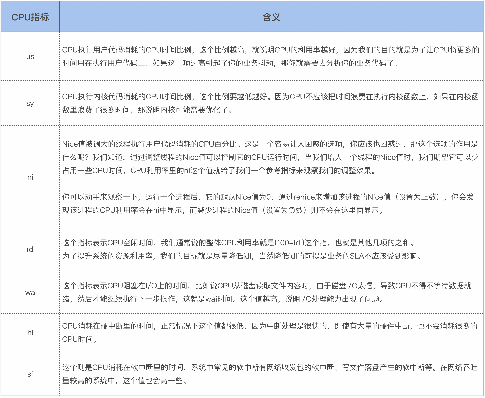
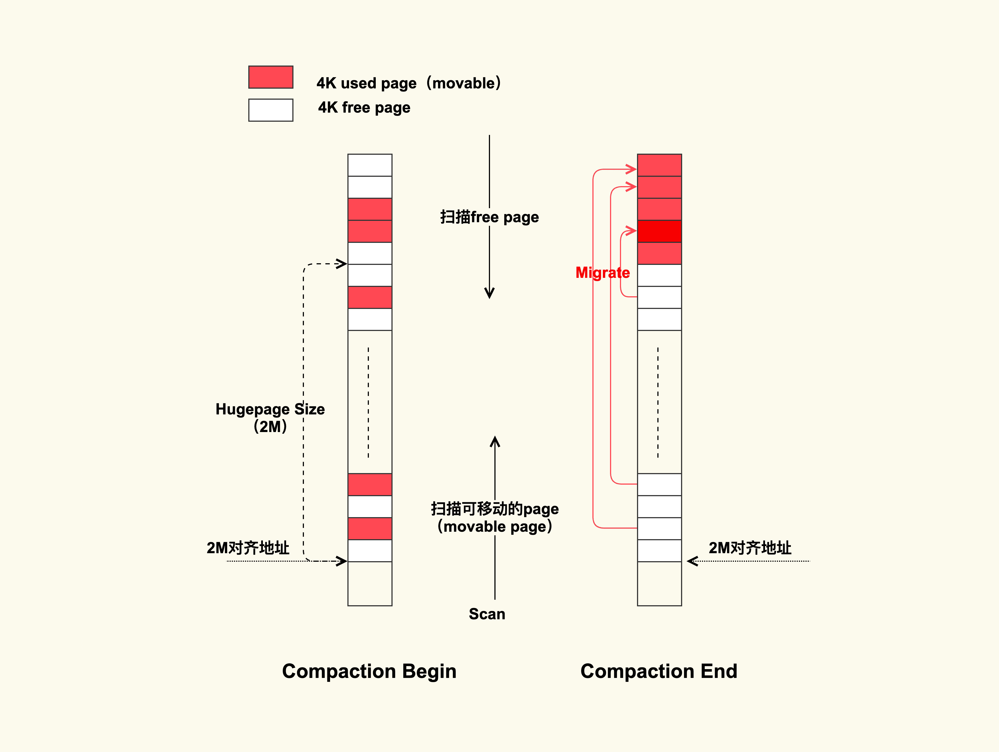

# 18 案例篇 | 业务是否需要使用透明大页：水可载舟，亦可覆舟？

 

你好，我是邵亚方。

我们这节课的案例来自于我在多年以前帮助业务团队分析的一个稳定性问题。当时，业务团队反映说他们有一些服务器的 CPU 利用率会异常飙高，然后很快就能恢复，并且持续的时间不长，大概几秒到几分钟，从监控图上可以看到它像一些毛刺。

因为这类问题是普遍存在的，所以我就把该问题的定位分析过程分享给你，希望你以后遇到 CPU 利用率飙高的问题时，知道该如何一步步地分析。

CPU 利用率是一个很笼统的概念，在遇到 CPU 利用率飙高的问题时，我们需要看看 CPU 到底在忙哪类事情，比如说 CPU 是在忙着处理中断、等待 I/O、执行内核函数？还是在执行用户函数？这个时候就需要我们细化 CPU 利用率的监控，因为监控这些细化的指标对我们分析问题很有帮助。

## 细化 CPU 利用率监控

这里我们以常用的 top 命令为例，来看看 CPU 更加细化的利用率指标（不同版本的 top 命令显示可能会略有不同）：

%Cpu(s): 12.5 us, 0.0 sy, 0.0 ni, 87.4 id, 0.0 wa, 0.0 hi, 0.0 si, 0.0 st

top 命令显示了 us、sy、ni、id、wa、hi、si 和 st 这几个指标，这几个指标之和为 100。那你可能会有疑问，细化 CPU 利用率指标的监控会不会带来明显的额外开销？答案是不会的，因为 CPU 利用率监控通常是去解析 /proc/stat 文件，而这些文件中就包含了这些细化的指标。

我们继续来看下上述几个指标的具体含义，这些含义你也可以从top 手册里来查看：

```
       us, user    : time running un-niced user processes  
       sy, system  : time running kernel processes  
       ni, nice    : time running niced user processes  
       id, idle    : time spent in the kernel idle handler  
       wa, IO-wait : time waiting for I/O completion  
       hi : time spent servicing hardware interrupts  
       si : time spent servicing software interrupts  
       st : time stolen from this vm by the hypervisor
```

上述指标的具体含义以及注意事项如下：



在上面这几项中，idle 和 wait 是 CPU 不工作的时间，其余的项都是 CPU 工作的时间。idle 和 wait 的主要区别是，idle 是 CPU 无事可做，而 wait 则是 CPU 想做事却做不了。你也可以将 wait 理解为是一类特殊的 idle，即该 CPU 上有至少一个线程阻塞在 I/O 时的 idle。

而我们通过对 CPU 利用率的细化监控发现，案例中的 CPU 利用率飙高是由 sys 利用率变高导致的，也就是说 sys 利用率会忽然飙高一下，比如在 usr 低于 30% 的情况下，sys 会高于 15%，持续几秒后又恢复正常。

所以，接下来我们就需要抓取 sys 利用率飙高的现场。

## 抓取 sys 利用率飙高现场

我们在前面讲到，CPU 的 sys 利用率高，说明内核函数执行花费了太多的时间，所以我们需要采集 CPU 在 sys 飙高的瞬间所执行的内核函数。采集内核函数的方法有很多，比如：

1. 通过 perf 可以采集 CPU 的热点，看看 sys 利用率高时，哪些内核耗时的 CPU 利用率高；
2. 通过 perf 的 call-graph 功能可以查看具体的调用栈信息，也就是线程是从什么路径上执行下来的；
3. 通过 perf 的 annotate 功能可以追踪到线程是在内核函数的哪些语句上比较耗时；
4. 通过 ftrace 的 function-graph 功能可以查看这些内核函数的具体耗时，以及在哪个路径上耗时最大。

不过，这些常用的追踪方式在这种瞬间消失的问题上是不太适用的，因为它们更加适合采集一个时间段内的信息。

那么针对这种瞬时的状态，我希望有一个系统快照，把当前 CPU 正在做的工作记录下来，然后我们就可以结合内核源码分析为什么 sys 利用率会高了。

有一个工具就可以很好地追踪这种系统瞬时状态，即系统快照，它就是 sysrq。sysrq 是我经常用来分析内核问题的工具，用它可以观察当前的内存快照、任务快照，可以构造 vmcore 把系统的所有信息都保存下来，甚至还可以在内存紧张的时候用它杀掉内存开销最大的那个进程。sysrq 可以说是分析很多疑难问题的利器。

要想用 sysrq 来分析问题，首先需要使能 sysyrq。我建议你将 sysrq 的所有功能都使能，你无需担心会有什么额外开销，而且这也没有什么风险。使能方式如下：

> $ sysctl -w kernel.sysrq = 1

sysrq 的功能被使能后，你可以使用它的 -t 选项把当前的任务快照保存下来，看看系统中都有哪些任务，以及这些任务都在干什么。使用方式如下：

> $ echo t > /proc/sysrq-trigger

然后任务快照就会被打印到内核缓冲区，这些任务快照信息你可以通过 dmesg 命令来查看：

> $ dmesg

当时我为了抓取这种瞬时的状态，写了一个脚本来采集，如下就是一个简单的脚本示例：

```
#!/bin/sh  
  
while [ 1 ]; do  
     top -bn2 | grep "Cpu(s)" | tail -1 | awk '{  
         # $2 is usr, $4 is sys.  
         if ($2 < 30.0 && $4 > 15.0) {  
              # save the current usr and sys into a tmp file  
              while ("date" | getline date) {  
                   split(date, str, " ");  
                   prefix=sprintf("%s_%s_%s_%s", str[2],str[3], str[4], str[5]);  
               }  
  
              sys_usr_file=sprintf("/tmp/%s_info.highsys", prefix);  
              print $2 > sys_usr_file;  
              print $4 >> sys_usr_file;  
  
              # run sysrq  
              system("echo t > /proc/sysrq-trigger");  
         }  
     }'  
     sleep 1m  
done
```

这个脚本会检测 sys 利用率高于 15% 同时 usr 较低的情况，也就是说检测 CPU 是否在内核里花费了太多时间。如果出现这种情况，就会运行 sysrq 来保存当前任务快照。你可以发现这个脚本设置的是 1 分钟执行一次，之所以这么做是因为不想引起很大的性能开销，而且当时业务团队里有几台机器差不多是一天出现两三次这种状况，有些机器每次可以持续几分钟，所以这已经足够了。不过，如果你遇到的问题出现的频率更低，持续时间更短，那就需要更加精确的方法了。

## 透明大页：水可载舟，亦可覆舟？

我们把脚本部署好后，就把问题现场抓取出来了。从 dmesg 输出的信息中，我们发现处于 R 状态的线程都在进行 compcation（内存规整），线程的调用栈如下所示（这是一个比较古老的内核，版本为 2.6.32）：

```
java          R  running task        0 144305 144271 0x00000080  
 ffff88096393d788 0000000000000086 ffff88096393d7b8 ffffffff81060b13  
 ffff88096393d738 ffffea003968ce50 000000000000000e ffff880caa713040  
 ffff8801688b0638 ffff88096393dfd8 000000000000fbc8 ffff8801688b0640  
  
Call Trace:  
 [<ffffffff81060b13>] ? perf_event_task_sched_out+0x33/0x70  
 [<ffffffff8100bb8e>] ? apic_timer_interrupt+0xe/0x20  
 [<ffffffff810686da>] __cond_resched+0x2a/0x40  
 [<ffffffff81528300>] _cond_resched+0x30/0x40  
 [<ffffffff81169505>] compact_checklock_irqsave+0x65/0xd0  
 [<ffffffff81169862>] compaction_alloc+0x202/0x460  
 [<ffffffff811748d8>] ? buffer_migrate_page+0xe8/0x130  
 [<ffffffff81174b4a>] migrate_pages+0xaa/0x480  
 [<ffffffff81169660>] ? compaction_alloc+0x0/0x460  
 [<ffffffff8116a1a1>] compact_zone+0x581/0x950  
 [<ffffffff8116a81c>] compact_zone_order+0xac/0x100  
 [<ffffffff8116a951>] try_to_compact_pages+0xe1/0x120  
 [<ffffffff8112f1ba>] __alloc_pages_direct_compact+0xda/0x1b0  
 [<ffffffff8112f80b>] __alloc_pages_nodemask+0x57b/0x8d0  
 [<ffffffff81167b9a>] alloc_pages_vma+0x9a/0x150  
 [<ffffffff8118337d>] do_huge_pmd_anonymous_page+0x14d/0x3b0  
 [<ffffffff8152a116>] ? rwsem_down_read_failed+0x26/0x30  
 [<ffffffff8114b350>] handle_mm_fault+0x2f0/0x300  
 [<ffffffff810ae950>] ? wake_futex+0x40/0x60  
 [<ffffffff8104a8d8>] __do_page_fault+0x138/0x480  
 [<ffffffff810097cc>] ? __switch_to+0x1ac/0x320  
 [<ffffffff81527910>] ? thread_return+0x4e/0x76e  
 [<ffffffff8152d45e>] do_page_fault+0x3e/0xa0  
 [<ffffffff8152a815>] page_fault+0x25/0x30
```

从该调用栈我们可以看出，此时这个 java 线程在申请 THP（do_huge_pmd_anonymous_page）。THP 就是透明大页，它是一个 2M 的连续物理内存。但是，因为这个时候物理内存中已经没有连续 2M 的内存空间了，所以触发了 direct compaction（直接内存规整），内存规整的过程可以用下图来表示：



THP Compaction

这个过程并不复杂，在进行 compcation 时，线程会从前往后扫描已使用的 movable page，然后从后往前扫描 free page，扫描结束后会把这些 movable page 给迁移到 free page 里，最终规整出一个 2M 的连续物理内存，这样 THP 就可以成功申请内存了。

direct compaction 这个过程是很耗时的，而且在 2.6.32 版本的内核上，该过程需要持有粗粒度的锁，所以在运行过程中线程还可能会主动检查（_cond_resched）是否有其他更高优先级的任务需要执行。如果有的话就会让其他线程先执行，这便进一步加剧了它的执行耗时。这也就是 sys 利用率飙高的原因。关于这些，你也都可以从内核源码的注释来看到：

```
/*  
 * Compaction requires the taking of some coarse locks that are potentially  
 * very heavily contended. Check if the process needs to be scheduled or  
 * if the lock is contended. For async compaction, back out in the event  
 * if contention is severe. For sync compaction, schedule.  
 * ...  
 */
```

在我们找到了原因之后，为了快速解决生产环境上的这些问题，我们就把该业务服务器上的 THP 关掉了，关闭后系统变得很稳定，再也没有出现过 sys 利用率飙高的问题。关闭 THP 可以使用下面这个命令：

> $ echo never > /sys/kernel/mm/transparent_hugepage/enabled

关闭了生产环境上的 THP 后，我们又在线下测试环境中评估了 THP 对该业务的性能影响，我们发现 THP 并不能给该业务带来明显的性能提升，即使是在内存不紧张、不会触发内存规整的情况下。这也引起了我的思考，**THP 究竟适合什么样的业务呢？**

这就要从 THP 的目的来说起了。我们长话短说，THP 的目的是用一个页表项来映射更大的内存（大页），这样可以减少 Page Fault，因为需要的页数少了。当然，这也会提升 TLB 命中率，因为需要的页表项也少了。如果进程要访问的数据都在这个大页中，那么这个大页就会很热，会被缓存在 Cache 中。而大页对应的页表项也会出现在 TLB 中，从上一讲的存储层次我们可以知道，这有助于性能提升。但是反过来，假设应用程序的数据局部性比较差，它在短时间内要访问的数据很随机地位于不同的大页上，那么大页的优势就会消失。

因此，我们基于大页给业务做性能优化的时候，首先要评估业务的数据局部性，尽量把业务的热点数据聚合在一起，以便于充分享受大页的优势。以我在华为任职期间所做的大页性能优化为例，我们将业务的热点数据聚合在一起，然后将这些热点数据分配到大页上，再与不使用大页的情况相比，最终发现这可以带来 20% 以上的性能提升。对于 TLB 较小的架构（比如 MIPS 这种架构），它可以带来 50% 以上的性能提升。当然了，我们在这个过程中也对内核的大页代码做了很多优化，这里就不展开说了。

针对 THP 的使用，我在这里给你几点建议：

1. 不要将 /sys/kernel/mm/transparent_hugepage/enabled 配置为 always，你可以将它配置为 madvise。如果你不清楚该如何来配置，那就将它配置为 never；
2. 如果你想要用 THP 优化业务，最好可以让业务以 madvise 的方式来使用大页，即通过修改业务代码来指定特定数据使用 THP，因为业务更熟悉自己的数据流；
3. 很多时候修改业务代码会很麻烦，如果你不想修改业务代码的话，那就去优化 THP 的内核代码吧。

好了，这节课就讲到这里。

## 课堂总结

我们来回顾一下这节课的要点：

1. 细化 CPU 利用率监控，在 CPU 利用率高时，你需要查看具体是哪一项指标比较高；
2. sysrq 是分析内核态 CPU 利用率高的利器，也是分析很多内核疑难问题的利器，你需要去了解如何使用它；
3. THP 可以给业务带来性能提升，但也可能会给业务带来严重的稳定性问题，你最好以 madvise 的方式使用它。如果你不清楚如何使用它，那就把它关闭。

## 课后作业

我们这节课的作业有三种，你可以根据自己的情况进行选择：

1. 如果你是应用开发者，请问如何来观察系统中分配了多少 THP？
2. 如果你是初级内核开发者，请问在进行 compaction 时，哪些页可以被迁移？哪些不可以被迁移？
3. 如果你是高级内核开发者，假设现在让你来设计让程序的代码段也可以使用 hugetlbfs，那你觉得应该要做什么？

欢迎你在留言区与我讨论。

感谢你的阅读，如果你认为这节课的内容有收获，也欢迎把它分享给你的朋友，我们下一讲见。
