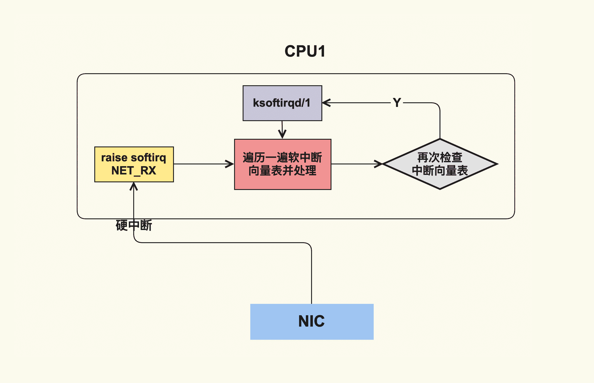

# 19 案例篇 | 网络吞吐高的业务是否需要开启网卡特性呢？

 

你好，我是邵亚方。

通过上一讲我们对 CPU 利用率的细化，相信你已经知道，对于应用而言，它的目标是让 CPU 的开销尽量用在执行用户代码上，而非其他方面。usr 利用率越高，说明 CPU 的效率越高。如果 usr 低，就说明 CPU 执行应用的效率不高。在第 18 讲里，我们还讲了 CPU 时间浪费在 sys 里的案例。那今天这一讲，我们一起来看看 CPU 在 softirq 上花费过多时间所引起的业务性能下降问题，这也是我们在生产环境中经常遇到的一类问题。接下来我会为你讲解相关案例，以及这类问题常用的观察方法。

## 中断与业务进程之间是如何相互干扰的？

这是我多年以前遇到的一个案例，当时业务反馈说为了提升 QPS（Query per Second），他们开启了 RPS（Receivce Packet Steering）来模拟网卡多队列，没想到开启 RPS 反而导致了 QPS 明显下降，不知道是什么原因。

其实，这类特定行为改变引起的性能下降问题相对好分析一些。最简单的方式就是去对比这个行为前后的性能数据。即使你不清楚 RPS 是什么，也不知道它背后的机制，你也可以采集需要的性能指标进行对比分析，然后判断问题可能出在哪里。这些性能指标包括 CPU 指标，内存指标，I/O 指标，网络指标等，我们可以使用 dstat 来观察它们的变化。

在业务打开 RPS 之前的性能指标：

```
$ dstat   
You did not select any stats, using -cdngy by default.  
----total-cpu-usage---- -dsk/total- -net/total- ---paging-- ---system--  
usr sys idl wai hiq siq| read  writ| recv  send|  in   out | int   csw   
 64  23   6   0   0   7|   0  8192B|7917k   12M|   0     0 |  27k 1922   
 64  22   6   0   0   8|   0     0 |7739k   12M|   0     0 |  26k 2210   
 61  23   9   0   0   7|   0     0 |7397k   11M|   0     0 |  25k 2267 
```

打开了 RPS 之后的性能指标：

```
$ dstat   
You did not select any stats, using -cdngy by default.  
----total-cpu-usage---- -dsk/total- -net/total- ---paging-- ---system--  
usr sys idl wai hiq siq| read  writ| recv  send|  in   out | int   csw   
 62  23   4   0   0  12|   0     0 |7096k   11M|   0     0 |  49k 2261   
 74  13   4   0   0   9|   0     0 |4003k 6543k|   0     0 |  31k 2004   
 59  22   5   0   0  13|   0  4096B|6710k   10M|   0     0 |  48k 2220 
```

我们可以看到，打开 RPS 后，CPU 的利用率有所升高。其中，siq 即软中断利用率明显增加，int 即硬中断频率也明显升高，而 net 这一项里的网络吞吐数据则有所下降。也就是说，在网络吞吐不升反降的情况下，系统的硬中断和软中断都明显增加。由此我们可以推断出，网络吞吐的下降应该是中断增加导致的结果。

那么，接下来我们就需要分析到底是什么类型的软中断和硬中断增加了，以便于找到问题的源头。

系统中存在很多硬中断，这些硬中断及其发生频率我们都可以通过 /proc/interruptes 这个文件来查看：

```
$ cat /proc/interrupts 
```

如果你想要了解某个中断的详细情况，比如中断亲和性，那你可以通过 /proc/irq/[irq_num]来查看，比如：

```
$ cat /proc/irq/123/smp_affinity
```

软中断可以通过 /proc/softirq 来查看：

```
$ cat /proc/softirqs 
```

当然了，你也可以写一些脚本来观察各个硬中断和软中断的发生频率，从而更加直观地查看是哪些中断发生得太频繁。

关于硬中断和软中断的区别，你可能多少有些了解，软中断是用来处理硬中断在短时间内无法完成的任务的。硬中断由于执行时间短，所以如果它的发生频率不高的话，一般不会给业务带来明显影响。但是由于内核里关中断的地方太多，所以进程往往会给硬中断带来一些影响，比如进程关中断时间太长会导致网络报文无法及时处理，进而引起业务性能抖动。

我们在生产环境中就遇到过这种关中断时间太长引起的抖动案例，比如 cat /proc/slabinfo 这个操作里的逻辑关中断太长，它会致使业务 RT 抖动。这是因为该命令会统计系统中所有的 slab 数量，并显示出来，在统计的过程中会关中断。如果系统中的 slab 数量太多，就会导致关中断的时间太长，进而引起网络包阻塞，ping 延迟也会因此明显变大。所以，在生产环境中我们要尽量避免去采集 /proc/slabinfo，否则可能会引起业务抖动。

由于 /proc/slabinfo 很危险，所以它的访问权限也从 2.6.32 版本时的 0644更改为了后来的0400，也就是说只有 root 用户才能够读取它，这在一定程度上避免了一些问题。如果你的系统是 2.6.32 版本的内核，你就需要特别注意该问题。

如果你要分析因中断关闭时间太长而引发的问题，有一种最简单的方式，就是使用 ftrace 的 irqsoff 功能。它不仅可以统计出中断被关闭了多长时间，还可以统计出为什么会关闭中断。不过，你需要注意的是，irqsoff 功能依赖于 CONFIG_IRQSOFF_TRACER 这个配置项，如果你的内核没有打开该配置项，那你就需要使用其他方式来去追踪了。

如何使用 irqsoff 呢？首先，你需要去查看你的系统是否支持了 irqsoff 这个 tracer：

```
$ cat /sys/kernel/debug/tracing/available_tracers 
```

如果显示的内容包含了 irqsoff，说明系统支持该功能，你就可以打开它进行追踪了：

```
$ echo irqsoff > /sys/kernel/debug/tracing/current_tracer
```

接下来，你就可以通过 /sys/kernel/debug/tracing/trace_pipe 和 trace 这两个文件，来观察系统中的 irqsoff 事件了。

我们知道，相比硬中断，软中断的执行时间会长一些，而且它也会抢占正在执行进程的 CPU，从而导致进程在它运行期间只能等待。所以，相对而言它会更容易给业务带来延迟。那我们怎么对软中断的执行频率以及执行耗时进行观测呢？你可以通过如下两个 tracepoints 来进行观测：

```
/sys/kernel/debug/tracing/events/irq/softirq_entry  
/sys/kernel/debug/tracing/events/irq/softirq_exit
```

这两个 tracepoint 分别表示软中断的进入和退出，退出时间减去进入时间就是该软中断这一次的耗时。关于 tracepoint 采集数据的分析方式，我们在之前的课程里已经讲过多次，所以就不在这里继续描述了。

如果你的内核版本比较新，支持 eBPF 功能，那你同样可以使用 bcc 里的softirqs.py这个工具来进行观测。它会统计软中断的次数和耗时，这对我们分析软中断引起的业务延迟来说，是比较方便的。

为了避免软中断太过频繁，进程无法得到 CPU 而被饿死的情况，内核引入了 ksoftirqd 这个机制。如果所有的软中断在短时间内无法被处理完，内核就会唤醒 ksoftirqd 处理接下来的软中断。ksoftirqd 与普通进程的优先级一样，也就是说它会和普通进程公平地使用 CPU，这在一定程度上可以避免用户进程被饿死的情况，特别是对于那些更高优先级的实时用户进程而言。

不过，这也会带来一些问题。如果 ksoftrirqd 长时间得不到 CPU，就会致使软中断的延迟变得很大，它引起的典型问题也是 ping 延迟。如果 ping 包无法在软中断里得到处理，就会被 ksoftirqd 处理。而 ksoftirqd 的实时性是很难得到保障的，可能需要等其他线程执行完，ksoftirqd 才能得到执行，这就会导致 ping 延迟变得很大。

要观测 ksoftirqd 延迟的问题，你可以使用 bcc 里的runqlat.py。这里我们以网卡中断为例，它唤醒 ksoftirqd 的逻辑大致如下图所示：



中断与ksoftirqd

我们具体来看看这个过程：软中断被唤醒后会检查一遍软中断向量表，逐个处理这些软中断；处理完一遍后，它会再次检查，如果又有新的软中断要处理，就会唤醒 ksoftrqd 来处理。ksoftirqd 是 per-cpu 的内核线程，每个 CPU 都有一个。对于 CPU1 而言，它运行的是 ksoftirqd/1 这个线程。ksoftirqd/1 被唤醒后会检查软中断向量表并进行处理。如果你使用 ps 来查看 ksoftirqd/1 的优先级，会发现它其实就是一个普通线程（对应的 Nice 值为 0）：

```
$ ps -eo "pid,comm,ni" | grep softirqd  
    9 ksoftirqd/0       0  
   16 ksoftirqd/1       0  
   21 ksoftirqd/2       0  
   26 ksoftirqd/3       0
```

总之，在软中断处理这部分，内核需要改进的地方还有很多。

## softirq 是如何影响业务的？

在我们对硬中断和软中断进行观察后发现，使能 RPS 后增加了很多 CAL（Function Call Interrupts）硬中断。CAL 是通过软件触发硬中断的一种方式，可以指定 CPU 以及需要执行的中断处理程序。它也常被用来进行 CPU 间通信（IPI），当一个 CPU 需要其他 CPU 来执行特定中断处理程序时，就可以通过 CAL 中断来进行。

如果你对 RPS 的机制有所了解的话，应该清楚 RPS 就是通过 CAL 这种方式来让其他 CPU 去接收网络包的。为了验证这一点，我们可以通过 mpstat 这个命令来观察各个 CPU 利用率情况。

使能 RPS 之前的 CPU 利用率如下所示：

```
$ mpstat -P ALL 1  
Average:     CPU    %usr   %nice    %sys %iowait    %irq   %soft  %steal  %guest  %gnice   %idle  
Average:     all   70.18    0.00   19.28    0.00    0.00    5.86    0.00    0.00    0.00    4.68  
Average:       0   73.25    0.00   21.50    0.00    0.00    0.00    0.00    0.00    0.00    5.25  
Average:       1   58.85    0.00   14.46    0.00    0.00   23.44    0.00    0.00    0.00    3.24  
Average:       2   74.50    0.00   20.00    0.00    0.00    0.00    0.00    0.00    0.00    5.50  
Average:       3   74.25    0.00   21.00    0.00    0.00    0.00    0.00    0.00    0.00    4.75
```

使能 RPS 之后各个 CPU 的利用率情况为：

```
$ mpstat -P ALL 1  
Average:     CPU    %usr   %nice    %sys %iowait    %irq   %soft  %steal  %guest  %gnice   %idle  
Average:     all   66.21    0.00   17.73    0.00    0.00   11.15    0.00    0.00    0.00    4.91  
Average:       0   68.17    0.00   18.33    0.00    0.00    7.67    0.00    0.00    0.00    5.83  
Average:       1   60.57    0.00   15.81    0.00    0.00   20.80    0.00    0.00    0.00    2.83  
Average:       2   69.95    0.00   19.20    0.00    0.00    7.01    0.00    0.00    0.00    3.84  
Average:       3   66.39    0.00   17.64    0.00    0.00    8.99    0.00    0.00    0.00    6.99
```

我们可以看到，使能 RPS 之后，softirq 在各个 CPU 之间更加均衡了一些，本来只有 CPU1 在处理 softirq，使能后每个 CPU 都会处理 softirq，并且 CPU1 的 softirq 利用率降低了一些。这就是 RPS 的作用：让网络收包软中断处理在各个 CPU 间更加均衡，以防止其在某个 CPU 上达到瓶颈。你可以看到，使能 RPS 后整体的 %soft 比原来高了很多。

理论上，处理网络收包软中断的 CPU 变多，那么在单位时间内这些 CPU 应该可以处理更多的网络包，从而提升系统整体的吞吐。可是，在我们的案例中，为什么会引起业务的 QPS 不升反降呢？

其实，答案同样可以从 CPU 利用率中得出。我们可以看到在使能 RPS 之前，CPU 利用率已经很高了，达到了 90% 以上，也就是说 CPU 已经在超负荷工作了。而打开 RPS，RPS 又会消耗额外的 CPU 时间来模拟网卡多队列特性，这就会导致 CPU 更加超负荷地工作，从而进一步挤压用户进程的处理时间。因此，我们会发现，在打开 RPS 后 %usr 的利用率下降了一些。

我们知道 %usr 是衡量用户进程执行时间的一个指标，%usr 越高意味着业务代码的运行时间越多。如果 %usr 下降，那就意味着业务代码的运行时间变少了，在业务没有进行代码优化的前提下，这显然是一个危险的信号。

由此我们可以发现，RPS 的本质就是把网卡特性（网卡多队列）给 upload 到 CPU，通过牺牲 CPU 时间来提升网络吞吐。如果你的系统已经很繁忙了，那么再使用该特性无疑是雪上加霜。所以，你需要注意，使用 RPS 的前提条件是：系统的整体 CPU 利用率不能太高。

找到问题后，我们就把该系统的 RPS 特性关闭了。如果你的网卡比较新，它可能会支持硬件多队列。硬件多队列是在网卡里做负载均衡，在这种场景下硬件多队列会很有帮助。我们知道，与 upload 相反的方向是 offload，就是把 CPU 的工作给 offload 到网卡上去处理，这样可以把 CPU 解放出来，让它有更多的时间执行用户代码。关于网卡的 offload 特性，我们就不在此讨论了。

好了，这节课就讲到这里。

## 课堂总结

我们来简单回顾一下这节课的重点：

1. 硬中断、软中断以及 ksoftirqd 这个内核线程，它们与用户线程之间的关系是相对容易引发业务抖动的地方，你需要掌握它们的观测方式；
2. 硬中断对业务的主要影响体现在硬中断的发生频率上，但是它也容易受线程影响，因为内核里关中断的地方有很多；
3. 软中断的执行时间如果太长，就会给用户线程带来延迟，你需要避免你的系统中存在耗时较大的软中断处理程序。如果有的话，你需要去做优化；
4. ksoftirqd 的优先级与用户线程是一致的，因此，如果软中断处理函数是在 ksoftirqd 里执行的，那它可能会有一些延迟；
5. RPS 的本质是网卡特性 unload 到 CPU，靠牺牲 CPU 时间来提升吞吐，你需要结合你的业务场景来评估是否需要开启它。如果你的网卡支持了硬件多队列，那么就可以直接使用硬件多队列了。

## 课后作业

我们这节课的作业有两种，你可以根据自己的情况进行选择。

1. 入门：

请问如果软中断以及硬中断被关闭的时间太长，会发生什么事？

1. 高级：

如果想要追踪网络数据包在内核缓冲区停留了多长时间才被应用读走，你觉得应该如何来追踪？

欢迎你在留言区与我讨论。

感谢你的阅读，如果你认为这节课的内容有收获，也欢迎把它分享给你的朋友，我们下一讲见。
