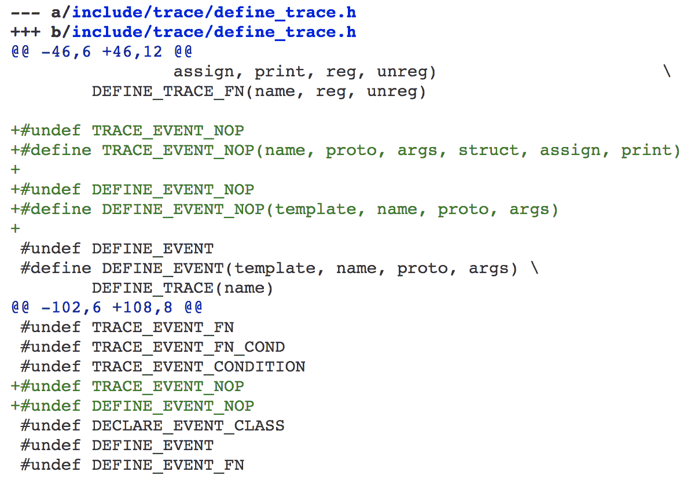
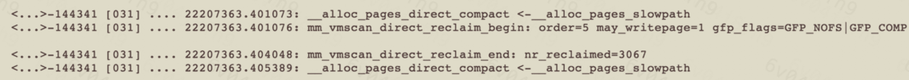

# 加餐 | 我是如何使用tracepoint来分析内核Bug的？

 

你好，我是邵亚方。

我们这个系列课程的目标受众是应用开发者和运维人员，所以，你可以看到课程里的案例在分析应用问题的时候，都在尽量避免分析内核 bug，避免把内核代码拿过来逐个函数地解析为什么会这样。我希望这个课程可以降低内核的门槛，让更多人可以更加容易地了解内核机制，从而更好地解决应用难题、提升应用性能。

不过，在我们这个课程的学习者中还是有一些内核开发者的，因此，我写了这篇加餐来分析内核 bug，希望能把分析内核 bug 的一些经验分享给这些内核开发者们。

通过对课程的学习，你应该能发现，我对 tracepoint 和 ftrace 是极其推崇的。我对它推崇备至不是没有道理的，这节课我就带你来看下我是如何借助 tracepoint 来分析内核 bug 的。

## 炫技般存在的 tracepoint 内核源码

如果你看过 tracepoint 的内核代码，相信你一定对它炫技般存在的宏定义印象深刻。我在第一眼看到这些宏定义时，也是一脸懵逼，不知从何下手，但是很快我就看懂了。为了证明我看懂了，我还特意给 tracepoint 的这些宏定义又增加了一些定义，我增加的这个宏定义，其关键部分如下：



如果你能看明白这些，那就说明你对这些 tracepoint 宏的工作机制一清二楚了。当然，这节课我不是来剖析 tracepoint 内核源码的。如果你不懂 tracepoint 内核源码，也不妨碍你使用它，不过这对一名内核开发者而言终究是一件憾事。

因为我经常使用 tracepoint，所以我对 tracepoint 的一些功能也比较上心。比如，最近在我的推动下，tracepoint 模块的 maintainer Steven Rostedt又给 tracepoint 增加了一个宏定义。我之所以推动 Steven 增加该宏，是为了让 tracepoint 函数可以在头文件中使用，以减少因为额外函数调用而带来的开销。有了这个新增的宏之后，你就可以方便地在头文件中使用 tracepoint 了。

接下来我要讲的这个内核 bug，就是借助 tracepoint 来分析的。

## 内存申请在慢速路径上为什么会失败

有一次，业务人员反馈说他们在启动程序时会偶然失败，我查看内核日志后发现了下面这些报错信息（这个系统为 CentOS-7，对应的内核版本为 3.10）：

```
kworker/31:0: page allocation failure: order:5, mode:0x104050  
CPU: 31 PID: 635928 Comm: kworker/31:0 Tainted: G   
0000000000104050 000000009a44a60e ffff882016b93808 ffffffff81686b13  
ffff882016b93898 ffffffff81187010 0000000000000000 ffff88207ffd8000  
0000000000000005 0000000000104050 ffff882016b93898 000000009a44a60e  
 Call Trace:  
[<ffffffff81686b13>] dump_stack+0x19/0x1b  
[<ffffffff81187010>] warn_alloc_failed+0x110/0x180  
[<ffffffff816826a7>] __alloc_pages_slowpath+0x6b7/0x725  
[<ffffffff8118b5c5>] __alloc_pages_nodemask+0x405/0x420  
[<ffffffff811cf77a>] alloc_pages_current+0xaa/0x170  
[<ffffffff81185eee>] __get_free_pages+0xe/0x50  
[<ffffffff811db01e>] kmalloc_order_trace+0x2e/0xa0  
[<ffffffff811e05d9>] __kmalloc_track_caller+0x219/0x230  
[<ffffffff8119f78f>] krealloc+0x4f/0xa0  
[<ffffffffa07eebe6>] osdmap_set_max_osd+0x76/0x1d0 [libceph]  
[<ffffffffa07f14f6>] ceph_osdmap_decode+0x216/0x600 [libceph]  
[<ffffffffa07ecce4>] handle_one_map+0x224/0x250 [libceph]  
[<ffffffffa07ed98f>] ceph_osdc_handle_map+0x6cf/0x720 [libceph]  
[<ffffffffa07e3340>] dispatch+0x350/0x7c0 [libceph]  
[<ffffffffa07deecf>] try_read+0x4df/0x1260 [libceph]  
[<ffffffffa07dfd09>] ceph_con_workfn+0xb9/0x650 [libceph]  
[<ffffffff810a845b>] process_one_work+0x17b/0x470  
[<ffffffff810a9296>] worker_thread+0x126/0x410  
[<ffffffff810b0a4f>] kthread+0xcf/0xe0  
[<ffffffff81697118>] ret_from_fork+0x58/0x90  
Mem-Info:  
active_anon:13891624 inactive_anon:358552 isolated_anon:0#012 active_file:1652146 inactive_file:14520052 isolated_file:0#012 unevictable:0 dirty:472 writeback:0 unstable:0#012 slab_reclaimable:1071185 slab_unreclaimable:201037#012 mapped:53234 shmem:1046930 pagetables:31965 bounce:0#012 free:966225 free_pcp:185 free_cma:0  
Node 0 DMA free:15864kB min:48kB low:60kB high:72kB active_anon:0kB inactive_anon:0kB active_file:0kB inactive_file:0kB unevictable:0kB isolated(anon):0kB isolated(file):0kB present:15948kB managed:15864kB mlocked:0kB dirty:0kB writeback:0kB mapped:0kB shmem:0kB slab_reclaimable:0kB slab_unreclaimable:0kB kernel_stack:0kB pagetables:0kB unstable:0kB bounce:0kB free_pcp:0kB local_pcp:0kB free_cma:0kB writeback_tmp:0kB pages_scanned:0 all_unreclaimable? yes  
 lowmem_reserve[]: 0 1700 64161 64161  
Node 0 DMA32 free:261328kB min:5412kB low:6764kB high:8116kB active_anon:303220kB inactive_anon:2972kB active_file:51840kB inactive_file:239320kB unevictable:0kB isolated(anon):0kB isolated(file):0kB present:1952512kB managed:1741564kB mlocked:0kB dirty:0kB writeback:0kB mapped:1160kB shmem:15968kB slab_reclaimable:687588kB slab_unreclaimable:183756kB kernel_stack:6640kB pagetables:724kB unstable:0kB bounce:0kB free_pcp:0kB local_pcp:0kB free_cma:0kB writeback_tmp:0kB pages_scanned:0 all_unreclaimable? no  
lowmem_reserve[]: 0 0 62460 62460  
Node 0 Normal free:272880kB min:198808kB low:248508kB high:298212kB active_anon:26813396kB inactive_anon:912660kB active_file:2646440kB inactive_file:30619568kB unevictable:0kB isolated(anon):0kB isolated(file):0kB present:65011712kB managed:63960000kB mlocked:0kB dirty:36kB writeback:0kB mapped:144152kB shmem:2567180kB slab_reclaimable:1870364kB slab_unreclaimable:262608kB kernel_stack:12880kB pagetables:45840kB unstable:0kB bounce:0kB free_pcp:652kB local_pcp:0kB free_cma:0kB writeback_tmp:0kB pages_scanned:32 all_unreclaimable? no  
lowmem_reserve[]: 0 0 0 0  
Node 1 Normal free:3315332kB min:205324kB low:256652kB high:307984kB active_anon:28449880kB inactive_anon:518576kB active_file:3910304kB inactive_file:27221320kB unevictable:0kB isolated(anon):0kB isolated(file):0kB present:67108864kB managed:66056916kB mlocked:0kB dirty:1852kB writeback:0kB mapped:67624kB shmem:1604572kB slab_reclaimable:1726788kB slab_unreclaimable:357784kB kernel_stack:18928kB pagetables:81296kB unstable:0kB bounce:0kB free_pcp:0kB local_pcp:0kB free_cma:0kB writeback_tmp:0kB pages_scanned:0 all_unreclaimable? no  
lowmem_reserve[]: 0 0 0 0  
Node 0 DMA: 0*4kB 1*8kB (U) 1*16kB (U) 1*32kB (U) 1*64kB (U) 1*128kB (U) 1*256kB (U) 0*512kB 1*1024kB (U) 1*2048kB (M) 3*4096kB (M) = 15864kB  
Node 0 DMA32: 36913*4kB (UEM) 14087*8kB (UEM) 44*16kB (UEM) 17*32kB (UEM) 0*64kB 0*128kB 0*256kB 0*512kB 0*1024kB 0*2048kB 0*4096kB = 261596kB  
Node 0 Normal: 69629*4kB (UEM) 411*8kB (UEM) 1*16kB (E) 3*32kB (E) 0*64kB 0*128kB 0*256kB 0*512kB 0*1024kB 0*2048kB 0*4096kB = 281916kB  
Node 1 Normal: 241701*4kB (UEM) 240734*8kB (UEM) 24010*16kB (UEM) 990*32kB (UEM) 175*64kB (UEM) 20*128kB (UEM) 3*256kB (EM) 0*512kB 0*1024kB 0*2048kB 0*4096kB = 3323044kB  
Node 0 hugepages_total=0 hugepages_free=0 hugepages_surp=0 hugepages_size=1048576kB  
Node 0 hugepages_total=0 hugepages_free=0 hugepages_surp=0 hugepages_size=2048kB  
Node 1 hugepages_total=0 hugepages_free=0 hugepages_surp=0 hugepages_size=1048576kB
```

从上面的日志可以看出，这是在 __alloc_pages_slowpath() 分配内存失败，所以有了这个打印:

```
__alloc_pages_slowpath  
{  
    ...  
nopage:  
    // 这里打印的错误日志  
    warn_alloc_failed(gfp_mask, order, NULL);  
    return NULL;  
}
```

此时申请的内存大小是 order 5，也就是 32 个连续页。紧接着，我们可以看到各个 node 具体内存使用情况的打印，该机器共有 2 个 node：

```
Node 0 DMA free:15864kB min:48kB  
Node 0 DMA32 free:261328kB min:5412kB  
Node 0 Normal free:272880kB min:198808kB  
Node 1 Normal free:3315332kB min:205324kB 
```

从中我们可以发现，各个 zone 的 free 内存都大于 min，而且相差不止 32 个 page。也就是说，从 free 内存的大小来看，各个 zone 都是可以满足需求的。那么，为什么此时会申请内存失败呢？

接下来，我们一起分析失败的原因。

## 逐一排查可能的情况

对于 3.10 版本的内核而言，在内存分配慢速路径里失败，原因可以分为以下三种情况：

1. 特殊的 GFP flags 导致；
2. 进程自身的状态；
3. reclaim 和 compact 无法满足需求。

现在，我们来逐一排查究竟是哪种情况导致的。

#### GFP flags

此时的 GFP flags 是 0x104050，对应于下面这几项：

```
#define ___GFP_WAIT             0x10u  
#define ___GFP_IO               0x40u  
#define ___GFP_COMP             0x4000u  
#define ___GFP_KMEMCG           0x100000u
```

看到这里，你是否思考过：为什么不直接在内核日志里打印出这些 GFP flags 呢？如果你思考了，那么恭喜你，你具备内核开发者的特质；如果你没有思考过，那么你需要加强这方面的思考：我觉得内核这里有点不好，我得改变它。

我觉得内核日志里打印这些数字不如直接打印对应的 GFP flags 好，然后我就去查看最新的内核代码，发现这部分已经在新版本的内核里被修改过了，看来其他的内核开发者与我的想法一致。当然，这也说明了使用老版本的内核做开发是一件多么憋屈的事，因为你会发现你在老版本内核里分析清楚的内核 bug，早已在新版本中被别人给 fix 了，这大大限制了我们的发挥空间。

通过前面的调用栈，我们可以知道申请内存是在 osdmap_set_max_osd() 这个函数中进行的，它对应的内核代码如下：

```
osdmap_set_max_osd  
    addr = krealloc(map->osd_addr, max*sizeof(*addr), GFP_NOFS);  
    if (!addr)  
        return -ENOMEM;
```

我们看到这里的 GFP flags 为 GFP_NOFS，它的定义如下：

```
#define GFP_NOFS        (__GFP_WAIT | __GFP_IO)
```

这与内核日志里的 GFP flags 是对得上的。然后我们去比较`goto nopage;`的情况，可以发现这几个 flag 不会导致这种情况，也就是不会导致 nopage。

关于 GFP_NOFS 的作用，我在这里大致说明一下。它的作用是为了防止某些路径上触发直接内存回收时，回收到正在进行 I/O 的 page 从而引起死锁。那什么情况下可能会引起死锁呢？你可以参考一下我尚未完成的PATCH：xfs: avoid deadlock when trigger memory reclaim in ->writepages。这个链接里描述的问题在 3.10 版本以及最新版本的内核上都存在，之所以我还没有完成该 PATCH，是因为它依赖于我的另外一组 PATCH，而我目前很少有精力去写它们。具体的逻辑你可以看下这个 PATCH 的代码以及描述，我就不在这里细说了。

现在，我们排除了 GFP flags 产生 nopage 的可能，接下来继续看看另外两种情况。

#### 进程标记 current->flag

在 warn_alloc_failed 里，我们可以看到，如果是因为进程自身的状态有问题（比如正在退出，或者正在 oom 过程中等），那么`SHOW_MEM_FILTER_NODES`这个标记位就会被清掉，然后各个 zone 的具体内存信息就不会被打印出来了。

因此，内存申请在慢速路径上失败也不是因为这个原因。

#### reclaim 和 compact 无法满足需求

现在就只有“reclaim 和 compact 无法满足需求”这一种情况了。

根据前面的信息我们可以知道，此时 free 的内存其实挺多，可以排除 reclaim 无法满足需求的情况。所以，只剩下 compcat 这个因素了。也就是说，由于申请的是连续页，而系统中没有足够的连续页，所以 compact 也满足不了需求，进而导致分配内存失败。

那么，在什么情况下 compact 会失败呢？我们继续来看代码：

```
try_to_compact_pages  
    int may_enter_fs = gfp_mask & __GFP_FS;  
    int may_perform_io = gfp_mask & __GFP_IO;  
      
    if (!order || !may_enter_fs || !may_perform_io)  
      return rc;
```

我们可以看到`__GFP_FS`没有被设置，无法进行 compaction，直接返回了`COMPACT_SKIPPED`。

明白了问题所在后，我们需要在生产环境上验证一下，看看到底是不是这个原因。

## 使用 tracepoint 分析生产环境

tracepoint 是一种性能开销比较小的追踪手段，在生产环境上使用它，不会给业务带来明显的性能影响。

在使用 tracepoint 分析前，我们需要明确它可以追踪什么事件。

因为我们目前的问题是 compact fail，所以我们需要去追踪 direct compact 这个事件。新版本的内核里有 compact 相关的 tracepoint，我们直接打开对应的 tracepoint 就可以了。不过，3.10 版本的内核没有 compact 相关的 tracepoint，这个时候我们就需要借助 kprobe 机制了，最简单的方式是利用 ftrace 提供的 kprobe_events 功能或者是 ftrace 的 function tracer 功能。我们以 function tracer 为例来追踪 direct compact：

```
$ echo function > /sys/kernel/debug/tracing/current_tracer  
$ echo __alloc_pages_direct_compact > /sys/kernel/debug/tracing/set_ftrace_filter
```

这样，当发生 direct compact 时，在 trace_pipe 中就会有相应的信息输出。不过，这显示不了 compact 的细节，我们还需要结合其他手段查看是否进行了 compact。方式有很多，在这里，我们结合源码来看一种比较简单的方式：

```
 __alloc_pages_direct_compact  
   try_to_compact_pages  
     /* Check if the GFP flags allow compaction */  
     if (!order || !may_enter_fs || !may_perform_io)  
       return rc;  
       
      // 如果可以进行direct compact的话，会有COMPACTSTALL事件  
      count_compact_event(COMPACTSTALL);  
```

从源码中我们能看到，如果可以进行 direct compact 的话，会有相应的 COMPACTSTALL 事件，而该事件会统计在 /proc/vmstat 中：

```
$ cat /proc/vmstat | grep compact
```

这样我们就可以知道调用 __alloc_pages_direct_compact 时，有没有真正进行 compact 的行为。另外，在 compact 的过程中还会伴随着 direct reclaim，我们也需要看下 direct reclaim 的细节，看看 direct claim 能否成功回收内存。我们可以借助 direct reclaim 的 tracepoint 来查看，该 tracepoint 在 3.10 版本的内核里已经有了：

```
$ echo 1 > /sys/kernel/debug/tracing/events/vmscan/mm_vmscan_direct_reclaim_begin/enable  
  
$ echo 1 > /sys/kernel/debug/tracing/events/vmscan/mm_vmscan_direct_reclaim_end/enable
```

在追踪这些事件之后，我们就可以看到 direct compact 前后的信息了。

direct compact 前的 vmstat 指标为：

```
$ cat /proc/vmstat | grep compact  
compact_migrate_scanned 690141298  
compact_free_scanned 186406569096  
comoact_isolated 332972232  
compact_stall 87914  
compact_fail 40935  
compact_success 46979
```

compact 过程中的事件：



compact 结束后的 vmstat 指标为：

```
$ cat /proc/vmstat | grep compact  
compact_migrate_scanned 690141298  
compact_free_scanned 186406569096  
comoact_isolated 332972232  
compact_stall 87914  
compact_fail 40935  
compact_success 46979
```

我们可以看到，在 compact 前后，compcat_stall 这个指标没有任何变化，也就是说 try_to_compact_pages 中没有进行真正的 compact 行为；从 direct reclaim 事件中的 nr_reclaimed=3067 可以看到，此时可以回收到足够的 page，也就是说 direct reclaim 没有什么问题；同样，direct reclaim 的“order=5, gfp_flags=GFP_NOFS|GFP_COMP” 也与之前日志里的信息吻合。因此，这些追踪数据进一步印证了我们之前的猜测：`__GFP_FS`没有被设置，无法进行 compaction。

我们现在再次观察申请内存失败时的日志，可以发现，此时 free list 上其实有当前 order 的内存（因为没有 GFP_DMA，所以会先从 NORMAL zone 申请内存）：

```
Node 0 Normal: 69629*4kB (UEM) 411*8kB (UEM) 1*16kB (E) 3*32kB (E) 0*64kB 0*128kB 0*256kB 0*512kB 0*1024kB 0*2048kB 0*4096kB = 281916kB  
Node 1 Normal: 241701*4kB (UEM) 240734*8kB (UEM) 24010*16kB (UEM) 990*32kB (UEM) 175*64kB (UEM) 20*128kB (UEM) 3*256kB (EM) 0*512kB 0*1024kB 0*2048kB 0*4096kB = 3323044kB
```

我们能看到 node 1 大于 order 5（即 128K）的连续物理内存有很多，那为什么不能从这些 zone->free_area[order]里分配内存呢？

```
答案就在于该zone的水位不满足要求（见__zone_watermark_ok()）：  
  
__zone_watermark_ok  
{  
    ...  
    for (o = 0; o < order; o++) {  
        free_pages -= z->free_area[o].nr_free << o;  
        min >>= 1;  
        if (free_pages <= min)  
            return false;  
    }  
}
```

对于 node 1 而言，4K/8K/16K/32K/64K 内存和为 3319716kB，该 zone 的 watermark min 为 205324kB，该 node 的总内存为 3323044KB，我们可以简单地进行如下比较：

```
(3323044-3319716) 为3328KB  
(205324kB >> 5) 为6416KB
```

因此，order 5 无法满足水位。

根据上述这些追踪信息，我们可以得出这样的结论：在内存分配慢速路径上失败，是因为当前的内存申请请求无法进行碎片整理，而系统中 low order 的内存又太多，从而导致了该 order 的内存申请失败。

## 解决方案

因为此时 normal zone 的 order=5 的 free page 依然有很多，而整体的 watermark 又满足需求，所以不应该让 order=5 的内存申请失败，这是一个内核缺陷。我去查看 upstream 的最新代码时，发现该缺陷已经被修改过了。你可以看到，使用老版本的内核做开发的确是一件很憋屈的事。

关于 upstream 的修改方案，你可以参考这个 patch 以及它的一些依赖：

mm, page_alloc: only enforce watermarks for order-0 allocations

如果你无法通过修改内核来解决这一问题的话，那就采取一些规避措施。

1. 规避方案一：

通过 drop_caches 清理掉 pagecache，不过这种做法也有很多缺陷，具体你可以参考我们这个课程的 pagecache 模块，我在这里就不细说了。

2. 规避方案二：

调整碎片指数，确保紧急情况下能够申请到连续页。内存碎片指数对应的文件是`/proc/sys/vm/extfrag_threshold`，它的默认值是 500 ，我们可以适当降低该值，不过在这种情况下，降低它的效果并不会很明显。

3. 规避方案三：

手动 compact，你可以通过写入 /proc/sys/vm/compact_memory 来触发 compact。

4. 规避方案四：

调整 vm.vfs_cache_pressure，降低它的值，让 pagecache 被回收得更多，以此来减少 freelist 中 order 为 0 的 page 个数。

至此，我们这个问题的分析就结束了。

## 总结

在比较新的内核上，我们也可以通过 eBPF 来分析内核 bug，比如在我们的生产环境中，我就通过 eBPF 追踪过 fadvise 的内核 bug 引起的业务抖动问题，具体 bug 你可以看看我贡献给内核的这个PATCH: mm,fadvise: improve the expensive remote LRU cache draining after FADV_DONTNEED，这也再次印证了我的观点：内核开发者只有在新版本的内核里做开发，才会有更多的发挥空间。

另外，虽然 eBPF 很强大，但是它依然难以替代 ftrace 在我心中的地位。
