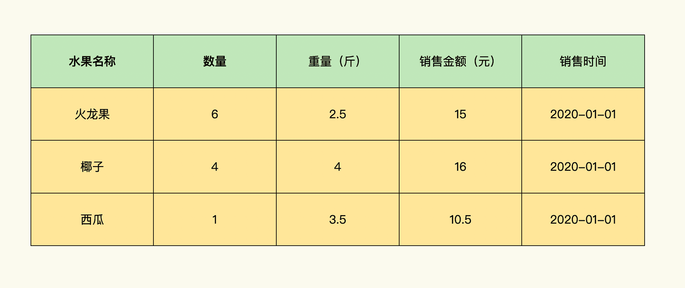

# 春节特别放送1｜实体水果店转线上销售的数据统计问题

 

你好，我是尹会生。今天是大年三十儿，先祝你春节快乐。同时我也要为假期还在坚持学习的你点赞。

春节期间，我为你准备了一个项目作业，帮助你检验第一模块的学习成果。这个作业由 3 个部分组成，今天，我会介绍项目背景，给出你操作题目，2 月 13 号，我会给出参考思路，在 2 月 16 号，我会公布答案。希望你跟着更新节奏，完整地参与进来，巩固你之前的学习成果。

接下来，我先介绍下项目情况。

这个题目来自我身边的一个真实案例。我先给你简单介绍下背景：一家实体水果店上了多多买菜后，店里的销售管理系统都没法直接使用实体店的那一套。而且像多多买菜、美团社群现在都只能下载 Excel 数据表。

题目是：F 水果店由于疫情原因，2020 年由实体店改为了线上销售。老板为了进行年终数据统计，需要从在线管理软件下载 Excel 格式的销售数据，并对销售数据进行处理，分析各个种类的水果受欢迎的程度和库存量，最后录入销售管理系统。不过老板在分析 Excel 的过程中，遇到了这样一个问题。

将线上的数据转换为线下数据的时候，由于数据不兼容，必须进行统计和一定格式的调整。首先需要合并 Excel，统计全年水果销售量。在 Excel 中，每个 sheet 记录了当日的销售数据，每个 Excel 文件记录了当月的销售数据。图表如下：

我给你留两道题目：

1. 统计出全年每种水果的总销售额。
2. 统计出每月销售数量排名 Top 3 的水果。

欢迎你在留言区分享你对这道题的想法和思考，我们一起交流、讨论。在 2 月 13 日，也就是大年初二这一天，我会把解题思路给你分享出来，供你参考。
