# 31丨为什么大部分RDBMS都会支持MVCC？

 

上一篇文章中，我们讲到了锁的划分，以及乐观锁和悲观锁的思想。今天我们就来看下 MVCC，它就是采用乐观锁思想的一种方式。那么它到底有什么用呢？

我们知道事务有 4 个隔离级别，以及可能存在的三种异常问题，如下图所示：


  
 在 MySQL 中，默认的隔离级别是可重复读，可以解决脏读和不可重复读的问题，但不能解决幻读问题。如果我们想要解决幻读问题，就需要采用串行化的方式，也就是将隔离级别提升到最高，但这样一来就会大幅降低数据库的事务并发能力。

有没有一种方式，可以不采用锁机制，而是通过乐观锁的方式来解决不可重复读和幻读问题呢？实际上 MVCC 机制的设计，就是用来解决这个问题的，它可以在大多数情况下替代行级锁，降低系统的开销。

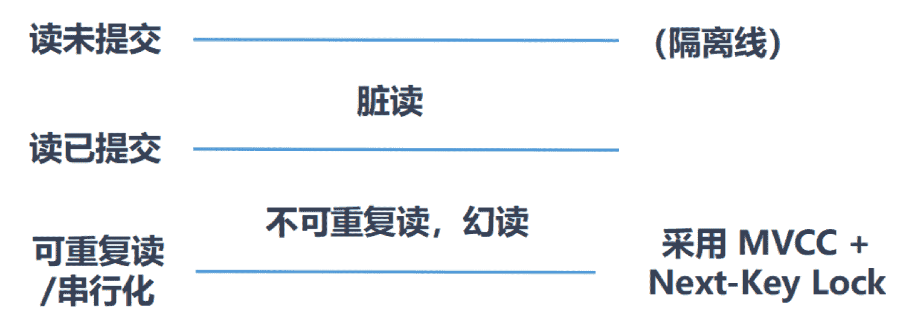

  
 今天的课程主要包括以下几个方面的内容：

 
1. MVCC 机制的思想是什么？为什么 RDBMS 会采用 MVCC 机制？ 
2. 在 InnoDB 中，MVCC 机制是如何实现的 ？ 
3. Read View 是如何工作的？ 

## MVCC 是什么，解决了什么问题

MVCC 的英文全称是 Multiversion Concurrency Control，中文翻译过来就是多版本并发控制技术。从名字中也能看出来，MVCC 是通过数据行的多个版本管理来实现数据库的并发控制，简单来说它的思想就是保存数据的历史版本。这样我们就可以通过比较版本号决定数据是否显示出来（具体的规则后面会介绍到），读取数据的时候不需要加锁也可以保证事务的隔离效果。

通过 MVCC 我们可以解决以下几个问题：

 
1. 读写之间阻塞的问题，通过 MVCC 可以让读写互相不阻塞，即读不阻塞写，写不阻塞读，这样就可以提升事务并发处理能力。 
2. 降低了死锁的概率。这是因为 MVCC 采用了乐观锁的方式，读取数据时并不需要加锁，对于写操作，也只锁定必要的行。 
3. 解决一致性读的问题。一致性读也被称为快照读，当我们查询数据库在某个时间点的快照时，只能看到这个时间点之前事务提交更新的结果，而不能看到这个时间点之后事务提交的更新结果。 

### 什么是快照读，什么是当前读

那么什么是快照读呢？快照读读取的是快照数据。不加锁的简单的 SELECT 都属于快照读，比如这样：

```
SELECT * FROM player WHERE ...
```

当前读就是读取最新数据，而不是历史版本的数据。加锁的 SELECT，或者对数据进行增删改都会进行当前读，比如：

```
SELECT * FROM player LOCK IN SHARE MODE;
```

```
SELECT * FROM player FOR UPDATE;
```

```
INSERT INTO player values ...
```

```
DELETE FROM player WHERE ...
```

```
UPDATE player SET ...
```

这里需要说明的是，快照读就是普通的读操作，而当前读包括了加锁的读取和 DML 操作。

上面讲 MVCC 的作用，你可能觉得有些抽象。我们用具体的例子体会一下。

比如我们有个账户金额表 user_balance，包括三个字段，分别是 username 用户名、balance 余额和 bankcard 卡号，具体的数据示意如下：

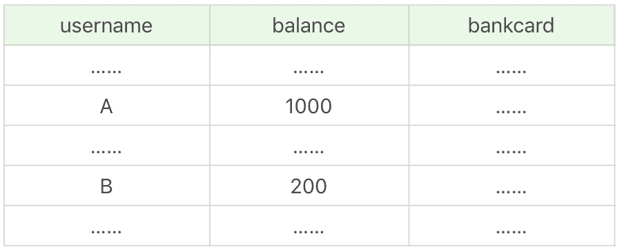

  
 为了方便，我们假设 user_balance 表中只有用户 A 和 B 有余额，其他人的账户余额均为 0。下面我们考虑一个使用场景。

用户 A 和用户 B 之间进行转账，此时数据库管理员想要查询 user_balance 表中的总金额：

```
SELECT SUM(balance) FROM user_balance
```

你可以思考下，如果数据库不支持 MVCC 机制，而是采用自身的锁机制来实现的话，可能会出现怎样的情况呢？

情况 1：因为需要采用加行锁的方式，用户 A 给 B 转账时间等待很久，如下图所示。

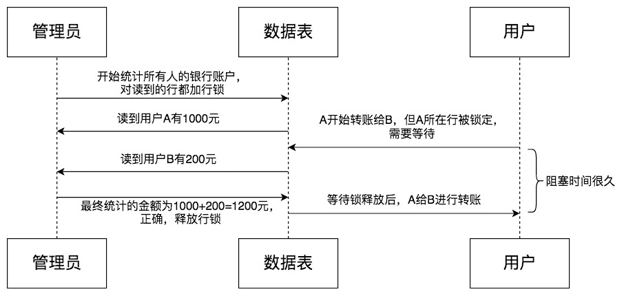

  
 你能看到为了保证数据的一致性，我们需要给统计到的数据行都加上行锁。这时如果 A 所在的数据行加上了行锁，就不能给 B 转账了，只能等到所有操作完成之后，释放行锁再继续进行转账，这样就会造成用户事务处理的等待时间过长。

情况 2：当我们读取的时候用了加行锁，可能会出现死锁的情况，如下图所示。比如当我们读到 A 有 1000 元的时候，此时 B 开始执行给 A 转账：

```
UPDATE user_balance SET balance=balance-100 WHERE username ='B' 
```

执行完之后马上执行下一步：

```
UPDATE user_balance SET balance=balance+100 WHERE username ='A'
```

我们会发现此时 A 被锁住了，而管理员事务还需要对 B 进行访问，但 B 被用户事务锁住了，此时就发生了死锁。

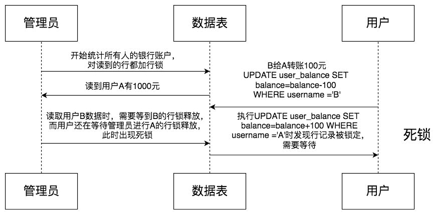

  
 MVCC 可以解决读写互相阻塞的问题，这样提升了效率，同时因为采用了乐观锁的思想，降低了死锁的概率。

## InnoDB 中的 MVCC 是如何实现的？

我刚才讲解了 MVCC 的思想和作用，实际上 MVCC 没有正式的标准，所以在不同的 DBMS 中，MVCC 的实现方式可能是不同的，你可以参考相关的 DBMS 文档。今天我来讲一下 InnoDB 中 MVCC 的实现机制。

在了解 InnoDB 中 MVCC 的实现方式之前，我们需要了解 InnoDB 是如何存储记录的多个版本的。这里的多版本对应的就是 MVCC 前两个字母的释义：Multi Version，我们需要了解和它相关的数据都有哪些，存储在哪里。这些数据包括事务版本号、行记录中的隐藏列和 Undo Log。

### 事务版本号

每开启一个事务，我们都会从数据库中获得一个事务 ID（也就是事务版本号），这个事务 ID 是自增长的，通过 ID 大小，我们就可以判断事务的时间顺序。

### 行记录的隐藏列

InnoDB 的叶子段存储了数据页，数据页中保存了行记录，而在行记录中有一些重要的隐藏字段，如下图所示：

 
1. db_row_id：隐藏的行 ID，用来生成默认聚集索引。如果我们创建数据表的时候没有指定聚集索引，这时 InnoDB 就会用这个隐藏 ID 来创建聚集索引。采用聚集索引的方式可以提升数据的查找效率。 
2. db_trx_id：操作这个数据的事务 ID，也就是最后一个对该数据进行插入或更新的事务 ID。 
3. db_roll_ptr：回滚指针，也就是指向这个记录的 Undo Log 信息。 

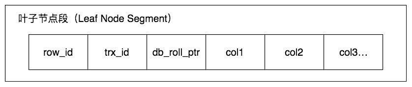

### Undo Log

InnoDB 将行记录快照保存在了 Undo Log 里，我们可以在回滚段中找到它们，如下图所示：

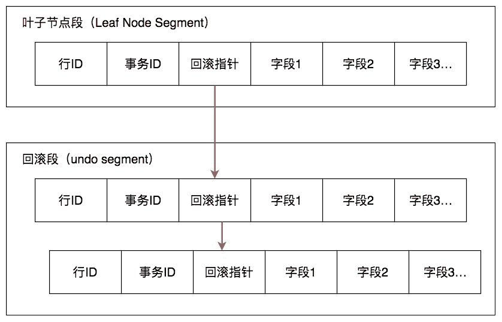

  
 从图中你能看到回滚指针将数据行的所有快照记录都通过链表的结构串联了起来，每个快照的记录都保存了当时的 db_trx_id，也是那个时间点操作这个数据的事务 ID。这样如果我们想要找历史快照，就可以通过遍历回滚指针的方式进行查找。

## Read View 是如何工作的

在 MVCC 机制中，多个事务对同一个行记录进行更新会产生多个历史快照，这些历史快照保存在 Undo Log 里。如果一个事务想要查询这个行记录，需要读取哪个版本的行记录呢？这时就需要用到 Read View 了，它帮我们解决了行的可见性问题。Read View 保存了当前事务开启时所有活跃（还没有提交）的事务列表，换个角度你可以理解为 Read View 保存了不应该让这个事务看到的其他的事务 ID 列表。

在 Read VIew 中有几个重要的属性：

 
1. trx_ids，系统当前正在活跃的事务 ID 集合。 
2. low_limit_id，活跃的事务中最大的事务 ID。 
3. up_limit_id，活跃的事务中最小的事务 ID。 
4. creator_trx_id，创建这个 Read View 的事务 ID。 

如图所示，trx_ids 为 trx2、trx3、trx5 和 trx8 的集合，活跃的最大事务 ID（low_limit_id）为 trx8，活跃的最小事务 ID（up_limit_id）为 trx2。

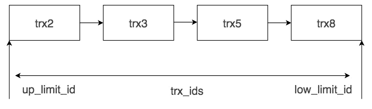

  
 假设当前有事务 creator_trx_id 想要读取某个行记录，这个行记录的事务 ID 为 trx_id，那么会出现以下几种情况。

如果 trx_id < 活跃的最小事务 ID（up_limit_id），也就是说这个行记录在这些活跃的事务创建之前就已经提交了，那么这个行记录对该事务是可见的。

如果 trx_id > 活跃的最大事务 ID（low_limit_id），这说明该行记录在这些活跃的事务创建之后才创建，那么这个行记录对当前事务不可见。

如果 up_limit_id < trx_id < low_limit_id，说明该行记录所在的事务 trx_id 在目前 creator_trx_id 这个事务创建的时候，可能还处于活跃的状态，因此我们需要在 trx_ids 集合中进行遍历，如果 trx_id 存在于 trx_ids 集合中，证明这个事务 trx_id 还处于活跃状态，不可见。否则，如果 trx_id 不存在于 trx_ids 集合中，证明事务 trx_id 已经提交了，该行记录可见。

了解了这些概念之后，我们来看下当查询一条记录的时候，系统如何通过多版本并发控制技术找到它：

 
1. 首先获取事务自己的版本号，也就是事务 ID； 
2. 获取 Read View； 
3. 查询得到的数据，然后与 Read View 中的事务版本号进行比较； 
4. 如果不符合 ReadView 规则，就需要从 Undo Log 中获取历史快照； 
5. 最后返回符合规则的数据。 

你能看到 InnoDB 中，MVCC 是通过 Undo Log + Read View 进行数据读取，Undo Log 保存了历史快照，而 Read View 规则帮我们判断当前版本的数据是否可见。

需要说明的是，在隔离级别为读已提交（Read Commit）时，一个事务中的每一次 SELECT 查询都会获取一次 Read View。如表所示：

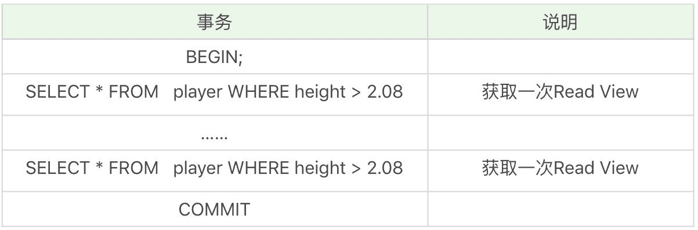

  
 你能看到，在读已提交的隔离级别下，同样的查询语句都会重新获取一次 Read View，这时如果 Read View 不同，就可能产生不可重复读或者幻读的情况。

当隔离级别为可重复读的时候，就避免了不可重复读，这是因为一个事务只在第一次 SELECT 的时候会获取一次 Read View，而后面所有的 SELECT 都会复用这个 Read View，如下表所示：

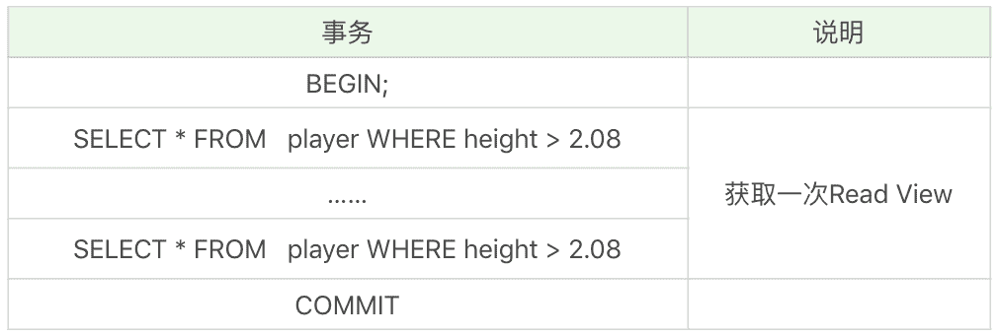

## InnoDB 是如何解决幻读的

不过这里需要说明的是，在可重复读的情况下，InnoDB 可以通过 Next-Key 锁 +MVCC 来解决幻读问题。

在读已提交的情况下，即使采用了 MVCC 方式也会出现幻读。如果我们同时开启事务 A 和事务 B，先在事务 A 中进行某个条件范围的查询，读取的时候采用排它锁，在事务 B 中增加一条符合该条件范围的数据，并进行提交，然后我们在事务 A 中再次查询该条件范围的数据，就会发现结果集中多出一个符合条件的数据，这样就出现了幻读。

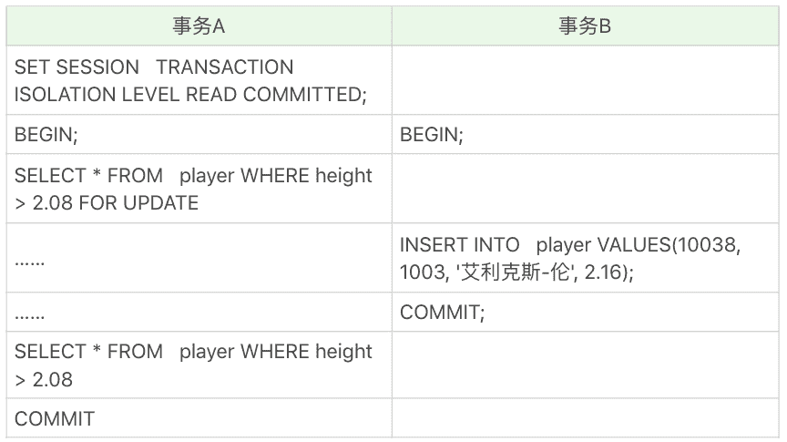

  
 出现幻读的原因是在读已提交的情况下，InnoDB 只采用记录锁（Record Locking）。这里要介绍下 InnoDB 三种行锁的方式：

 
1. 记录锁：针对单个行记录添加锁。 
2. 间隙锁（Gap Locking）：可以帮我们锁住一个范围（索引之间的空隙），但不包括记录本身。采用间隙锁的方式可以防止幻读情况的产生。 
3. Next-Key 锁：帮我们锁住一个范围，同时锁定记录本身，相当于间隙锁 + 记录锁，可以解决幻读的问题。 

在隔离级别为可重复读时，InnoDB 会采用 Next-Key 锁的机制，帮我们解决幻读问题。

还是这个例子，我们能看到当我们想要插入球员艾利克斯·伦（身高 2.16 米）的时候，事务 B 会超时，无法插入该数据。这是因为采用了 Next-Key 锁，会将 height>2.08 的范围都进行锁定，就无法插入符合这个范围的数据了。然后事务 A 重新进行条件范围的查询，就不会出现幻读的情况。

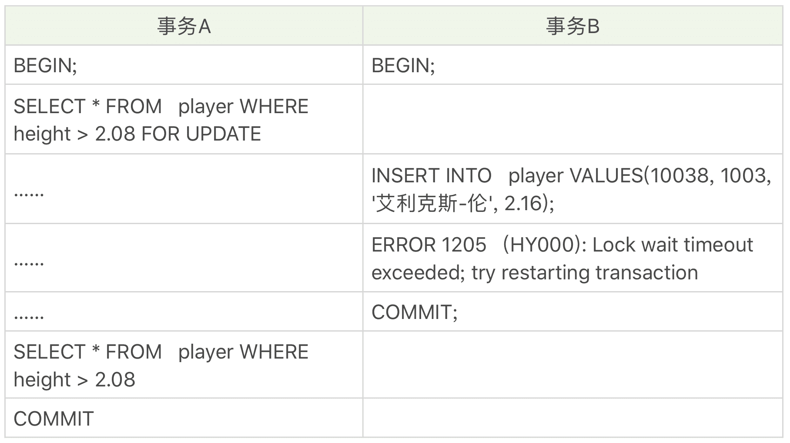

## 总结

今天关于 MVCC 的内容有些多，通过学习你应该能对采用 MVCC 这种乐观锁的方式来保证事务的隔离效果更有体会。

我们需要记住，MVCC 的核心就是 Undo Log+ Read View，“MV”就是通过 Undo Log 来保存数据的历史版本，实现多版本的管理，“CC”是通过 Read View 来实现管理，通过 Read View 原则来决定数据是否显示。同时针对不同的隔离级别，Read View 的生成策略不同，也就实现了不同的隔离级别。

MVCC 是一种机制，MySQL、Oracle、SQL Server 和 PostgreSQL 的实现方式均有不同，我们在学习的时候，更主要的是要理解 MVCC 的设计思想。

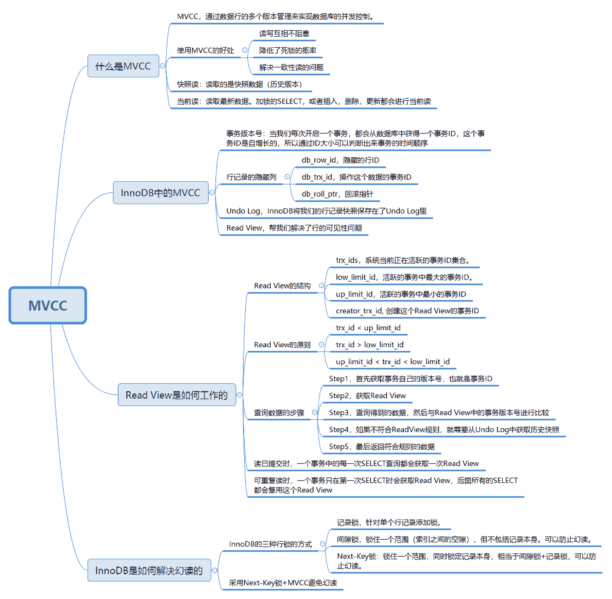

  
 最后给你留几道思考题吧，为什么隔离级别为读未提交时，不适用于 MVCC 机制呢？第二个问题是，读已提交和可重复读这两个隔离级别的 Read View 策略有何不同？

欢迎你在评论区写下你的思考，也欢迎把这篇文章分享给你的朋友或者同事，让我们一起来学习进步。


