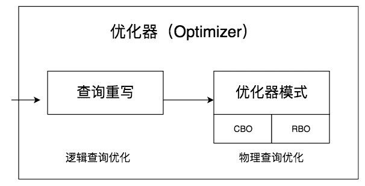
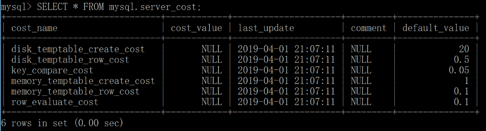
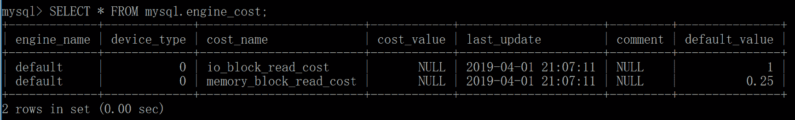
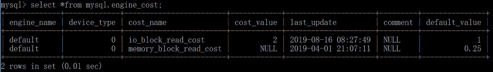
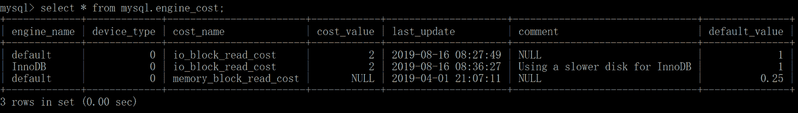
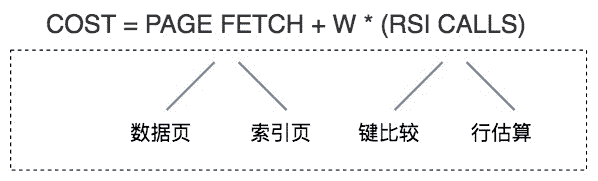
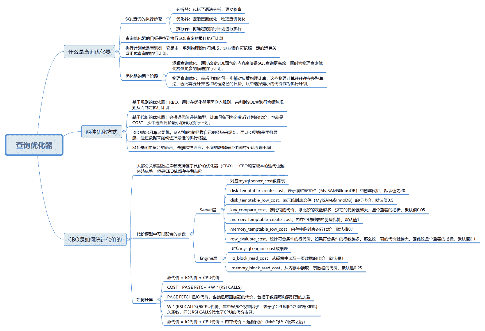

# 32丨查询优化器是如何工作的？

 

我们总是希望数据库可以运行得更快，也就是响应时间更快，吞吐量更大。想要达到这样的目的，我们一方面需要高并发的事务处理能力，另一方面需要创建合适的索引，让数据的查找效率最大化。事务和索引的使用是数据库中的两个重要核心，事务可以让数据库在增删查改的过程中，保证数据的正确性和安全性，而索引可以帮数据库提升数据的查找效率。

如果我们想要知道如何获取更高的 SQL 查询性能，最好的方式就是理解数据库是如何进行查询优化和执行的。

今天我们就来看看查询优化的原理是怎么一回事。今天的主要内容包括以下几个部分：

 
1. 什么是查询优化器？一条 SQL 语句的执行流程都会经历哪些环节，在查询优化器中都包括了哪些部分？ 
2. 查询优化器的两种优化方式分别是什么？ 
3. 基于代价的优化器是如何统计代价的？总的代价又如何计算？ 

## 什么是查询优化器

了解查询优化器的作用之前，我们先来看看一条 SQL 语句的执行都需要经历哪些环节，如下图所示：


  
 你能看到一条 SQL 查询语句首先会经过分析器，进行语法分析和语义检查。我们之前讲过语法分析是检查 SQL 拼写和语法是否正确，语义检查是检查 SQL 中的访问对象是否存在。比如我们在写 SELECT 语句的时候，列名写错了，系统就会提示错误。语法检查和语义检查可以保证 SQL 语句没有错误，最终得到一棵语法分析树，然后经过查询优化器得到查询计划，最后交给执行器进行执行。

查询优化器的目标是找到执行 SQL 查询的最佳执行计划，执行计划就是查询树，它由一系列物理操作符组成，这些操作符按照一定的运算关系组成查询的执行计划。在查询优化器中，可以分为逻辑查询优化阶段和物理查询优化阶段。

逻辑查询优化就是通过改变 SQL 语句的内容来使得 SQL 查询更高效，同时为物理查询优化提供更多的候选执行计划。通常采用的方式是对 SQL 语句进行等价变换，对查询进行重写，而查询重写的数学基础就是关系代数。对条件表达式进行等价谓词重写、条件简化，对视图进行重写，对子查询进行优化，对连接语义进行了外连接消除、嵌套连接消除等。

逻辑查询优化是基于关系代数进行的查询重写，而关系代数的每一步都对应着物理计算，这些物理计算往往存在多种算法，因此需要计算各种物理路径的代价，从中选择代价最小的作为执行计划。在这个阶段里，对于单表和多表连接的操作，需要高效地使用索引，提升查询效率。



  
 在这两个阶段中，查询重写属于代数级、语法级的优化，也就是属于逻辑范围内的优化，而基于代价的估算模型是从连接路径中选择代价最小的路径，属于物理层面的优化。

## 查询优化器的两种优化方式

查询优化器的目的就是生成最佳的执行计划，而生成最佳执行计划的策略通常有以下两种方式。

第一种是基于规则的优化器（RBO，Rule-Based Optimizer），规则就是人们以往的经验，或者是采用已经被证明是有效的方式。通过在优化器里面嵌入规则，来判断 SQL 查询符合哪种规则，就按照相应的规则来制定执行计划，同时采用启发式规则去掉明显不好的存取路径。

第二种是基于代价的优化器（CBO，Cost-Based Optimizer），这里会根据代价评估模型，计算每条可能的执行计划的代价，也就是 COST，从中选择代价最小的作为执行计划。相比于 RBO 来说，CBO 对数据更敏感，因为它会利用数据表中的统计信息来做判断，针对不同的数据表，查询得到的执行计划可能是不同的，因此制定出来的执行计划也更符合数据表的实际情况。

但我们需要记住，SQL 是面向集合的语言，并没有指定执行的方式，因此在优化器中会存在各种组合的可能。我们需要通过优化器来制定数据表的扫描方式、连接方式以及连接顺序，从而得到最佳的 SQL 执行计划。

你能看出来，RBO 的方式更像是一个出租车老司机，凭借自己的经验来选择从 A 到 B 的路径。而 CBO 更像是手机导航，通过数据驱动，来选择最佳的执行路径。

## CBO 是如何统计代价的

大部分 RDBMS 都支持基于代价的优化器（CBO），CBO 随着版本的迭代也越来越成熟，但是 CBO 依然存在缺陷。通过对 CBO 工作原理的了解，我们可以知道 CBO 可能存在的不足有哪些，有助于让我们知道优化器是如何确定执行计划的。

### 能调整的代价模型的参数有哪些

首先，我们先来了解下 MySQL 中的`COST Model`，`COST Model`就是优化器用来统计各种步骤的代价模型，在 5.7.10 版本之后，MySQL 会引入两张数据表，里面规定了各种步骤预估的代价（Cost Value） ，我们可以从`mysql.server_cost`和`mysql.engine_cost`这两张表中获得这些步骤的代价：

```
SQL > SELECT * FROM mysql.server_cost
```



  
 server_cost 数据表是在 server 层统计的代价，具体的参数含义如下：

 
1. `disk_temptable_create_cost`，表示临时表文件（MyISAM 或 InnoDB）的创建代价，默认值为 20。 
2. `disk_temptable_row_cost`，表示临时表文件（MyISAM 或 InnoDB）的行代价，默认值 0.5。 
3. `key_compare_cost`，表示键比较的代价。键比较的次数越多，这项的代价就越大，这是一个重要的指标，默认值 0.05。 
4. `memory_temptable_create_cost`，表示内存中临时表的创建代价，默认值 1。 
5. `memory_temptable_row_cost`，表示内存中临时表的行代价，默认值 0.1。 
6. `row_evaluate_cost`，统计符合条件的行代价，如果符合条件的行数越多，那么这一项的代价就越大，因此这是个重要的指标，默认值 0.1。 

由这张表中可以看到，如果想要创建临时表，尤其是在磁盘中创建相应的文件，代价还是很高的。

然后我们看下在存储引擎层都包括了哪些代价：

```
SQL > SELECT * FROM mysql.engine_cost
```



  
 `engine_cost`主要统计了页加载的代价，我们之前了解到，一个页的加载根据页所在位置的不同，读取的位置也不同，可以从磁盘 I/O 中获取，也可以从内存中读取。因此在`engine_cost`数据表中对这两个读取的代价进行了定义：

 
1. `io_block_read_cost`，从磁盘中读取一页数据的代价，默认是 1。 
2. `memory_block_read_cost`，从内存中读取一页数据的代价，默认是 0.25。 

既然 MySQL 将这些代价参数以数据表的形式呈现给了我们，我们就可以根据实际情况去修改这些参数。因为随着硬件的提升，各种硬件的性能对比也可能发生变化，比如针对普通硬盘的情况，可以考虑适当增加`io_block_read_cost`的数值，这样就代表从磁盘上读取一页数据的成本变高了。当我们执行全表扫描的时候，相比于范围查询，成本也会增加很多。

比如我想将`io_block_read_cost`参数设置为 2.0，那么使用下面这条命令就可以：

```
UPDATE mysql.engine_cost  SET cost_value = 2.0  WHERE cost_name = 'io_block_read_cost';FLUSH OPTIMIZER_COSTS;
```



  
 我们对`mysql.engine_cost`中的`io_block_read_cost`参数进行了修改，然后使用`FLUSH OPTIMIZER_COSTS`更新内存，然后再查看`engine_cost`数据表，发现`io_block_read_cost`参数中的`cost_value`已经调整为 2.0。

如果我们想要专门针对某个存储引擎，比如 InnoDB 存储引擎设置`io_block_read_cost`，比如设置为 2，可以这样使用：

```
INSERT INTO mysql.engine_cost(engine_name, device_type, cost_name, cost_value, last_update, comment)  VALUES ('InnoDB', 0, 'io_block_read_cost', 2,  CURRENT_TIMESTAMP, 'Using a slower disk for InnoDB');FLUSH OPTIMIZER_COSTS;
```

然后我们再查看一下`mysql.engine_cost`数据表：



  
 从图中你能看到针对 InnoDB 存储引擎可以设置专门的`io_block_read_cost`参数值。

### 代价模型如何计算

总代价的计算是一个比较复杂的过程，上面只是列出了一些常用的重要参数，我们可以根据情况对它们进行调整，也可以使用默认的系统参数值。

那么总的代价是如何进行计算的呢？

在论文[《Access Path Selection-in a Relational Database Management System》](http://dbis.rwth-aachen.de/lehrstuhl/staff/li/resources/download/AccessPathSelectionInRelationalDatabase.pdf%EF%BC%89)中给出了计算模型，如下图所示：



  
 你可以简单地认为，总的执行代价等于 I/O 代价 +CPU 代价。在这里 PAGE FETCH 就是 I/O 代价，也就是页面加载的代价，包括数据页和索引页加载的代价。W*(RSI CALLS) 就是 CPU 代价。W 在这里是个权重因子，表示了 CPU 到 I/O 之间转化的相关系数，RSI CALLS 代表了 CPU 的代价估算，包括了键比较（compare key）以及行估算（row evaluating）的代价。

为了让你更好地理解，我说下关于 W 和 RSI CALLS 的英文解释：W is an adjustable weight between I/O and CPU utilization. The number of RSI calls is used to approximate CPU utilization。

这样你应该能明白为了让 CPU 代价和 I/O 代价放到一起来统计，我们使用了转化的系数 W，

另外需要说明的是，在 MySQL5.7 版本之后，代价模型又进行了完善，不仅考虑到了 I/O 和 CPU 开销，还对内存计算和远程操作的代价进行了统计，也就是说总代价的计算公式演变成下面这样：

总代价 = I/O 代价 + CPU 代价 + 内存代价 + 远程代价

这里对内存代价和远程代价不进行讲解，我们只需要关注 I/O 代价和 CPU 代价即可。

## 总结

我今天讲解了查询优化器，它在 RDBMS 中是个非常重要的角色。在优化器中会经历逻辑查询优化和物理查询优化阶段。

最后我们只是简单梳理了下 CBO 的总代价是如何计算的，以及包括了哪些部分。CBO 的代价计算是个复杂的过程，细节很多，不同优化器的实现方式也不同。另外随着优化器的逐渐成熟，考虑的因素也会越来越多。在某些情况下 MySQL 还会把 RBO 和 CBO 组合起来一起使用。RBO 是个简单固化的模型，在 Oracle 8i 之前采用的就是 RBO，在优化器中一共包括了 15 种规则，输入的 SQL 会根据符合规则的情况得出相应的执行计划，在 Oracle 10g 版本之后就用 CBO 替代了 RBO。

CBO 中需要传入的参数除了 SQL 查询以外，还包括了优化器参数、数据表统计信息和系统配置等，这实际上也导致 CBO 出现了一些缺陷，比如统计信息不准确，参数配置过高或过低，都会导致路径选择的偏差。除此以外，查询优化器还需要在优化时间和执行计划质量之间进行平衡，比如一个执行计划的执行时间是 10 秒钟，就没有必要花 1 分钟优化执行计划，除非该 SQL 使用频繁高，后续可以重复使用该执行计划。同样 CBO 也会做一些搜索空间的剪枝，以便在有效的时间内找到一个“最优”的执行计划。这里，其实也是在告诉我们，为了得到一个事物，付出的成本过大，即使最终得到了，有时候也是得不偿失的。



  
 最后留两道思考题吧，RBO 和 CBO 各自的特点是怎样的呢？为什么 CBO 也存在不足？你能用自己的话描述一下其中的原因吗？

欢迎你在评论区写下你的思考，也欢迎把这篇文章分享给你的朋友或者同事，一起来学习进步。


