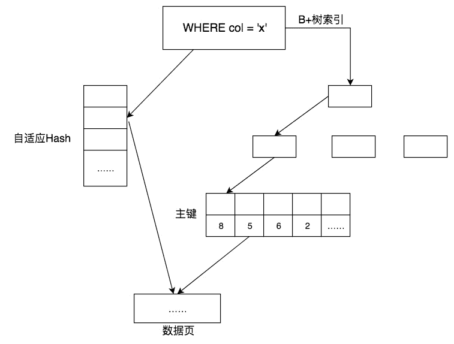
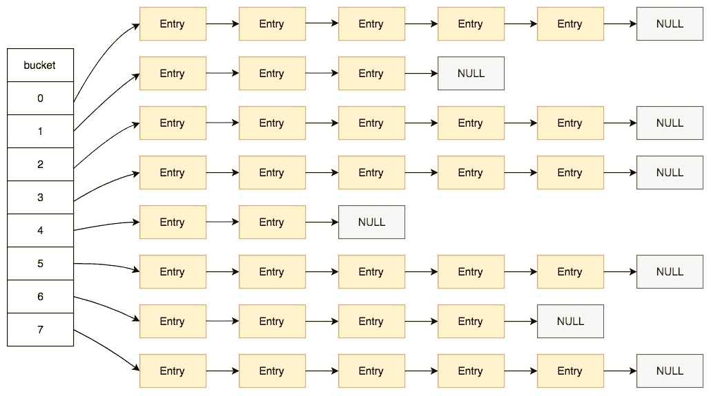
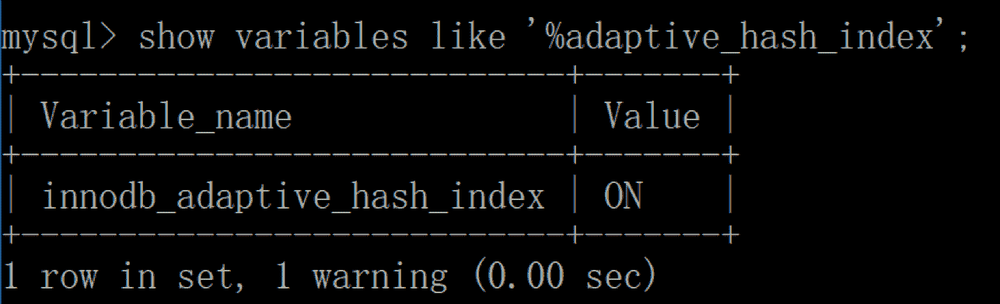
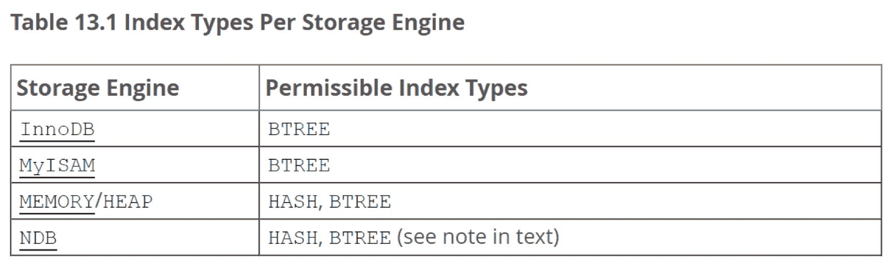
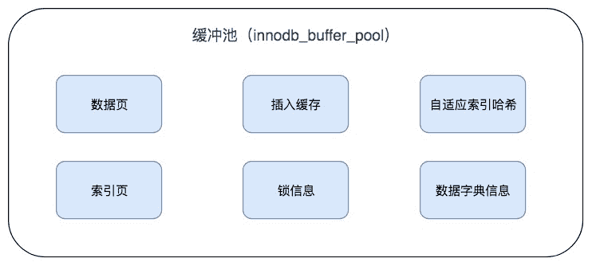
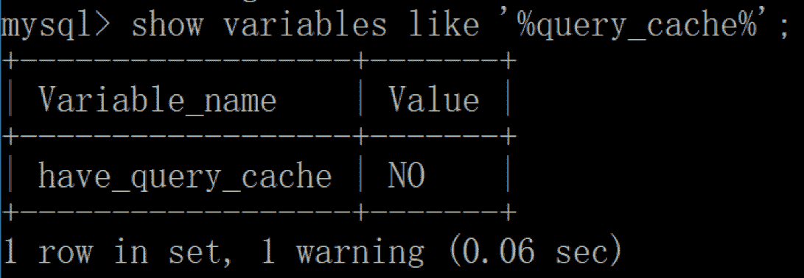

# 34丨答疑篇：关于索引以及缓冲池的一些解惑

 

这篇文章是进阶篇的最后一篇，在这一模块中，我主要针对 SQL 运行的底层原理进行了讲解，其中还有很多问题没有回答，我总结了进阶篇中常见的一些问题，希望能对你有所帮助。下面的内容主要包括了索引原则、自适应 Hash、缓冲池机制和存储引擎等。

## 关于索引（B+ 树索引和 Hash 索引，以及索引原则）

### 什么是自适应 Hash 索引？

在回答这个问题前，让我们先回顾下 B+ 树索引和 Hash 索引：

因为 B+ 树可以使用到范围查找，同时是按照顺序的方式对数据进行存储，因此很容易对数据进行排序操作，在联合索引中也可以利用部分索引键进行查询。这些情况下，我们都没法使用 Hash 索引，因为 Hash 索引仅能满足（=）（<>）和 IN 查询，不能使用范围查询。此外，Hash 索引还有一个缺陷，数据的存储是没有顺序的，在 ORDER BY 的情况下，使用 Hash 索引还需要对数据重新排序。而对于联合索引的情况，Hash 值是将联合索引键合并后一起来计算的，无法对单独的一个键或者几个索引键进行查询。

MySQL 默认使用 B+ 树作为索引，因为 B+ 树有着 Hash 索引没有的优点，那么为什么还需要自适应 Hash 索引呢？这是因为 Hash 索引在进行数据检索的时候效率非常高，通常只需要 O(1) 的复杂度，也就是一次就可以完成数据的检索。虽然 Hash 索引的使用场景有很多限制，但是优点也很明显，所以 MySQL 提供了一个自适应 Hash 索引的功能（Adaptive Hash Index）。注意，这里的自适应指的是不需要人工来制定，系统会根据情况自动完成。

什么情况下才会使用自适应 Hash 索引呢？如果某个数据经常被访问，当满足一定条件的时候，就会将这个数据页的地址存放到 Hash 表中。这样下次查询的时候，就可以直接找到这个页面的所在位置。

需要说明的是自适应 Hash 索引只保存热数据（经常被使用到的数据），并非全表数据。因此数据量并不会很大，因此自适应 Hash 也是存放到缓冲池中，这样也进一步提升了查找效率。

InnoDB 中的自适应 Hash 相当于“索引的索引”，采用 Hash 索引存储的是 B+ 树索引中的页面的地址。如下图所示：



  
 你能看到，采用自适应 Hash 索引目的是方便根据 SQL 的查询条件加速定位到叶子节点，特别是当 B+ 树比较深的时候，通过自适应 Hash 索引可以明显提高数据的检索效率。

我们来看下自适应 Hash 索引的原理。

自适应 Hash 采用 Hash 函数映射到一个 Hash 表中，如下图所示，查找字典类型的数据非常方便。

Hash 表是数组 + 链表的形式。通过 Hash 函数可以计算索引键值所对应的 bucket（桶）的位置，如果产生 Hash 冲突，就需要遍历链表来解决。



  
 我们可以通过`innodb_adaptive_hash_index`变量来查看是否开启了自适应 Hash，比如：

```
mysql> show variables like '%adaptive_hash_index';
```



  
 我来总结一下，InnoDB 本身不支持 Hash 索引，但是提供自适应 Hash 索引，不需要用户来操作，存储引擎会自动完成。自适应 Hash 是 InnoDB 三大关键特性之一，另外两个分别是插入缓冲和二次写。

### 什么是联合索引的最左原则？

关于联合索引的最左原则，读者 @老毕 给出了一个非常形象的解释：

假设我们有 x、y、z 三个字段，创建联合索引（x, y, z）之后，我们可以把 x、y、z 分别类比成“百分位”、“十分位”和“个位”。

查询“x=9 AND y=8 AND z=7”的过程，就是在一个由小到大排列的数值序列中寻找“987”，可以很快找到。

查询“y=8 AND z=7”，就用不上索引了，因为可能存在 187、287、387、487………这样就必须扫描所有数值。

我在这个基础上再补充说明一下。

查询“z=7 AND y=8 AND x=9”的时候，如果三个字段 x、y、z 在条件查询的时候是乱序的，但采用的是等值查询（=）或者是 IN 查询，那么 MySQL 的优化器可以自动帮我们调整为可以使用联合索引的形式。

当我们查询“x=9 AND y>8 AND z=7”的时候，如果建立了 (x,y,z) 顺序的索引，这时候 z 是用不上索引的。这是因为 MySQL 在匹配联合索引最左前缀的时候，如果遇到了范围查询，比如（<）（>）和 between 等，就会停止匹配。索引列最多作用于一个范围列，对于后面的 Z 来说，就没法使用到索引了。

通过这个我们也可以知道，联合索引的最左前缀匹配原则针对的是创建的联合索引中的顺序，如果创建了联合索引（x,y,z），那么这个索引的使用顺序就很重要了。如果在条件语句中只有 y 和 z，那么就用不上联合索引。

此外，SQL 条件语句中的字段顺序并不重要，因为在逻辑查询优化阶段会自动进行查询重写。

最后你需要记住，如果我们遇到了范围条件查询，比如（<）（<=）（>）（>=）和 between 等，那么范围列后的列就无法使用到索引了。

### Hash 索引与 B+ 树索引是在建索引的时候手动指定的吗？

如果使用的是 MySQL 的话，我们需要了解 MySQL 的存储引擎都支持哪些索引结构，如下图所示（参考来源 [https://dev.mysql.com/doc/refman/8.0/en/create-index.html](https://dev.mysql.com/doc/refman/8.0/en/create-index.html)）。如果是其他的 DBMS，可以参考相关的 DBMS 文档。



  
 你能看到，针对 InnoDB 和 MyISAM 存储引擎，都会默认采用 B+ 树索引，无法使用 Hash 索引。InnoDB 提供的自适应 Hash 是不需要手动指定的。如果是 Memory/Heap 和 NDB 存储引擎，是可以进行选择 Hash 索引的。

## 关于缓冲池

### 缓冲池和查询缓存是一个东西吗？

首先我们需要了解在 InnoDB 存储引擎中，缓冲池都包括了哪些。

在 InnoDB 存储引擎中有一部分数据会放到内存中，缓冲池则占了这部分内存的大部分，它用来存储各种数据的缓存，如下图所示：



  
 从图中，你能看到 InnoDB 缓冲池包括了数据页、索引页、插入缓冲、锁信息、自适应 Hash 和数据字典信息等。

我们之前讲过使用缓冲池技术的原因。这里重新回顾一下。InnoDB 存储引擎基于磁盘文件存储，访问物理硬盘和在内存中进行访问，速度相差很大，为了尽可能弥补这两者之间 I/O 效率的差值，我们就需要把经常使用的数据加载到缓冲池中，避免每次访问都进行磁盘 I/O。

“频次 * 位置”这个原则，可以帮我们对 I/O 访问效率进行优化。

首先，位置决定效率，提供缓冲池就是为了在内存中可以直接访问数据。

其次，频次决定优先级顺序。因为缓冲池的大小是有限的，比如磁盘有 200G，但是内存只有 16G，缓冲池大小只有 1G，就无法将所有数据都加载到缓冲池里，这时就涉及到优先级顺序，会优先对使用频次高的热数据进行加载。

了解了缓冲池的作用之后，我们还需要了解缓冲池的另一个特性：预读。

缓冲池的作用就是提升 I/O 效率，而我们进行读取数据的时候存在一个“局部性原理”，也就是说我们使用了一些数据，大概率还会使用它周围的一些数据，因此采用“预读”的机制提前加载，可以减少未来可能的磁盘 I/O 操作。

那么什么是查询缓存呢？

查询缓存是提前把查询结果缓存起来，这样下次不需要执行就可以直接拿到结果。需要说明的是，在 MySQL 中的查询缓存，不是缓存查询计划，而是查询对应的结果。这就意味着查询匹配的鲁棒性大大降低，只有相同的查询操作才会命中查询缓存。因此 MySQL 的查询缓存命中率不高，在 MySQL8.0 版本中已经弃用了查询缓存功能。

查看是否使用了查询缓存，使用命令：

```
show variables like '%query_cache%';
```



  
 缓冲池并不等于查询缓存，它们的共同点都是通过缓存的机制来提升效率。但缓冲池服务于数据库整体的 I/O 操作，而查询缓存服务于 SQL 查询和查询结果集的，因为命中条件苛刻，而且只要数据表发生变化，查询缓存就会失效，因此命中率低。

## 其他

很多人对 InnoDB 和 MyISAM 的取舍存在疑问，到底选择哪个比较好呢？

我们需要先了解 InnoDB 和 MyISAM 各自的特点。InnoDB 支持事务和行级锁，是 MySQL 默认的存储引擎；MyISAM 只支持表级锁，不支持事务，更适合读取数据库的情况。

如果是小型的应用，需要大量的 SELECT 查询，可以考虑 MyISAM；如果是事务处理应用，需要选择 InnoDB。

这两种引擎各有特点，当然你也可以在 MySQL 中，针对不同的数据表，可以选择不同的存储引擎。

最后给大家提供一下专栏中学习资料的下载。

如果你想导入文章中的“product_comment”表结构和数据，点击[这里](https://github.com/cystanford/product_comment)即可。你也可以在[网盘](https://pan.baidu.com/s/1LBEAm50DDP9AjErLtGplLg)里下载，提取码为 32ep。

关于文章中涉及到的思维导图，点击[这里](https://github.com/cystanford/SQL-XMind)下载即可。

最后留一道思考题，供你消化今天答疑篇里的内容。

假设我们有 x、y、z 三个字段，创建联合索引（x, y, z）。数据表中的数据量比较大，那么对下面语句进行 SQL 查询的时候，哪个会使用联合索引？如果使用了联合索引，分别使用到了联合索引的哪些部分？

A

```
SELECT x, y, z FROM table WHERE y=2 AND x>1 AND z=3 
```

B

```
SELECT x, y, z FROM table WHERE y=2 AND x=1 AND z>3
```

C

```
SELECT x, y, z FROM table WHERE y=2 AND x=1 AND z=3
```

D

```
SELECT x, y, z FROM table WHERE y>2 AND x=1 AND z=3 
```

欢迎你在评论区写下你的答案，我会和你一起交流，也欢迎把这篇文章分享给你的朋友或者同事，一起交流一下。


