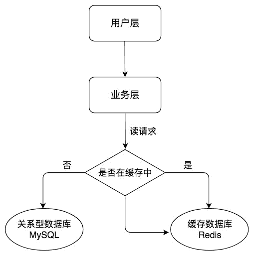
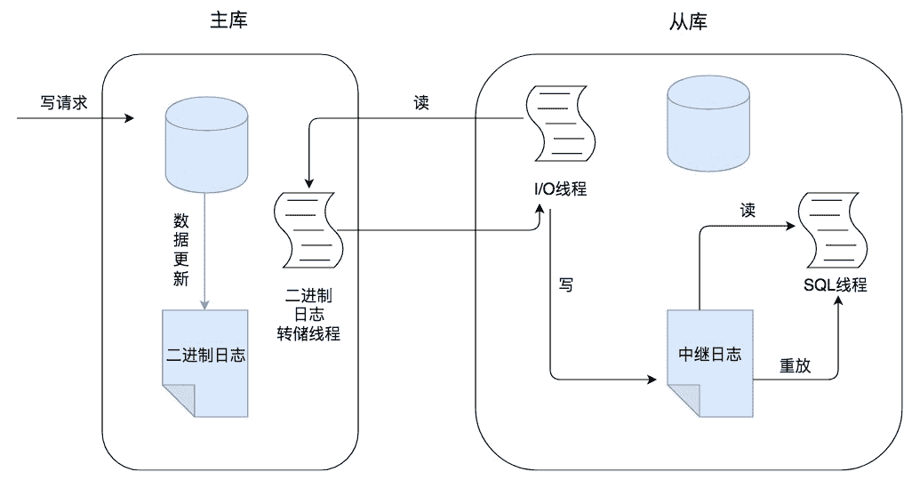
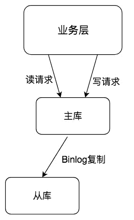
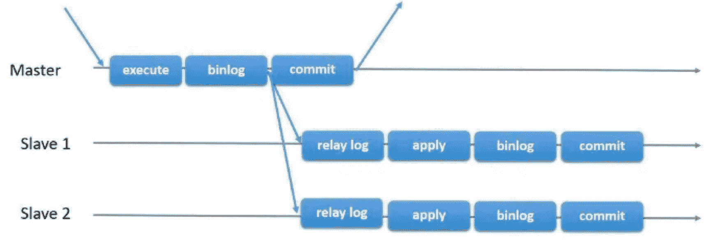
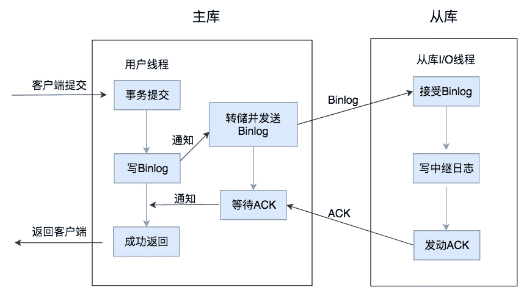
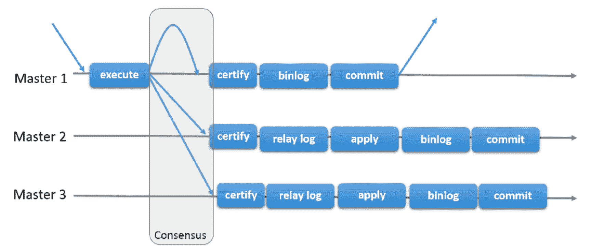
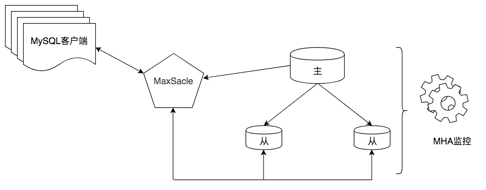
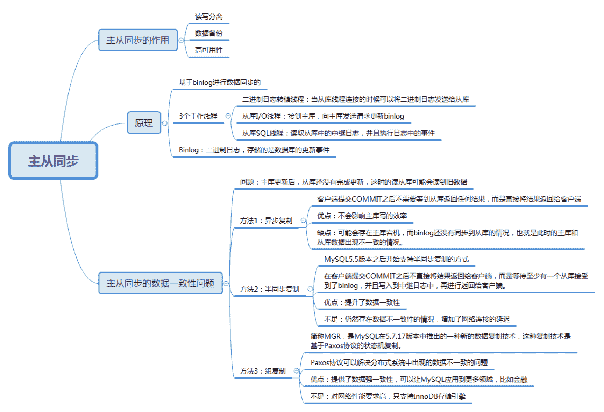

# 35丨数据库主从同步的作用是什么，如何解决数据不一致问题？

 我们之前讲解了 Redis，它是一种高性能的内存数据库；而 MySQL 是基于磁盘文件的关系型数据库，相比于 Redis 来说，读取速度会慢一些，但是功能强大，可以用于存储持久化的数据。在实际工作中，我们常常将 Redis 作为缓存与 MySQL 配合来使用，当有数据访问请求的时候，首先会从缓存中进行查找，如果存在就直接取出，如果不存在再访问数据库，这样就提升了读取的效率，也减少了对后端数据库的访问压力。可以说使用 Redis 这种缓存架构是高并发架构中非常重要的一环。

当然我们也可以对 MySQL 做主从架构并且进行读写分离，让主服务器（Master）处理写请求，从服务器（Slave）处理读请求，这样同样可以提升数据库的并发处理能力。不过主从架构的作用不止于此，我们今天就从以下几个方面了解一下它：为什么需要主从同步，设置主从同步有什么样的作用？主从同步的原理是怎样的？在进行主从同步的同时，会引入哪些问题？为了保证主从同步的数据一致性，都有哪些方案？

## 为什么需要主从同步

首先不是所有的应用都需要对数据库进行主从架构的设置，毕竟设置架构本身是有成本的，如果我们的目的在于提升数据库高并发访问的效率，那么首先需要考虑的应该是如何优化你的 SQL 和索引，这种方式简单有效，其次才是采用缓存的策略，比如使用 Redis，通过 Redis 高性能的优势将热点数据保存在内存数据库中，提升读取的效率，最后才是对数据库采用主从架构，进行读写分离。按照上面的方式进行优化，使用和维护的成本是由低到高的。主从同步设计不仅可以提高数据库的吞吐量，还有以下 3 个方面的作用。首先是可以读写分离。我们可以通过主从复制的方式来同步数据，然后通过读写分离提高数据库并发处理能力。简单来说就是同一份数据被放到了多个数据库中，其中一个数据库是 Master 主库，其余的多个数据库是 Slave 从库。当主库进行更新的时候，会自动将数据复制到从库中，而我们在客户端读取数据的时候，会从从库中进行读取，也就是采用读写分离的方式。互联网的应用往往是一些“读多写少”的需求，采用读写分离的方式，可以实现更高的并发访问。原本所有的读写压力都由一台服务器承担，现在有多个“兄弟”帮忙处理读请求，这样就减少了对后端大哥（Master）的压力。同时，我们还能对从服务器进行负载均衡，让不同的读请求按照策略均匀地分发到不同的从服务器上，让读取更加顺畅。读取顺畅的另一个原因，就是减少了锁表的影响，比如我们让主库负责写，当主库出现写锁的时候，不会影响到从库进行 SELECT 的读取。第二个作用就是数据备份。我们通过主从复制将主库上的数据复制到了从库上，相当于是一种热备份机制，也就是在主库正常运行的情况下进行的备份，不会影响到服务。第三个作用是具有高可用性。我刚才讲到的数据备份实际上是一种冗余的机制，通过这种冗余的方式可以换取数据库的高可用性，也就是当服务器出现故障或宕机的情况下，可以切换到从服务器上，保证服务的正常运行。关于高可用性的程度，我们可以用一个指标衡量，即正常可用时间 / 全年时间。比如要达到全年 99.999% 的时间都可用，就意味着系统在一年中的不可用时间不得超过 5.256 分钟，也就 365*24*60*（1-99.999%）=5.256 分钟，其他时间都需要保持可用的状态。需要注意的是，这 5.256 分钟包括了系统崩溃的时间，也包括了日常维护操作导致的停机时间。实际上，更高的高可用性，意味着需要付出更高的成本代价。在现实中我们需要结合业务需求和成本来进行选择。

## 主从同步的原理是怎样的

提到主从同步的原理，我们就需要了解在数据库中的一个重要日志文件，那就是 Binlog 二进制日志，它记录了对数据库进行更新的事件。实际上主从同步的原理就是基于 Binlog 进行数据同步的。在主从复制过程中，会基于 3 个线程来操作，一个主库线程，两个从库线程。二进制日志转储线程（Binlog dump thread）是一个主库线程。当从库线程连接的时候，主库可以将二进制日志发送给从库，当主库读取事件的时候，会在 Binlog 上加锁，读取完成之后，再将锁释放掉。从库 I/O 线程会连接到主库，向主库发送请求更新 Binlog。这时从库的 I/O 线程就可以读取到主库的二进制日志转储线程发送的 Binlog 更新部分，并且拷贝到本地形成中继日志（Relay log）。从库 SQL 线程会读取从库中的中继日志，并且执行日志中的事件，从而将从库中的数据与主库保持同步。

所以你能看到主从同步的内容就是二进制日志（Binlog），它虽然叫二进制日志，实际上存储的是一个又一个事件（Event），这些事件分别对应着数据库的更新操作，比如 INSERT、UPDATE、DELETE 等。另外我们还需要注意的是，不是所有版本的 MySQL 都默认开启服务器的二进制日志，在进行主从同步的时候，我们需要先检查服务器是否已经开启了二进制日志。进行主从同步的内容是二进制日志，它是一个文件，在进行网络传输的过程中就一定会存在延迟（比如 500ms），这样就可能造成用户在从库上读取的数据不是最新的数据，也就是主从同步中的数据不一致性问题。比如我们对一条记录进行更新，这个操作是在主库上完成的，而在很短的时间内（比如 100ms）又对同一个记录进行了读取，这时候从库还没有完成数据的更新，那么我们通过从库读到的数据就是一条旧的记录。这种情况下该怎么办呢？

## 如何解决主从同步的数据一致性问题

可以想象下，如果我们想要操作的数据都存储在同一个数据库中，那么对数据进行更新的时候，可以对记录加写锁，这样在读取的时候就不会发生数据不一致的情况，但这时从库的作用就是备份，并没有起到读写分离，分担主库读压力的作用。

因此我们还需要继续想办法，在进行读写分离的同时，解决主从同步中数据不一致的问题，也就是解决主从之间数据复制方式的问题，如果按照数据一致性从弱到强来进行划分，有以下 3 种复制方式。

### 方法 1：异步复制

异步模式就是客户端提交 COMMIT 之后不需要等从库返回任何结果，而是直接将结果返回给客户端，这样做的好处是不会影响主库写的效率，但可能会存在主库宕机，而 Binlog 还没有同步到从库的情况，也就是此时的主库和从库数据不一致。这时候从从库中选择一个作为新主，那么新主则可能缺少原来主服务器中已提交的事务。所以，这种复制模式下的数据一致性是最弱的。

### 方法 2：半同步复制

MySQL5.5 版本之后开始支持半同步复制的方式。原理是在客户端提交 COMMIT 之后不直接将结果返回给客户端，而是等待至少有一个从库接收到了 Binlog，并且写入到中继日志中，再返回给客户端。这样做的好处就是提高了数据的一致性，当然相比于异步复制来说，至少多增加了一个网络连接的延迟，降低了主库写的效率。在 MySQL5.7 版本中还增加了一个rpl_semi_sync_master_wait_for_slave_count参数，我们可以对应答的从库数量进行设置，默认为 1，也就是说只要有 1 个从库进行了响应，就可以返回给客户端。如果将这个参数调大，可以提升数据一致性的强度，但也会增加主库等待从库响应的时间。

### 方法 3：组复制

组复制技术，简称 MGR（MySQL Group Replication）。是 MySQL 在 5.7.17 版本中推出的一种新的数据复制技术，这种复制技术是基于 Paxos 协议的状态机复制。我刚才介绍的异步复制和半同步复制都无法最终保证数据的一致性问题，半同步复制是通过判断从库响应的个数来决定是否返回给客户端，虽然数据一致性相比于异步复制有提升，但仍然无法满足对数据一致性要求高的场景，比如金融领域。MGR 很好地弥补了这两种复制模式的不足。下面我们来看下 MGR 是如何工作的（如下图所示）。首先我们将多个节点共同组成一个复制组，在执行读写（RW）事务的时候，需要通过一致性协议层（Consensus 层）的同意，也就是读写事务想要进行提交，必须要经过组里“大多数人”（对应 Node 节点）的同意，大多数指的是同意的节点数量需要大于（N/2+1），这样才可以进行提交，而不是原发起方一个说了算。而针对只读（RO）事务则不需要经过组内同意，直接 COMMIT 即可。在一个复制组内有多个节点组成，它们各自维护了自己的数据副本，并且在一致性协议层实现了原子消息和全局有序消息，从而保证组内数据的一致性。（具体原理点击这里可以参考。）

MGR 将 MySQL 带入了数据强一致性的时代，是一个划时代的创新，其中一个重要的原因就是 MGR 是基于 Paxos 协议的。Paxos 算法是由 2013 年的图灵奖获得者 Leslie Lamport 于 1990 年提出的，有关这个算法的决策机制你可以去网上搜一下。或者点击这里查看具体的算法，另外作者在 2001 年发布了一篇简化版的文章，你如果感兴趣的话，也可以看下。事实上，Paxos 算法提出来之后就作为分布式一致性算法被广泛应用，比如 Apache 的 ZooKeeper 也是基于 Paxos 实现的。

## 总结

我今天讲解了数据库的主从同步，如果你的目标仅仅是数据库的高并发，那么可以先从 SQL 优化，索引以及 Redis 缓存数据库这些方面来考虑优化，然后再考虑是否采用主从架构的方式。在主从架构的配置中，如果想要采取读写分离的策略，我们可以自己编写程序，也可以通过第三方的中间件来实现。自己编写程序的好处就在于比较自主，我们可以自己判断哪些查询在从库上来执行，针对实时性要求高的需求，我们还可以考虑哪些查询可以在主库上执行。同时，程序直接连接数据库，减少了中间件层，相当于减少了性能损耗。采用中间件的方法有很明显的优势，功能强大，使用简单。但因为在客户端和数据库之间增加了中间件层会有一些性能损耗，同时商业中间件也是有使用成本的。我们也可以考虑采取一些优秀的开源工具，比如 MaxScale。它是 MariaDB 开发的 MySQL 数据中间件。比如在下图中，使用 MaxScale 作为数据库的代理，通过路由转发完成了读写分离。同时我们也可以使用 MHA 工具作为强一致的主从切换工具，从而完成 MySQL 的高可用架构。

今天讲的概念有点多，你能说一下主从复制、读写分离、负载均衡的概念吗？另外你不妨用自己的话说一下你对 MGR 的理解。欢迎你在评论区写下你的思考，也欢迎把这篇文章分享给你的朋友或者同事，一起交流一下。
