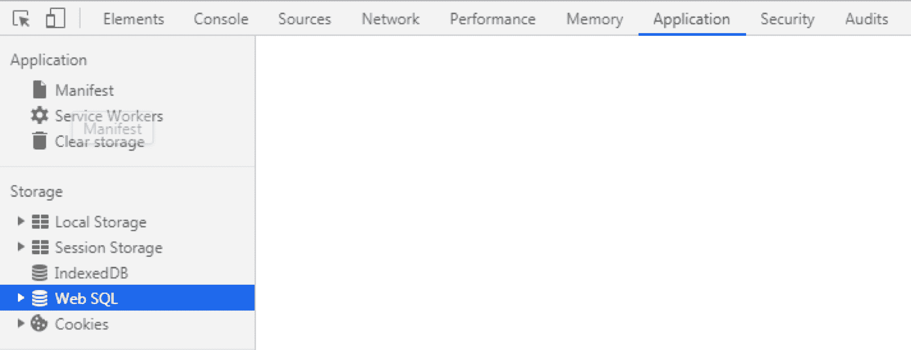
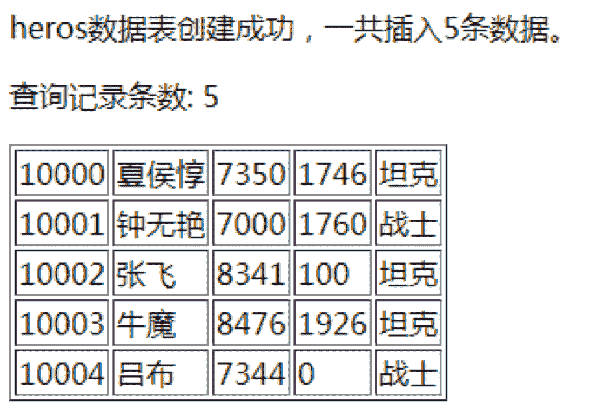
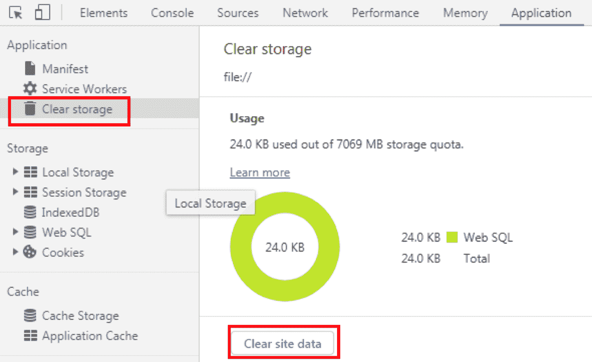
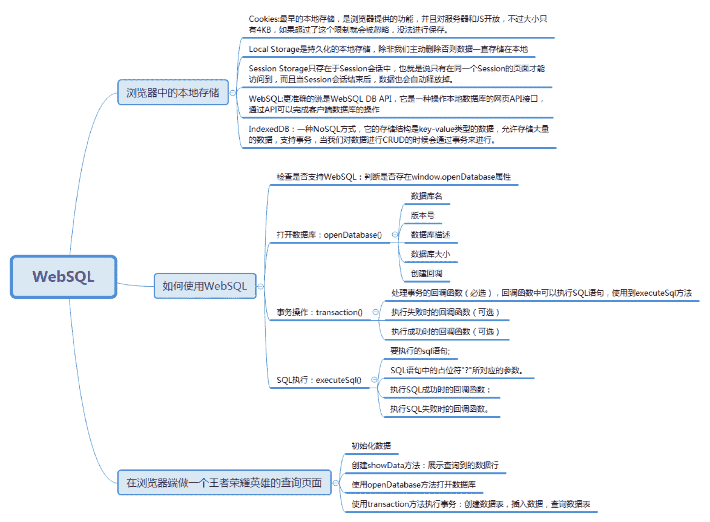
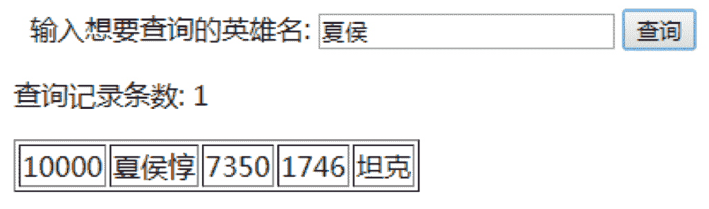

# 36丨WebSQL：如何在H5中存储一个本地数据库？

 

上一篇文章中，我们讲到了如何在 Excel 中使用 SQL 进行查询。在 Web 应用中，即使不通过后端语言与数据库进行操作，在 Web 前端中也可以使用 WebSQL。WebSQL 是一种操作本地数据库的网页 API 接口，通过它，我们就可以操作客户端的本地存储。

今天的课程主要包括以下几方面的内容：

 
1. 本地存储都有哪些，什么是 WebSQL？ 
2. 使用 WebSQL 的三个核心方法是什么？ 
3. 如何使用 WebSQL 在本地浏览器中创建一个王者荣耀英雄数据库，并对它进行查询和页面的呈现？ 

## 本地存储都有哪些？什么是 WebSQL？

我刚才讲到了 WebSQL 实际上是本地存储。其实本地存储是个更大的概念，你现在可以打开 Chrome 浏览器，看下本地存储都包括了哪些。

Cookies 是最早的本地存储，是浏览器提供的功能，并且对服务器和 JS 开放，这意味着我们可以通过服务器端和客户端保存 Cookies。不过可以存储的数据总量大小只有 4KB，如果超过了这个限制就会忽略，没法进行保存。

Local Storage 与 Session Storage 都属于 Web Storage。Web Storage 和 Cookies 类似，区别在于它有更大容量的存储。其中 Local Storage 是持久化的本地存储，除非我们主动删除数据，否则会一直存储在本地。Session Storage 只存在于 Session 会话中，也就是说只有在同一个 Session 的页面才能使用，当 Session 会话结束后，数据也会自动释放掉。

WebSQL 与 IndexedDB 都是最新的 HTML5 本地缓存技术，相比于 Local Storage 和 Session Storage 来说，存储功能更强大，支持的数据类型也更多，比如图片、视频等。

WebSQL 更准确的说是 WebSQL DB API，它是一种操作本地数据库的网页 API 接口，通过 API 可以完成客户端数据库的操作。当我们使用 WebSQL 的时候，可以方便地用 SQL 来对数据进行增删改查。而这些浏览器客户端，比如 Chrome 和 Safari 会用 SQLite 实现本地存储。

如果说 WebSQL 方便我们对 RDBMS 进行操作，那么 IndexedDB 则是一种 NoSQL 方式。它存储的是 key-value 类型的数据，允许存储大量的数据，通常可以超过 250M，并且支持事务，当我们对数据进行增删改查（CRUD）的时候可以通过事务来进行。



  
 你能看到本地存储包括了多种存储方式，它可以很方便地将数据存储在客户端中，在使用的时候避免重复调用服务器的资源。

需要说明的是，今天我要讲的 WebSQL 并不属于 HTML5 规范的一部分，它是一个单独的规范，只是随着 HTML5 规范一起加入到了浏览器端。主流的浏览器比如 Chrome、Safari 和 Firefox 都支持 WebSQL，我们可以在 JavaScript 脚本中使用 WebSQL 对客户端数据库进行操作。

## 如何使用 WebSQL

如果你的浏览器不是上面说的那三种，怎么检测你的浏览器是否支持 WebSQL 呢？这里你可以检查下 window 对象中是否存在 openDatabase 属性，方法如下：

```
if (!window.openDatabase) {  alert('浏览器不支持 WebSQL');}                                完整代码如下：<!DOCTYPE HTML><html>   <head>      <meta charset="UTF-8">      <title>SQL 必知必会 </title>       <script type="text/javascript">                           if (!window.openDatabase) {                 alert('浏览器不支持 WebSQL');        }                                     </script>                       </head>              <body>      <div id="status" name="status">WebSQL Test</div>   </body>       </html>
```

如果浏览器不支持 WebSQL，会有弹窗提示“浏览器不支持 WebSQL”，否则就不会有弹窗提示。使用 WebSQL 也比较简单，主要的方法有 3 个。

### 打开数据库：openDatabase()

我们可以使用 openDatabase 打开一个已经存在的数据库，也可以创建新的数据库。如果数据库已经存在了，就会直接打开；如果不存在则会创建。方法如下：

```
var db = window.openDatabase(dbname, version, dbdesc, dbsize,function() {});
```

这里 openDatabase 方法中一共包括了 5 个参数，分别为数据库名、版本号、描述、数据库大小、创建回调。其中创建回调可以缺省。

使用 openDatabase 方法会返回一个数据库句柄，我们可以将它保存在变量 db 中，方便我们后续进行使用。

如果我们想要创建一个名为 wucai 的数据库，版本号为 1.0，数据库的描述是“王者荣耀数据库”，大小是 1024*1024，创建方法为下面这样。

```
var db = openDatabase('wucai', '1.0', '王者荣耀数据库', 1024 * 1024);
```

### 事务操作：transaction()

我们使用 transaction 方法来对事务进行处理，执行提交或回滚操作，方法如下：

```
transaction(callback, errorCallback, successCallback); 
```

这里的 3 个参数代表的含义如下：

 
1. 处理事务的回调函数（必选），在回调函数中可以执行 SQL 语句，会使用到 ExecuteSQL 方法； 
2. 执行失败时的回调函数（可选）； 
3. 执行成功时的回调函数（可选）。 

如果我们进行了一个事务处理，包括创建 heros 数据表，想要插入一条数据，方法如下：

```
db.transaction(function (tx) {    tx.executeSql('CREATE TABLE IF NOT EXISTS heros (id unique, name, hp_max, mp_max, role_main)');    tx.executeSql('INSERT INTO heros (id, name, hp_max, mp_max, role_main) VALUES (10000, " 夏侯惇 ", 7350, 1746, " 坦克 ")');});
```

这里执行的事务就是一个方法，包括两条 SQL 语句。tx 表示的是回调函数的接收参数，也就是 transaction 对象的引用，方便我们在方法中进行使用。

### SQL 执行：executeSql()

ExecuteSQL 命令用来执行 SQL 语句，即增删改查。方法如下：

```
tx.executeSql(sql, [], callback, errorCallback);
```

这里包括了 4 个参数，它们代表的含义如下所示：

 
1. 要执行的 sql 语句。 
2. SQL 语句中的占位符（?）所对应的参数。 
3. 执行 SQL 成功时的回调函数。 
4. 执行 SQL 失败时的回调函数。 

假如我们想要创建一个 heros 数据表，可以使用如下命令：

```
tx.executeSql('CREATE TABLE IF NOT EXISTS heros (id unique, name, hp_max, mp_max, role_main)');
```

假如我们想要对刚创建的 heros 数据表插入一条数据，可以使用：

```
tx.executeSql('INSERT INTO heros (id, name, hp_max, mp_max, role_main) VALUES (10000, " 夏侯惇 ", 7350, 1746, " 坦克 ")');
```

## 在浏览器端做一个王者荣耀英雄的查询页面

刚才我讲解了 WebSQL 的基本语法，现在我们就来用刚学到的东西做一个小练习：在浏览器端做一个王者荣耀英雄的创建和查询页面。

具体步骤如下：

 
1. 初始化数据：我们需要在 HTML 中设置一个 id 为 datatable 的 table 表格，然后在 JavaScript 中创建 init() 函数，获取 id 为 datatable 的元素。 
2. 创建 showData 方法：参数为查询出来的数据 row，showData 方法可以方便地展示查询出来的一行数据我们在数据表中的字段为 id、name、hp_max、mp_max 和 role_main，因此我们可以使用 row.id、row.name、row.hp_max、row.mp_max 和 row.role_main 来获取这些字段的数值，并且创建相应的标签，将这 5 个字段放到一个里面。 
3. 使用 openDatabase 方法打开数据库：这里我们定义的数据库名为 wucai，版本号为 1.0，数据库描述为“王者荣耀英雄数据”，大小为 1024 * 1024。 
4. 使用 transaction 方法执行两个事务：第一个事务是创建 heros 数据表，并且插入 5 条数据。第二个事务是对 heros 数据表进行查询，并且对查询出来的数据行使用 showData 方法进行展示。 

完整代码如下（也可以通过 GitHub 下载：[https://github.com/cystanford/WebSQL](https://github.com/cystanford/WebSQL)）：

```
<!DOCTYPE HTML><html>   <head>      <meta charset="UTF-8">      <title>SQL 必知必会 </title>       <script type="text/javascript">         // 初始化         function init() {            datatable = document.getElementById("datatable");         }         // 显示每个英雄的数据         function showData(row){            var tr = document.createElement("tr");            var td1 = document.createElement("td");            var td2 = document.createElement("td");            var td3 = document.createElement("td");            var td4 = document.createElement("td");            var td5 = document.createElement("td");             td1.innerHTML = row.id;            td2.innerHTML = row.name;            td3.innerHTML = row.hp_max;            td4.innerHTML = row.mp_max;            td5.innerHTML = row.role_main;            tr.appendChild(td1);            tr.appendChild(td2);            tr.appendChild(td3);            tr.appendChild(td4);            tr.appendChild(td5);            datatable.appendChild(tr);            }         // 设置数据库信息         var db = openDatabase('wucai', '1.0', '王者荣耀英雄数据', 1024 * 1024);         var msg;           // 插入数据         db.transaction(function (tx) {            tx.executeSql('CREATE TABLE IF NOT EXISTS heros (id unique, name, hp_max, mp_max, role_main)');            tx.executeSql('INSERT INTO heros (id, name, hp_max, mp_max, role_main) VALUES (10000, " 夏侯惇 ", 7350, 1746, " 坦克 ")');            tx.executeSql('INSERT INTO heros (id, name, hp_max, mp_max, role_main) VALUES (10001, " 钟无艳 ", 7000, 1760, " 战士 ")');            tx.executeSql('INSERT INTO heros (id, name, hp_max, mp_max, role_main) VALUES (10002, " 张飞 ", 8341, 100, " 坦克 ")');            tx.executeSql('INSERT INTO heros (id, name, hp_max, mp_max, role_main) VALUES (10003, " 牛魔 ", 8476, 1926, " 坦克 ")');            tx.executeSql('INSERT INTO heros (id, name, hp_max, mp_max, role_main) VALUES (10004, " 吕布 ", 7344, 0, " 战士 ")');            msg = '<p>heros 数据表创建成功，一共插入 5 条数据。</p>';            document.querySelector('#status').innerHTML =  msg;         });         // 查询数据         db.transaction(function (tx) {            tx.executeSql('SELECT * FROM heros', [], function (tx, data) {               var len = data.rows.length;               msg = "<p> 查询记录条数: " + len + "</p>";               document.querySelector('#status').innerHTML +=  msg;                  // 将查询的英雄数据放到 datatable 中               for (i = 0; i < len; i++){                  showData(data.rows.item(i));               }            });          });      </script>   </head>    <body>      <div id="status" name="status"> 状态信息 </div>      <table border="1" id="datatable"></table>   </body> </html>
```

演示结果如下：



  
 你能看到使用 WebSQL 来操作本地存储还是很方便的。

刚才我们讲的是创建本地存储，那么如何删除呢？你可以直接通过浏览器来删除，比如在 Chrome 浏览器中找到 Application 中的 Clear storage，然后使用 Clear site data 即可：



## 总结

今天我讲解了如何在浏览器中通过 WebSQL 来操作本地存储，如果想使用 SQL 来管理和查询本地存储，我们可以使用 WebSQL，通过三个核心的方法就可以方便让我们对数据库的连接，事务处理，以及 SQL 语句的执行来进行操作。我在 Github 上提供了操作的 HTML 代码，如果还没有使用过 WebSQL 就快来使用下吧。



  
 我今天讲到了本地存储，在浏览器中包括了 Cookies、Local Storage、Session Storage、WebSQL 和 IndexedDB 这 5 种形式的本地存储，你能说下它们之间的区别么？

最后是一道动手题，请你使用 WebSQL 创建数据表 heros，并且插入 5 个以上的英雄数据，字段为 id、name、hp_max、mp_max、role_main。在 HTML 中添加一个输入框，可以输入英雄的姓名，并对该英雄的数据进行查询，如下图所示：



  
 欢迎你在评论区写下你的答案，我会和你一起交流，也欢迎把这篇文章分享给你的朋友或者同事，与他们一起交流一下。


