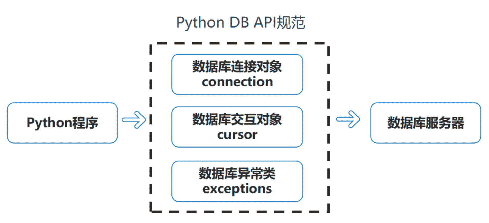
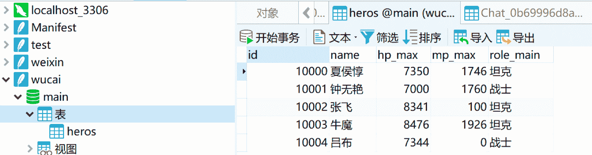
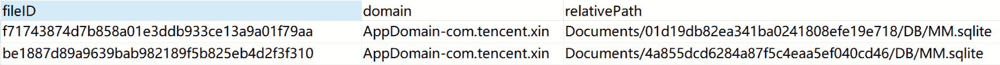
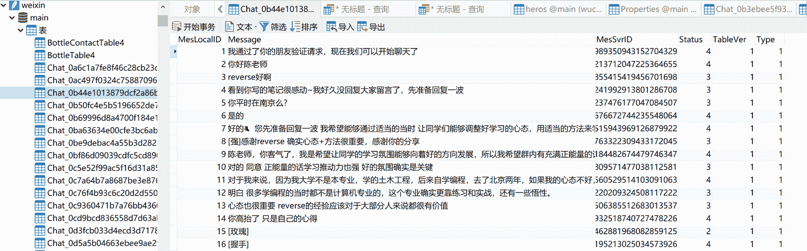
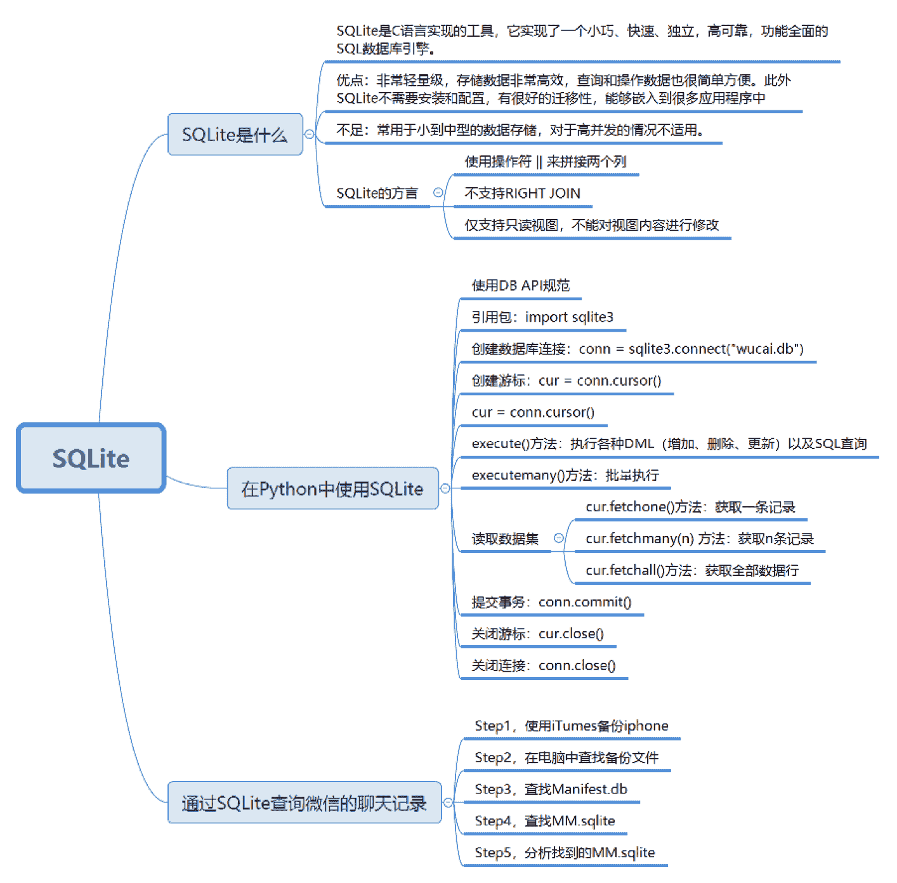

# 37丨SQLite：为什么微信用SQLite存储聊天记录？

 

我在上一篇文章中讲了 WebSQL，当我们在 Chrome、Safari 和 Firefox 等浏览器客户端中使用 WebSQL 时，会直接操作 SQLite。实际上 SQLite 本身是一个嵌入式的开源数据库引擎，大小只有 3M 左右，可以将整个 SQLite 嵌入到应用中，而不用采用传统的客户端／服务器（Client/Server）的架构。这样做的好处就是非常轻便，在许多智能设备和应用中都可以使用 SQLite，比如微信就采用了 SQLite 作为本地聊天记录的存储。

今天我们就来深入了解一下 SQLite，今天的内容主要包括以下几方面：

 
1. SQLite 是什么？它有哪些优点和不足？ 
2. 如何在 Python 中使用 SQLite？ 
3. 如何编写 SQL，通过 SQLite 查找微信的聊天记录？ 

## SQLite 是什么

SQLite 是在 2000 年发布的，到目前为止已经有 19 年了。一直采用 C 语言编写，采用 C 语言而非 C++ 面向对象的方式，可以提升代码底层的执行效率。但 SQLite 也有一些优势与不足。

它的优势在于非常轻量级，存储数据非常高效，查询和操作数据简单方便。此外 SQLite 不需要安装和配置，有很好的迁移性，能够嵌入到很多应用程序中，与托管在服务器上的 RDBMS 相比，约束少易操作，可以有效减少服务器的压力。

不足在于 SQLite 常用于小到中型的数据存储，不适用高并发的情况。比如在微信本地可以使用 SQLite，即使是几百 M 的数据文件，使用 SQLite 也可以很方便地查找数据和管理，但是微信本身的服务器就不能使用 SQLite 了，因为 SQLite 同一时间只允许一个写操作，吞吐量非常有限。

作为简化版的数据库，SQLite 没有用户管理功能，在语法上也有一些自己的“方言”。比如在 SQL 中的 SELECT 语句，SQLite 可以使用一个特殊的操作符来拼接两个列。在 MySQL 中会使用函数 concat，而在 SQLite、PostgreSQL、Oracle 和 Db2 中使用||号，比如：SELECT `MesLocalID || Message FROM "Chat_1234"`。

这个语句代表的是从 Chat_1234 数据表中查询 MesLocalID 和 Message 字段并且将他们拼接起来。

但是在 SQLite 中不支持 RIGHT JOIN，因此你需要将右外连接转换为左外连接，也就是 LEFT JOIN，写成下面这样：

```
SELECT * FROM team LEFT JOIN player ON player.team_id = team.team_id
```

除此以外 SQLite 仅支持只读视图，也就是说，我们只能创建和读取视图，不能对它们的内容进行修改。

总的来说支持 SQL 标准的 RDBMS 语法都相似，只是不同的 DBMS 会有一些属于自己的“方言”，我们使用不同的 DBMS 的时候，需要注意。

## 在 Python 中使用 SQLite

我之前介绍过如何在 Python 中使用 MySQL，其中会使用到 DB API 规范（如下图所示）。基于 DB API 规范，我们可以对数据库进行连接、交互以及异常的处理。



  
 在 Python 中使用 SQLite 也会使用到 DB API 规范，与使用 MySQL 的交互方式一样，也会用到 connection、cursor 和 exceptions。在 Python 中集成了 SQLite3，直接加载相应的工具包就可以直接使用。下面我们就来看下如何在 Python 中使用 SQLite。

在使用之前我们需要进行引用 SQLite，使用：

```
import sqlite3
```

然后我们可以使用 SQLite3 创建数据库连接：

```
conn = sqlite3.connect("wucai.db")
```

这里我们连接的是 wucai.db 这个文件，如果没有这个文件存储，上面的调用会自动在相应的工程路径里进行创建，然后我们可以使用 conn 操作连接，通过会话连接 conn 来创建游标：

```
cur = conn.cursor()
```

通过这一步，我们得到了游标 cur，然后可以使用 execute() 方法来执行各种 DML，比如插入，删除，更新等，当然我们也可以进行 SQL 查询，用的同样是 execute() 方法。

比如我们想要创建 heros 数据表，以及相应的字段 id、name、hp_max、mp_max、role_main，可以写成下面这样：

```
cur.execute("CREATE TABLE IF NOT EXISTS heros (id int primary key, name text, hp_max real, mp_max real, role_main text)")
```

在创建之后，我们可以使用 execute() 方法来添加一条数据：

```
cur.execute('insert into heros values(?, ?, ?, ?, ?)', (10000, '夏侯惇', 7350, 1746, '坦克'))
```

需要注意的是，一条一条插入数据太麻烦，我们也可以批量插入，这里会使用到 executemany 方法，这时我们传入的参数就是一个元组，比如：

```
cur.executemany('insert into heros values(?, ?, ?, ?, ?)',            ((10000, '夏侯惇', 7350, 1746, '坦克'),            (10001, '钟无艳', 7000, 1760, '战士'),          (10002, '张飞', 8341, 100, '坦克'),          (10003, '牛魔', 8476, 1926, '坦克'),          (10004, '吕布', 7344, 0, '战士')))
```

如果我们想要对 heros 数据表进行查询，同样使用 execute 执行 SQL 语句：

```
cur.execute("SELECT id, name, hp_max, mp_max, role_main FROM heros")
```

这时 cur 会指向查询结果集的第一个位置，如果我们想要获取数据有以下几种方法：

 
1. cur.fetchone() 方法，获取一条记录； 
2. cur.fetchmany(n) 方法，获取 n 条记录； 
3. cur.fetchall() 方法，获取全部数据行。 

比如我想获取全部的结果集，可以写成这样：

```
result = cur.fetchall()
```

如果我们对事务操作完了，可以提交事务，使用`conn.commit()`即可。

同样，如果游标和数据库的连接都操作完了，可以对它们进行关闭：

```
cur.close()conn.close()
```

上面这个过程的完整代码如下：

```
import sqlite3# 创建数据库连接conn = sqlite3.connect("wucai.db")# 获取游标cur = conn.cursor()# 创建数据表cur.execute("CREATE TABLE IF NOT EXISTS heros (id int primary key, name text, hp_max real, mp_max real, role_main text)")# 插入英雄数据cur.executemany('insert into heros values(?, ?, ?, ?, ?)',            ((10000, '夏侯惇', 7350, 1746, '坦克'),            (10001, '钟无艳', 7000, 1760, '战士'),          (10002, '张飞', 8341, 100, '坦克'),          (10003, '牛魔', 8476, 1926, '坦克'),          (10004, '吕布', 7344, 0, '战士')))cur.execute("SELECT id, name, hp_max, mp_max, role_main FROM heros")result = cur.fetchall()print(result)# 提交事务 conn.commit()# 关闭游标cur.close()# 关闭数据库连接conn.close()
```

除了使用 Python 操作 SQLite 之外，在整个操作过程中，我们同样可以使用 navicat 数据库可视化工具来查看和管理 SQLite。



## 通过 SQLite 查询微信的聊天记录

刚才我们提到很多应用都会集成 SQLite 作为客户端本地的数据库，这样就可以避免通过数据库服务器进行交互，减少服务器的压力。

如果你是 iPhone 手机，不妨跟着我执行以下的步骤，来查找下微信中的 SQLite 文件的位置吧。

第一步，使用 iTunes 备份 iPhone；第二步，在电脑中查找备份文件。

当我们备份好数据之后，需要在本地找到备份的文件，如果是 windows 可以在 C:\Users\XXXX\AppData\Roaming\Apple Computer\MobileSync\Backup 这个路径中找到备份文件夹。

第三步，查找 Manifest.db。

在备份文件夹中会存在 Manifest.db 文件，这个文件定义了苹果系统中各种备份所在的文件位置。

第四步，查找 MM.sqlite。

Manifest.db 本身是 SQLite 数据文件，通过 SQLite 我们能看到文件中包含了 Files 数据表，这张表中有 fileID、domain 和 relativePath 等字段。

微信的聊天记录文件为 MM.sqlite，我们可以直接通过 SQL 语句来查询下它的位置（也就是 fileID）。

```
SELECT * FROM Files WHERE relativePath LIKE '%MM.sqlite'
```



你能看到在我的微信备份中有 2 个 MM.sqlite 文件，这些都是微信的聊天记录。

第五步，分析找到的 MM.sqlite。

这里我们需要在备份文件夹中查找相关的 fileID，比如 f71743874d7b858a01e3ddb933ce13a9a01f79aa。

找到这个文件后，我们可以复制一份，取名为 weixin.db，这样就可以使用 navicat 对这个数据库进行可视化管理，如下图所示：



  
 微信会把你与每一个人的聊天记录都保存成一张数据表，在数据表中会有 MesLocalID、Message、Status 等相应的字段，它们分别代表在当前对话中的 ID、聊天内容和聊天内容的状态）。

如果聊天对象很多的话，数据表也会有很多，如果想知道都有哪些聊天对象的数据表，可以使用：

```
SELECT name FROM sqlite_master WHERE type = 'table' AND name LIKE 'Chat\_%' escape '\'
```

这里需要说明的是 sqlite_master 是 SQLite 的系统表，数据表是只读的，里面保存了数据库中的数据表的名称。聊天记录的数据表都是以 Chat_ 开头的，因为`（_）`属于特殊字符，在 LIKE 语句中会将`（_）`作为通配符。所以如果我们想要对开头为 Chat_ 的文件名进行匹配，就需要用 escape 对这个特殊字符做转义。

## 总结

我今天讲了有关 SQLite 的内容。在使用 SQLite 的时候，需要注意 SQLite 有自己的方言，比如在进行表连接查询的时候不支持 RIGHT JOIN，需要将其转换成 LEFT JOIN 等。同时，我们在使用 execute() 方法的时候，尽量采用带有参数的 SQL 语句，以免被 SQL 注入攻击。

学习完今天的内容后，不如试试用 SQL 查询来查找本地的聊天记录吧。



  
 最后留一道思考题吧。请你使用 SQL 查询对微信聊天记录中和“作业”相关的记录进行查找。不论是 iPhone，还是 Android 手机都可以找到相应的 SQLite 文件，你可以使用 Python 对 SQLite 进行操作，并输出结果。

欢迎你在评论区写下你的答案，也欢迎把这篇文章分享给你的朋友或者同事，一起交流一下。


