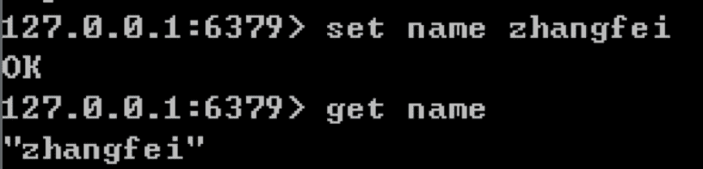
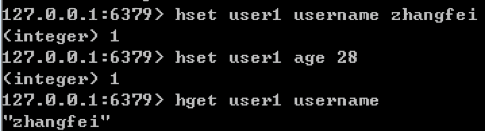
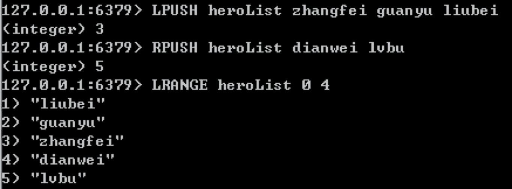
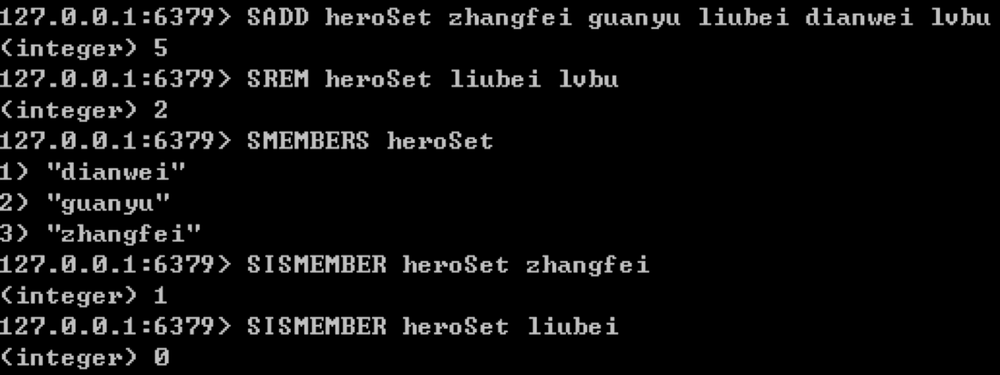
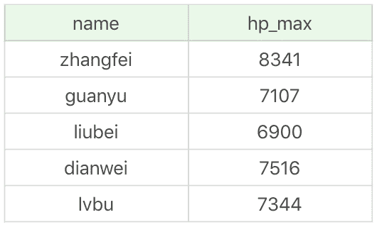
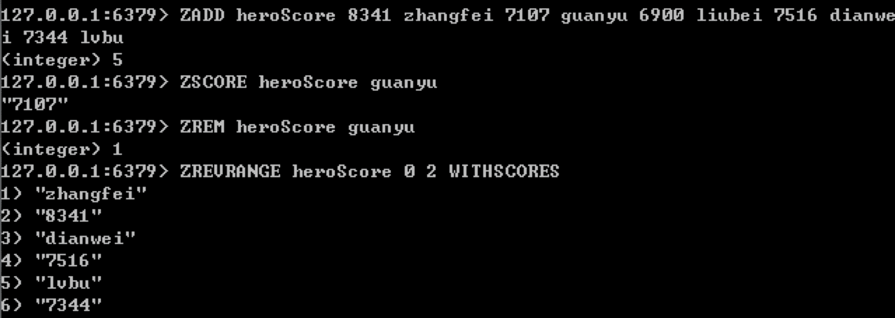
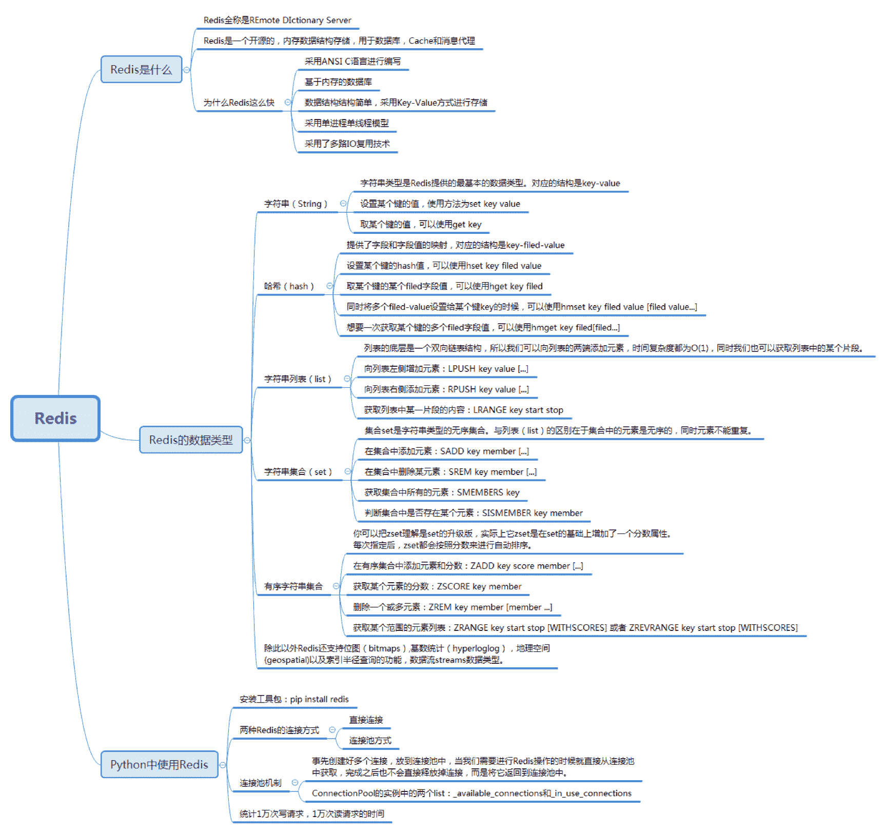

# 40丨初识Redis：Redis为什么会这么快？

 

之前我们讲解了一些 RDBMS 的使用，比如 MySQL、Oracle、SQL Server 和 SQLite 等，实际上在日常工作中，我们还会接触到一些 NoSQL 类型的数据库。如果对比 RDBMS 和 NoSQL 数据库，你会发现 RDBMS 建立在关系模型基础上，强调数据的一致性和各种约束条件，而 NoSQL 的规则是“只提供你想要的”，数据模型灵活，查询效率高，成本低。但同时，相比 RDBMS，NoSQL 数据库没有统一的架构和标准语言，每种数据库之间差异较大，各有所长。

今天我们要讲解的 Redis 属于键值（key-value）数据库，键值数据库会使用哈希表存储键值和数据，其中 key 作为唯一的标识，而且 key 和 value 可以是任何的内容，不论是简单的对象还是复杂的对象都可以存储。键值数据库的查询性能高，易于扩展。

今天我们就来了解下 Redis，具体的内容包括以下几个方面：

 
1. Redis 是什么，为什么使用 Redis 会非常快？ 
2. Redis 支持的数据类型都有哪些？ 
3. 如何通过 Python 和 Redis 进行交互？ 

## Redis 是什么，为什么这么快

Redis 全称是 REmote DIctionary Server，从名字中你也能看出来它用字典结构存储数据，也就是 key-value 类型的数据。

Redis 的查询效率非常高，根据官方提供的数据，Redis 每秒最多处理的请求可以达到 10 万次。

为什么这么快呢？

Redis 采用 ANSI C 语言编写，它和 SQLite 一样。采用 C 语言进行编写的好处是底层代码执行效率高，依赖性低，因为使用 C 语言开发的库没有太多运行时（Runtime）依赖，而且系统的兼容性好，稳定性高。

此外，Redis 是基于内存的数据库，我们之前讲到过，这样可以避免磁盘 I/O，因此 Redis 也被称为缓存工具。

其次，数据结构结构简单，Redis 采用 Key-Value 方式进行存储，也就是使用 Hash 结构进行操作，数据的操作复杂度为 O(1)。

但 Redis 快的原因还不止这些，它采用单进程单线程模型，这样做的好处就是避免了上下文切换和不必要的线程之间引起的资源竞争。

在技术上 Redis 还采用了多路 I/O 复用技术。这里的多路指的是多个 socket 网络连接，复用指的是复用同一个线程。采用多路 I/O 复用技术的好处是可以在同一个线程中处理多个 I/O 请求，尽量减少网络 I/O 的消耗，提升使用效率。

## Redis 的数据类型

相比 Memcached，Redis 有一个非常大的优势，就是支持多种数据类型。Redis 支持的数据类型包括字符串、哈希、列表、集合、有序集合等。

字符串类型是 Redis 提供的最基本的数据类型，对应的结构是 key-value。

如果我们想要设置某个键的值，使用方法为`set key value`，比如我们想要给 name 这个键设置值为 zhangfei，可以写成`set name zhangfei`。如果想要取某个键的值，可以使用`get key`，比如想取 name 的值，写成 get name 即可。



  
 哈希（hash）提供了字段和字段值的映射，对应的结构是 key-field-value。

如果我们想要设置某个键的哈希值，可以使用`hset key field value`，如果想要给 user1 设置 username 为 zhangfei，age 为 28，可以写成下面这样：

```
hset user1 username zhangfeihset user1 age 28
```

如果我们想要同时将多个 field-value 设置给某个键 key 的时候，可以使用`hmset key field value [field value...]`，比如上面这个可以写成：

```
Hmset user1 username zhangfei age 28 
```

如果想要取某个键的某个 field 字段值，可以使用`hget key field`，比如想要取 user1 的 username，那么写成`hget user1 username`即可。

如果想要一次获取某个键的多个 field 字段值，可以使用`hmget key field[field...]`，比如想要取 user1 的 username 和 age，可以写成`hmget user1 username age`。



  
 字符串列表（list）的底层是一个双向链表结构，所以我们可以向列表的两端添加元素，时间复杂度都为 O(1)，同时我们也可以获取列表中的某个片段。

如果想要向列表左侧增加元素可以使用：`LPUSH key value [...]`，比如我们给 heroList 列表向左侧添加 zhangfei、guanyu 和 liubei 这三个元素，可以写成：

```
LPUSH heroList zhangfei guanyu liubei
```

同样，我们也可以使用`RPUSH key value [...]`向列表右侧添加元素，比如我们给 heroList 列表向右侧添加 dianwei、lvbu 这两个元素，可以写成下面这样：

```
RPUSH heroList dianwei lvbu 
```

如果我们想要获取列表中某一片段的内容，使用`LRANGE key start stop`即可，比如我们想要获取 heroList 从 0 到 4 位置的数据，写成`LRANGE heroList 0 4`即可。



  
 字符串集合（set）是字符串类型的无序集合，与列表（list）的区别在于集合中的元素是无序的，同时元素不能重复。

如果想要在集合中添加元素，可以使用`SADD key member [...]`，比如我们给 heroSet 集合添加 zhangfei、guanyu、liubei、dianwei 和 lvbu 这五个元素，可以写成：

```
SADD heroSet zhangfei guanyu liubei dianwei lvbu
```

如果想要在集合中删除某元素，可以使用`SREM key member [...]`，比如我们从 heroSet 集合中删除 liubei 和 lvbu 这两个元素，可以写成：

```
SREM heroSet liubei lvbu
```

如果想要获取集合中所有的元素，可以使用`SMEMBERS key`，比如我们想要获取 heroSet 集合中的所有元素，写成`SMEMBERS heroSet`即可。

如果想要判断集合中是否存在某个元素，可以使用`SISMEMBER key member`，比如我们想要判断 heroSet 集合中是否存在 zhangfei 和 liubei，就可以写成下面这样：

```
SISMEMBER heroSet zhangfeiSISMEMBER heroSet liubei
```



  
 我们可以把有序字符串集合（SortedSet，简称 ZSET）理解成集合的升级版。实际上 ZSET 是在集合的基础上增加了一个分数属性，这个属性在添加修改元素的时候可以被指定。每次指定后，ZSET 都会按照分数来进行自动排序，也就是说我们在给集合 key 添加 member 的时候，可以指定 score。

有序集合与列表有一定的相似性，比如这两种数据类型都是有序的，都可以获得某一范围的元素。但它俩在数据结构上有很大的不同，首先列表 list 是通过双向链表实现的，在操作左右两侧的数据时会非常快，而对于中间的数据操作则相对较慢。有序集合采用 hash 表的结构来实现，读取排序在中间部分的数据也会很快。同时有序集合可以通过 score 来完成元素位置的调整，但如果我们想要对列表进行元素位置的调整则会比较麻烦。

如果我们想要在有序集合中添加元素和分数，使用`ZADD key score member [...]`，比如我们给 heroScore 集合添加下面 5 个英雄的 hp_max 数值，如下表所示：



  
 那么我们可以写成下面这样：

```
ZADD heroScore 8341 zhangfei 7107 guanyu 6900 liubei 7516 dianwei 7344 lvbu
```

如果我们想要获取某个元素的分数，可以使用`ZSCORE key member`，比如我们想要获取 guanyu 的分数，写成`ZSCORE heroScore guanyu`即可。

如果我们想要删除一个或多元素，可以使用 ZREM key member [member …]，比如我们想要删除 guanyu 这个元素，使用`ZREM heroScore guanyu`即可。

我们也可以获取某个范围的元素列表。如果想要分数从小到大进行排序，使用`ZRANGE key start stop [WITHSCORES]`，如果分数从大到小进行排序，使用`ZREVRANGE key start stop [WITHSCORES]`。需要注意的是，WITHSCORES 是个可选项，如果使用 WITHSCORES 会将分数一同显示出来，比如我们想要查询 heroScore 这个有序集合中分数排名前 3 的英雄及数值，写成`ZREVRANGE heroScore 0 2 WITHSCORES`即可。



  
 除了这 5 种数据类型以外，Redis 还支持位图（Bitmaps）数据结构，在 2.8 版本之后，增加了基数统计（HyperLogLog），3.2 版本之后加入了地理空间（Geospatial）以及索引半径查询的功能，在 5.0 版本引用了数据流（Streams）数据类型。

## 如何使用 Redis

我们可以在 Python 中直接操作 Redis，在使用前需要使用`pip install redis`安装工具包，安装好之后，在使用前我们需要使用 import redis 进行引用。

在 Python 中提供了两种连接 Redis 的方式，第一种是直接连接，使用下面这行命令即可。

```
r = redis.Redis(host='localhost', port= 6379)
```

第二种是连接池方式。

```
pool = redis.ConnectionPool(host='localhost', port=6379)r = redis.Redis(connection_pool=pool)
```

你可能会有疑问，这两种连接方式有什么不同？直接连接可能会耗费掉很多资源。通常情况下，我们在连接 Redis 的时候，可以创建一个 Redis 连接，通过它来完成 Redis 操作，完成之后再释放掉。但是在高并发的情况下，这样做非常不经济，因为每次连接和释放都需要消耗非常多的资源。

### 为什么采用连接池机制

基于直接连接的弊端，Redis 提供了连接池的机制，这个机制可以让我们事先创建好多个连接，将其放到连接池中，当我们需要进行 Redis 操作的时候就直接从连接池中获取，完成之后也不会直接释放掉连接，而是将它返回到连接池中。

连接池机制可以避免频繁创建和释放连接，提升整体的性能。

### 连接池机制的原理

在连接池的实例中会有两个 list，保存的是`_available_connections`和`_in_use_connections`，它们分别代表连接池中可以使用的连接集合和正在使用的连接集合。当我们想要创建连接的时候，可以从`_available_connections`中获取一个连接进行使用，并将其放到`_in_use_connections`中。如果没有可用的连接，才会创建一个新连接，再将其放到`_in_use_connections`中。如果连接使用完毕，会从`_in_use_connections`中删除，添加到`_available_connections`中，供后续使用。

Redis 库提供了 Redis 和 StrictRedis 类，它们都可以实现 Redis 命令，不同之处在于 Redis 是 StrictRedis 的子类，可以对旧版本进行兼容。如果我们想要使用连接池机制，然后用 StrictRedis 进行实例化，可以写成下面这样：

```
import redis pool = redis.ConnectionPool(host='localhost', port=6379)r = redis.StrictRedis(connection_pool=pool)
```

### 实验：使用 Python 统计 Redis 进行 1 万次写请求和 1 万次读请求的时间

了解了如何使用 Python 创建 Redis 连接之后，我们再来看下怎样使用 Python 对 Redis 进行数据的写入和读取。这里我们使用 HMSET 函数同时将多个`field-value`值存入到键中。模拟 1 万次的写请求里，设置了不同的 key，和相同的`field-value`值，然后在 1 万次读请求中，将这些不同的 key 中保存的`field-value`值读取出来。具体代码如下：

```
import redisimport time# 创建 redis 连接pool = redis.ConnectionPool(host='localhost', port=6379)r = redis.StrictRedis(connection_pool=pool)# 记录当前时间time1 = time.time()# 1 万次写for i in range(10000):    data = {'username': 'zhangfei', 'age':28}    r.hmset("users"+str(i), data)# 统计写时间delta_time = time.time()-time1print(delta_time)# 统计当前时间time1 = time.time()# 1 万次读for i in range(10000):    result = r.hmget("users"+str(i), ['username', 'age'])# 统计读时间delta_time = time.time()-time1print(delta_time)
```

运行结果：

```
2.00411462783813480.9920568466186523
```

你能看到 1 万次写请求差不多用时 2 秒钟，而 1 万次读请求用时不到 1 秒钟，读写效率还是很高的。

## 总结

NoSQL 数据库种类非常多，了解 Redis 是非常有必要的，在实际工作中，我们也经常将 RDBMS 和 Redis 一起使用，优势互补。

作为常见的 NoSQL 数据库，Redis 支持的数据类型比 Memcached 丰富得多，在 I/O 性能上，Redis 采用的是单线程 I/O 复用模型，而 Memcached 是多线程，可以利用多核优势。而且在持久化上，Redis 提供了两种持久化的模式，可以让数据永久保存，这是 Memcached 不具备的。



  
 你不妨思考一下，为什么 Redis 采用了单线程工作模式？有哪些机制可以保证 Redis 即使采用单线程模式效率也很高呢？

欢迎你在评论区写下你的思考，也欢迎把这篇文章分享给你的朋友或者同事，一起交流一下。


