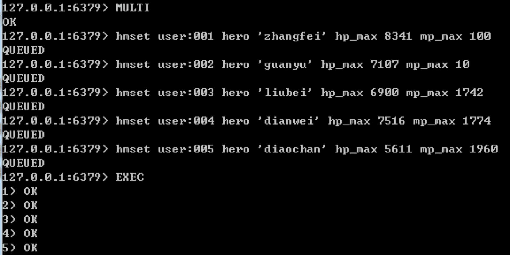
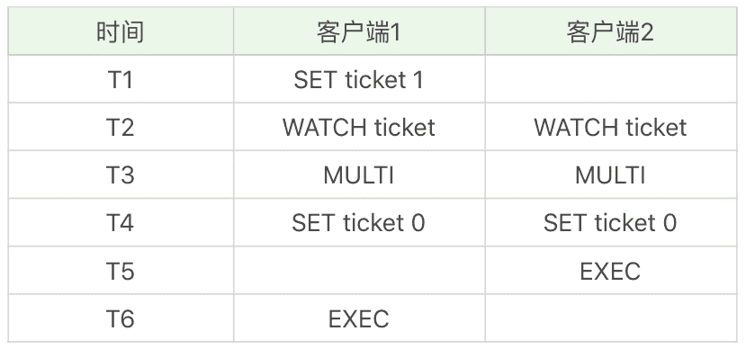
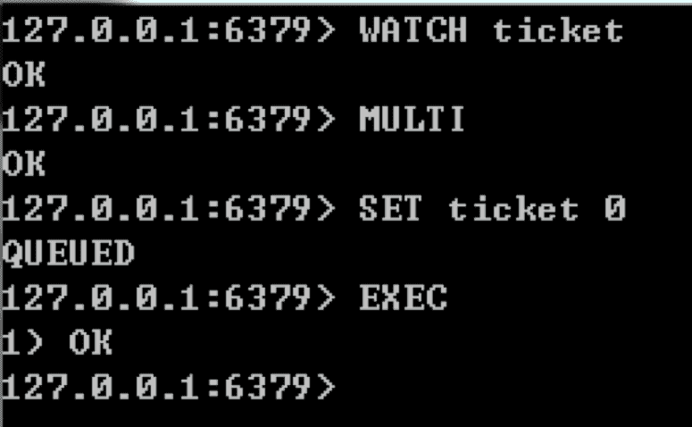
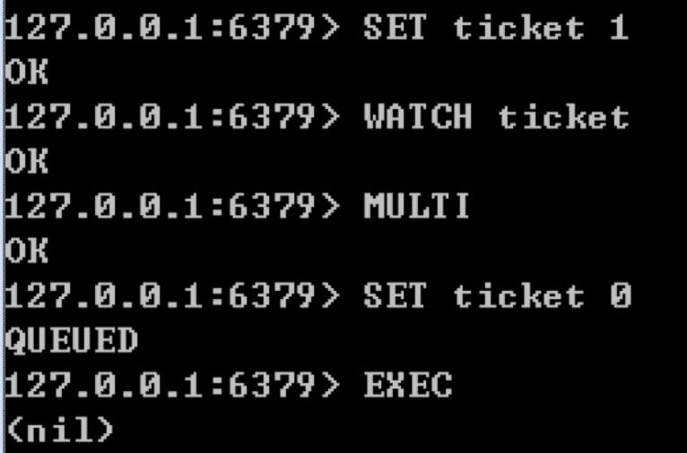
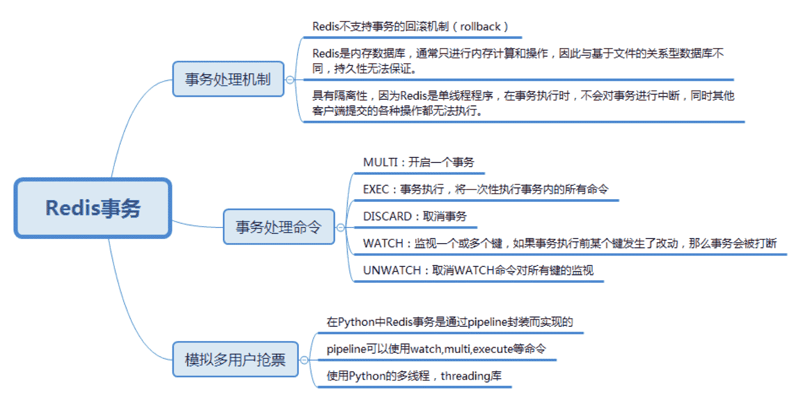
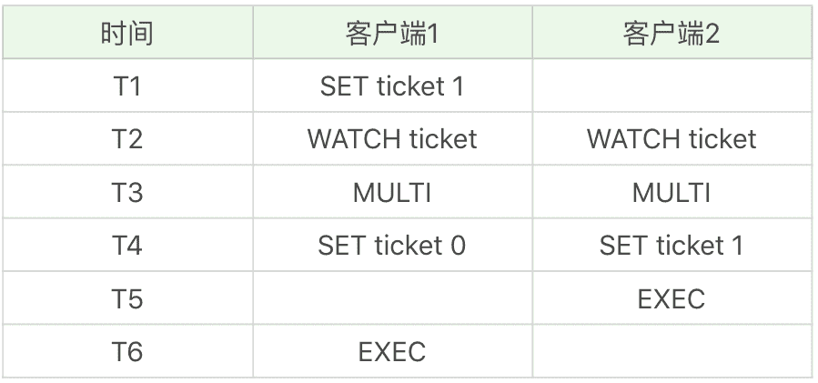

# 41丨如何使用Redis来实现多用户抢票问题

 

在上一篇文章中，我们已经对 Redis 有了初步的认识，了解到 Redis 采用 Key-Value 的方式进行存储，在 Redis 内部，使用的是 redisObject 对象来表示所有的 key 和 value。同时我们还了解到 Redis 本身用的是单线程的机制，采用了多路 I/O 复用的技术，在处理多个 I/O 请求的时候效率很高。

今天我们来更加深入地了解一下 Redis 的原理，内容包括以下几方面：

 
1. Redis 的事务处理机制是怎样的？与 RDBMS 有何不同？ 
2. Redis 的事务处理的命令都有哪些？如何使用它们完成事务操作？ 
3. 如何使用 Python 的多线程机制和 Redis 的事务命令模拟多用户抢票？ 

## Redis 的事务处理机制

在此之前，让我们先来回忆下 RDBMS 中事务满足的 4 个特性 ACID，它们分别代表原子性、一致性、隔离性和持久性。

Redis 的事务处理与 RDBMS 的事务有一些不同。

首先 Redis 不支持事务的回滚机制（Rollback），这也就意味着当事务发生了错误（只要不是语法错误），整个事务依然会继续执行下去，直到事务队列中所有命令都执行完毕。在[Redis 官方文档](https://redis.io/topics/transactions)中说明了为什么 Redis 不支持事务回滚。

只有当编程语法错误的时候，Redis 命令执行才会失败。这种错误通常出现在开发环境中，而很少出现在生产环境中，没有必要开发事务回滚功能。

另外，Redis 是内存数据库，与基于文件的 RDBMS 不同，通常只进行内存计算和操作，无法保证持久性。不过 Redis 也提供了两种持久化的模式，分别是 RDB 和 AOF 模式。

RDB（Redis DataBase）持久化可以把当前进程的数据生成快照保存到磁盘上，触发 RDB 持久化的方式分为手动触发和自动触发。因为持久化操作与命令操作不是同步进行的，所以无法保证事务的持久性。

AOF（Append Only File）持久化采用日志的形式记录每个写操作，弥补了 RDB 在数据一致性上的不足，但是采用 AOF 模式，就意味着每条执行命令都需要写入文件中，会大大降低 Redis 的访问性能。启用 AOF 模式需要手动开启，有 3 种不同的配置方式，默认为 everysec，也就是每秒钟同步一次。其次还有 always 和 no 模式，分别代表只要有数据发生修改就会写入 AOF 文件，以及由操作系统决定什么时候记录到 AOF 文件中。

虽然 Redis 提供了两种持久化的机制，但是作为内存数据库，持久性并不是它的擅长。

Redis 是单线程程序，在事务执行时不会中断事务，其他客户端提交的各种操作都无法执行，因此你可以理解为 Redis 的事务处理是串行化的方式，总是具有隔离性的。

## Redis 的事务处理命令

了解了 Redis 的事务处理机制之后，我们来看下 Redis 的事务处理都包括哪些命令。

 
1. MULTI：开启一个事务； 
2. EXEC：事务执行，将一次性执行事务内的所有命令； 
3. DISCARD：取消事务； 
4. WATCH：监视一个或多个键，如果事务执行前某个键发生了改动，那么事务也会被打断； 
5. UNWATCH：取消 WATCH 命令对所有键的监视。 

需要说明的是 Redis 实现事务是基于 COMMAND 队列，如果 Redis 没有开启事务，那么任何的 COMMAND 都会立即执行并返回结果。如果 Redis 开启了事务，COMMAND 命令会放到队列中，并且返回排队的状态 QUEUED，只有调用 EXEC，才会执行 COMMAND 队列中的命令。

比如我们使用事务的方式存储 5 名玩家所选英雄的信息，代码如下：

```
MULTIhmset user:001 hero 'zhangfei' hp_max 8341 mp_max 100hmset user:002 hero 'guanyu' hp_max 7107 mp_max 10hmset user:003 hero 'liubei' hp_max 6900 mp_max 1742hmset user:004 hero 'dianwei' hp_max 7516 mp_max 1774hmset user:005 hero 'diaochan' hp_max 5611 mp_max 1960EXEC
```

你能看到在 MULTI 和 EXEC 之间的 COMMAND 命令都会被放到 COMMAND 队列中，并返回排队的状态，只有当 EXEC 调用时才会一次性全部执行。



  
 我们经常使用 Redis 的 WATCH 和 MULTI 命令来处理共享资源的并发操作，比如秒杀，抢票等。实际上 WATCH+MULTI 实现的是乐观锁。下面我们用两个 Redis 客户端来模拟下抢票的流程。



  
 我们启动 Redis 客户端 1，执行上面的语句，然后在执行 EXEC 前，等待客户端 2 先完成上面的执行，客户端 2 的结果如下：



  
 然后客户端 1 执行 EXEC，结果如下：



  
 你能看到实际上最后一张票被客户端 2 抢到了，这是因为客户端 1WATCH 的票的变量在 EXEC 之前发生了变化，整个事务就被打断，返回空回复（nil）。

需要说明的是 MULTI 后不能再执行 WATCH 命令，否则会返回 WATCH inside MULTI is not allowed 错误（因为 WATCH 代表的就是在执行事务前观察变量是否发生了改变，如果变量改变了就不将事务打断，所以在事务执行之前，也就是 MULTI 之前，使用 WATCH）。同时，如果在执行命令过程中有语法错误，Redis 也会报错，整个事务也不会被执行，Redis 会忽略运行时发生的错误，不会影响到后面的执行。

## 模拟多用户抢票

我们刚才讲解了 Redis 的事务命令，并且使用 Redis 客户端的方式模拟了两个用户抢票的流程。下面我们使用 Python 继续模拟一下这个过程，这里需要注意三点。

在 Python 中，Redis 事务是通过 pipeline 封装而实现的，因此在创建 Redis 连接后，需要获取管道 pipeline，然后通过 pipeline 使用 WATCH、MULTI 和 EXEC 命令。

其次，用户是并发操作的，因此我们需要使用到 Python 的多线程，这里使用 threading 库来创建多线程。

对于用户的抢票，我们设置了 sell 函数，用于模拟用户 i 的抢票。在执行 MULTI 前，我们需要先使用 pipe.watch(KEY) 监视票数，如果票数不大于 0，则说明票卖完了，用户抢票失败；如果票数大于 0，证明可以抢票，再执行 MULTI，将票数减 1 并进行提交。不过在提交执行的时候可能会失败，这是因为如果监视的 KEY 发生了改变，则会产生异常，我们可以通过捕获异常，来提示用户抢票失败，重试一次。如果成功执行事务，则提示用户抢票成功，显示当前的剩余票数。

具体代码如下：

```
import redisimport threading# 创建连接池pool = redis.ConnectionPool(host = '127.0.0.1', port=6379, db=0)# 初始化 redisr = redis.StrictRedis(connection_pool = pool) # 设置 KEYKEY="ticket_count"# 模拟第 i 个用户进行抢票def sell(i):    # 初始化 pipe    pipe = r.pipeline()    while True:        try:            # 监视票数            pipe.watch(KEY)            # 查看票数            c = int(pipe.get(KEY))                  if c > 0:                # 开始事务                pipe.multi()                            c = c - 1                pipe.set(KEY, c)                        pipe.execute()                print('用户 {} 抢票成功，当前票数 {}'.format(i, c))                break            else:                print('用户 {} 抢票失败，票卖完了'.format(i))                break        except Exception as e:            print('用户 {} 抢票失败，重试一次'.format(i))            continue        finally:            pipe.unwatch() if __name__ == "__main__":    # 初始化 5 张票    r.set(KEY, 5)      # 设置 8 个人抢票    for i in range(8):        t = threading.Thread(target=sell, args=(i,))        t.start()
```

运行结果：

```
用户 0 抢票成功，当前票数 4用户 4 抢票失败，重试一次用户 1 抢票成功，当前票数 3用户 2 抢票成功，当前票数 2用户 4 抢票失败，重试一次用户 5 抢票失败，重试一次用户 6 抢票成功，当前票数 1用户 4 抢票成功，当前票数 0用户 5 抢票失败，重试一次用户 3 抢票失败，重试一次用户 7 抢票失败，票卖完了用户 5 抢票失败，票卖完了用户 3 抢票失败，票卖完了
```

在 Redis 中不存在悲观锁，事务处理要考虑到并发请求的情况，我们需要通过 WATCH+MULTI 的方式来实现乐观锁，如果监视的 KEY 没有发生变化则可以顺利执行事务，否则说明事务的安全性已经受到了破坏，服务器就会放弃执行这个事务，直接向客户端返回空回复（nil），事务执行失败后，我们可以重新进行尝试。

## 总结

今天我讲解了 Redis 的事务机制，Redis 事务是一系列 Redis 命令的集合，事务中的所有命令都会按照顺序进行执行，并且在执行过程中不会受到其他客户端的干扰。不过在事务的执行中，Redis 可能会遇到下面两种错误的情况：

首先是语法错误，也就是在 Redis 命令入队时发生的语法错误。Redis 在事务执行前不允许有语法错误，如果出现，则会导致事务执行失败。如官方文档所说，通常这种情况在生产环境中很少出现，一般会发生在开发环境中，如果遇到了这种语法错误，就需要开发人员自行纠错。

第二个是执行时错误，也就是在事务执行时发生的错误，比如处理了错误类型的键等，这种错误并非语法错误，Redis 只有在实际执行中才能判断出来。不过 Redis 不提供回滚机制，因此当发生这类错误时 Redis 会继续执行下去，保证其他命令的正常执行。

在事务处理中，我们需要通过锁的机制来解决共享资源并发访问的情况。在 Redis 中提供了 WATCH+MULTI 的乐观锁方式。我们之前了解过乐观锁是一种思想，它是通过程序实现的锁机制，在数据更新的时候进行判断，成功就执行，不成功就失败，不需要等待其他事务来释放锁。事实上，在在 Redis 的设计中，处处体现了这种乐观、简单的设计理念。



  
 最后我们一起思考两个问题吧。Redis 既然是单线程程序，在执行事务过程中按照顺序执行，为什么还会用 WATCH+MULTI 的方式来实现乐观锁的并发控制呢？

我们在进行抢票模拟的时候，列举了两个 Redis 客户端的例子，当 WATCH 的键 ticket 发生改变的时候，事务就会被打断。这里我将客户端 2 的 SET ticket 设置为 1，也就是 ticket 的数值没有发生变化，请问此时客户端 1 和客户端 2 的执行结果是怎样的，为什么？



  
 欢迎你在评论区写下你的思考，我会和你一起交流，也欢迎你把这篇文章分享给你的朋友或者同事，一起交流一下。
