# 43丨如何使用Redis搭建玩家排行榜？

 

上一篇文章中，我们使用 Redis 模拟了多用户抢票的问题，这里再回顾一下原理。我们通过使用 WATCH+MULTI 的方式实现乐观锁机制，对 ticket_count 这个键进行监视，当这个键发生变化的时候事务就会被打断，重新请求，这样做的好处就是可以保证事务对键进行操作的原子性，当然我们也可以使用 Redis 的 incr 和 decr 来实现键的原子性递增或递减。

今天我们用 Redis 搭建一个玩家的排行榜，假设一个服务器存储了 10 万名玩家的数据，我们想给这个区（这台服务器）上的玩家做个全区的排名，该如何用 Redis 实现呢？

不妨一起来思考下面几个问题：

 
1. MySQL 是如何实现玩家排行榜的？有哪些难题需要解决？ 
2. 如何用 Redis 模拟 10 万名玩家数据？Redis 里的 Lua 又是什么？ 
3. Redis 如何搭建玩家排行榜？和 MySQL 相比有什么优势？ 

## 使用 MySQL 搭建玩家排行榜

我们如果用 MySQL 搭建玩家排行榜的话，首先需要生成 10 万名玩家的数据，这里我们使用之前学习过的存储过程来模拟。

为了简化，玩家排行榜主要包括 3 个字段：user_id、score、和 create_time，它们分别代表玩家的用户 ID、玩家的积分和玩家的创建时间。

### 王者荣耀英雄等级说明

这里我们可以模拟王者荣耀的英雄等级，具体等级标准如下：

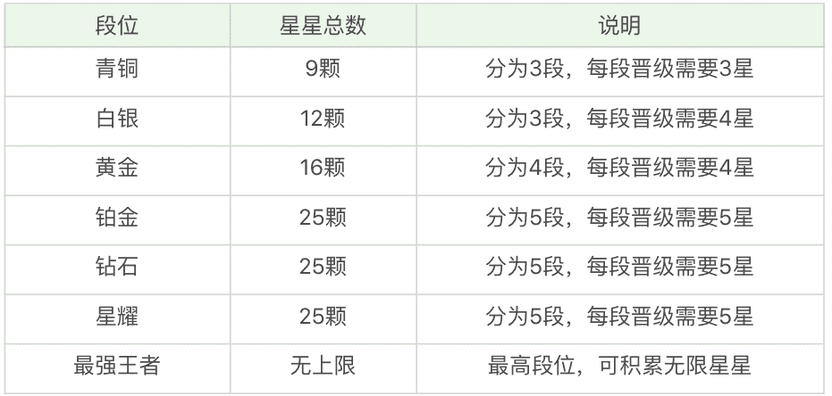

  
 如果想要英雄要达到最强王者的段位，那么之前需要积累 112 颗（9+12+16+25+25+25）星星，而达到最强王者之后还可以继续积累无上限的星星。在随机数模拟上，我们也分成两个阶段，第一个阶段模拟英雄的段位，我们使用随机数来模拟 score（数值范围是 1-112 之间），当 score=112 的时候，再模拟最强王者等级中的星星个数。如果我们只用一个随机数进行模拟，会出现最强王者的比例变大的情况，显然不符合实际情况。

### 使用存储过程模拟 10 万名玩家数据

这里我们使用存储过程，具体代码如下：

```
CREATE DEFINER=`root`@`localhost` PROCEDURE `insert_many_user_scores`(IN START INT(10), IN max_num INT(10))BEGINDECLARE i INT DEFAULT 0;-- 模拟玩家英雄的星星数DECLARE score INT;DECLARE score2 INT;-- 初始注册时间DECLARE date_start DATETIME DEFAULT ('2017-01-01 00:00:00');-- 每个玩家的注册时间DECLARE date_temp DATETIME;SET date_temp = date_start;SET autocommit=0; REPEATSET i=i+1;SET date_temp = date_add(date_temp, interval RAND()*60 second);-- 1-112 随机数SET score = CEIL(RAND()*112);-- 如果达到了王者，继续模拟王者的星星数IF score = 112 THEN           SET score2 = FLOOR(RAND()*100);           SET score = score + score2;END IF;-- 插入新玩家INSERT INTO user_score(user_id, score, create_time) VALUES((START+i), score, date_temp); UNTIL i = max_numEND REPEAT;COMMIT;END
```

然后我们使用`call insert_many_user_scores(10000,100000);`模拟生成 10 万名玩家的得分数据。注意在 insert 之前，需要先设置`autocommit=0`，也就是关闭了自动提交，然后在批量插入结束之后再手动进行 COMMIT，这样做的好处是可以进行批量提交，提升插入效率。你可以看到整体的用时为 5.2 秒。

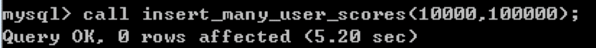

如上代码所示，我用 score 来模拟第一阶段的星星数，如果 score 达到了 112 再来模拟 score2 的分数，这里我限定最强王者阶段的星星个数上限为 100。同时我们还模拟了用户注册的时间，这是因为排行榜可以有两种表示方式，第二种方式需要用到这个时间。

第一种表示方式为并列排行榜，也就是分数相同的情况下，允许排名并列，如下所示：

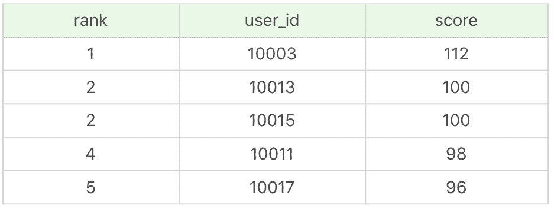

  
 第二种为严格排行榜。当分数相同的时候，会按照第二条件来进行排序，比如按照注册时间的长短，注册时间越长的排名越靠前。这样的话，上面那个排行榜就会变成如下所示的严格排行榜。

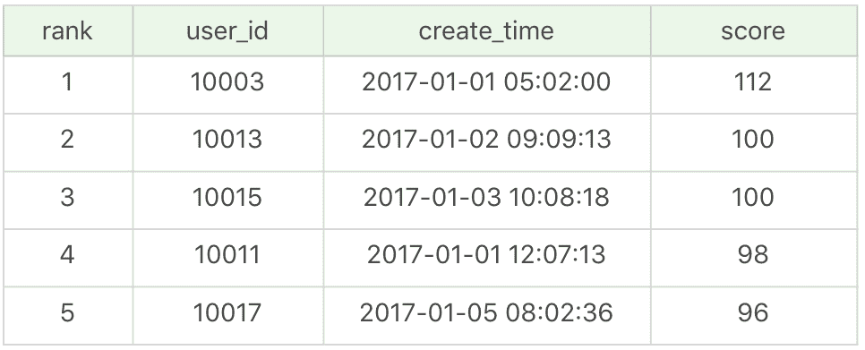

  
 你能看到当 10013 和 10015 得分相同的时候，如果按照注册时间来进行排名的话，会将 10013 排到 10015 前面。

上面的数据仅仅为示意，下面我们用实际的 10 万条数据做一个严格排行榜（你可以点击[下载地址](https://github.com/cystanford/mysql_user_scores)下载这 10 万条数据， 也可以自己使用上面的存储过程来进行模拟）首先使用 SQL 语句进行查询：

```
SELECT (@rownum := @rownum + 1) AS user_rank, user_id, score, create_timeFROM user_score, (SELECT @rownum := 0) bORDER BY score DESC, create_time ASC
```

运行结果如下（10 万条数据，用时 0.17s）：

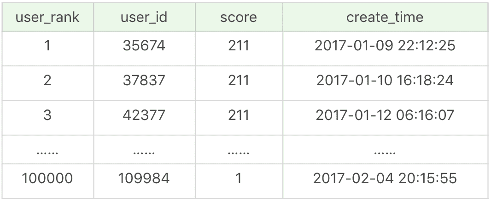

  
 这里有几点需要说明。

MySQL 不像 Oracle 一样自带 rownum 统计行编号的功能，所以这里我们需要自己来实现 rownum 功能，也就是设置 MySQL 的变量`@rownum`，初始化为`@rownum :=0`，然后每次 SELECT 一条数据的时候都自动加 1。

通过开发程序（比如 Python、PHP 和 Java 等）统计排名会更方便，这里同样需要初始化一个变量，比如`rownum=0`，然后每次 fetch 一条数据的时候都将该变量加 1，作为记录的排名。同时，开发程序也可以很方便地实现并列排名，因为程序可以进行上下文的统计，当两名玩家得分相同时，排名相同，否则排名会顺序加 1。

如果想要通过 SQL 来实现，可以写成下面这样：

```
SELECT user_id, score,    IFNULL((SELECT COUNT(*) FROM user_score WHERE score > t.score), 0) + 1 AS user_rank  FROM user_score tORDER BY user_rank ASC
```

这样做的原理是查找比当前分数大的数据行数，然后加 1，但是这样执行效率会很低，相当于需要对每个玩家都统计一遍排名。

## Lua 是什么，如何在 Redis 中使用

知道如何用 MySQL 模拟数据后，我们再来看下如何在 Redis 中完成这一步。事实上，Redis 本身不提供存储过程的功能，不过在 2.6 版本之后集成了 Lua 语言，可以很方便地实现类似存储过程的函数调用方式。

Lua 是一个小巧的脚本语言，采用标准 C 语言编写，一个完整的 Lua 解析器大小只有 200K。我们之前讲到过采用标准 C 语言编写的好处就在于执行效率高，依懒性低，同时兼容性好，稳定性高。这些特性同样 Lua 也有，它可以嵌入到各种应用程序中，提供灵活的扩展和定制功能。

### 如何在 Redis 中使用 Lua

在 Redis 中使用 Lua 脚本的命令格式如下：

```
EVAL script numkeys key [key ...] arg [arg ...]
```

我来说明下这些命令中各个参数代表的含义。

 
1. script，代表的是 Lua 的脚本内容。 
2. numkeys，代表后续参数 key 的个数。 
3. key 就是我们要操作的键，可以是多个键。我们在 Lua 脚本中可以直接使用这些 key，直接通过`KEYS[1]`、`KEYS[2]`来获取，默认下标是从 1 开始。 
4. arg，表示传入到 Lua 脚本中的参数，就像调用函数传入的参数一样。在 Lua 脚本中我们可以通过`ARGV[1]`、`ARGV[2]`来进行获取，同样默认下标从 1 开始。 

下面我们通过 2 个例子来体会下，比如我们使用 eval `"return {ARGV[1], ARGV[2]}" 0 cy 123`，代表的是传入的 key 的个数为 0，后面有两个 arg，分别为 cy 和 123。在 Lua 脚本中，我们直接返回这两个参数`ARGV[1]`, `ARGV[2]`，执行结果如下：

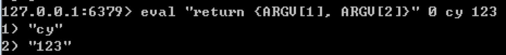

  
 比如我们要用这一条语句：

```
eval "math.randomseed(ARGV[1]); local temp = math.random(1,112); redis.call('SET', KEYS[1], temp); return 'ok';" 1 score 30
```

这条语句代表的意思是，我们传入 KEY 的个数为 1，参数是 score，arg 参数为 30。在 Lua 脚本中使用`ARGV[1]`，也就是 30 作为随机数的种子，然后创建本地变量 temp 等于 1 到 112 之间的随机数，再使用 SET 方法对 KEY，也就是用刚才创建的随机数对 score 这个字段进行赋值，结果如下：

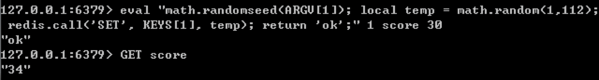

  
 然后我们在 Redis 中使用`GET score`对刚才设置的随机数进行读取，结果为 34。

另外我们还可以在命令中调用 Lua 脚本，使用的命令格式：

```
redis-cli --eval lua_file key1 key2 , arg1 arg2 arg3
```

使用 redis-cli 的命令格式不需要输入 key 的个数，在 key 和 arg 参数之间采用了逗号进行分割，注意逗号前后都需要有空格。同时在 eval 后面可以带一个 lua 文件（以.lua 结尾）。

## 使用 Lua 创建 10 万名玩家数据

如果我们想要通过 Lua 脚本创建 10 万名玩家的数据，文件名为`insert_user_scores.lua`，代码如下：

```
-- 设置时间种子math.randomseed(ARGV[1]) -- 设置初始的生成时间local create_time = 1567769563 - 3600*24*365*2.0 local num = ARGV[2]local user_id = ARGV[3]for i=1, num do  -- 生成 1 到 60 之间的随机数  local interval = math.random(1, 60)   -- 产生 1 到 112 之间的随机数  local temp = math.random(1, 112)   if (temp == 112) then        -- 产生 0 到 100 之间的随机数        temp = temp + math.random(0, 100)   end  create_time = create_time + interval  temp = temp + create_time / 10000000000  redis.call('ZADD', KEYS[1], temp, user_id+i-1)endreturn 'Generation Completed'
```

上面这段代码可以实现严格排行榜的排名，具体方式是将 score 进行了改造，score 为浮点数。整数部分为得分，小数部分为时间差。

在调用的时候，我们通过`ARGV[1]`获取时间种子的参数，传入的`KEYS[1]`为`user_score`，也就是创建有序集合`user_score`。然后通过 num 来设置生成玩家的数量，通过`user_id`获取初始的`user_id`。最后调用如下命令完成玩家数据的创建：

```
redis-cli -h localhost -p 6379 --eval insert_user_scores.lua user_score , 30 100000 10000
```

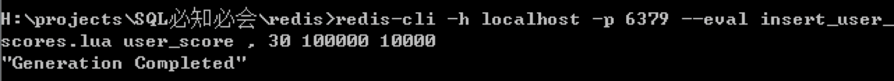

### 使用 Redis 实现玩家排行榜

我们通过 Lua 脚本模拟完成 10 万名玩家数据，并将其存储在了 Redis 的有序集合`user_score`中，下面我们就来使用 Redis 来统计玩家排行榜的数据。

首先我们需要思考的是，一个典型的游戏排行榜都包括哪些功能呢？

 
1. 统计全部玩家的排行榜 
2. 按名次查询排名前 N 名的玩家 
3. 查询某个玩家的分数 
4. 查询某个玩家的排名 
5. 对玩家的分数和排名进行更新 
6. 查询指定玩家前后 M 名的玩家 
7. 增加或移除某个玩家，并对排名进行更新 

在 Redis 中实现上面的功能非常简单，只需要使用 Redis 我们提供的方法即可，针对上面的排行榜功能需求，我们分别来看下 Redis 是如何实现的。

### 统计全部玩家的排行榜

在 Redis 里，统计全部玩家的排行榜的命令格式为`ZREVRANGE 排行榜名称 起始位置 结束为止 [WITHSCORES]`。

我们使用这行命令即可：

```
ZREVRANGE user_score 0 -1 WITHSCORES
```

我们对玩家排行榜`user_score`进行统计，其中 -1 代表的是全部的玩家数据，`WITHSCORES`代表的是输出排名的同时也输出分数。

### 按名次查询排名前 N 名的玩家

同样我们可以使用`ZREVRANGE`完成前 N 名玩家的排名，比如我们想要统计前 10 名玩家，可以使用：`ZREVRANGE user_score 0 9`。

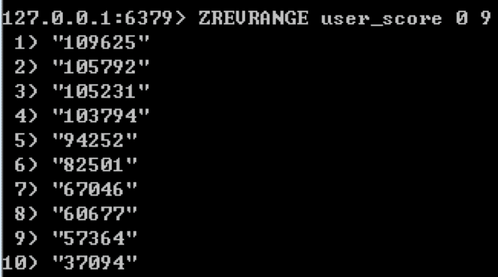

### 查询某个玩家的分数

命令格式为`ZSCORE 排行榜名称 玩家标识`。

时间复杂度为`O(1)`。

如果我们想要查询玩家 10001 的分数可以使用：`ZSCORE user_score 10001`。

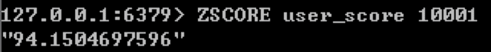

### 查询某个玩家的排名

命令格式为`ZREVRANK 排行榜名称 玩家标识`。

时间复杂度为`O(log(N))`。

如果我们想要查询玩家 10001 的排名可以使用：`ZREVRANK user_score 10001`。

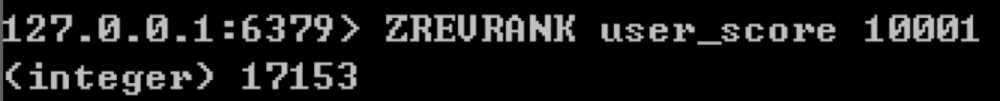

### 对玩家的分数进行更新，同时排名进行更新

如果我们想要对玩家的分数进行增减，命令格式为`ZINCRBY 排行榜名称 分数变化 玩家标识`。

时间复杂度为`O(log(N))`。

比如我们想对玩家 10001 的分数减 1，可以使用：`ZINCRBY user_score -1 10001`。

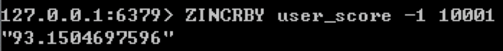

  
 然后我们再来查看下玩家 10001 的排名，使用：`ZREVRANK user_score 10001`。

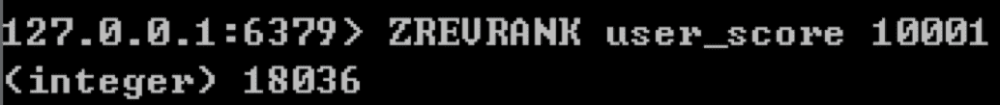

  
 你能看到排名由 17153 降到了 18036 名。

### 查询指定玩家前后 M 名的玩家

比如我们想要查询玩家 10001 前后 5 名玩家都是谁，当前已知玩家 10001 的排名是 18036，那么可以使用：`ZREVRANGE user_score 18031 18041`。

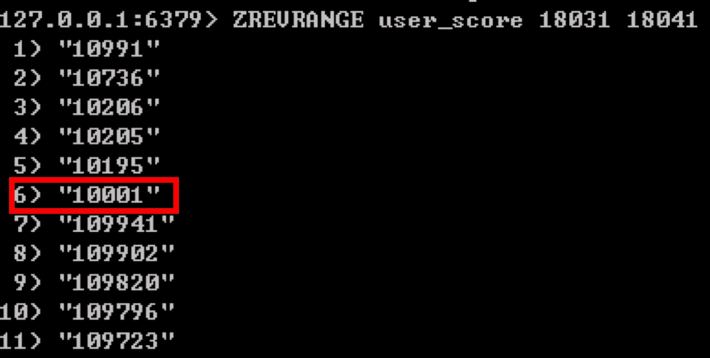

  
 这样就可以得到玩家 10001 前后 5 名玩家的信息。

**增加或删除某个玩家，并对排名进行更新**

如果我们想要删除某个玩家，命令格式为`ZREM 排行榜名称 玩家标识`。

时间复杂度为`O(log(N))`。

比如我们想要删除玩家 10001，可以使用：`ZREM user_score 10001`。

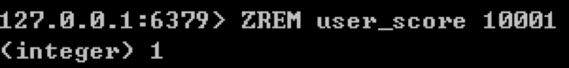

  
 这样我们再来查询下排名在 18031 到 18041 的玩家是谁，使用：`ZREVRANGE user_score 18031 18041`。

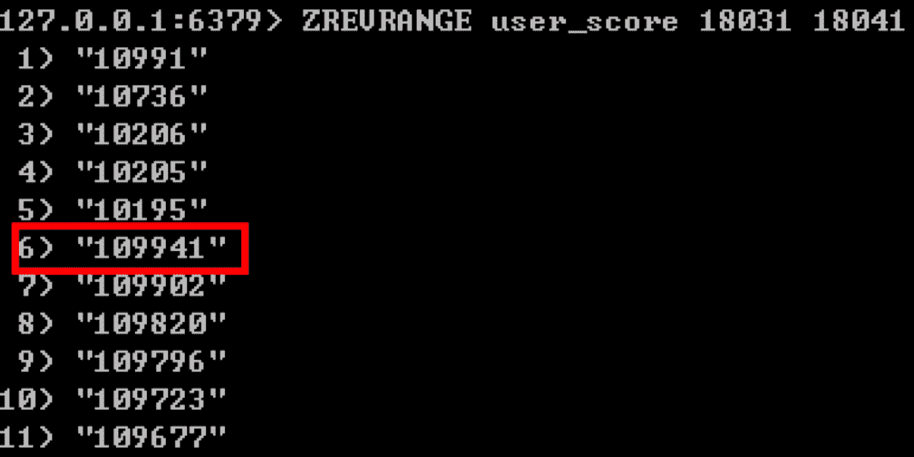

  
 你能看到玩家 10001 的信息被删除，同时后面的玩家排名都向前移了一位。

如果我们想要增加某个玩家的数据，命令格式为`ZADD 排行榜名称 分数 玩家标识`。

时间复杂度为`O(log(N))`。

这里，我们把玩家 10001 的信息再增加回来，使用：`ZADD user_score 93.1504697596 10001`。

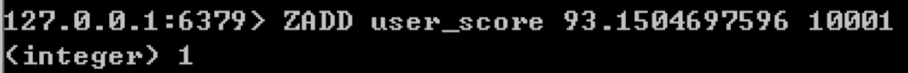

  
 然后我们再来看下排名在 18031 到 18041 的玩家是谁，使用：`ZREVRANGE user_score 18031 18041`。

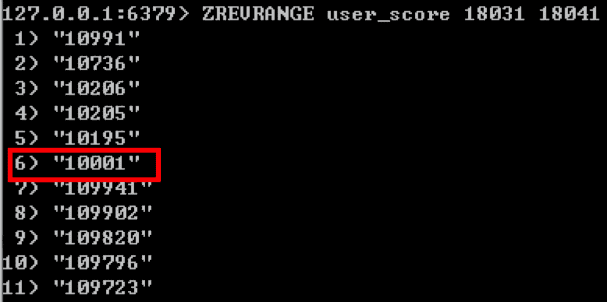

  
 你能看到插入了玩家 10001 的数据之后，排名又回来了。

## 总结

今天我们使用 MySQL 和 Redis 搭建了排行榜，根据相同分数的处理方式，我们可以把排行榜分成并列排行榜和严格排行榜。虽然 MySQL 和 Redis 都可以搭建排行榜，但两者还是有区别的。MySQL 擅长存储数据，而对于数据的运算来说则效率不高，比如统计排行榜的排名，通常还是需要使用后端语言（比如 Python、PHP、Java 等）再进行统计。而 Redis 本身提供了丰富的排行榜统计功能，不论是增加、删除玩家，还是对某个玩家的分数进行调整，Redis 都可以对排行榜实时更新，对于游戏的实时排名来说，这还是很重要的。

在 Redis 中还集成了 Lua 脚本语言，通过 Lua 我们可以更加灵活地扩展 Redis 的功能，同时在 Redis 中使用 Lua 语言，还可以对 Lua 脚本进行复用，减少网络开销，编写代码也更具有模块化。此外 Redis 在调用 Lua 脚本的时候，会将它作为一个整体，也就是说中间如果有其他的 Redis 命令是不会被插入进去的，也保证了 Lua 脚本执行过程中不会被其他命令所干扰。

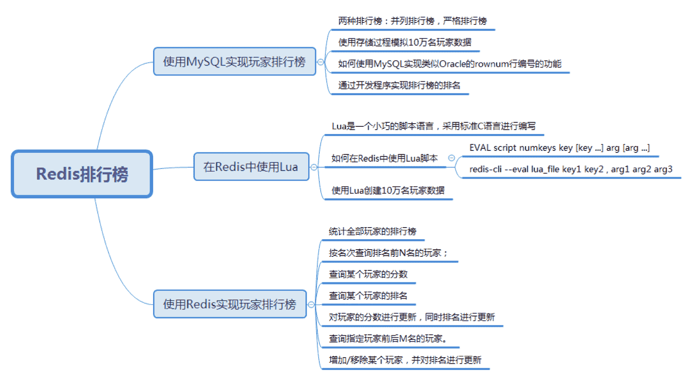

  
 我们今天使用 Redis 对 10 万名玩家的数据进行了排行榜的统计，相比于用 RDBMS 实现排行榜来说，使用 Redis 进行统计都有哪些优势呢？

我们使用了 Lua 脚本模拟了 10 万名玩家的数据，其中玩家的分数 score 分成了两个部分，整数部分为实际的得分，小数部分为注册时间。例子中给出的严格排行榜是在分数相同的情况下，按照注册时间的长短进行的排名，注册时间长的排名靠前。如果我们将规则进行调整，同样是在分数相同的情况下，如果注册时间长的排名靠后，又该如何编写代码呢？

欢迎你在评论区写下你的思考，也欢迎把这篇文章分享给你的朋友或者同事，一起交流一下。


