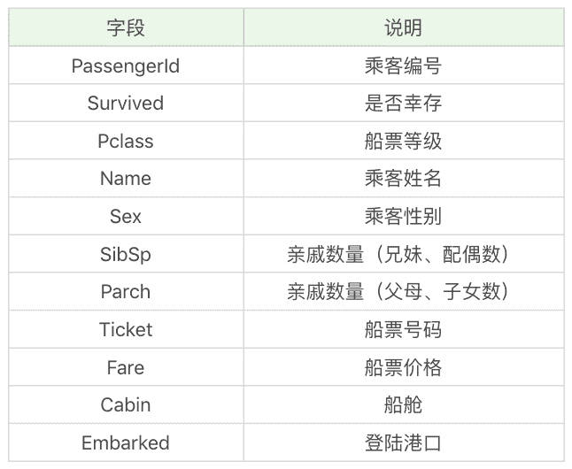
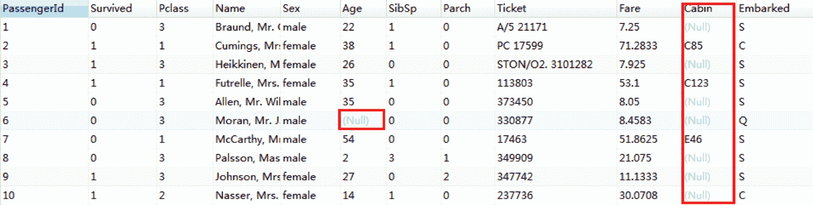
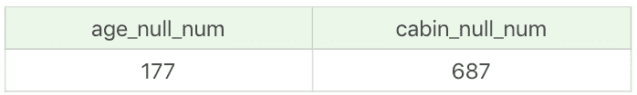
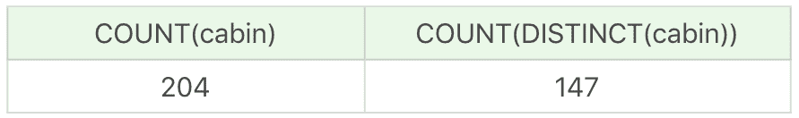
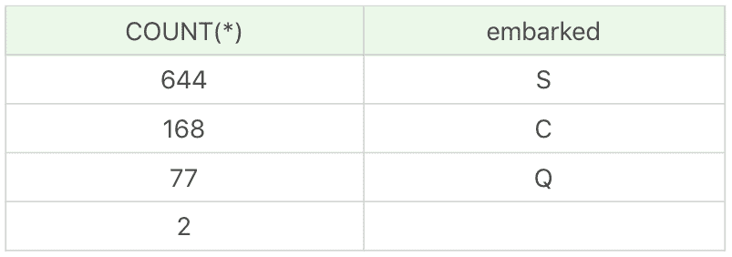
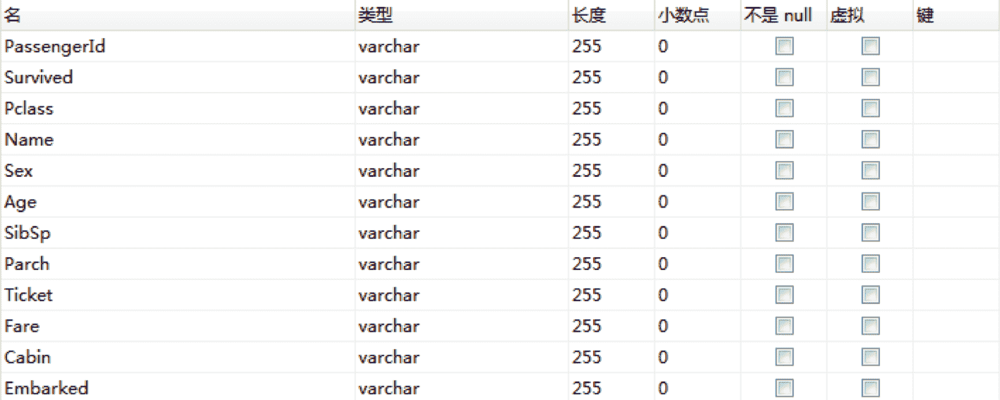
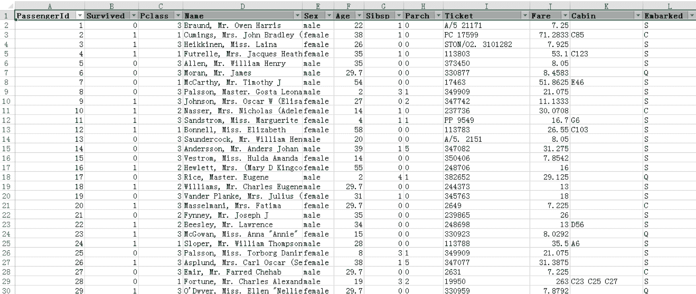
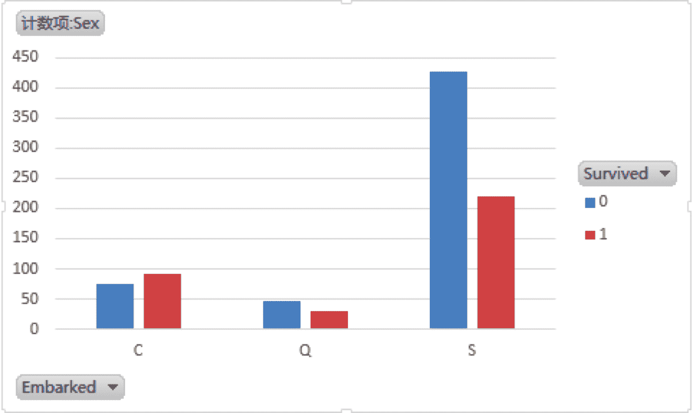
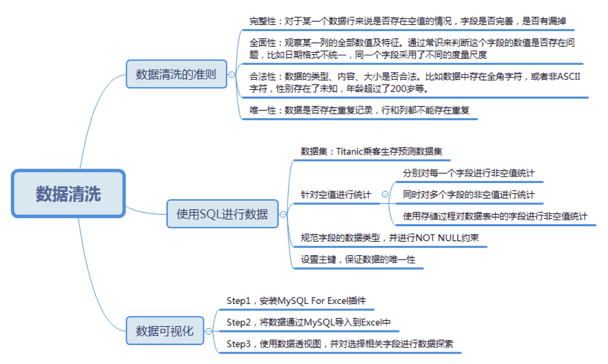

# 45丨数据清洗：如何使用SQL对数据进行清洗？

 

SQL 可以帮我们进行数据处理，总的来说可以分成 OLTP 和 OLAP 两种方式。

OLTP 称之为联机事务处理，我们之前讲解的对数据进行增删改查，SQL 查询优化，事务处理等就属于 OLTP 的范畴。它对实时性要求高，需要将用户的数据有效地存储到数据库中，同时有时候针对互联网应用的需求，我们还需要设置数据库的主从架构保证数据库的高并发和高可用性。

OLAP 称之为联机分析处理，它是对已经存储在数据库中的数据进行分析，帮我们得出报表，指导业务。它对数据的实时性要求不高，但数据量往往很大，存储在数据库（数据仓库）中的数据可能还存在数据质量的问题，比如数据重复、数据中有缺失值，或者单位不统一等，因此在进行数据分析之前，首要任务就是对收集的数据进行清洗，从而保证数据质量。

对于数据分析工作来说，好的数据质量才是至关重要的，它决定了后期数据分析和挖掘的结果上限。数据挖掘模型选择得再好，也只能最大化地将数据特征挖掘出来。

高质量的数据清洗，才有高质量的数据。今天我们就来看下，如何用 SQL 对数据进行清洗。

 
1. 想要进行数据清洗有怎样的准则呢？ 
2. 如何使用 SQL 对数据进行清洗？ 
3. 如何对清洗之后的数据进行可视化？ 

## 数据清洗的准则

我在《数据分析实战 45 讲》里专门讲到过数据清洗的原则，这里为了方便你理解，我用一个数据集实例讲一遍。

一般而言，数据集或多或少地会存在数据质量问题。这里我们使用泰坦尼克号乘客生存预测数据集，你可以从[GitHub](https://www.kaggle.com/c/titanic/data)上下载这个数据集。

数据集格式为 csv，一共有两种文件：train.csv 是训练数据集，包含特征信息和存活与否的标签；test.csv 是测试数据集，只包含特征信息。

数据集中包括了以下字段，具体的含义如下：



  
 训练集给出了 891 名乘客幸存与否的结果，以及相关的乘客信息。通过训练集，我们可以对数据进行建模形成一个分类器，从而对测试集中的乘客生存情况进行预测。不过今天我们并不讲解数据分析的模型，而是来看下在数据分析之前，如何对数据进行清洗。

首先，我们可以通过 Navicat 将 CSV 文件导入到 MySQL 数据库中，然后浏览下数据集中的前几行，可以发现数据中存在缺失值的情况还是很明显的。



  
 数据存在数据缺失值是非常常见的情况，此外我们还需要考虑数据集中某个字段是否存在单位标识不统一，数值是否合法，以及数据是否唯一等情况。要考虑的情况非常多，这里我将数据清洗中需要考虑的规则总结为 4 个关键点，统一起来称之为“完全合一”准则，你可以[点这里](https://time.geekbang.org/column/article/76307)看一下。

“完全合一”是个通用的准则，针对具体的数据集存在的问题，我们还需要对症下药，采取适合的解决办法，甚至为了后续分析方便，有时我们还需要将字符类型的字段替换成数值类型，比如我们想做一个 Steam 游戏用户的数据分析，统计数据存储在两张表上，一个是 user_game 数据表，记录了用户购买的各种 Steam 游戏，其中数据表中的 game_title 字段表示玩家购买的游戏名称，它们都采用英文字符的方式。另一个是 game 数据表，记录了游戏的 id、游戏名称等。因为这两张表存在关联关系，实际上在 user_game 数据表中的 game_title 对应了 game 数据表中的 name，这里我们就可以用 game 数据表中的 id 替换掉原有的 game_title。替换之后，我们在进行数据清洗和质量评估的时候也会更清晰，比如如果还存在某个 game_title 没有被替换的情况，就证明这款游戏在 game 数据表中缺少记录。

## 使用 SQL 对预测数据集进行清洗

了解了数据清洗的原则之后，下面我们就用 SQL 对泰坦尼克号数据集中的训练集进行数据清洗，也就是 train.csv 文件。我们先将这个文件导入到 titanic_train 数据表中：


### 检查完整性

在完整性这里，我们需要重点检查字段数值是否存在空值，在此之前，我们需要先统计每个字段空值的个数。在 SQL 中，我们可以分别统计每个字段的空值个数，比如针对 Age 字段进行空值个数的统计，使用下面的命令即可：

```
SELECT COUNT(*) as num FROM titanic_train WHERE Age IS NULL
```

运行结果为 177。

当然我们也可以同时对多个字段的非空值进行统计：

```
SELECT SUM((CASE WHEN Age IS NULL THEN 1 ELSE 0 END)) AS age_null_num, SUM((CASE WHEN Cabin IS NULL THEN 1 ELSE 0 END)) AS cabin_null_numFROM titanic_train
```

运行结果：



  
 不过这种方式适用于字段个数较少的情况，如果一个数据表存在几十个，甚至更多的字段，那么采用这种方式既麻烦又容易出错。这时我们可以采用存储过程的方式，用程序来进行字段的空值检查，代码如下：

```
CREATE PROCEDURE `check_column_null_num`(IN schema_name VARCHAR(100), IN table_name2 VARCHAR(100))BEGIN-- 数据表 schema_name 中的列名称DECLARE temp_column VARCHAR(100); -- 创建结束标志变量  DECLARE done INT DEFAULT false;-- 定义游标来操作每一个 COLUMN_NAMEDECLARE cursor_column CURSOR FORSELECT COLUMN_NAME FROM information_schema.COLUMNS WHERE table_schema = schema_name AND table_name = table_name2;-- 指定游标循环结束时的返回值  DECLARE CONTINUE HANDLER FOR NOT FOUND SET done = true;  -- 打开游标OPEN cursor_column;read_loop:LOOP           FETCH cursor_column INTO temp_column;           -- 判断游标的循环是否结束            IF done THEN                     LEAVE read_loop;           END IF;           -- 这里需要设置具体的 SQL 语句 temp_query           SET @temp_query=CONCAT('SELECT COUNT(*) as ', temp_column, '_null_num FROM ', table_name2, ' WHERE ', temp_column, ' IS NULL');           -- 执行 SQL 语句           PREPARE stmt FROM @temp_query;                      EXECUTE stmt;END LOOP;-- 关闭游标CLOSE cursor_column;END
```

我来说下这个存储过程的作用，首先我定义了两个输入的参数 schema_name 和 table_name2，用来接收想要检查的数据库的名称以及数据表名。

然后使用游标来操作读取出来的 column_name，赋值给变量 temp_column。对于列名，我们需要检查它是否为空，但是这个列名在 MySQL 中是动态的，我们无法使用 @temp_column 来表示列名，对其进行判断，在这里我们需要使用 SQL 拼接的方式，这里我设置了 @temp_query 表示想要进行查询的 SQL 语句，然后设置 COUNT(*) 的别名为动态别名，也就是 temp_column 加上 _null_num，同样在 WHERE 条件判断中，我们使用 temp_column 进行动态列名的输出，以此来判断这个列数值是否为空。

然后我们执行这个 SQL 语句，提取相应的结果。

```
call check_column_null_num('wucai', 'titanic_train'); 
```

运行结果如下：

```
Age_null_num：177Cabin_null_num：687Embarked_null_num：2Fare_null_num：0Name_null_num：0Parch_null_num：0PassengerId_null_num：0Pclass_null_num：0Sex_null_num：0SibSp_null_num：0Survived_null_num：0Ticket_null_num：0
```

为了浏览方便我调整了运行结果的格式，你能看到在 titanic_train 数据表中，有 3 个字段是存在空值的，其中 Cabin 空值数最多为 687 个，Age 字段空值个数 177 个，Embarked 空值个数 2 个。

既然存在空值的情况，我们就需要对它进行处理。针对缺失值，我们有 3 种处理方式。

 
1. 删除：删除数据缺失的记录； 
2. 均值：使用当前列的均值； 
3. 高频：使用当前列出现频率最高的数据。 

对于 Age 字段，这里我们采用均值的方式进行填充，但如果直接使用 SQL 语句可能会存在问题，比如下面这样。

```
UPDATE titanic_train SET age = (SELECT AVG(age) FROM titanic_train) WHERE age IS NULL
```

这时会报错：

```
1093 - You can't specify target table 'titanic_train' for update in FROM clause
```

也就是说同一条 SQL 语句不能先查询出来部分内容，再同时对当前表做修改。

这种情况下，最简单的方式就是复制一个临时表 titanic_train2，数据和 titanic_train 完全一样，然后再执行下面这条语句：

```
UPDATE titanic_train SET age = (SELECT ROUND(AVG(age),1) FROM titanic_train2) WHERE age IS NULL
```

这里使用了 ROUND 函数，对 age 平均值 AVG(age) 进行四舍五入，只保留小数点后一位。

针对 Cabin 这个字段，我们了解到这个字段代表用户的船舱位置，我们先来看下 Cabin 字段的数值分布情况：

```
SELECT COUNT(cabin), COUNT(DISTINCT(cabin)) FROM titanic_train
```

运行结果：



  
 从结果中能看出 Cabin 字段的数值分布很广，而且根据常识，我们也可以知道船舱位置每个人的差异会很大，这里既不能删除掉记录航，又不能采用均值或者高频的方式填充空值，实际上这些空值即无法填充，也无法对后续分析结果产生影响，因此我们可以不处理这些空值，保留即可。

然后我们来看下 Embarked 字段，这里有 2 个空值，我们可以采用该字段中高频值作为填充，首先我们先了解字段的分布情况使用：

```
SELECT COUNT(*), embarked FROM titanic_train GROUP BY embarked
```

运行结果：



  
 我们可以直接用 S 来对缺失值进行填充：

```
UPDATE titanic_train SET embarked = 'S' WHERE embarked IS NULL
```

至此，对于 titanic_train 这张数据表中的缺失值我们就处理完了。

### 检查全面性

在这个过程中，我们需要观察每一列的数值情况，同时查看每个字段的类型。



  
 因为数据是直接从 CSV 文件中导进来的，所以每个字段默认都是 VARCHAR(255) 类型，但很明显 PassengerID、Survived、Pclass 和 Sibsp 应该设置为 INT 类型，Age 和 Fare 应该设置为 DECIMAL 类型，这样更方便后续的操作。使用下面的 SQL 命令即可：

```
ALTER TABLE titanic_train CHANGE PassengerId PassengerId INT(11) NOT NULL PRIMARY KEY;ALTER TABLE titanic_train CHANGE Survived Survived INT(11) NOT NULL;ALTER TABLE titanic_train CHANGE Pclass Pclass INT(11) NOT NULL;ALTER TABLE titanic_train CHANGE Sibsp Sibsp INT(11) NOT NULL;ALTER TABLE titanic_train CHANGE Age Age DECIMAL(5,2) NOT NULL;ALTER TABLE titanic_train CHANGE Fare Fare DECIMAL(7,4) NOT NULL;
```

然后我们将其余的字段（除了 Cabin）都进行 NOT NULL，这样在后续进行数据插入或其他操作的时候，即使发现数据异常，也可以对字段进行约束规范。

在全面性这个检查阶段里，除了字段类型定义需要修改以外，我们没有发现其他问题。

**然后我们来检查下合法性及唯一性。**合法性就是要检查数据内容、大小等是否合法，这里不存在数据合法性问题。

针对数据是否存在重复的情况，我们刚才对 PassengerId 字段类型进行更新的时候设置为了主键，并没有发现异常，证明数据是没有重复的。

## 对清洗之后的数据进行可视化

我们之前讲到过如何通过 Excel 来导入 MySQL 中的数据，以及如何使用 Excel 来进行数据透视表和数据透视图的呈现。

这里我们使用 MySQL For Excel 插件来进行操作，在操作之前有两个工具需要安装。

首先是 mysql-for-excel，点击[这里](https://dev.mysql.com/downloads/windows/excel/)进行下载；然后是 mysql-connector-odbc，点击[这里](https://dev.mysql.com/downloads/connector/odbc/)进行下载。

安装好之后，我们新建一个空的 excel 文件，打开这个文件，在数据选项中可以找到“MySQL for Excel”按钮，点击进入，然后输入密码连接 MySQL 数据库。

然后选择我们的数据库以及数据表名称，在下面可以找到 Import MySQL Data 按钮，选中后将数据表导入到 Excel 文件中。



  
 在“插入”选项中找到“数据透视图”，这里我们选中 Survived、Sex 和 Embarked 字段，然后将 Survive 字段放到图例（系列）栏中，将 Sex 字段放到求和值栏中，可以看到呈现出如下的数据透视表：



  
 从这个透视表中你可以清晰地了解到用户生存情况（Survived）与 Embarked 字段的关系，当然你也可以通过数据透视图进行其他字段之间关系的探索。

为了让你能更好地理解操作的过程，我录制了一段操作视频。

## 总结

在数据清洗过程中，你能看到通过 SQL 来进行数据概览的查询还是很方便的，但是使用 SQL 做数据清洗，会有些繁琐，这时你可以采用存储过程对数据进行逐一处理，当然你也可以使用后端语言，比如使用 Python 来做具体的数据清洗。

在进行数据探索的过程中，我们可能也会使用到数据可视化，如果不采用 Python 进行可视化，你也可以选择使用 Excel 自带的数据透视图来进行可视化的呈现，它会让你对数据有个更直观的认识。



  
 今天讲解的数据清洗的实例比较简单，实际上数据清洗是个反复的过程，有时候我们需要几天时间才能把数据完整清洗好。你在工作中，会使用哪些工具进行数据清洗呢？

另外，数据缺失问题在数据清洗中非常常见，我今天列举了三种填充数据缺失的方式，分别是删除、均值和高频的方式。实际上缺失值的处理方式不局限于这三种，你可以思考下，如果数据量非常大，某个字段的取值分布也很广，那么对这个字段中的缺失值该采用哪种方式来进行数据填充呢？

欢迎你在评论区写下你的思考，也欢迎把这篇文章分享给你的朋友或者同事，一起交流一下。


