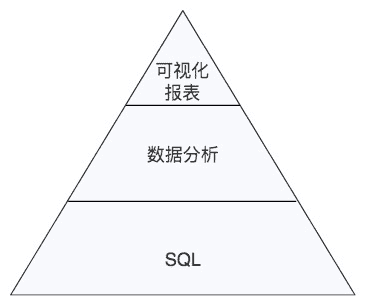
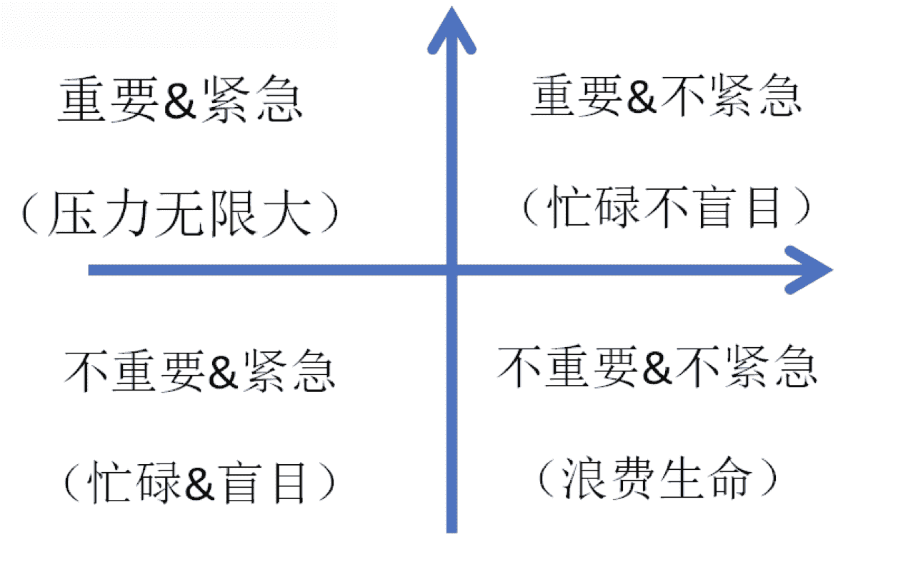

# 结束语 | 互联网的下半场是数据驱动的时代

 

你好，我是陈旸。

看到结束语的时候，就意味着 SQL 专栏已经结束了。我希望这个专栏可以帮你打开数据的大门，从而通过数据发现更多的宝藏。

互联网已经进入到下半场是不争的事实。我们每天不是想着下载某个新的 APP，而是选择卸载掉哪个不经常用的 APP。对于互联网新业务来说，我们处于一个流量稀缺的时代，用户不再野蛮增长。这也是为什么很多互联网企业转向修炼内功，开始注重内部效率的提升。而数据则是这项内功最核心的部分，向内寻找答案，通过数据的力量驱动增长。

回想一下，互联网上半场的打法可以说是营销和资本驱动。几年前我们动不动就搞个活动，送几个 iPhone 手机就可以换取免费流量。我走访过一些大型的互联网企业，它们对于用户数据的重视程度远不如今天，甚至是很多数据都没有及时存储下来，这样就意味着，他们想要使用之前的数据做精细化运营，就无从下手。真是非常可惜。

而互联网的下半场是数据和技术在驱动。当用户不再“便宜”的时候，我们开始重视用户数据的完善，开始重视如何通过数据来挖掘同一个用户更多的价值。实际上，在这个层面上，我看到了更多数据技术的机会，很明显这几年招聘的岗位中，数据相关的工作受到越来越多的重视。如何有效地存储，管理和使用这些数据是企业提升内部效率中的重要环节。

对于和数据打交道的技术人员来说，这是非常好的时代，那该如何构建我们的数据知识体系呢？

## 越基础的内容，越重要

就像我在专栏开篇讲到的一样，SQL 是一门半衰期很长的语言，经历过长时间的考验，不仅现在在程序语言排行榜名列前茅，未来也依然是主流的语言。

SQL 的通用性也会越来越强，不光是技术人员，很多产品经理，运营人员都在学习 SQL。我的一个初中同学，现在在今日头条负责消费金融业务的运营，他们整个部门的人都在学习使用 SQL，而她是金融专业背景，之前并没有写过代码。同样，我们还看到一些最新的 AI 技术也开始在 SQL 工具中进行集成，比如最后一篇文章中我们介绍的那些工具。

实际上相比于各种 AI 技术来说，SQL 语言很少有大的变化。这是因为越基础的内容，大的改动频率就会越少，半衰期越长。同时作为整个应用的基石，发挥的作用也会越大。而越上层的应用，虽然离用户离场景更近，但是变化更新的频率也会越快，更加多样性。比如在 AI 技术中，我们会存在传统机器学习，深度学习和自动机器学习，同样在深度学习中，也存在着多种神经网络，比如 CNN（卷积神经网络），RNN（循环神经网络），DBN（深度信念网络），GAN（生成对抗网络），DRL（深度强化学习）等。即便是一种神经网络，比如 CNN，也存在着不同的网络结构（Le-Net、VGG、GoogleNet、ResNet、DenseNet 等）。这些技术更新频率非常快，你可能刚掌握了一个网络结构，又有新的网络结构推出来。而 SQL 语言，45 年中并没有大的变化，现在学习和使用的技能，在未来依然可以发挥作用。

同时，越基础的内容，使用频率也会越高。实际工作中，很多时候我们并不需要太多“先进”的技术，对于大多数的数据分析需求来说，一些 SQL 查询就可以帮我们做很多统计的工作。

## 将 SQL 作为入口，构建你的 DT 大厦

实际上，SQL 已经成为我们获取数据的入口，这也意味着通过 SQL 可能会衍生出一个完整的 DT 生态，各种个性化的数据分析工具将集成在 SQL 中，未来你可以像使用 SQL 语言一样来使用这些机器学习、数据分析的工具。

  
 DT 时代，SQL 是数据的入口，是构建我们整个数据大厦的基石，在此基础上你可以使用现有的各种算法，也可以改进算法对数据进行分析。最后是进行可视化报表的呈现，对于老板们来说这是他们更关心的部分，因为他们更关注结果，而中间分析的过程依靠于各种数据分析算法，底层的数据来源自 DBMS，可以通过 SQL 来进行获取。

## 每天积累一点，做重要不紧急的事

DT（Data Technology）全栈在互联网的下半场会发挥越来越重要的作用，如果你未来想从事数据相关的工作，那么 SQL 是这个 DT 大厦中非常重要且使用频率很高的基石。在此基础上，我们还可以掌握各种数据分析的能力，以及数据可视化的能力。

如果我们把事情按照重要程度和紧急程度，划分成 4 个象限的话，我希望能在重要不紧急这个象限上，你可以每天积累一点点。

在重要 & 紧急这个象限上的事情，会让你压力无限大，无法做长远的学习积累。比如明天马上要交一个工作汇报，程序 Bug 马上需要 fix 掉然后上线等。

重要 & 不紧急这个象限上的事情能让你做更长远的计划，像是做投资一样播下一棵种子，在未来会有新的收获。

不重要 & 紧急，会让我们忙碌且盲目。不重要 & 不紧急，让我们浪费生命时间。

这两个象限的事情，做与不做其实区别不大。

  
 你可以把技术的学习过程当成是一个重要不紧急的过程，虽然不是你明天马上要完成的工作，但它们却是你未来工作中非常重要的工具。

虽然 SQL 专栏结束了，但我希望这个专栏能开启你的数据学习之旅。不论你是从事 DBA 的工作，还是后端开发，数据算法工作，还是产品，运营岗位，SQL 都将是你未来工作中需要掌握的重要技能，在数据全栈这条道路上，每天积累一点点，终究可以搭建出来属于你的 DT 全栈之路。

最后文章结尾处有一份调查问卷，希望你可以抽出两三分钟填写一下。我想认真倾听你对这个专栏的意见或者建议，期待你的反馈！

