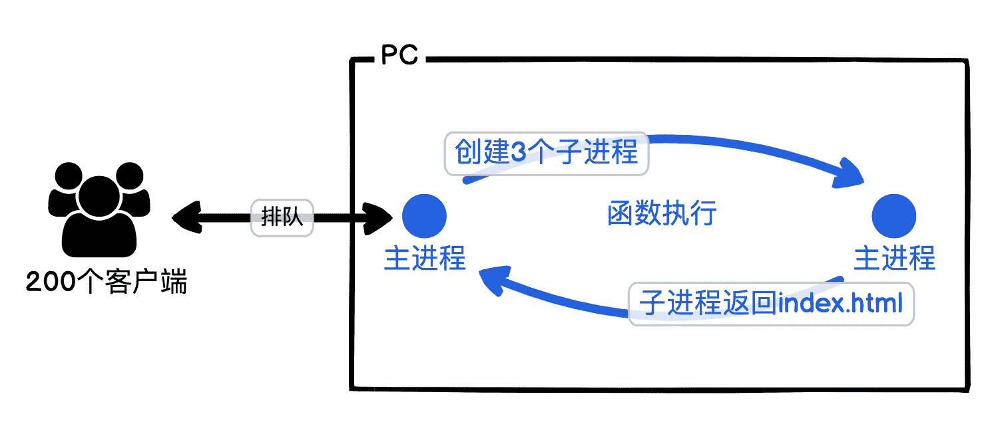
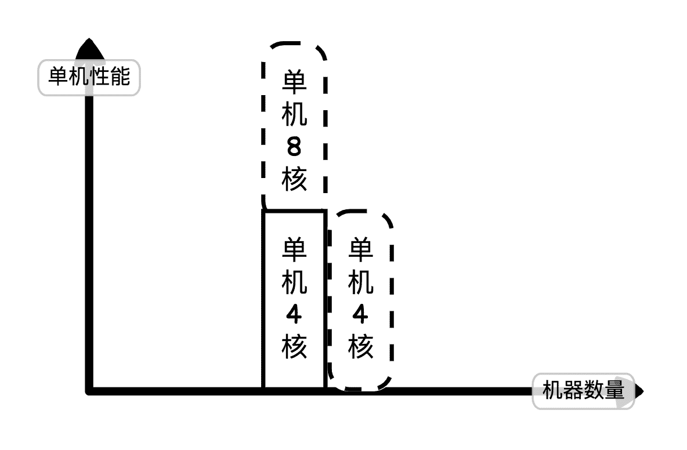
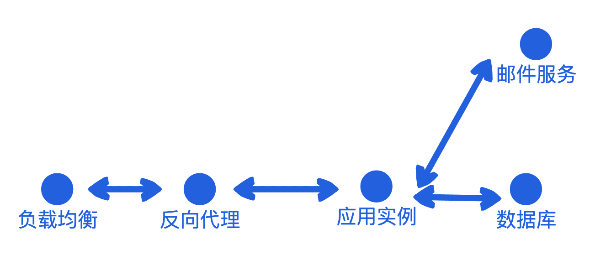
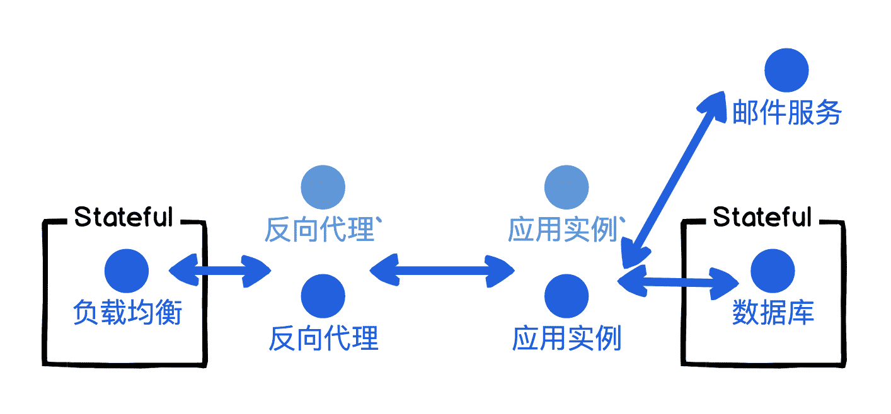
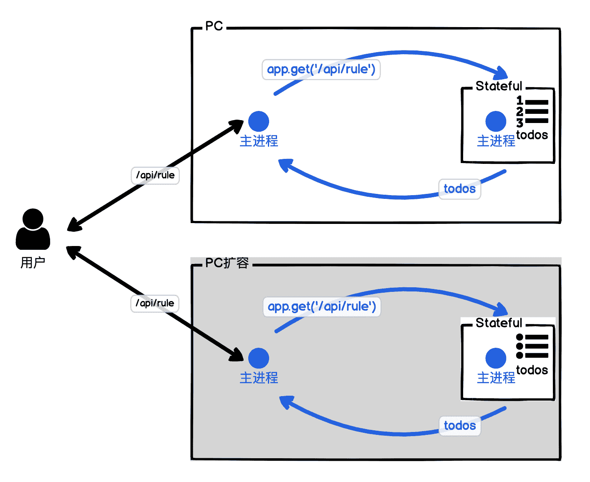
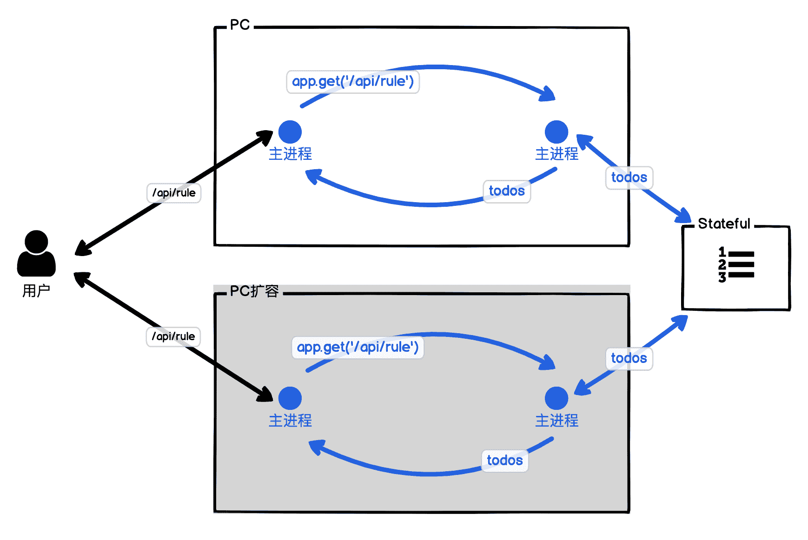
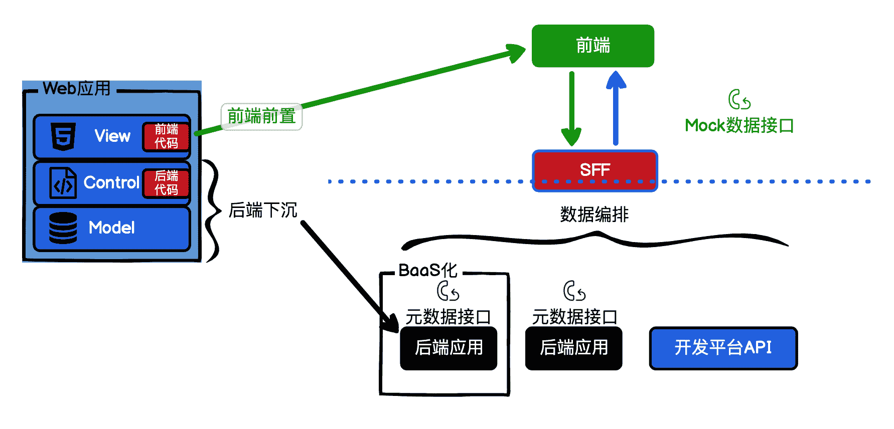

# 04 | 原理：FaaS应用如何才能快速扩缩容？

 

你好，我是秦粤。上一讲我们介绍了 FaaS 的两种进程模型：用完即毁型和常驻进程型，这两种进程模型最大的区别就是在函数执行阶段，函数执行完之后函数实例是否直接结束。同时，我还给你演示了用完即毁型的应用场景，数据编排和服务编排。

这里我估计你可能会有点疑虑，这两个场景用常驻进程型，应该也可以实现吧？当然可以，但你还记得不，我多次强调用完即毁型是 FaaS 最纯正的用法。那既然介绍了两种进程模型，为什么我要说用完即毁型 FaaS 模型比常驻进程型纯正？它背后的逻辑是什么？你可以停下来自己想想。

要真正理解这个问题，我们需要引入进来复杂互联网应用架构演进的一个重要知识点：扩缩容，这也是我们这节课的重点。

为了授课需要，我还是会搬出我们之前提到的创业项目“待办任务”Web 网站。这一次，需要你动动手，在自己本地的机器上运行下这个项目。项目的代码我已经写好了，放到 GitHub 上了，你需要把它下载到本地，然后阅读 README.md 安装和启动我们的应用。

GitHub 地址：https://github.com/pusongyang/todolist-backend

我给你简单介绍下我们目前这个项目的功能。这是一个后端项目，前端代码不是我们的重点，当然如果你有兴趣，我的 REAME.md 里面也有前端代码地址，你可以在待办任务列表里面创建、删除、完成任务。

技术实现上，待办任务数据就存储在了数组里。宏观上看，它是个典型的 Node.js 传统 MVC 应用，Control 函数就是 app.get 和 app.post；Model 我们放在内存里，就是 Todos 对象；View 是纯静态的单页应用代码，在 public 目录。

你先想一下，假如我们让 200 个用户**同时并发访问**你本地开发环境的“待办任务”Web 网站首页 index.html，你本地的 Web 网站实例，会出现什么样的场景？如果方便的话，你可以用 Apache[1] 提供的 ab 工具，压测一下我们的项目。

```
# 模拟1000个请求，由200个用户并发访问我们启动的本地3001端口  
ab -n 1000 -c 200 http://localhost:3001/
```

我来试着描述下你 PC 此时的状态，首先客户端与 PC 建立了 200 个 TCP/IP 的连接，这时 PC 还可以勉强承受得住。然后 200 个客户端同时发起 HTTP 请求"/ GET"，我们 Web 服务的主进程，会创建“CPU 核数 -1”个子进程并发，来处理这些请求。注意，这里 CPU 核数之所以要减一，是因为有一个要留给主进程。

例如 4 核 CPU 就会创建 3 条子进程，并发处理 3 个客户端请求，剩下的客户端请求排队等待；子进程开始处理"/ GET"，命中路由规则，进入对应的 Control 函数，返回 index.html 给客户端；子进程发送完 index.html 文件后，被主进程回收，主进程又创建一个新的子进程去处理下一个客户端请求，直到所有的客户端请求都处理完。具体如下图所示。



PC状态示意图

理解了这一点，接下来的问题就很简单了。如果我问你，为了提升我们客户端队列的处理速度，我们应该怎么做？我想答案你应该已经脱口而出了。

## 纵向扩缩容与横向扩缩容

是的，我们很容易想到最直接的方式就是增加 CPU 的核数。要增加 CPU 的核数，我们可以通过升级单台机器配置，例如从 4 核变成 8 核，那并发的子进程就有 7 个了。

除了直接增加 CPU 的核数，我们还可以增加机器数（还是增加一个 4 核的），我们用 2 台机器，让 500 个客户端访问一台，剩下 500 个客户端访问另外一台，这样我们并发的子进程也能增加到 6 个。



纵向扩缩容 & 横向扩缩容

我画了张图，你可以看看。增加或减少单机性能就是纵向扩缩容，纵向扩缩容随着性能提升成本曲线会陡增，通常我们采用时要慎重考虑。而增加或减少机器数量就是横向扩缩容，横向扩缩容成本更加可控，也是我们最常用的默认扩缩容方式。这里我估计很多人知道，为了照顾初学者，所以再啰嗦下。

你理解了这一点，我们就要增加难度了。因为 index.html 只是单个文件，如果是数据呢？无论是纵向还是横向扩缩容，我们都需要重启机器。现在待办列表的数据保存在内存中，它每次重启都会被还原到最开始的时候，那我们要如何在扩缩容的时候保存我们的数据呢？

在讲解这个问题前，我们还是需要简化一下模型。我们先从宏观架构角度去看“待办任务”Web 服务端数据流的网络拓扑图，数据请求从左往右，经过我们架构设计的各个节点后，最终获取到它要的数据，然后聚合数据并返回。那在这个过程中，哪些节点可以扩缩容，哪些节点不容易扩缩容呢？



“待办任务”Web服务端数据流网络拓扑图

## Stateful VS Stateless

网络拓扑中的节点，我们可以根据是否保存状态分为 Stateful 和 Stateless。Stateful 就是有状态的节点，Stateful 节点用来保存状态，也就是存储数据，因此 Stateful 节点我们需要额外关注，需要保障稳定性，不能轻易改动。例如通常数据库都会采用主 - 从结构，当主节点出问题时，我们立即切换到从节点，让 Stateful 节点整体继续提供服务。

Stateless 就是无状态的节点，Stateless 不存储任何状态，或者只能短暂存储不可靠的部分数据。Stateless 节点没有任何状态，因此在并发量高的时候，我们可以对 Stateless 节点横向扩容，而没有流量时我们可以缩容到 0（是不是有些熟悉了？）。Stateful 节点则不行，如果面对流量峰值峰谷的流量差比较大时，我们要按峰值去设计 Stateful 节点来抗住高流量，没有流量时我们也要维持开销。



“待办任务”Web服务端数据流网络拓扑图

在我们“待办任务”的项目中，数据库就是典型 Stateful 节点，因为它要持久化保存用户的待办任务。另外负载均衡也是 Stateful 节点，就跟我们思维试验中保存客户端队列的主进程一样，它要保存客户端的链接，才能将我们 Web 应用的处理结果返回给客户端。

回到我们的进程模型，**用完即毁型是天然的 Stateless**，因为它执行完就销毁，你无法单纯用它持久化存储任何值；**常驻进程型则是天然的 Stateful**，因为它的主进程不退出，主进程可以存储部分值。



进程模型实例

如上图所示，我们将待办任务列表的数据存储在了主进程的内存中，而在 FaaS 中，即使我们在常驻进程型的主进程中保存了值，它也可能会被云服务商回收。即便我们购买了预留实例，但扩容出来的节点与节点之间，它们各自内存中的数据是无法共享的，这个我们上节课有讲过。

所以我们要让常驻进程型也变成 Stateless，我们就要避免在主进程中保存值，或者只保存临时变量，而将持久化保存的值，移出去交给 Stateful 的节点，例如数据库。



进程模型实例

我们将主进程节点中的数据独立出来，主进程不保存数据，这时我们的应用就变成 Stateless。数据我们放入独立出来的数据库 Stateful 节点，网络拓扑图就是上面这张图。这个例子也就变成了我们上节课讲常驻进程型 FaaS 的例子，我们在主进程启动时连接数据库，通过子进程访问数据库数据，但这样做的弊端其实也很明显，它会直接增加冷启动时间。那有没有更好的解决方案呢？

换一种数据持久化的思路，我们为什么非要自己连接数据库呢？我们对数据的增删改查，无非就是子进程复用主进程建立好的 TCP 链接，发送数据库语句，获取数据。咱们大胆想象下，如果向数据库发送指令，变成 HTTP 访问数据接口 POST、DELETE、PUT、GET，那是不是就可以利用上一课的数据编排和服务编排了？

是的，铺垫了这么多，就是为了引出我们今天的主角：BaaS 化。数据接口的 POST、DELETE、PUT、GET 其实就是语义化的 RESTful API[2] 的 HTTP 方法。用 MySQL 举例，那 POST 对应 CREATE 指令，DELETE 对应 DELETE 指令，PUT 对应 UPDATE 指令，GET 对应 SELECT 指令，语义上是一一对应的，因此我们可以天然地将 MySQL 的操作转为 RESTful API 操作。

为了防止有同学误解，我觉得我还是需要补充一下。传统数据库方式，因为 TCP 链路复用和通信字段冗余低，同样的操作会比 HTTP 快。FaaS 可以直连数据库，但传统数据通过 IP 形式连接往往很难生效，因为云上环境都是用 VPC 切割的。所以 FaaS 直连数据库，我们通常要采用云服务商提供的数据库 BaaS 服务，但目前很多 BaaS 服务还不成熟。

再进一步考虑，既然 FaaS 不适合用作 Stateful 的节点，那我们是不是可以将 Stateful 的操作全部变成数据接口，外移？这样我们的 FaaS 就可以用我们上一课讲的数据编排，自由扩缩容了。

## 后端应用 BaaS 化

BaaS 这个词我们前面已经讲过了，在我看来，BaaS 化的核心思想就是将后端应用转换成 **NoOps 的数据接口**，这样 FaaS 在 SFF 层就可以放开手脚，而不用再考虑冷启动时间了。其实我们上一课在讲 SFF 的时候，后端应用就是一定程度的 BaaS 化。后端应用接口化只是 BaaS 化的一小部分，BaaS 化最重要的部分是后端数据接口应用的开发人员也可以不再关心服务端运维的事情。



SFF示意图

回顾一下，[第 1 课] 中我们说的 **Serverless 应用 = FaaS+BaaS**，相信此刻你一定会有不一样的感悟了吧。

BaaS 化的概念容易理解，但实际上要实践，将我们的网站后端改造 BaaS 化，就比较困难，这其中主要的难点在于后端的运维体系如何 Serverless 化，改造后端 BaaS 化的内容相比 FaaS 的 SFF 要复杂得多。在本专栏后续的课程中，我将通过我们的创业项目“待办任务”Web 服务逐步演进，带你一起学习后端 BaaS 化，不过你也不必有压力，因为我们在学习 FaaS 的过程中已经掌握的知识点，也是适用于后端 BaaS 化的。

另外值得一提的是，云服务商也在大力发展 BaaS，例如 AWS 提供的 DynamoDB 服务或 Aurora 服务。数据库就是 BaaS 化的，我们无需关心服务端运维，也无需关心 IP，我们只要通过域名和密钥访问我们的 DB，就像使用数据编排一样。而且 BaaS 的阵营还在不停壮大，不要忘了我们手中还有服务编排这一利器。

## 总结

用完即毁型之所以比常驻进程型更加纯正，就是因为常驻进程型往往容易误导我们，让我们以为它像 PaaS 一样受控，可以用作 Stateful 节点，永久存储数据。实际上，在 FaaS 中即使我们采用常驻进程型，我们的函数实例还是会被云服务商回收。

就像我们的“待办任务”Web 网站的例子，将数据 Todos 放在内存中，我们每次重启都会重置一样。我们用数据编排的思路，将后端对数据库的操作转为数据接口，那我们就可以将 FaaS 中的数据存储移出到后端应用上，采用上一节课讲的数据编排跟我们的后端进行交互。但后端应用我们不光要做成数据接口，还要 BaaS 化，让后端工程师在开发过程中，也能不用关心服务端运维。

现在我们再来回顾一下这节课的知识点：

1. 扩缩容我们可以选择纵向扩缩容和横向扩缩容，纵向扩缩容就是提升单机性能，价格上升曲线陡峭，我们通常要慎重选择；横向扩缩容就是提升机器数量，价格上升平稳，也是我们常用的默认扩缩容方式。
2. 在网络拓扑图中，Stateful 是存数据的节点；Stateless 是处理数据的节点，不负责保存数据。只有 Stateless 节点才能任意扩缩容，Stateful 节点因为是保存我们的重要数据，所以我们要谨慎对待。如果我们的网络拓扑节点想自由扩缩容，则需要将这个节点的数据操作外移到专门的 Stateful 节点。
3. 我们的 FaaS 访问 Stateful 节点，那我们就希望 Stateful 节点对 FaaS 提供数据接口，而不是单纯的数据库指令，因为数据库连接会增加 FaaS 的额外开支。另外为了方便后端工程师开发，我们需要将 Stateful 节点 BaaS 化，BaaS 化的内容，我们将在后续的课程中展开。

## 作业

本节课我们创业项目“待办任务”中的数据处理并没有按照 RESTFul API 的 HTTP 语义化来开发，不太规范。作业中的 GitHub 仓库，这个版本我已经将请求方式转为语义化的 RESTFul API 了，你可以对比一下 master 分支中的代码，看看语义化带来的好处。另外我引入一个本地数据库 lowdb[3]，在你第一次启动后，创建本地数据库文件 db.json，我们的增删改查不会因为重启项目而丢失了，但是在 FaaS 上我们却无法使用 db.json 文件，原因是 FaaS 的实例文件系统是只读的。因此 FaaS 版本，我们用了内存来替换文件系统。

作业初始化项目地址：https://github.com/pusongyang/todolist-backend/tree/lesson04-homework

给你的作业是，你要将这个项目部署到云上函数服务，注意 FaaS 的版本是 index-faas.js。如果你条件允许的话，最好用自己的域名关联。我们[第 1 课] 已经讲过 FaaS 官方提供的域名受限，只能下载，这个链接就是我用 FaaS 部署的“待办任务”：http://todo.jike-serverless.online/list

期待你的作业。如果今天的内容让你有所收获，也欢迎你转发给你的朋友，邀请他一起学习。

## 参考资料

[1] http://httpd.apache.org/

[2] https://restfulapi.net/http-methods/

[3] https://github.com/typicode/lowdb
