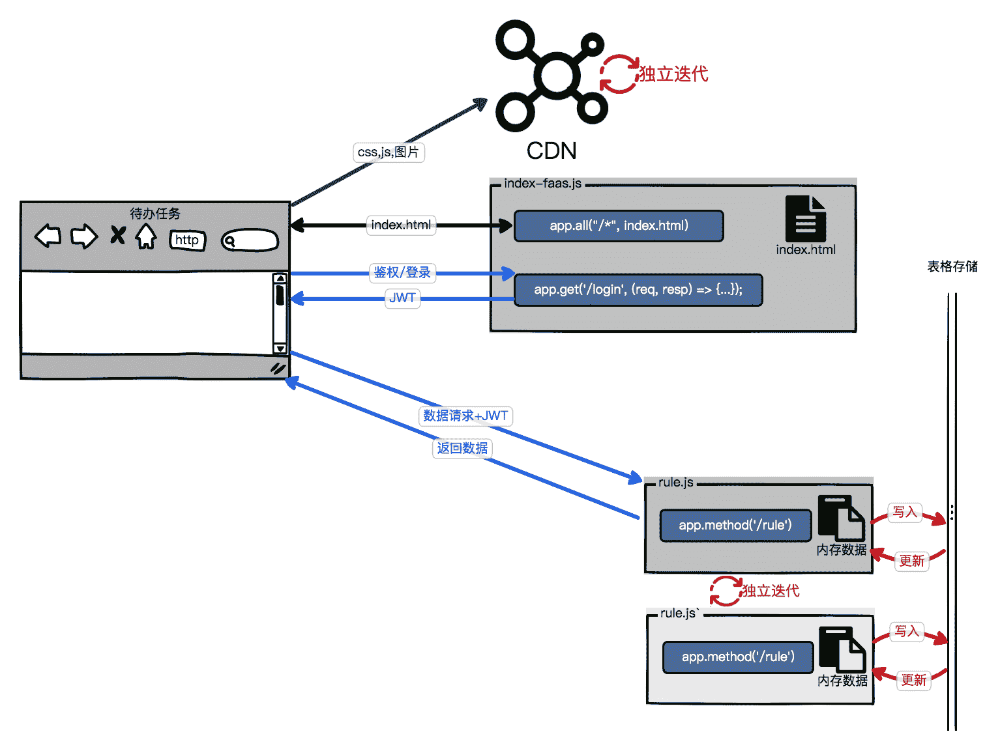
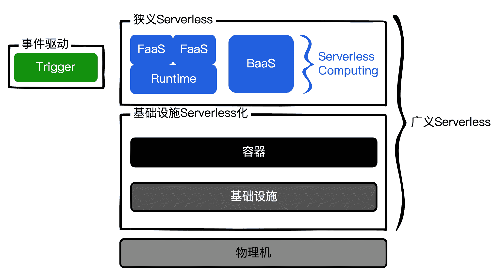
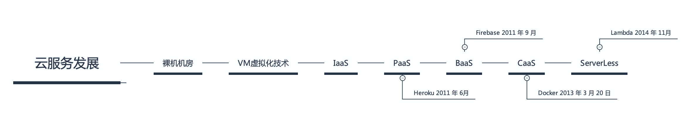
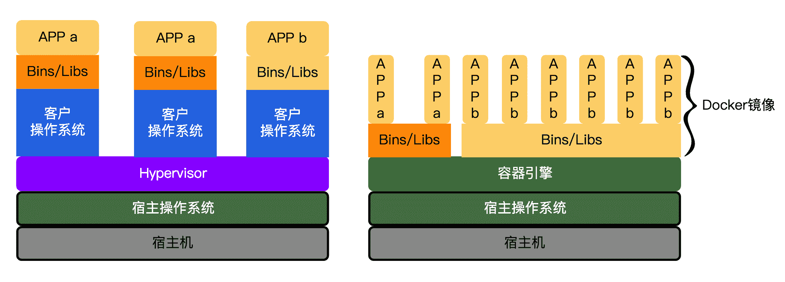
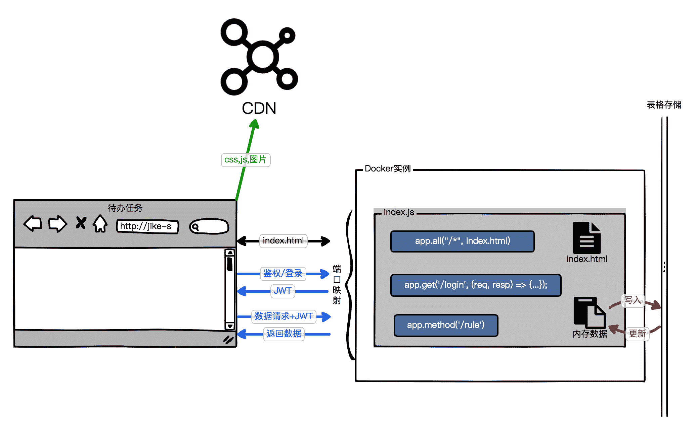
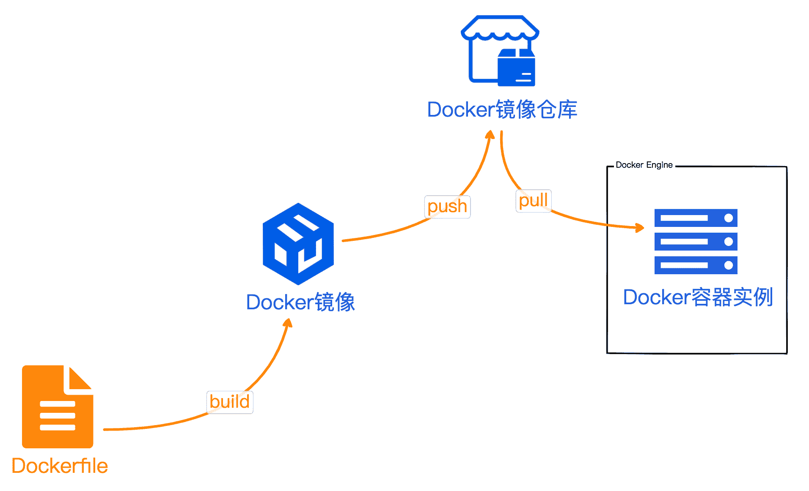
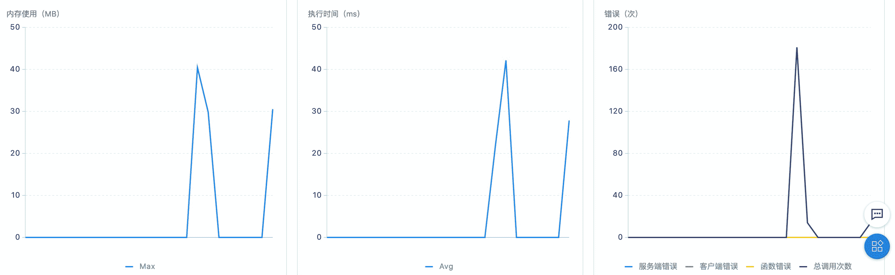
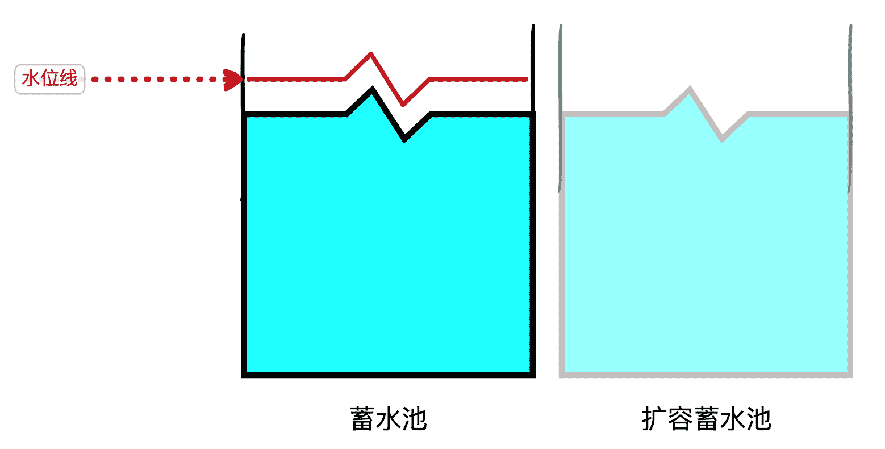

# 07 | 后端BaaS化（下）：Container Serverless

 

你好，我是秦粤。上节课，我重点给你讲了业务逻辑的拆和合，拆的话可以借助 DDD 的方法论，也可以用动态网络的思想让微服务自然演进；合的话，我们可以用代码编排，也可以用事件流来驱动。另外，我们还了解了微服务拆解后会带来的安全信任问题，这可以通过微服务的跨域认证 JWT 方案解决。我们还了解了后端应用要支持快速迭代或发布，可以参考微服务搭建灰度发布流水线，也就是发布管道。其实我们在使用 FaaS 过程中遇到的很多问题，都可以借助或参考微服务的解决方案。

现在我们再回顾一下 BaaS 化后的“待办任务”Web 服务，我们已经将后端拆解为用户微服务和待办任务微服务，前端用户访问我们的 FaaS 服务，登录后获取到 JWT，通过数据接口 +JWT 安全地访问我们的微服务。而且我们的 FaaS 和微服务都具备了快速迭代的能力。



BaaS化后的“待办任务”Web服务

到这里，我要指出我之前 rule-faas.js 的一个 Bug，如果你之前亲自动手做过实验的话，估计也有发现。这个 Bug 的直接表现是用户初次请求数据时，如果触发了冷启动，返回的待办任务列表就会为空。

究其原因，是因为冷启动时连接数据库会有延时，这直接导致了第一个请求返回的待办任务列表还未同步到消息队列的数据。要解决这个 bug，我们可以用之前讲过的预热 FaaS 或预留实例的方式，但你也要知道，FaaS 函数扩容时，新启动的函数副本也会出现同样的问题。

我前面卖了很多关子，其实 FaaS 在设计时已经考虑到这个问题了，所以在 FaaS 的“函数配置”里，都会提供一项“函数初始化入口”的选项。但你会发现，它同时也会让你配置初始化时间，最少 1 秒。还记得我们在[第 2 课]，讲函数执行阶段的一人一半的函数代码初始化时间吗？没错，就是那个时间。

当你配置了“函数初始化入口”，每次启动 FaaS 实例时，系统都会先等待初始化函数执行，而且在函数初始化时间结束后，才会继续执行函数。而从目前平台的配置来看，初始化时至少也需要 1 秒的时间（你去云服务商后台就能看到）。

对很多事件触发的应用场景，FaaS 增加几秒的初始化时间，影响并不大。但对很多后端应用则不然，尤其是 Java 等语言，如果软件包比较大，启动和初始化的时间会更长。

要缩短或绕过初始化的时间，我们要尽可能地利用 Runtime 里面给我们提供的内置能力，例如我们 BaaS 化一直提倡使用服务编排和 HTTP 接口，就是因为云服务商 SDK 和 HTTP 协议，所有语言的 Runtime 里都内置了。

那什么是 Runtime 呢？Runtime 其实就是运行我们代码所需要的函数库和二进制包。FaaS 中的 Runtime 是云服务商预先设计好的，会放一些常用的函数库和二进制包进去，相当于是平台的能力。

但是当我们后端应用 BaaS 化后，想采用 FaaS 方案部署的话则会碰到 Runtime 这个拦路虎。FaaS 虽然已经支持多数主流后端语言，但后端应用根据业务需求，要依赖特殊的函数库或二进制包，FaaS 的官方 Runtime 就无法支持。而且像 Java 等语言，在代码包较大的情况下，FaaS 启动速度很慢，也不适合。例如 Node.js 的 Runtime，其实也包括我们自己安装的 NPM 包，所以相当于我们可以部分定制。但是你也注意到了，我们是整个目录包括 node_modules 一起上传的，也就是说涉及编译的 NPM 包是无法跨操作系统生效的。这种场景下 FaaS 的 Runtime 不可控就会成为我们难以绕过的问题了。当我们遇到 FaaS 无法解决的场景，我们就可以考虑下降一层，使用 FaaS 的底层支撑技术 Docker 容器了。



广义Serverless

还记得我们[第 1 课] 中的广义 Serverless 的图吗？基础设施中的容器，一般情况下指的就是 Docker 容器。Docker 这个技术你肯定或多或少已经用过了，使用它们可以将应用代码和代码依赖的 Runtime 一起打包成一个 Docker 镜像。这个 Docker 镜像，可以在云上、自己的笔记本电脑、同事的电脑上无畅运行，并且完全不用担心环境依赖的问题，因为我们应用的依赖也打包在一起了。

到这里，我们又引入了 Docker 的概念，Docker 出现之后，CaaS（Container as a Service）很快也就流行起来了。为了帮助你理解 IaaS、PaaS、BaaS、CaaS 这几者的关系，我画了张图，希望能从云服务发展的角度，帮你梳理下脉络。



云服务发展进程

图片很好理解，我就不解释了。不过这里要解决一个你可能会有的疑惑：为什么 BaaS 的出现，比 Serverless FaaS 还要早三年？那是因为早期出现的 BaaS 其实是 mBaaS（移动后端即服务），这概念当时也曾经火过一段时间，现在已经被 Google 收购的 FireBase 其实就是做的这个生意。mBaaS 设计之初是专门为移动端提供后端服务的，例如用户管理、角色服务、文件存储服务等等。除了服务对象是移动端之外，跟我们说的 BaaS 概念很像。移动端可以将 BaaS 的所需鉴权算法放到客户端中，并随着客户端的版本定期更新秘钥。但前端却做不到，因此 mBaaS 只局限在移动端，没有火起来。直到 FaaS 的出现，才诞生了 BaaS 的使用场景，mBaaS 也开始转型，支持更广范围的前端场景了。

VM 是一种虚拟化技术，这个我们都知道，其实 Docker 也是一种虚拟化技术，只不过它是利用新版 Linux 内核提供 Namespace、Cgroups 和 Union File System 特性，模拟操作系统的运行环境。它跟虚拟机 VM 最大的区别在于，Docker 是进程模型的。怎么理解这句话呢？我们需要画一张图。



Docker进程模型

从图中我们可以看出，虚拟机是在宿主机上启动一个虚拟机监视器 HyperVisor 管理控制虚拟机的。而虚拟机自身包含整个客户操作系统、函数库依赖和用户的应用，虚拟机操作系统之间相互都是隔离的。经典的 HyperVisor 就是 VirtualBox[1]，你感兴趣的话可以下载体验一下。你也可以试想一下，如果我们我们一台虚拟机部署一个微服务，其实资源利用率是很低的。

容器实例则只包含函数库依赖和用户的应用，操作系统是依赖宿主机的用户态模拟的，也就是说容器之间是共享宿主机内核的。所以 Docker 更加轻量，启动速度更快，代码执行速度也更快。

Docker 的容器呢，因为只包含函数库依赖和用户的应用，可以部署到任意 Docker 引擎上，而 Docker 引擎呢，可以安装在你的个人电脑、公司机房或者云上。通常我们容器移动时，是移动容器的硬盘快照，内存中的状态我们比较难复制，这个硬盘快照就是 Docker 镜像。我们给 Docker 的镜像打上标签，标签就像是镜像的唯一标识符 URI，打上后它就可以到处移动了。这个也是 Docker 的核心概念：build、ship、run。

其实你会不会觉得，Docker 的这个层级结构有些眼熟？是的，这正是我们[第 2 课] 中讲的 FaaS 分层。我们回想一下，我当时所说的操作系统容器就是 Docker 模拟的，Runtime 其实就是 Bins/Libs 层。云服务商的冷启动加速，就是利用 Docker 镜像缓存加速。我想你也应该猜到了，其实很多云服务商 FaaS 和 PaaS 的底层技术就是容器即服务 CaaS。

那么接下来，我们就体验一下 Docker 的便利吧。我们的“待办任务”Web 服务，只要添加一个文件，就可以让它变成 Docker 镜像了。

## Docker 再探

这里我建议你，最好自己在电脑上安装体验一下 Docker。在主流的操作系统数安装 Docker 都不难的，只需要下载安装包就可以了。

### build: Dockerfile

构建是 Docker 最重要的一环。Docker 镜像是硬盘快照，那我们就看看标准的 Docker 硬盘快照如何制作吧。下面就是我们在代码根目录下增加的文件，供你参考：

```
# FROM是指我们的镜像基于哪个镜像来构建，我们这里是基于jessie linux的Node.js镜像  
FROM registry.cn-shanghai.aliyuncs.com/jike-serverless/nodejs  
# ENV是设置环境变量  
ENV HOME /home/myhome/myapp  
# RUN是执行一段命令  
RUN mkdir -p /home/myhome/myapp/public  
# COPY是将当前目录下的内容拷贝到容器中  
COPY . /home/myhome/myapp  
COPY public /home/myhome/myapp/public/  
COPY node_modules /home/myhome/myapp/node_modules/  
# WORKDIR是设置进入容器后的工作目录  
WORKDIR /home/myhome/myapp/  
# ENTRYPOINT是容器启动后执行的脚本  
ENTRYPOINT [ "node","index.js" ]
```

通常我们使用 Docker 前，先去 Docker Hub 上，找合适的基础镜像。看看基础镜像上都安装了哪些函数库或二进制包，再对比一下要运行自己的应用还缺少哪些函数库和二进制包。在基础镜像的层级上，加上自己的依赖。这样我们就构建好适合自己的镜像了。以后我们就能 FROM 自己的基础镜像，构建自己的应用了。

然后你在项目下执行：`docker build` 命令，就可以帮你构建 Docker 镜像了。

```
docker build --force-rm -t myapp -f Dockerfile .
```

构建好的镜像，我们可以通过 `docker run` 这个命令在本地调试。

```
docker run -d -p 3001:3001 -e TEST=abc  myapp:latest
```

然后我们通过浏览器访问http://127.0.0.1:3001，就可以看到我们刚刚构建的 Docker 内容了。你会发现，这不就是我们云上运行的版本吗？是的，既然 FaaS 是用 CaaS 技术实现的。我们当然也可以利用 Docker 实现我们的“待办任务”Web 服务。

为了方便 Docker 例子的展示，这节课的项目代码 index.js，包含了 rule.js 的逻辑。你会发现 index.js 中，我们启动的时候，不用关心初始化需要等待多少秒了，而是直到初始化完成后，才监听 3001 端口，而 Node.js 连接数据库的时间通常也只需要几十毫秒。



Docker版本的“待办任务”Web服务

另外为了方面你观察和调试 Docker 容器实例，我这里给出一个登录 Docker 容器实例的命令。

```
docker exec -it 容器ID bash

### ship: Docker Registry

本地调试完，我们再看看如何部署到云上。Docker 官方的镜像仓库[2]速度太慢，现在的云服务都支持私有的容器镜像仓库[3]，上面构建 Dockerfile 里面的 Node.js 镜像，就是用我自己的私有容器仓库搭建的。
```

你可以登录云服务的容器镜像服务，他们都会告诉你如何 `Docker login` 到私有 Registry，如何打标签，以及如何上传。

用我们的例子来说，大致会有下面的命令。

未登录过的话，要先登录 Registry。

```
docker login --username=极客时间serverless registry.cn-shanghai.aliyuncs.com
```

根据容器镜像仓库的 URI，打标签。镜像 ID 可以通过 `docker images` 查看。

```
docker tag 你本地的镜像ID registry.cn-shanghai.aliyuncs.com/jike-serverless/todolist
```

上传镜像到私有的 Registry 仓库。

```
docker push registry.cn-shanghai.aliyuncs.com/jike-serverless/todolist

### run: Docker Engine

运行 Docker 镜像就很简单了，云服务都支持容器服务 CaaS。你只需要购买好容器服务，就可以从自己私有的容器镜像仓库 Docker Registry 中下载镜像，并运行了。你要是执行过上面的例子，那相信你也能体会到为什么 FaaS 的冷启动速度这么快了。不过需要提醒你一下，这里会产生费用。
```



运行Docker镜像示意图

另外，我们的专栏是讲 Serverless，但是为了让你理解 Serverless 底层的实现，所以我们也讲到了 Docker 容器的部分内容。对于我们专栏来说，你不用尝试部署云上容器了。

恭喜你，获得 DevOps 奖章一枚！

现在我们了解了容器，也知道了 FaaS 是构建在容器上的。我们的微服务和整个应用都可以部署在 CaaS 之上，容器对我们来说更加可控，因为我们可以通过 Dockerfile 安装我们需要的各种函数库依赖或者二进制文件。但这里还有一个问题，FaaS 的扩缩容是怎么做到的呢？我们如果采用了容器，容器如何做到扩缩容呢？

## FaaS 与 Docker 的扩缩容

FaaS 中的扩缩容，我们可以通过云控制台看到在 FaaS 函数配置中的“单实例并发度”。FaaS 的做法比较简单粗暴，需要我们告诉函数服务，我们的单个函数实例可以承载多少的并发量，如果事件触发并发量超出了这个并发度，则会自动扩容。扩容的数量 N，就是这个事件触发量除以单机并发量取整。例如我们设定，我们 rule-faas 函数的单实例并发度为 10，那么当用户并发量是 11 时就会扩容 2 个实例。如果用户并发量达到 100，就会扩容出 10 个实例。

这种做法其实是比较机械式的，我们再看看 FaaS 的“函数指标”监控图。你有没有想到，我们其实可以利用实时监控，去控制扩缩容？例如当单个函数实例承受不了时，内存使用率会越来越高，它的执行时间也会越来越长。



FaaS的“函数指标”监控图

是的，我们在使用 Docker 时，要考虑的就是：监控指标 metrics 以及扩容水位。

监控指标 metrics 就像 FaaS“函数指标”监控图那样，是一系列需要我们关心的单个容器核心指标，包括 CPU 利用率、内存使用率、硬盘使用率、网络连接数等等。

我们将监控指标中的各项数值想象成蓄水，我们监控就像一个蓄水池，一旦某一项超过了蓄水池，水就会溢出。所以，我们要设定**水位**告警。我们在蓄水池里面画上刻度，当水位到这个刻度，我们就马上给这个蓄水池扩容。



蓄水池案例

Docker 容器本身并不提供扩缩容机制，但我们要让 Docker 自动化扩缩容，就可以用监控指标和水位去设计扩缩容机制。我们需要实时监控容器状态，当容器状态的某一项数值过高时，我们就需要给容器扩容。FaaS 的弹性做法很简洁，而 Docker 的扩缩容机制弹性更高、更加可控。但是 Docker 容器，通常需要我们至少保持 1 个容器实例在线。相信你也知道了 FaaS 的预留实例是怎么做到的了吧？

讲到这里，不知道你发现没有，我们 BaaS 化的三讲，已经默默地实现了微服务的 10 要素。这也是为什么我一直说 BaaS 化和微服务高度重叠。

我们再来回顾一下微服务 10 要素。其中，API、服务调用、服务发现，我们可以通过 RESTful HTTP 接口实现；日志、链路追踪，我们没有展开，但我们可以依赖云服务商提供的日志采集解决；鉴权我们可以用跨域认证 JWT 解决；发布管道，需要我们搭建流水线发布管道；容灾性、监控、扩缩容，我们可以通过实时监控和扩缩容解决。到这儿呢，我们的高铁车厢也终于完成了。

这节课的内容挺多的，需要你动手消化吸收一下。下节课我们再看看，如何利用 K8s 调度我们的 Docker 容器。

## 总结

BaaS 化的内容，到今天，我们用了三节课讲完了，现在我们一起回顾一下。

我们讲后端应用 BaaS 化的问题，转换为后端应用 NoOps 微服务。所以我们先了解了微服务的 10 要素，并且看到微服务中如何通过消息队列将 Stateful 的节点，变成 Stateless 的。在微服务的拆解过程中，我们学习了微服务的拆解思想 DDD 和动态网络演进，以及拆解后带来的信任问题，需要我们加密身份认证。合并时，除了代码里面编排 HTTP 请求结果，我们还学习了事件流触发获取结果。为了让微服务能够快速迭代，我们还需要自己搭建流水线发布管道。

这节课我们通过 FaaS 和 BaaS 的初始化问题，向你介绍了 FaaS 和 BaaS 依赖的底层实现容器 Docker。Docker 也是一种虚拟化技术，它的核心理念是：build、ship、run。通过将我们的应用代码和应用依赖的函数库、二进制包，打包在一起的方式，解决应用开发环境和运行环境的一致性问题。我们可以借助 Docker 容器维持我们的应用实例，来解决初始化慢的问题。

我们还了解了 FaaS 的扩缩容逻辑是通过用户配置的“函数初始化入口”，以及固定的“初始化超时时间”配合“单实例并发度”来实现的。而我们在容器 Docker，其实可以采用实时监控配合扩容水位，来做到更加弹性的扩缩容策略。

接下来我会通过 K8s 实践我们目前所学到的内容，我们的“待办任务”Web 服务，将在我们本地搭建的 CaaS 环境和 Serverless 环境中开发和调试。

## 作业

首先，拉取我们lesson07的代码，为“待办任务”部署的 rule-faas 函数添加初始化入口。

这节课的作业呢，就是我们要在本地完全通过 Docker 容器，搭建起我们的“待办任务”Web 服务。除了 css 和 js 静态资源是来自 CDN，其它内容都将运行在 Docker 容器里。

相信你可以通过这个作业，体验到 FaaS 的底层 CaaS 的运行机制。

当然如果你有预算，也可以将 Docker 镜像上传到云服务商的 Registry，在云上购买容器服务就可以部署你的 Docker 镜像，并在云上运行我们的“待办任务”Docker 版本了。这样你就拥有了一个永不停机的 Docker 服务。

另外，我也希望你可以帮助我继续优化我们的课程作业代码。如果你有更好的建议，也可以通过 Github 的 MergeRequest 告知我。

接下来就期待你的作业和建议了。如果今天的内容让你有所收获，也欢迎你把文章分享给身边的朋友，邀请他加入学习。

## 参考资料

[1] https://www.virtualbox.org/

[2] https://docs.docker.com/get-docker/

[3] https://hub.docker.com/
