# 09 | 搭建私有Serverless（二）：基于K8s的Serverless

 

你好，我是秦粤。上节课我向你介绍了云原生基金会 CNCF 的重要成员 K8s，它是用于自动部署、扩展和管理容器化应用程序的开源系统。通过实践，我们在本地搭建 K8s，并将“待办任务”Web 服务案例部署到了本地 K8s 上。K8s 这门技术，我推荐你一定要学习下，不管是前端还是后端，因为从目前的发展趋势来看，这门技术必定会越来越重要。

今天这节课我们就继续学习如何搭建私有的 Serverless 环境。具体来说，我们会在上节课部署本地 K8s 的基础上，搭建 Serverless 底座，然后继续安装组件，扩展 K8s 的集群能力，最终让本地 K8s 集群支持 Serverless。

## 搭建 Serverless 的前提

在开始之前，我们先得清楚一个问题，之前在基础篇讲 Serverless Computing，也就是 FaaS 的时候，也有同学提问到，“微服务、Service Mesh 和 Serverless 到底是什么关系？”

这些概念确实很高频地出现在我们的视野，不过你不要有压力，我在学习 Serverless 的时候也被这些概念所困扰。我们可以先回顾下微服务，我们在用微服务做 BaaS 化时，相信你也发现了微服务中有很多概念和 Serverless 的概念很接近。

Service Mesh 简单来说就是让微服务应用无感知的微服务网络通讯方案。我们可以将 Serverless 架构的网络通讯也托管给 ServiceMesh。通过 Service Mesh，Serverless 组件可以和 K8s 集群复杂且精密地配合在一起，最终支撑我们部署的应用 Serverless 化。我们看下下面这张架构图：

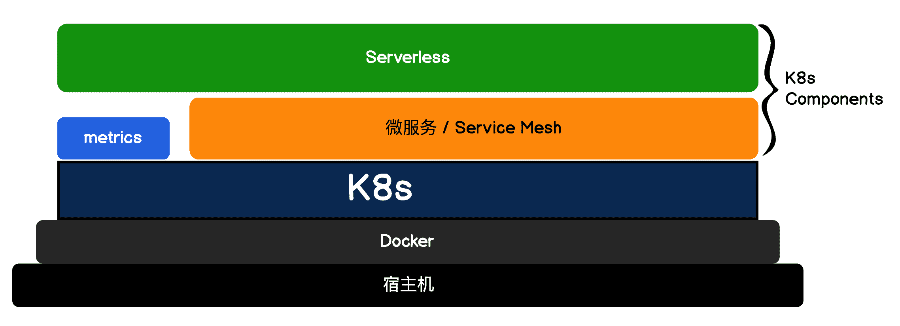

通过图示，我们可以清楚地看到：Serverless 的底层可以基于 Service Mesh 来搭建。但 Service Mesh 其实只是实现 Serverless 网络通讯的其中一种方案，除此之外还有 RSocket、gRPC、Dubbo 等方案，而我选择 Service Mesh 的原因是这套方案是可以基于 K8s 组件的，而且还提供了可视化工具帮助我们理解 Serverless 的运行机制，比如：如何做到零启动？如何控制灰度流量？等等。如果要实践，Service Mesh 无疑是首选。

## Serverless 底座：Service Mesh

有人把 Kubernetes、 Service Mesh 和 Serverless 技术称为云原生应用开发的三驾马车，到现在，我估摸着你也理解这其中的缘由了吧。这里我还是要说明下，我们后面几节课里引入了很多新名词，这些名词我基本都是走马观花大致给你过了下，让你有个宏观的了解。有时间的话，你还是应该再深入进去看看。

那么言归正传，我们现在具体看下 Service Mesh 的应用原理。

我们在讲微服务的时候，只是讲了拆解与合并的理论指导，并没有涉及到具体实现。那如果切换到实现的话，业界其实就有很多的微服务框架了，但大多数都是限定语言的 SDK，尤其是 Java 的微服务框架特别多。

而 SDK 版本的微服务框架，其实很重的一块都在于微服务之间网络通讯的实现。例如服务请求失败重试，调用多个服务实例的负载均衡，服务请求量过大时的限流降级等等。这些逻辑往往还需要微服务的开发者关心，而且在每种 SDK 语言中都需要重复实现一遍。那有没有可能将微服务的网络通信逻辑从 SDK 中抽离出来呢？让我们的微服务变得更加轻量，甚至不用去关心网络如何通讯呢？

答案就是 Service Mesh。我们举例来说明，还是用咱们的“待办任务”Web 服务来举例。

我们如果把拆解后的应用部署到 K8s 集群 Pod 中，过程就如下图所示，MyApp 应用会通过 HTTP 直接去调用集群内的用户微服务和待办任务微服务。

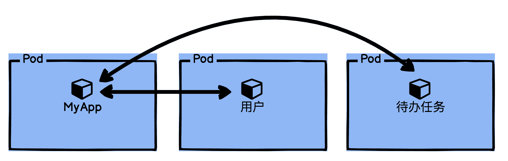

但 HTTP 直接访问，带来的安全性问题又怎么办呢？如果有人在我们的集群中启动一个 BusyBox 容器，那不就直接可以对我们的用户微服务和待办任务微服务进行攻击了吗？还有，当我们有多个用户微服务实例时，我们又该如何分配流量呢？

所以通常我们使用传统微服务架构 SDK，它里面会有大量的这种逻辑，而且有很多策略需要我们自己在调用 SDK 时去判断开启，我们的代码也将会和微服务架构的 SDK 大量地耦合在一起。

服务网格 Service Mesh 则是换了一种思路，它将微服务中的网络通信逻辑抽离了出来，通过无侵入的方式接管我们的网络流量，让我们不用再去关心那么重的微服务 SDK 了。下面我们看看 Service Mesh 是怎么解决这个问题的。

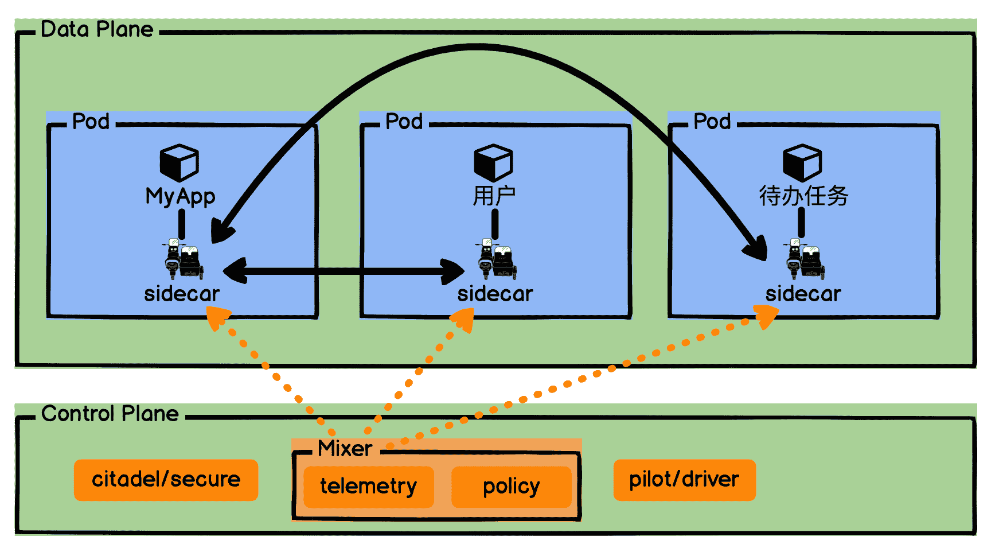

通过图示可知，Service Mesh 可以分为数据面板和控制面板，数据面板负责接管我们的网络通讯；控制面板则控制和反馈网络通讯的状态。Service Mesh 将我们网络的通讯通过注入一个边车 Sidecar 全部承接了过去。

数据面板中我们的应用和微服务，看上去直接跟 Sidecar 通信，但实际上，Sidecar 可以通过流量劫持来实现，所以通常我们的应用和微服务是无感的，不用有任何的改动，只是使用 HTTP 请求数据。

控制面板则复杂一些，它也是 Service Mesh 的运作核心。pilot 是整个 Control Plane 的驾驶员，它负责服务发现、流量管理和扩缩容；citadel 则是控制面板的守护堡垒，它负责安全证书和鉴权；Mixer 则是通讯官，将我们控制面板的策略下发，并且收集每个服务的运行状况。

现在你应该清楚 Service Mesh 是怎么回事了，它是怎么把微服务的网络通信逻辑从 SDK 中抽离出来的，我们又为什么说 Service Mesh 就是 Serverless 的网络通讯底座。

## Serverless 底座搭建：K8s 组件 Istio

那接下来我们就要动手搭建 Service Mesh 了。

首先，我们得扩大一下 Docker Desktop 操作系统的占用资源，这是因为我们后面在搭建的过程中需要创建一堆容器。我推荐你将 CPUs 配置到 4 核，内存至少 8GB，这是从我的经验出发一个较为合适的参数。

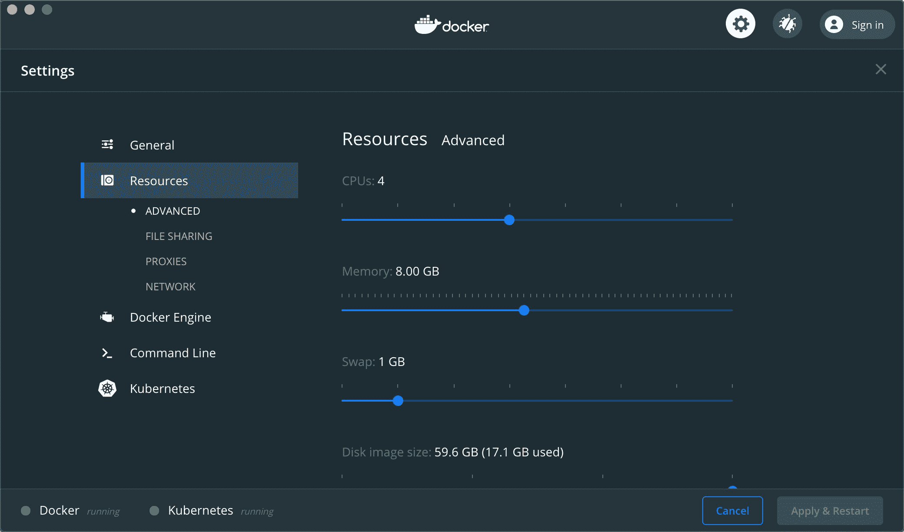

设置好后，我们需要用到 CNCF 的另外一位重要成员 Istio[1] 了，它是在 K8s 上 Service Mesh 的实现方式，用于连接、保护、控制和观测服务。有关它的详细介绍，我们在这就不展开了，不清楚的话可以查看我们的参考资料。

Istio 的安装脚本，我已经放在我们这节课的Github 仓库代码中了。下面我们要进入根目录下的 install-istio，这里 Istio 官方其实提供了 Istio 1.4.3 K8s 安装包，但为了简化大家的操作，我直接放到项目代码中了。

然后 kubectl apply 安装 Istio。

```
kubectl apply -f .
```

安装完毕后，我们就可以通过命名空间 istio-system 来查看 Istio 是否安装成功。

```
kubectl get all -n istio-system
```

相信你也发现了吧，这跟我们上节课中安装 metrics 组件一样，Istio 也是采用 K8s 组件 Component 的方式来安装的。

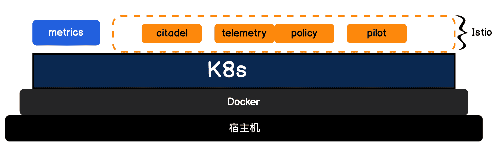

不过使用了 Istio 以后，还有一个细节需要我们注意：默认 Istio 不会开启 Sidecar 注入，这个需要我们手动开启。

我们可以通过给命名空间 default 打上 label，让我们部署的 Pod 自动打开 Sidecar。

```
kubectl label ns default istio-injection=enabled
```

Istio 会根据我们的标签去判断，当前部署的应用是否需要开启 Sidecar。

```
kubectl describe ns default
```

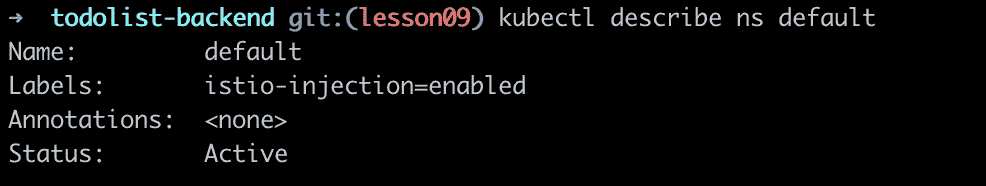

好了，我们现在可以部署我们的应用了。我们将项目目录下的 Dockerfile、Dockerfile-rule、Dockerfile-user 都用 Docker 构建一遍，并且上传到我们的 Registry。

```
docker build --force-rm -t registry.cn-shanghai.aliyuncs.com/jike-serverless/todolist:lesson09 -f Dockerfile .  
docker build --force-rm -t registry.cn-shanghai.aliyuncs.com/jike-serverless/rule:lesson09 -f Dockerfile-rule .  
docker build --force-rm -t registry.cn-shanghai.aliyuncs.com/jike-serverless/user:lesson09 -f Dockerfile-user .  
docker push registry.cn-shanghai.aliyuncs.com/jike-serverless/todolist:lesson09  
docker push registry.cn-shanghai.aliyuncs.com/jike-serverless/rule:lesson09  
docker push registry.cn-shanghai.aliyuncs.com/jike-serverless/user:lesson09
```

然后修改项目 istio-myapp 目录中的 YAML 文件，改成你自己仓库中的 URI。接着在 istio-myapp 目录下执行，kubectl apply“点”部署所有 YAML 文件。

```
kubectl apply -f .
```

部署完成后，我们通过 kubectl describe 查看一下 MyApp 服务暴露的端口号：

```
kubectl describe service/myapp
```

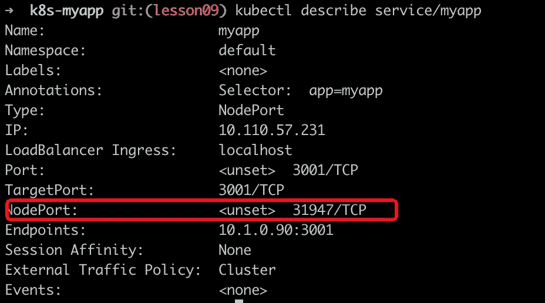

接下来我们用浏览器访问http://localhost:31947，就可以看到我们新部署的 MyApp 应用了。

你也许会好奇，这跟我们之前的有什么不同，Istio 都做了什么？

我们将 Istio 的控制面板服务 kiali 也通过 Service 暴露到端口上，访问一下看看。

```
kubectl expose deployment.apps/kiali --type=NodePort --port=20001 --name='kiali-local' -n istio-system
```

然后查看一下 kiali 的本地端口号。

```
kubectl describe svc kiali-local -n istio-system
```

接着用浏览器打开 kiali，进入后你就可以看到我们应用调用微服务的网络拓扑图了。怎么样，是不是很惊艳？

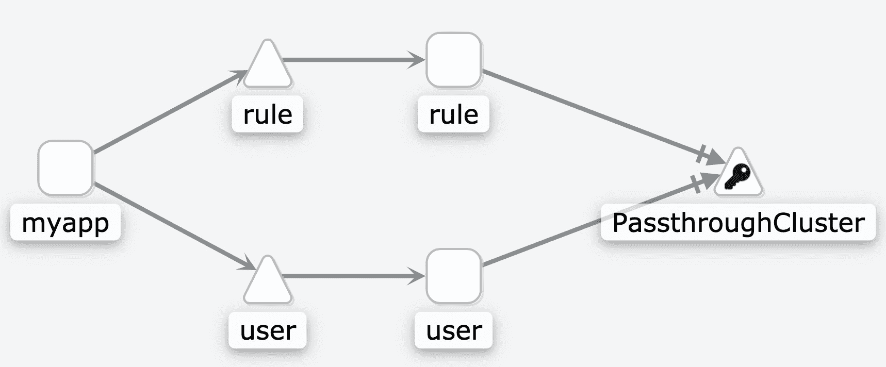

Service Mesh 可以协助我们处理应用和微服务网络的连接、保护、控制和观测问题。综上，再次总结下，Serverless 的底层，我们完全可以依赖 Service Mesh 来处理复杂的网络问题。

最后演示完，我们就可以通过 kubectl delete 清除刚刚部署的应用，注意要在 istio-myapp 目录下执行。

```
kubectl delete -f .
```

到这儿，部署好 Istio Service Mesh，Serverless 的底层部署，我们就已经实现了一大半。

## Serverless 完整实现：K8s 组件 Knative

现在，就还剩最后一步，安装组件了。如果你能想到，在 Service Mesh 的底座上，还需要加上哪些组件才能满足我们 Serverless 的需求，说明你已经真正地理解了 K8s 的组件 Component 的威力了。

接下来我们就基于 Istio，看看 Serverless 在 K8s 的架构方案上还需要添加哪些内容。

Knative 是通过整合：工作负载管理（和动态扩缩）以及事件模型来实现的 Serverless 标准，也叫容器化 Serverless。

Knative 社区的主要贡献者有：Google、Pivotal、IBM、Red Hat，可见其阵容强大。还有，CloudFoundry、OpenShift 这些 PaaS 提供商都在积极地参与 Knative 的建设。参考资料中我还放了“由阿里云提供 Knative”的电子书，这里作为福利送给你。

接下来我们看看 Knative 是怎么做到 Serverless 的吧。

Knative 在 Istio 的基础上，加上了流量管控和灰度发布能力、路由 Route 控制、版本 Revision 快照和自动扩缩容，就组成了 Server 集合；它还将触发器、发布管道 Pipeline 结合起来组成了 Event 集合。

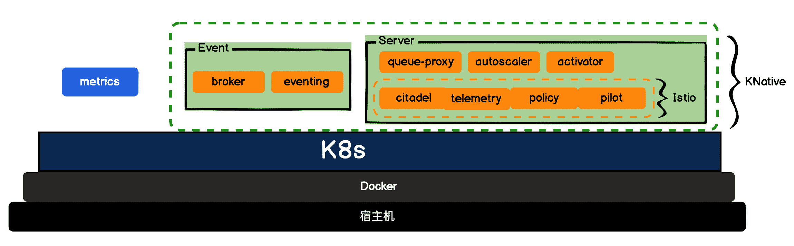

我们近几节课都有操作 K8s，其实你应该能感觉到，它还是有些复杂的。Knative 提供的应用托管服务可以大大降低直接操作 K8s 资源的复杂度和风险，提升应用的迭代和服务交付效率。

我们还是以“待办任务”Web 服务为例，看看 Knative 是怎么做到的吧。

首先进入项目 install-knative 目录，执行 kubectl apply 安装 Knative。

```
kubectl apply -f .
```

安装完毕，你就可以通过命名空间 knative-eventing 和 knative-serving，看到我们都安装了哪些组件。

```
kubectl get all -n knative-serving  
kubectl get all -n knative-eventing
```

Knative 帮我们部署了一套自动运维托管应用的服务，因此我们要部署应用，才能看到效果。我们再进入项目 knative-myapp 目录，执行 kubectl apply。

```
kubectl apply -f .
```

到这，我们的应用就部署起来了。要访问应用也比 Istio 要简单，通过 get kservice 我们就可以查看部署的应用域名。

```
kubectl get ksvc
```

这个域名其实是通过 Istio-ingress 部署的，我们再看看 Istio-ingressgateway 的信息。

```
kubectl get svc istio-ingressgateway -n istio-system
```

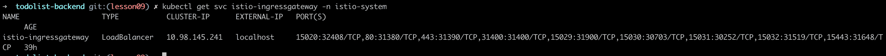

我们可以看到，它绑定到我们本地 IP:localhost 上了，所以我们只需要添加一下 Host，绑定我们 MyApp 的域名到 127.0.0.1 就可以了。

```
// Mac上host文件地址是/etc/hosts  
127.0.0.1 myapp.default.example.com
```

然后我们就可以用浏览器直接访问我们的域名 myapp.default.example.com，进入“待办任务”Web 服务了。如果你多刷新几次页面就可以看到右上角我的名字，有时是“秦粤”有时是“粤秦 D”。这其实是因为我的 user 服务开启了 2 个版本，而且我设置了 50% 的流量进入版本 v1，50% 的流量进入版本 v2。另外我们还需要在页面上多点击几下，这是为了让我们查看 Kiali 的网络拓扑图时有数据。

目前 Knative 还没有官方的控制台，所以最后我们再看看 Istio 中 Kiali 的网络拓扑图，如果忘记了如何访问 Kiali 请看上一节，介绍 Istio 中的内容。

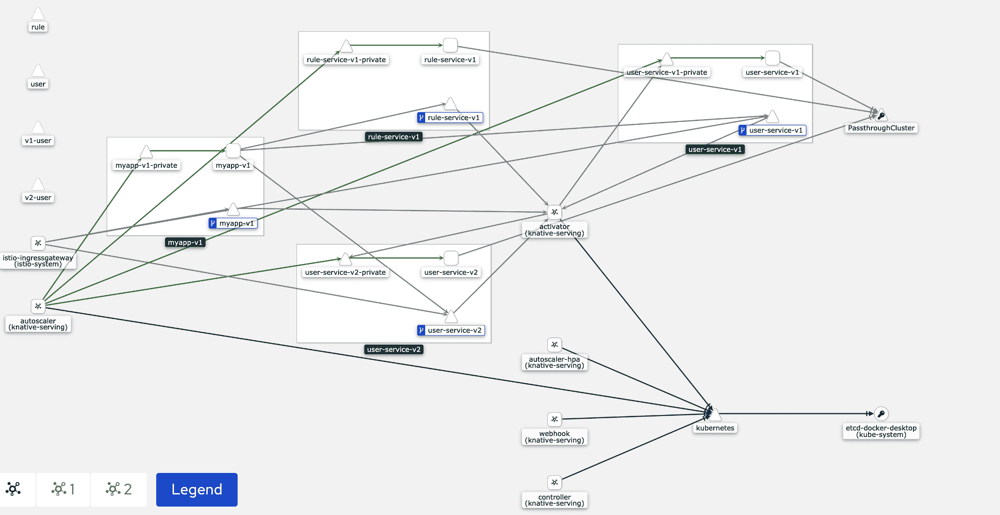

你看，网络拓扑图是不是变得更复杂了？当然，因为 Knative 也是隐藏了一堆的内容，来简化应用和微服务的部署。好了，实践完，我们就再来看看原理，请看下图：

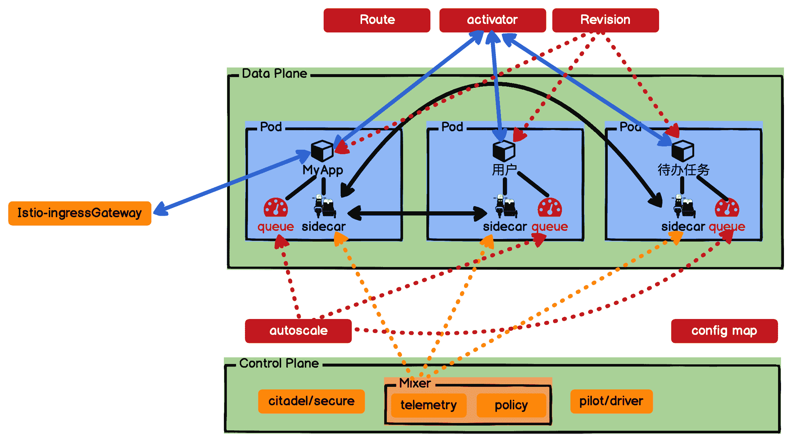

我来解释下这张图。为了让你更好地识别，我用红色表示 Knative 添加的组件，橙色表示 Istio 的组件。首先我们看到 Knative 又给每个 Pod 里面添加了一个伴生容器 queue，它是专门用来实时采集反馈我们部署应用容器的监控指标 metrics 的，收集到的信息会反馈到 autoscale，由 autoscale 决定是否需要扩缩容。

然后我们看看请求，从上面的操作，我们知道浏览器的 HTTP 请求是访问 Istio-ingressGateway 的，我们还需要绑定域名。这是因为 Istio-ingressGateway 是域名网关，它会验证请求的域名。我们的 MyApp 应用，接收到请求会调用用户微服务和待办任务微服务，这时就会访问 activator 了，这个是 Knative 比较重要的组件，它会 hold 住我们的请求，并查看一下目前有没有活跃的服务，如果没有，它会负责拉起一个服务，等服务启动后，再将请求转接过去。这也就是为什么 Serverless 可以缩容到 0 的原因。

另外，我再啰嗦一下，当我们的 autoscale 配置了可以缩容到 0，如果一段时间没有请求，那么我们每个应用都会处于很低的水位，这时 autoscale 就会缩容到 0 了。当然我们的 MyApp 应用不可以缩容到 0，因为它需要接收入口请求。

当 MyApp 有流量进来请求用户服务时，此时 activator 就会临时接收请求，让请求等待；然后通知 autoscale 扩容到 1；等待 autoscale 扩容到 1 完毕后，activator 再让用户容器处理等待的请求。

而我们在 Knative 中每次发布服务，都会被 Revision 组件拍一个快照，这个快照可以用于我们管理版本号和灰度流量分配。我们“待办任务”Web 服务中的用户微服务的 2 个版本流量切换，其实就是利用 Revision 和 Route 实现的。

## 总结

这节课我首先介绍了 Service Mesh。Service Mesh 通过 Pod 给我们的应用容器注入了一个伴生容器 Sidecar，配合控制面板来接管我们应用和微服务的网络流量，从而实现网络流量的连接、保护、控制和观测。

接着我介绍了 CNCF 的另一位重要成员：Istio，它是基于 K8s 组件实现的 Service Mesh。我们在 Istio 的基础上又搭建了 Knative，它也是基于 K8s 组件实现的一套 Serverless 方案。

总结来说就是，Service Mesh 是一种微服务网络通讯方案，它通过 Sidecar 和控制面板接管了上层的网络通讯，可以让上层开发者无感知地使用网络通讯。我们可以复用 Service Mesh 的网络通讯能力，部署 Serverless 架构。通过 Service Mesh、Serverless 组件和 K8s 集群复杂且精密地配合，支撑我们部署的应用 Serverless 化。

另外我需要提醒你一下，Knative 是容器 Serverless 方案，所以你在容器里面运行函数、微服务或者应用都可以，这完全取决于你的 Dockerfile 里面“编排”的是什么内容。我们这节课介绍的 Knative，可以让你既部署 FaaS 也部署 BaaS。还记得我们[第 1 课] 讲过：FaaS 和 BaaS 都是基于 CaaS 实现的，Knative 正是一种容器服务 Serverless 化的产物。我们将[第 1 课]和这节课的架构图映射一下，相信你对 Serverless 的实现会有新的体会。

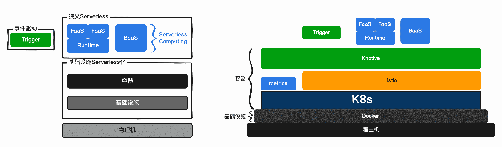

## 作业

这节课是实战课，所以作业就是我们今天课程中的内容。请在上节课安装的 K8s 集群的基础上，先安装 Istio 组件，部署 Istio 版本的“待办任务”Web 服务；再安装 Knative 组件，部署 Knative 版本的“待办任务”Web 服务。实践结束后，你可以在 Docker Desktop 中关闭 K8s 集群，这样就能清掉我们这两节课创建的所有资源了。

大胆尝试一下吧，期待你能与大家分享成果。如果今天的内容让你有所收获，也欢迎你把文章分享给更多的朋友。

## 参考资料

[1] https://istio.io/
