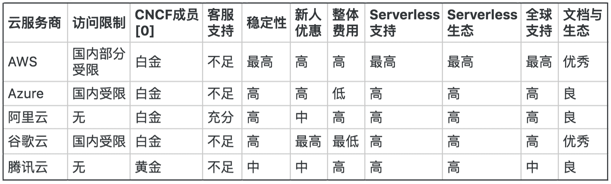
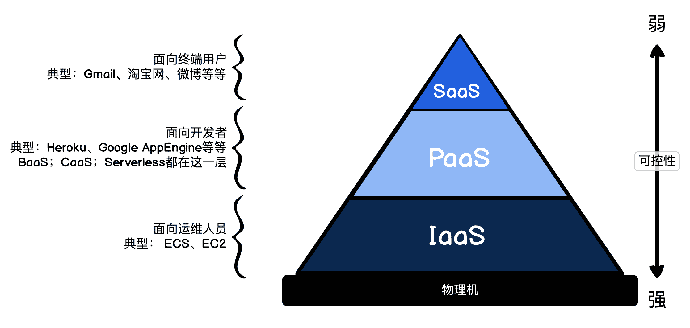
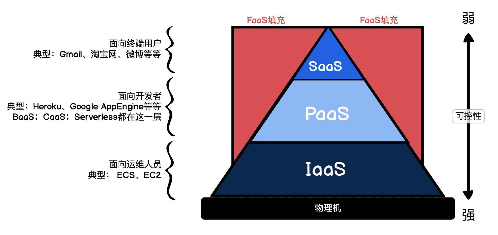
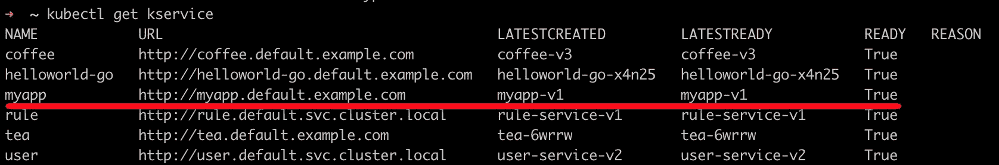
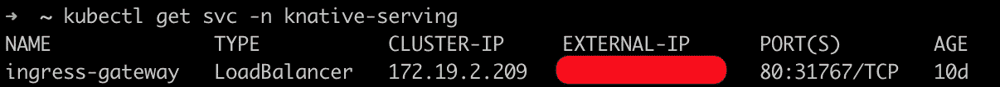
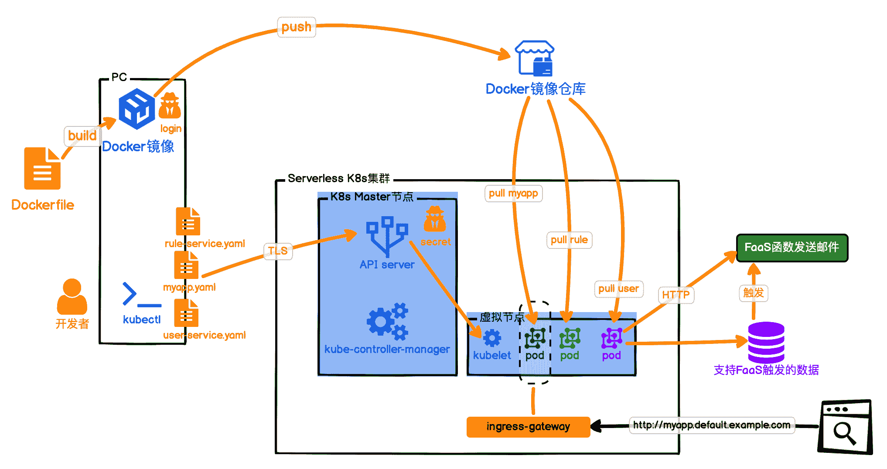

# 10 | 经验：Serverless架构应该如何选型？

 

你好，我是秦粤。通过前面的两节实践课，我们体验了在本地环境中搭建 K8s，并且我们利用 K8s 的组件扩展能力，在本地的 K8s 上安装了 Istio 和 Knative。正如我在前面课程中所说的，K8s 可以让我们的集群架构，轻松迁移到其他集群上，那么今天我就带你将我们本地 K8 上部署的“待办任务”Web 服务部署到云上的 K8s 集群。

实践课里还有这么个小细节，不知道你注意没，我们使用 Knative 时，应用和微服务部署都需要关心项目应用中的 Dockerfile，而我在使用 FaaS 函数时，连 Dockerfile 都不用管了，其实这就是 Serverless 带来的变革之一。当然，现在有很多应用托管 PaaS 平台，也做了 Serverless 化，让我们部署一个应用时只需要关心 Release 分支的代码合并，例如 Heroku、SAE 等等。

这里我需要先解释一下，K8s 集群的运维工作对于很多个人开发者来说，是有些重的。我们通常了解基本知识，用 kubectl 调用 K8s 集群就可以了。咱们课程里，我是为了让你更好理解 Serverless 的工作原理，所以才向你介绍 Knative 在 K8s 上的搭建和使用过程。

实际工作中 K8s 集群的运维，还是应该交给专业的运维人员。另外，云服务商的 K8s 集群，都会提供控制面板，一键安装组件。我们在使用 Serverless 的部署应用时，不用关心底层“被透明化”的类似 Knative、Istio 等等插件能力，这也是 Serverless 应用的价值所在，虽然它本身的底层构建在复杂且精密的各种服务上，但我们使用 Serverless 却极其精简。

在开始部署 K8s 上云之前，我们要先选择一个云服务商。正如我们上节课所说，K8s 整体架构迁移能力，可以帮我们破解 Vendor-lock，只要我们部署的云服务商是 CNCF 的成员，支持 K8s 集群就可以了。实际上目前几乎所有的云服务商都加入了 CNCF 阵营。因此，我们的 K8s 版本的“待办任务”Web 服务，可以任意选择云服务商部署，你完全可以横向对比云服务商的各项指标去选择适合自己的。当我们有了选择权，也反向促进了云服务商的良性竞争。

## 云服务商

我们先看看 2019 年的全球云服务商的市场占有率数据，我也将按照这个数据排名，依次向你介绍云服务商和他的主要特色：

1. 亚马逊的 AWS 市占率 32.4%。亚马逊凭借庞大复杂的全球电商业务，让其机房做到了覆盖全球，并引领云服务的发展，提供最全面的生态和最高稳定性的服务。云服务商老大的地位近年内都难以撼动。
2. 微软的 Azure 市占率 17.6%。依赖微软 Windows 全家桶的优势和近年的 JavaScrpit 技术社区的收购或者并购，他的市场地位紧跟亚马逊之后。整体云服务产品的报价也紧盯 AWS，所有服务价格略低于 AWS。
3. 阿里巴巴的阿里云，市占率 6.0%。国内市场占有率第一，随着阿里电商业务出海，阿里云机房也部署到了海外。在国内云里生态建设得比较完备，每年都经受双十一流量的洗礼，不断打磨稳定性。客服响应速度是一大亮点。
4. 谷歌的谷歌云，市场占有率 5.4%。谷歌是后起之秀，凭借 15 年提出 CNCF 云原生白皮书，通过建立规范和开源生态，迅速切入云服务领域并占有一席之地。价格策略上紧盯 AWS，并依靠 Google 的搜索引擎对大规模集群调度能力的积累。云服务商中最高的物理机资源利用率，让谷歌云的价格做到了云服务商中的最低。
5. 其他云，市场占有率 38.5%。腾讯云、华为云等其他的云服务商都归并到了这里，还有一些专门做专有云服务的，比如 CDN 全球加速的 Akamai，PaaS 应用托管的 Heroku 等等。值得一提的是腾讯云，腾讯云从 2019 年开始大力发展 Serverless，并积极和 Serverless 生态合作，估计是希望以此为突破点提升自己的市场占有率。

下面是我按我目前（注意只是目前）掌握的数据和认知整理的表格，在选择云服务商时你可以作为参考。其中访问限制应该是最优先考虑的，国内运营部署的应用，肯定是要首选国内云服务商。



当我们完成云服务商的选择后，理论上我们可以通过 Docker 容器，创建我们所需要的各种服务，例如 Redis、MySQL、Kafka 等等。具体怎么做，你应该很熟悉了，先去 Docker Hub 官网，找到我们所需要的服务镜像，在这个镜像的基础上加上我们自己的用户名和密码，生成私有 Docker 镜像上传到我们的 Registry，然后在 K8s 集群中就可以部署了。这也是前面我们讲到的 Docker 容器带来的颠覆式体验。

不过，我们在重度使用 Docker 技术的同时，也必须深入了解 Docker 和我们所用的具体镜像的限制。比如，如何解决应用镜像硬盘持久化的问题、如何解决 MySQL 镜像的容器扩缩容的问题、Kafka 镜像集群如何搭建等等。这些都是新技术引入的新的问题，而且解决方案和传统运维虚拟机也不一样。

另外，为了提升我们的研发效能，我们还应该进一步了解云服务商还能为我们提供哪些能力，节省我们的时间和成本。当我们开发一个云上项目时，云服务商已经为我们准备了各种行业解决方案，来提升我们的开发速度，例如文件存储服务、视频媒体流转码服务、物联网 MQTT 解决方案等等。利用这些服务和我们前面讲的服务编排，可以进一步加速我们的研发速度。

## 云服务如何选型？

现在云服务商都提供数以百计的各种服务，但大体上我们可以分为以下 3 类：IaaS、PaaS 和 SaaS。



我们先看看图示中的金字塔，这里我需要引入新的概念服务级别协议 SLA：服务提供商与受服务用户之间具体达成了承诺的服务指标——质量、可用性、责任。看上去有些绕，简单来说，就是服务不达标，我们可以向云服务商索赔损失。

我们前面课程中所说的，消息队列的稳定性达到 10 个 9，其实就是指 SLA 指标数据可靠性为 99.99999999%，但是，消息队列的服务可用性其实是 99.95%，也就是说消息队列服务服务一年中不可使用时间为 4.38 小时，一旦不可用时间超过了这个要求，云服务商则需要向客户赔付（如果这部分知识你没接触过的话，可以看下赵成老师的这篇文章）。

因此对于云服务商来说，要维持资源的高可用性，必须保证资源调度及时，宁可浪费部分资源，也不能牺牲用户的可用性。而云服务的价格则和物理机虚拟化比例强相关，虚拟化比例越低，说明你对这个资源独占性越高，当然价格也就越高。物理机虚拟化比例，也是云服务商的资源调度能力，对云服务商来说核心指标就是 CPU 利用率。

了解了一些前提，接下来我们具体看看这 3 类。

1. IaaS 层是面向运维人员，服务器或虚拟机服务。可用性也最高，通常可以到 4 个 9，99.99%。可控性高，虚拟机从操作系统开始，你可以登录虚拟机，并且任意安装各种自己所需的函数库和二进制包。资源的物理机虚拟化比例，通常是 2:1 的，性能是最稳定的。
2. PaaS 层是面向开发者，通常部署在 IaaS 层之上，服务种类最为繁多。可用性低于 IaaS，通常是 99.95%。可控性中等，PaaS 通常都提供特定的服务，例如应用托管、数据库等等，我们只能通过提供的控制台登录。资源的物理机虚拟化比例，通常是 4:1，性能较稳定。
3. SaaS 层是面向终端用户，通常部署在 PaaS 层之上。可用性低于 PaaS，通常是 99.9%。可控性低，SaaS 直接面向用户提供服务，我们只能登录后台操作部分数据进行增删改查。资源的物理机虚拟化比例不太确定，但肯定超过 8:1，性能一般。

FaaS 则是一个特例，虽然它也属于面向开发者的，但利用 FaaS 极速的冷启动特性，它并不需要关心底层的高可用性。反而用它可以填满闲置的机器资源，提升物理机的资源利用率。这也是为什么在云服务商这么高的运作成本下，FaaS 还能免费提供给大家使用。



我介绍 SLA，主要是希望你能对云服务商提供的服务层级有个认识。我们在设计和运维自己的应用时，需要综合考虑到可用性和价格。FaaS 是性价比最高的，所以我们在日常使用时，如果有适合 FaaS 的场景，应该尽可能地使用 FaaS。

如果要深入了解云服务，我的经验是可以从云服务商网站的行业解决方案出发。先粗略了解一下，有哪些行业解决方案，便于我们掌握云服务商的能力边界。如果感觉比较凌乱的话，最好自己用“脑图”梳理一次。另外再说句题外话，我不建议你学习别人的脑图，因为脑图都是自己梳理思考的过程，你自己大脑的 Map 不一定适合别人，别人的 Map 也不适合你。

言归正传，我们自己在云上搭建 K8s 集群主要有 2 种方式：购买虚拟机自建和购买 K8s 集群。当然首推购买 K8s 集群，可以节省我们更多成本。K8s 集群的 Master 节点，阿里云 K8s 集群是不收费的，而我们自己搭建则需要至少一台虚拟机。虚拟机自建，比较适合大型或拥有强大运维团队的互联网公司。但无论是自建还是购买 K8s 集群，我们搭建的 K8s 集群的底层都是 IaaS。

## 云上部署 K8s 集群 Knative

了解完选型相关的知识，接下来我们还是动手实操一下。

我们这节课的 K8s 例子，选择了阿里云的 Serverless K8s 集群：ASK。这个 K8s 集群的特点是，Master 节点是免费的，只收取网关的费用，Worker 节点是虚拟节点，而我们 Pod 中的容器是通过 ECI 容器创建的。传统的 K8s 集群 ACK 的 Worker 节点，需要我们自己购买虚拟机授权 K8s 集群，初始化成 Worker 节点。ECI 是轻量级的 Docker 容器，同时具备高性能和低价格的优势。另外，ASK 的 Knative 功能是新上线公测的，推荐它还是因为性价比。

我们使用 K8s 集群，同样可以自己安装 Istio，再安装 Knative，只需要注意 K8s 集群的版本就可以了。但云服务商提供的 K8s 集群，通常都已经帮你准备好了控制台操作。所以实际上我们使用云端的 K8s 集群，要比本地搭建还要简单。所以，我们只需要在 ASK 控制台，左边 Knative（公测）中选择我们的 K8s 集群，点击“一键部署”就可以了。当然如果你选择的云服务商不支持“一键部署”，你可以通过查看 K8s 集群的版本号，选择对应的 Istio 版本和 Knative 版本，按照我们上节课所讲的内容，自行安装 K8s 组件。

另外为了方便新手，我还是需要提示一下如何在本地同时管理多个 K8s 集群。

首先我们打开本地的 kubectl 的配置文件：$HOME/.kube/config，我们可以看到，这个 K8s 集群的配置文件主要分为 3 个部分：clusters、contexts、users。

```
apiVersion: v1  
clusters:  
- cluster:  
    certificate-authority-data: xxx  
    server: https://kubernetes.docker.internal:6443  
  name: docker-desktop  
- cluster:  
    certificate-authority-data: xxx  
    server: https://k8s集群IP:6443  
  name: kubernetes  
contexts:  
- context:  
    cluster: docker-desktop  
    user: docker-desktop  
  name: docker-desktop  
- context:  
    cluster: kubernetes-ask  
    user: kubernetes-ask-admin  
  name: kubernetes-admin-id  
current-context: docker-desktop  
kind: Config  
preferences: {}  
users:  
- name: docker-desktop  
  user:  
    client-certificate-data: xxx  
    client-key-data: xxx  
- name: kubernetes-admin  
  user:  
    client-certificate-data: xxx  
    client-key-data: xxx  

```

我们将云上 K8s 给我们提供的集群凭据的 cluster、context、user，分别添加到 config 文件对应的 clusters、contexts、users 部分下面，就可以了。

我们再次查看 kubectl config get contexts，就可以看到新添加的云上 K8s 集群了。

```
kubectl config get-contexts
```

剩下的操作就跟我们上节课保持一致了。我们只需要在 knative-myapp 里面执行 kubectl apply，就可以让我们的例子运行在云上的 K8s 集群了。

我们想访问云上 K8s 集群版本的“待办任务”Web 服务时，同样也是用 kubectl 查看 kservice，我们的域名。

```
kubectl get kservice
```



紧接着通过查看 ingress-gateway 了解 K8s 集群的外网入口 IP。

```
kubectl get svc -n knative-serving
```



我们在本地通过 Host 绑定域名和 EXTERNAL-IP，就可以访问了。我再啰嗦一句：如果是你自己的域名，你可以通过修改域名的 DNS 解析 A 值，指向这个 EXTERNAL-IP 就可以了。



我们同样也可以通过命名空间 namespace，看看这个 K8s 集群中都给我们安装了哪些组件。还记得我们讲过的 FaaS 的 HTTP 触发器认证方式吗？我们部署在云上的 K8s 集群，调用我们的 FaaS 函数，就可以通过我们自己的容器实现函数鉴权的算法，走函数鉴权流程了。

到这儿，云上部署 K8s 集群 Knative 这个例子我们就实践完了，不知道你有没有跟着我一起动手操作？最后，还有一点需要提示你一下，如果你为了体验我们这节课的内容，在云上自己购买了 K8s 集群测试，那等部署完成后，云上的 K8s 集群你一定要清理干净了，除了通过 kubectl delete 清除我们部署的应用，还要在云上删除 K8s 集群和 worker 节点，否则还会持续产生费用。

## 总结

这节课我们学习了如何让本地的 Knative 应用打破云服务商的锁定，部署上云。因为 CNCF 的 K8s 集群的可移植性，我们可以在 CNCF 的云服务商成员中任意选择。我根据我自己的经验，总结了一份云服务商的对比表格，这个表格的内容对比了我们自身业务的特点，还有价格等因素，让我们自由选择适合自己的云服务商。

我们在云上创建好 K8s 集群，使用 K8s 集群就跟我们本地使用是一样的，而且很多云服务商还提供“一键部署”让我们快速安装 K8s 组件。最后我们就可以将 Knative 的应用部署上云了。

然而我们虽然可以用 Knative 解决 Container Serverless 的云服务商锁，但却无法解决云服务商用 FaaS 构建起的新壁垒。每个云服务商 FaaS 的 Runtime 都不一样，我们的函数代码要兼容多个云服务商部署，要写很多额外的代码，处理兼容性的问题。那么下节课我们就再看看如何破解 FaaS 的新 Vendor-lock。

## 作业

这节课，建议你创建一个云上的 K8s 集群，并且将我们上节课的内容部署到云上的 K8s 集群。感受一下云上的 K8s 如何打通部署和提供给互联网用户访问。

期待你的实践总结，欢迎留言与我交流。如果今天的内容让你有所收获，也欢迎你把文章分享给更多的朋友。
