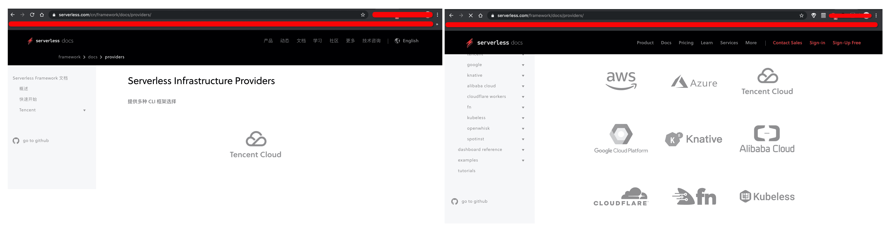
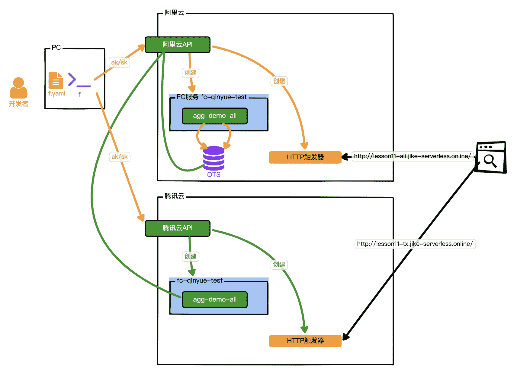
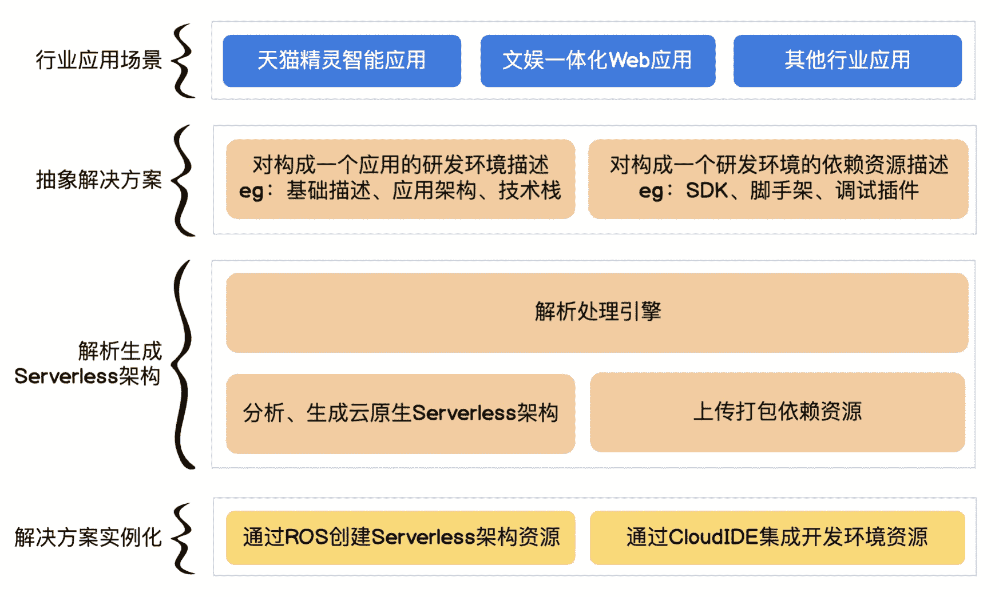

# 11 | 经验：Serverless开发最佳实践

 

你好，我是秦粤。上节课，我们了解了利用 K8s 集群的迁移和扩展能力，可以解决云服务商锁定的问题。我们还横向对比了各大云服务商的特点和优势，纵向梳理了云服务商提供的各种服务能力。最后我们可以看到，利用 Knative 提供的 Container Serverless 能力，我们可以任意迁移部署我们的应用架构，选择适合我们的云服务商。

但同时我们也发现，FaaS 相对于 Knative，反而是我们的瓶颈，我们无法平滑地迁移 FaaS 的函数。云服务商大力发展 FaaS，其实部分原因也是看中了 FaaS 新建立起来的 Vendor-lock，因此目前各大运营商都在拼 FaaS 的体验和生态建设。

那这节课，我们就来看看 FaaS 是如何解除云服务商锁定的吧。但在正式开始之前呢，我们先得了解一些 FaaS 的使用场景，以免一些同学误会，要是你的实践是为了 Serverless 而去 Serverless，那就不好了，我们还是应该从技术应用的角度出发。

## FaaS 场景

我从[第 5 课] 开始就在讲 FaaS 和 BaaS 的底层实现原理 Container Serverless，是希望通过底层实现原理，帮助你更好地掌握 Serverless 的思想。但在日常工作中，使用 Serverless，只需要借助云服务商提供的 Serverless 化的 FaaS 和 BaaS 服务就可以了。

就像我上节课中所讲的，FaaS 因为可以帮助云服务商利用碎片化的物理机算力，所以它是最便宜的。在日常工作中，我十分鼓励你去使用 FaaS。

那么说到使用 FaaS，以我的经验来说，我们可以将 FaaS 的最佳使用场景分为 2 种：事件响应和 Serverless 应用。

### FaaS 事件响应

FaaS 最擅长的还是处理事件响应，所以我们应该先了解清楚，你选择的云服务商的 FaaS 函数具体支持哪些触发器，例如阿里云的触发器列表[1]、腾讯云的触发器列表[2]。因为这些触发器通常都是云服务商根据自身 Serverless 的成功案例所制定的下沉方案，也就是说这些触发器都具备完整的使用场景。基于 FaaS 支持的触发器，设计事件响应函数，我们就可以最大限度地享受 FaaS 的红利，而且不用担心用法不正确。

### Serverless 应用

那如果 FaaS 是作为 Serverless 应用的使用场景，我们则需要关注大型互联网公司的成功案例所沉淀出来的成熟方案。这样既可以轻松简单地搭建出 Serverless 应用，还能帮我们节省不少费用。

因为我们尝试用 FaaS 去解构自己的整个应用时，如果超出了目前 FaaS 的适应边界，那么技术挑战还是比较大的。所以我并不推荐你将整个现存的应用完全 Serverless 化，而是应该去找出适用 FaaS 事件响应的场景去使用 FaaS。

如果你关注 Serverless 就不难发现，至少目前它还处在发展阶段，很多解决方案还在摸索之中。大厂具备技术实力，也乐于在拓展 Serverless 边界的同时发现痛点、解决痛点并占领技术高地。那如果你是一般用户，最好的选择还是持续关注 Serverless 动向，及时了解哪些方案可以为自己所用。当然，这是 Serverless 的舒适圈，但技术挑战也意味着机遇，我确实也看到有不少同学因为拓展 Serverless 的边界而被吸收进入大厂，去参与 Serverless 共建。

## FaaS 痛点

以上就是我对 FaaS 应用场景的一些看法和建议。虽然 FaaS 最擅长是事件响应，但是如果可以改造 Serverless 应用，无疑 FaaS 的附加值会更高。接下来我们就看看 FaaS 在 Serverless 应用过程中切实存在的痛点，相信随着课程一路跟下来的同学一定深有体会。

1. 首先，调试困难，我们每次在本地修改和线上运行的函数都无法保持一致，而且线上的报错也很奇怪，常见的错误都是超时、内存不足等等，让我们根本无法用这些信息去定位问题。
2. 其次，部署麻烦，每次改动都要压缩上传代码包，而且因为每个云服务商的函数 Runtime 不一致，导致我们也很难兼容多云服务商。
3. 最后，很多问题客服无法跟进，需要自己到处打听。

但如果你有仔细阅读文档的话，你就会发现各大云服务商都会提供命令行调试工具，例如阿里云提供的"fun"工具[3]、腾讯云合作的 Serverless Framework 等等。不过云服务商提供的工具，都是云服务商锁定的。为了破解 FaaS 的新 Vendor-lock，我从目前热门的 Serverless 社区中，选择了 3 个 Serverless 应用框架和 1 个平台，介绍给你帮助你破解 Vendor-lock，同时也能更好地解决痛点。

## Serverless 应用框架

### Serverless Framework [4]

Serverless 框架作为第一款支持跨云服务商的 Serverless 应用解决方案，一旦进入首页，我们就可以看到：Serverless X Tencent Cloud。其实最早的 Serverless 框架官方例子是 AWS 的，不过从去年开始被腾讯云强势入驻了。正如我上节课中所讲，腾讯云将 Serverless 作为切入云服务商市场的突破口，正在大力推进 Serverless 腾讯云的生态建设。

Serverless 框架具备先发优势，而且已经有很多成熟的应用方案，我们可以直接拿来使用。我们可以通过 Serverless Component 用 yaml 文件编排整个 Serverless 应用架构。

另外 Serverless Framework 也支持将应用部署到其他 Provider：AWS、阿里云、Azure，还有 Knative 等等，正如以下图示。不过这里有个小问题：就是我们只有在英文版 Serverless 框架的官网上才能看到其他云服务商的 Provider 和文档介绍（中文版 Serverless 框架官网一并给出）。



Serverless Framework 官方本身主要解决跨云服务商 Serverless 应用的部署运维问题。它利用类似 K8s 组件 Component 的概念，让开发者可以自己开发并且共享组件。通过组件来支持多语言的模板，而且 Serverless 组件的扩展能力还让 Serverless 框架具备生态优势。

目前，Serverless 的确是前端参与的比较多，因此在 Serverless 应用框架中，除了 Node.js 外，其他语言的选择并不多。下面我就再介绍 2 款 Node.js 新的 Serverless 框架。

### Malagu [5]

Malagu 是基于 TypeScript 的 Serverless First、可扩展和组件化的应用框架。为了提升 Serverless 的开发体验，只专注 Node.js Serverless 应用。

首先，Malagu 的理念是支持前后端一体化，基于 JSON RPC，前端像调用本地方法一样调用后端方法。前后端支持 RPC 和 MVC 两种通信形式，MVC 可以满足传统纯后端 Rest 风格接口的开发。

其次，Malagu 框架本身也是基于组件化实现的，将复杂的大型项目拆解成一个个 Malagu 组件，可以提高代码的复用能力、降低代码的维护难度。

最后，命令行工具插件化，默认提供初始化、运行、构建、部署能力，通过插件可以扩展命令行的能力。

我有幸与 Malagu 的开发者共事过，Malagu 汲取了众家所长，我觉得这是一个值得关注的 Serverless 框架。而且目前 Malagu 已经有很多合作伙伴，他们正在积极使用和推广 Malagu 的解决方案。

### Midway FaaS [6]

接着是我今天想给你介绍的重点，就是：Midway Faas 和它的工具链"f"。Midway FaaS 是用于构建 Node.js 云函数的 Serverless 框架，可以帮助你在云原生时代大幅降低维护成本，更专注于产品研发。

Midway FaaS 诞生于 Node.js 老牌框架 Midway，我也有幸与 Midway 的开发者一起共事过。Midway FaaS 是阿里巴巴集团发起的开源项目，由一个专业的 Node.js 架构团队进行维护。目前已大规模应用于阿里集团各 BU 线上业务，稳定承载了数千万的流量。

Midway FaaS 有这样一些特点，也可以说是特色。

1. **跨云厂商：**一份代码可在多个云平台间快速部署，不用担心你的产品会被云厂商所绑定。
2. **代码复用：**通过框架的依赖注入能力，让每一部分逻辑单元都天然可复用，可以快速方便地组合以生成复杂的应用。
3. **传统迁移：**通过框架的运行时扩展能力，让 Egg.js 、Koa、Express.js 等传统应用无缝迁移至各云厂商的云函数。

我们的“待办任务”Web 服务，也将采用这个方案进行重构。

首先，我们通过命令行全局安装工具链"f"。

```
npm install -g @midwayjs/faas-cli
```

然后，拉取我们最新的lesson11 代码分支，注意这个分支跟之前的分支相比改动比较大。因此，我们需要重新安装 NPM 依赖包。

```
npm install
```

前端代码还是在 public 目录，后端代码在 src 目录，项目里面的代码逻辑也比较简单，你可以自己看一下。我们需要讲解的是比较核心的配置文件 f.yml，这里有我放的 f.yml 的文件结构。

```
service: fc-qinyue-test  
  
provider:  
  name: aliyun  
  runtime: nodejs10  
  
functions:  
  index:  
    handler: index.handler  
    events:  
      - http:  
          path: /*  
  
  getUser:  
    handler: user.get  
    events:  
      - http:  
          path: /user/234534  
          method: get  
  
package:  
  include:  
    - public/*  
  
aggregation:  
  agg-demo-all:  
    deployOrigin: false  
    functions:  
      - index  
      - getUser  
  
custom:  
  customDomain:  
    domainName: lesson11-ali.jike-serverless.online  

```

这里我们主要关注的是 Provider，目前 Midway FaaS 支持阿里云和腾讯云，后续还会陆续增加其他云服务商。我们切换云服务商只需要修改 Provider 就可以了。其次，你也可以看到 Functions 部分，我们定义了所有的入口函数和路径 path 的映射关系。最后我们在部署环节，自己指定了域名。我们在配置域名解析时，根据云服务商提供的方式，通常都是修改域名的 CNAME，指向云服务提供的 FaaS 地址就可以了。

Midway FaaS 的强大之处就在于我们可以借助它提供的工具链"f"，根据我们的 f.yml 文件配置内容，从而直接在本地模拟云上事件触发，调试我们的应用。

这里你只需要执行：

```
f invoke -p
```

我们就可以通过浏览器访问：http://127.0.0.1:3000 调试我们的 FaaS 函数代码了。并且因为执行就在我们本地，所以调试时，我们可以借助现代 IDE 提供的 Node.js debug 能力逐行调试。而我们部署时也只需要一行代码：

```
f deploy
```

然后 Midway FaaS 就会根据我们的 f.yml 文件配置内容，帮我们部署到云上。

下面这 2 个 URL 地址，就是我用 Midway FaaS 分别部署在阿里云和腾讯云上的“待办任务”Web 服务。

阿里云“待办任务”Web 服务：http://lesson11-ali.jike-serverless.online/

腾讯云“待办任务”Web 服务：http://lesson11-tx.jike-serverless.online/

这里我需要提醒你一下，这 2 个云服务都是以阿里云的 OTS 服务作为数据库存储。这也是 FaaS 服务编排的强大之处，现在有些云服务商提供的 BaaS 服务是支持其他云服务商通过 ak/sk 访问的。另外如下图所示，如果我们采用 ak/sk 编排云服务商的 HTTP API 服务，那么利用 FaaS 就可以实现混合云编排服务了。



如果你留意过 GitHub，你会发现 Midway FaaS 和 Malagu 都是非常新的 GitHub 仓库。Serverless 作为一门新兴技术，还有非常大的想象空间。

另外阿里云也推出了自己的云开发平台，而且将 Serverless 应用的生态集成了进去。目前 Midway FaaS 和 Malagu 也都在其中作为应用创建模板供你使用。

### 阿里云开发平台 [7]

阿里云开发平台就是由咱们专栏特别放送中的被采访者，杜欢（笔名风驰）负责的。

他的核心理念呢，就是将大厂成熟的 Serverless 应用场景抽象成解决方案，并且透出到云开发平台上来，为各个中小企业和个人开发者赋能。

正如下图所示，云开发平台是将大厂的行业应用场景沉淀成了解决方案，解析生成 Serverless 架构，这样我们就可以把云开发平台上实例化的“解决方案”快速应用到我们的 Serverless 应用中来。基于成熟 Serverless 的应用，“反序列化”快速沉淀为解决方案，这也是云服务平台会收录 Midway FaaS 和 Malagu 的原因。

而且我相信以后还会有更多的 Serverless 应用解决方案被收录到云开发平台中的。另外阿里云开发平台并不限制开发语言，但截止到咱们这节课的发布时间，阿里云开发平台的模板仅支持 Node.js 和 Java 的 Serverless 应用，其它语言还需要等成功案例沉淀。



## 总结

这节课我向你介绍了如何打破 FaaS 的 Vendor-lock，并且介绍了我经验中 FaaS 的最佳使用场景：事件响应和 Serverless 应用。事件响应无疑就是 FaaS 的最佳使用场景；而 Serverless 应用则需要我们在云服务商提供的 FaaS 服务上，利用我们专栏前面学习到的知识和原理，挑战将完整的应用完全 Serverless 化。

为了解决 FaaS 的痛点和云服务商锁定，我向你介绍了 3 个框架和一个平台。

1. 目前由腾讯云主导的 Serverless Framework，它支持多语言，具备组件扩展性。目前仅在英文版官网可以看到其支持的云服务商 Provider 文档。
2. 由阿里云 FC 团队主导的 Malagu 解决方案，目前仅支持 Node.js，同样具备扩展性。目前正在积极的和很多开发团队合作共建 Serverless 应用生态。
3. 由阿里巴巴 Node.js 框架 Midway 团队主导的 Midway FaaS 解决方案，它仅支持 Node.js，扩展性由 Midway 团队官方保障。Midway 团队的社区响应迅速，很多 GitHub 上的 issue 会在第一时间响应。
4. 由阿里云主导的阿里云开发平台，它支持多语言，具备模板扩展性，扩展性由官方提供的模板保障。目前收录了 Serverless 生态比较成熟的方案，可以快速部署到阿里云 FC 上。虽然开发平台有一定的云服务商锁定嫌疑，但其采用的模板却可以支持解除云服务商锁定，例如 Midway FaaS。

作为本专栏的最后一课，我还想再啰嗦一句。Serverless 确实是一门新兴技术，其未来无限可能，接下来该由你探索了！

> 想要我的财宝吗？想要的话就给你，去找出来吧，这世上所有的一切都放在那里。世界吗？没错！去追求自由。去超越吧！在信念的旗帜的带领下。—— 海贼王 罗杰

## 作业

Serverless 技术实践还是很重要的，最后一节课的作业我们就继续实操。请你将这节课“待办任务”Web 服务的 Midway FaaS 版本，在本地调试运行起来，并且通过 `f deploy` 把它部署到阿里云或者腾讯云上。

期待你的成果，有问题欢迎随时留言与我交流。如果今天的内容让你有所收获，也欢迎你把文章分享给更多的朋友。

## 参考资料

[1] https://help.aliyun.com/document_detail/74707.html

[2] https://cloud.tencent.com/document/product/583/31927

[3] https://help.aliyun.com/document_detail/140283.html

[4] https://www.serverless.com/cn/framework/docs/getting-started/

[5] https://www.yuque.com/malagu/guide/puw7p0

[6] https://github.com/midwayjs/midway-faas

[7] https://workbench.aliyun.com/
