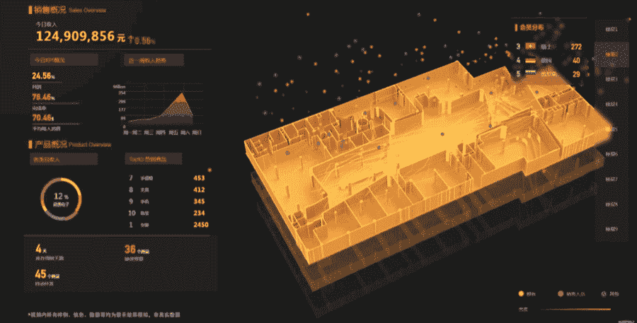

# 08 | 口碑：如何打造一个有影响力的Demo？

 

你好，我是曹林。今天我们来聊聊，如何打造一个有影响力的 Demo。

上一节课，我们讲了如何构建一个产品世界观，或者说如何打造产品体系的故事。但这是个水磨工夫，需要投入很多时间。比起产品世界观，你可能更想去了解一些立竿见影的东西，比如我们该如何让公众在有限的时间里迅速制造一个吸引眼球、引发热议的事件呢？

一个很精彩的产品市场手段就是通过制造技术 / 产品事件，来向大众宣告新产品，新技术的不一样的能力，我们通常称为做一个 Demo 展示。

Demo 的效果显而易见，你一定会记得当年谷歌的阿尔法狗战胜棋神，你也一定会记得当年乔布斯掏出 iPhone，手指滑过屏幕的那个瞬间。

所以今天，我们就来讲讲如何做一个有影响力的 Demo 展示。

## Demo 为谁而做？

首先，在做 Demo 展示之前，我们一定要想清楚一个问题，Demo 展示为谁而做？这个问题看起来非常简单，但是实际上会对我们后续的工作起到决定性的指引作用。

一个 Demo，本质上是一次真实的“演出”，每一次需要的“道具”都不一样，有时候要表演“胸口碎大石”，有时候要表演“口吞宝剑”。所以，要看受众的具体需求，而我们今天探讨的就是一个方法论。

一般来说，我们的 Demo 如果是为**公众**而做，为了追求社会效应层面的轰动，那就要“尽量先进，极致简单”。

1. “尽量先进”：有足够的噱头，能够引发热议。
2. “极致简单”：小孩都能明白这里讲了什么。

我们的 Demo，如果是为了**企业**而做，那就要给企业提供一个真实的解决问题的方案，这个方案我们可以做得尽量前瞻，但是立足点一定是真实严肃客观的。当客户认为你“不真实”的时候，无论你的 Demo 多么炫酷，客户都会选择放弃你。

我们的 Demo，如果是为了**技术人群**而做，那么很多时候，Demo 的重点可能就是技术指标的领先性。例如，在某知名测试中取得了高分，或者是性能达到了多万兆的读写速度，等等。反而演示的成分会更弱化一些。

## 有影响力的 Demo 是怎样的？

我们今天，就按照要打造一个有公众影响力的 Demo 来展开话题，毕竟这也是我们在工作中最常见的。事实上，公众现在对于“演示”本身的兴趣，要高于各种各样的 PPT 演讲，所以越来越多的企业是愿意来做一个 Demo 演示的。

那怎样的 Demo 才算是一个有公众影响力的 Demo 呢？我认为它要具备下面四个要素。

### 第一，一个有影响力的场子。

1893 年芝加哥世博会上，交流电第一次点亮了整个世博会，这个事件标志着人类电气时代的到来，我们可以从这个事件中分析看看。

首先，世博会本身就是展示新技术里程碑的一个载体，Demo 本身需要投入的成本较大（设备、产品、技术），在一个重磅的场合展示，是性价比最高的选择。所以，我们看海外的公司，谷歌会在它的 I/O 大会，苹果会在它的秋季发布会、开发者大会上做很多的 Demo 演示。

而目前我们国内常见的有影响力的场子，一般是以技术类型为主的大会，例如 DTCC、Linux 内核大会这样的开发者大会。还有一类是厂商主办的大会，包括云栖大会、腾讯 WE 大会、腾讯数字生态大会、华为全联接大会、Intel 的 IDF、Oracle Open World 等。当然，还有地方政府主办的大会，例如重庆智博会、上海世界人工智能大会等。这些都属于有影响力的场子。

### 第二，具备可理解性。

在“具备可理解性”上，我有一个传播经验要分享给你：一般情况下，如果人类对某些信息的理解时间超过 10 秒，他就会放弃对这个信息的理解，Demo 也是一样。

所以，我们的 Demo，务必能够迅速被人 get 到，回到谷歌那个案例：人工智能战胜了人（阿尔法狗战胜棋神）。这个信息就非常符合 10 秒定律。

### 第三，具备领先性。

领先性是自传播口碑的第一助力。为什么呢？我们接下来慢慢来说。

我们看到，绝大多数科技传播的优秀案例，一定都是领先性主导的。

比如说，特斯拉就是一家几乎从来不投放广告的企业。但是，每一次特斯拉的发布会都会被媒体“义务地”剪辑成各种小视频片段，投放在各个社交媒体，我看过最高的剪辑小视频点击量甚至过亿。

为什么特斯拉今天能够创造这样的声量？就是因为它不断地在 Demo 里，通过自动驾驶技术的迭代，让公众看到了一个领先的形象。

那你可能要说了，我们公司没有特斯拉的条件，你的意思是要技术厉害才能做 Demo 啊？其实不是的，领先性不仅是指的技术领先性。

那 Demo 的领先性指的是什么呢？在我看来，它包括了技术领先性、合规领先性、生态领先性、高可用领先性。这些领先性都适合用来“露出”。

1. 技术领先性：Demo 是否体现了我可以解决这个顶尖的技术问题？（举例：图灵测试）
2. 合规领先性：Demo 是不是体现了我比别人符合更多的合规标准？（例如：安全认证、国家网信办认证）
3. 生态领先性：Demo 有没有体现我能和更多人、设备、标准兼容？
4. 高可靠、高可用性：我能够连续、可靠地提供多久的服务？（例如：××天无故障）

Demo 可以是视频，也可以是现场展示。

有段时间，IPv6 转换是一个很热门的事。因为国家有政策，要求政企要在一段时间内完成切换。于是，产品团队推出了一个网关，只需要简单的几步，就能完成切换。

于是，我们就把这个切换过程做了一个对比的 Demo 演示。我们模拟了一个实验，如果自己来做切换，从开始采购设备到完全弄好，需要大概 2 个月时间（压缩时间拍摄）。但如果采用了我们的网关产品，工程师只花了 10 分钟就完成了这个工作。这个对比 Demo，获得了极好的效果。无缝转换是很多企业的痛点，销售团队带着这个 Demo 视频去谈合作，几乎是无往不利。

### 第四，要可视化。

今天在 To B 的行业里，很多人的公司做的业务，其实都是非常非常底层的（服务器、数据库、网络），很难将其可视化，但这正是我们这样的市场团队的价值所在。

Demo 可视化的第一步，叫**流程可视化**，我们能够清晰地看到演示过程中，数据、产品在发生什么变化。这也是绝大多数公司做 Demo 可视化的方法——做一块数据大屏。

我也做了很多年的数据大屏。一块好的数据大屏，有几个非常重要的要素。你可以把它类比成 PPT 的页面。那一页好的 PPT 或者说可视化大屏，应该长什么样子呢？

1. 逻辑要清晰，你要思考好自己到底想表达什么。
2. 文字要少，一定要避免在大屏上写长篇大论的文字。
3. 核心图表要清晰，最重要的观点图表一定要放在最显眼的地方。
4. 一块大屏上，配色不要超过 5 种配色，否则花里胡哨的，会降低大屏的品质。

Demo 的第二步，叫**故事可视化**。流程可视化很好理解，那什么是故事可视化呢？

举个例子，我们极客云有一个 AI 检测类的产品，能够检测物体的表面积瑕疵，用在手机行业可以检测屏幕有没划痕。你可以先自己想想怎么来玩这个事儿，然后再继续往下看我是怎么做的。

首先可以想到的是，我们可以放一个视频，拍一下生产线上的机器，用数据大屏展示每分钟检测了多少台手机。

但是，我们想升级一下可视化的定义，不再局限于数据，而是要将“故事”可视化。为了达到这一目的，我们可以请一个手机厂商，提供检测屏幕最厉害的一个工人小组和我们的人工智能检测产品进行 PK，并且现场公布答案。

后续再做一篇通稿——《AI 不仅战胜了棋手，今天又赢了这双最强的手》，蹭一把阿尔法狗的热度。这样在做 Demo 的同时跟进 PR 传播，证明我们的观点，AI 又毫无悬念地赢了。

是不是故事可视化更有意思？你可以感受一下。这里你要注意，故事可视化的要点有三个：第一，要解决的矛盾明确；第二，平时不易见到，有奇观性；第三，是胜负明确。

## 怎么生产一个典型的 Demo？

前面说了这么多，我猜你快坐不住了，想赶快看看，一个典型的 Demo 是怎么生产出来的。下面我就带你实操一下。

### 第一步，我们已经有一个待展现的产品和产品组合。

做 Demo，一定是为公司在一段时期里面的战略级产品服务的，所以我们的选择空间往往不会太大。这里要做的基本工作，还是要寻找到产品本身的核心价值，基于这个核心价值进行创作。一旦在这里偏离了我们产品的核心价值，那么就很容易走偏。

例如，一个数据湖产品它的核心能力是能够接入 300+ 数据源。但是我们展示的时候，选择了去展示它的计算能力，虽然不能说错，但是这就是偏离了产品的核心卖点。

所以在这一步，与产品经理合作提取产品 / 产品组合的核心卖点是一个很重要的工作。

### 第二步，建立一个场景。

所谓的 Demo，其实本质上就是场景化地展示产品，而建立场景的方式有很多种。

第一种是直接上实际工作的环境，我们的产品在用户环境中是怎么样的，我们就怎样把它展示给大家。例如，我们想演示一个先进的 GPU 服务器，它可以插 8 张卡（传统服务器只能插 4 张卡），我们就可以把机器拆开给大家看。这种方式真实且直观，比较适合硬件类产品。

第二种则是对实际的环境稍稍进行加工，变得更加有意思、易传播。例如，我们做一个自动驾驶 AI 产品的 Demo，那我们一定是希望它去 PK 复杂城市道路。过程中可能还要设计一些桥段，看看车辆能否通过 180 度的大急弯？面对加塞，AI 会做什么？通过对这些场景的加工，话题就自然出来了。

### 第三步，制造一个场景中的悬念和冲突任务。

在一个印象深刻的 Demo 里，悬念和冲突的设计是至关重要的。我们现在能看到很多的碎片化传播小视频，都是这类冲突场景。

那么怎么寻找冲突呢？有一个非常简单的方法，就是在环境中寻找二元对立的部分。哪些事情、哪些人是在这个场景中二元对立的？设置悬念的方法就是让结果的获得与呈现尽量一波三折。

回到前面 AI 与检测工人的 PK 例子里，你会发现它就是一个典型的悬念和冲突。冲突，是人和 AI 的冲突，这是二元对立。最终的结果，就是到底谁能够获胜。根据这些信息，我们可以包装一个悬念：他们前期经历了多么长的训练，就是为了打败 AI，那么他们到底能不能获胜？悬念就这么产生了。

### 第四步，请各个团队介入，分工开发。

这个时候，你有了一个初步的创意剧本，但是要把这些创意变成一个 Demo，你需要产品团队支持你，需要技术团队来参与开发。我们的课程主要侧重讲市场营销相关的内容，这里每一个公司的资源介入和调动都不太一样，我就不多说了。

### 第五步，选择什么样的人来展示。

Demo 由谁来说，也是很重要的，这就是 To B 产品品牌里经常提到的“站台”。今天同样的观点，一个在行业里有影响力的人来说和小白来说，一定是两个概念。通常我们会根据产品来选择站台的人，有这几类：

1. 偏底层设施的产品：我们会请学界的专家学者，因为学者会从学术的角度阐述，虽然很多人不懂，但是专家的技术预言会产生不明觉厉的效果。
2. 偏上层 saas 能力的产品：我们往往会邀请明星企业家，明星客户来站台，因为能够通过他的人物本身吸引流量和关注。
3. 偏行业解决方案类的产品：我们往往会请行业里的大咖来站台，因为，很显然你要影响的是这个行业里的选型决策。

### 第六步，协同 PR 同学打好传播线战役。

我们需要思考在整个 Demo 过程中，配套的传播话题是什么？在泛科技圈公众圈如何传播？在企业家圈层如何传播？在技术圈层如何传播？这个知识点，我在后面的打造优秀案例中，有非常详尽的描述，这里暂时就不详细展开了。

## 总结

在我看来，Demo 的本质是一次 To B 的事件营销。通过将技术或产品场景化、结构化，帮助公众、企业经营者更好地理解产品价值。

一个好的 Demo，是能够起到里程碑式的作用的，回到我开篇讲的故事。1893 年芝加哥世博会，西屋电气的交流电第一次点亮了整个世博会，这一个事件标志着人类电气时代的到来。西屋电气依靠着这一个 Demo 建立起来的心智，成为了 20 世纪初叶当之无愧的电力霸主。

一个 Demo 的成功，背后其实是“技术 + 市场 +PR”的联合结晶，也是一个公司建立市场心智的重要手段。

很多人市场人喜欢把 Demo 叫做 showcase，事实上是不够全面的。

最后，我想说说我对 Demo 的理解。Demo 展示是心智塑造的一个重要环节，无论是从现场看到，还是在视频上看到，无疑都会在客户心中产品巨大的波澜。Demo 展示又是一次事件营销，通过我们的展示，事实上是要告诉人们一个新产品、新技术。Demo 展示是一个里程碑，大众记忆都是需要里程碑的。Demo 展示同时又是对未来的预言，预示着这些产品、技术将很快走进大家的企业里、生活中。

## 场景练习

假设，极客时间要发布一个 AI 学习音箱——小极，发挥你的想象力，如何给小极做一次成功的 Demo 展示？（小极的功能可以在智能音箱功能的合理范围内自主发挥）

欢迎在留言区写出你的答案，与其他同学相互讨论。如果你觉得有所收获，也欢迎你把这一讲分享给你的朋友。
