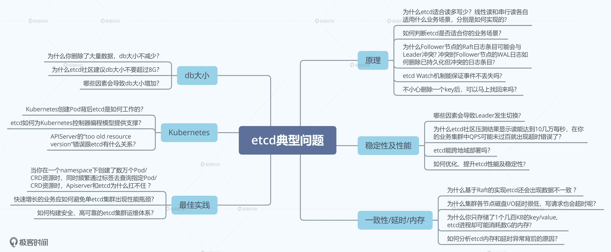
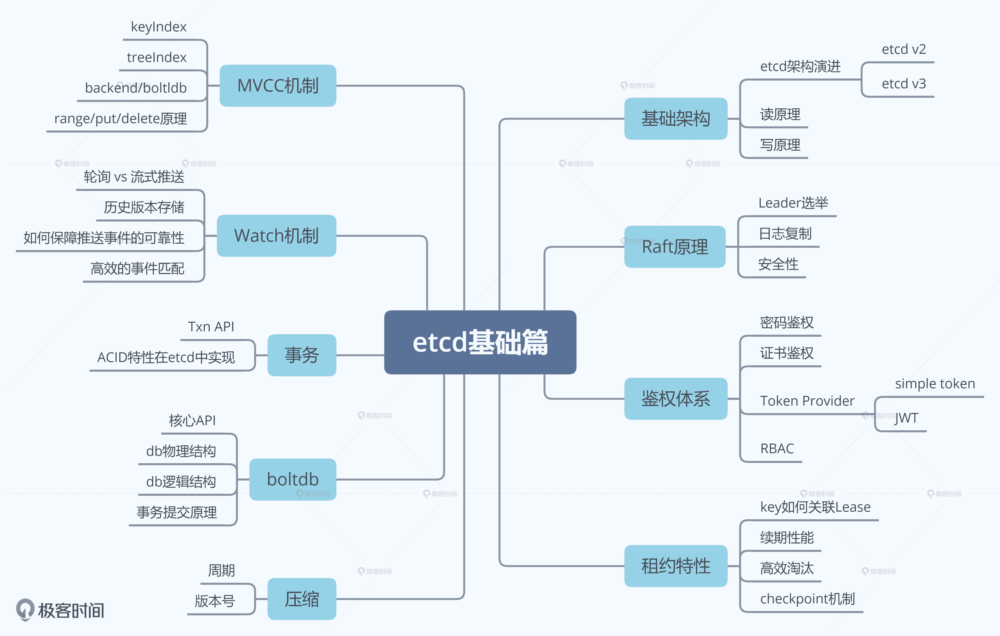
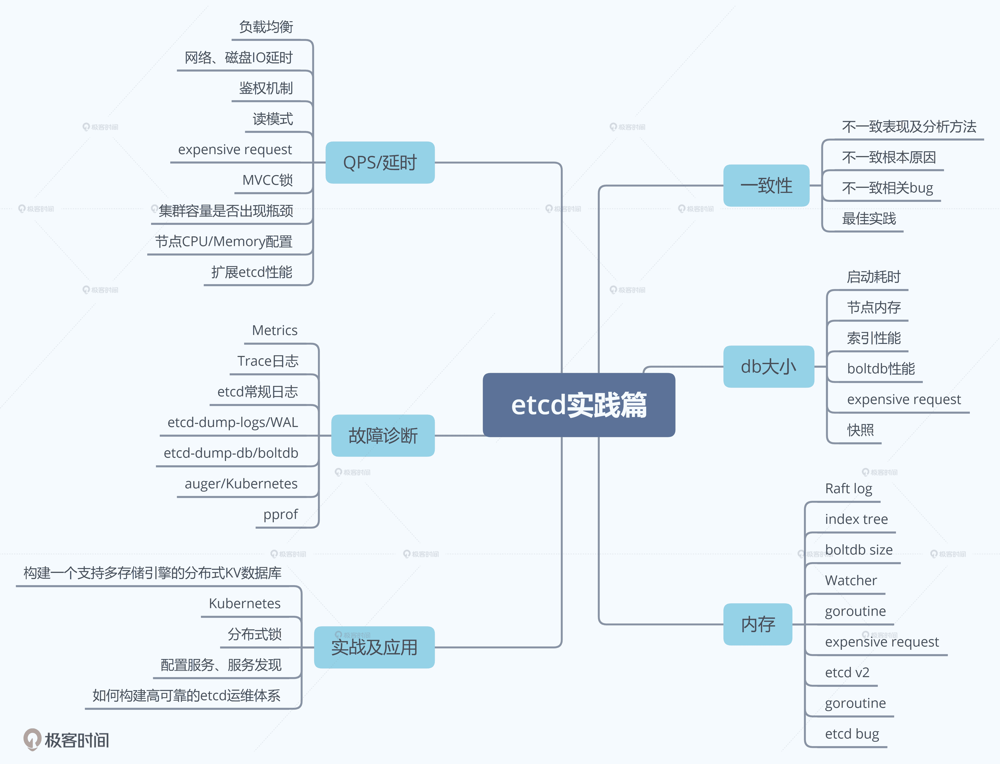

# 开篇词｜为什么你要学习etcd?

 

你好，我是唐聪，etcd 活跃贡献者，腾讯资深工程师，欢迎你和我一起学习 etcd。

开门见山，今天我想和你聊聊为什么要学习 etcd。随着 Kubernetes 成为容器编排领域霸主，etcd 也越来越火热，越来越多的软件工程师使用 etcd 去解决各类业务场景中遇到的痛点。你知道吗？etcd 的 GitHub star 数已超过 34.2K，它的应用场景相当广泛，从服务发现到分布式锁，从配置存储到分布式协调等等。可以说，etcd 已经成为了云原生和分布式系统的存储基石。

另外，etcd 作为最热门的云原生存储之一，在腾讯、阿里、Google、AWS、美团、字节跳动、拼多多、Shopee、明源云等公司都有大量的应用，覆盖的业务可不仅仅是 Kubernetes 相关的各类容器产品，更有视频、推荐、安全、游戏、存储、集群调度等核心业务。

## 我想为你解决哪些问题？

在工作和参与 etcd 社区贡献的过程中，我经常会收到各类问题咨询，同时自己也经历了各种问题。我相信你在使用 Kubernetes、etcd 的过程中，很可能也会遇到下面这些典型问题：

1. etcd Watch 机制能保证事件不丢吗？（原理类）
2. 哪些因素会导致你的集群 Leader 发生切换? （稳定性类）
3. 为什么基于 Raft 实现的 etcd 还可能会出现数据不一致？（一致性类）
4. 为什么你删除了大量数据，db 大小不减少？为何 etcd 社区建议 db 大小不要超过 8G？（db 大小类）
5. 为什么集群各节点磁盘 I/O 延时很低，写请求也会超时？（延时类）
6. 为什么你只存储了 1 个几百 KB 的 key/value， etcd 进程却可能耗费数 G 内存? （内存类）
7. 当你在一个 namespace 下创建了数万个 Pod/CRD 资源时，同时频繁通过标签去查询指定 Pod/CRD 资源时，APIServer 和 etcd 为什么扛不住?（最佳实践类）

当然，你在学习和使用 etcd、Kubernetes 过程中遇到的问题肯定远远不止这些，下面我用思维导图给你总结了更多类似问题，你可以对照自身的经历去看一下。

这门课就是为了帮助你解决这些问题而生。不过你可能会想，你能把这些东西都讲明白么？我先和你聊聊我的个人 etcd 经历，你就知道我为什么有自信能带你学好 etcd 了。

## 我和 etcd 的那些事

本科毕业后，我通过校招加入了腾讯。不到一年的时间，我就主导完成了一个亿级用户的业务核心存储平滑迁移任务。

在 2015 到 2017 的这两年时间里，为了满足业务大量的 Redis 诉求，我基于 Redis/Codis 构建了大规模的排行榜和 Redis 集群平台服务，支撑了公司的多个重要业务。在这期间，我积累了大量的 NoSQL 数据库知识与经验，为后面工作转岗到 To B，负责 Kubernetes 的元数据存储 etcd 奠定了良好的基础。

2017 年后，我就开始接触 Docker 和 Kubernetes，并通过 Kubernetes 来解决大规模 Redis 集群的治理问题，提升服务的可用性、降低运维成本。

2018 年，我转岗到了腾讯云，负责 Kubernetes 集群存储 etcd 治理工作。我主导构建的云原生 etcd 平台，支持自动化的集群管理、调度、迁移、监控、巡检、备份，成功解决了集群大规模增长过程中的各类 etcd 稳定性问题，支撑了万级的 Kubernetes 和 etcd 集群。

etcd 平台从解决 Kubernetes etcd 稳定性问题，到为各类云原生产品提供 etcd 基础服务，再到保障开箱即用的腾讯云 etcd 产品化服务，它发挥着重要作用。在这个过程中，我也见证了越来越多的软件工程师加入 etcd 的阵营，越来越多的产品使用 etcd。目前，etcd 作为腾讯众多产品的基础设施，服务用户已达数亿。

同时，我也遇到了很多问题，从内存泄露到数据不一致，从节点 crash 到性能慢，再到死锁、OOM 等稳定性问题等等。最令我记忆犹新的是，我和小伙伴王超凡通过混沌工程发现并修复了多个数据不一致 Bug，其中一个 Bug 已经存在近 3 年之久，而且很严重，重启就可能会触发数据不一致。

从解决类似上面的棘手 Bug 到提交稳定性、性能优化 PR，从提交 QoS 特性设计方案、POC 到给新的 contributor review PR，通过一点点的积累，大量周末、凌晨时间的付出，我成为了 2020 年 etcd 社区的全球 Top3 活跃贡献者，与 Google、AWS、阿里巴巴的小伙伴们，一起推动 etcd 项目越来越好，服务于全球开发者。

总结来说的话，过去几年我一直在与 Redis、etcd 打交道，一线的经历、解决的问题都让我收获良多，所以我也非常有自信能把这些经验都交付给你。

在业务实践方面，我成功解决过众多大规模业务增长过程中，遇到的存储稳定性、可扩展性等痛点，积累了丰富的理论知识、大规模集群的实战、治理经验，能直接帮助到你今后的工作。

另外，在 etcd 开源项目方面，我深度参与 etcd 开源项目的贡献经历，让我可以从开发者的视角，为你分析问题、梳理最佳实践、解读特性设计方案、阐述社区未来演进方向等等，帮助你深度理解 etcd 以及分布式服务。

## 你应该怎么学 etcd？

在我看来，etcd 学习其实可以分为大中小三个目标。最大的目标我当然是希望你能够用最低的学习成本，掌握 etcd 核心原理与最佳实践，让 etcd 为你所用，帮助你解决业务过程中的各类痛点，在工作中少踩坑、少交学费，多升职、多涨薪。

但是这个大的目标怎么实现呢？

我的答案是**使用拆解法**。下面我给你提出了学习这个专栏的一些中等大小目标，希望你能带着这些目标进行学习，每过一段时间，回过头来看看，这些目标实现了多少？

首先，你能知道什么是 etcd，了解它的基本读写原理、核心特性和能解决什么问题。

然后，在使用 etcd 解决各类业务场景需求时，能独立判断 etcd 是否适合你的业务场景，并能设计出良好的存储结构，避免 expensive request。

其次，在使用 Kubernetes 的过程中，你能清晰地知道你的每个操作背后的 etcd 是如何工作的，并遵循 Kubernetes/etcd 最佳实践，让你的 Kubernetes 集群跑得更快更稳。

接着，在运维 etcd 集群的时候，你能知道 etcd 集群核心监控指标，了解常见的坑，制定良好的巡检、监控策略，及时发现、规避问题，避免事故的产生。

最后，当你遇到 etcd 问题时，能自己分析为什么会出现这样的错误，并知道如何解决，甚至给社区提 PR 优化，做到知其然知其所以然。

做到以上五个目标其实也并不容易，别着急，我们接着往下拆分。为了让你实现以上五个目标，我把专栏分为了基础和实践两大主线。每个主线里都有一个一个的小目标，我们逐个攻破就容易多了。

基础篇主线是为了帮助你建立起对 etcd 的整体认知，搞懂读写请求、各个核心特性背后的原理，为我们后面的实践篇打下基础。

基础篇的学习也是一个中小型分布式存储系统从 0 到 1 的实现案例解读，学习它你收获的不仅仅是 etcd，更是如何构建分布式存储系统的理论知识。

我把基础篇分为了以下的学习小目标：

1. etcd 基础架构。通过为你梳理 etcd 前世今生、分析 etcd 读写流程，帮助你建立起对 etcd 的整体认知，了解一个分布式存储系统的基本模型、设计思想。
2. Raft 算法。通过为你介绍 Raft 算法在 etcd 中是如何工作的，帮助你了解 etcd 高可用、高可靠背后的核心原理。
3. 鉴权模块。通过介绍 etcd 的鉴权、授权体系，带你了解 etcd 是如何保护你的数据安全，以及各个鉴权机制的优缺点。
4. 租约模块。介绍 etcd 租约特性的实现，帮助你搞懂如何检测一个进程的存活性，为什么它可以用于 Leader 选举中。
5. MVCC/Watch 模块。通过这两个模块帮助你搞懂 Kubernetes 控制器编程模型背后的原理。

在介绍 etcd 原理的过程中，我也会从更上层的角度，为你解读分布式系统存储系统的核心技术难点是什么，常见的解决方案有哪些，以及为什么 etcd 要这样设计、实现。让你对整个分布式系统有更深层次的理解，明白不同存储系统只是在面对各自的业务场景的时候，选择了合适的技术方案，让你从本质上去理解分布式存储系统要解决的核心问题基本是一致的。

当然基础篇讲的远不止这些，关于基础篇的更多内容，你可以参考下面的 etcd 基础篇思维导图：

通过基础篇掌握好 etcd 核心模块原理后，实践篇我将为你解读实际使用 etcd 时，可能会遇到的各种问题，帮助你提前避坑、遇到类似问题时能独立分析、解决。

我把实践篇分为以下的学习小目标：

1. 问题篇。为你分析 etcd 使用过程中的各类典型问题，和你细聊各种异常现象背后的原理、最佳实践。
2. 性能优化篇。通过读写链路的分析，为你梳理可能影响 etcd 性能的每一个瓶颈。
3. 实战篇。带你从 0 到 1 亲手参与构建一个简易的分布式 KV 数据库，进一步提升你对分布式存储系统的认知。
4. Kubernetes 实践篇。为你分析 etcd 在 Kubernetes 中的应用，让你对 Kubernetes 原理有更深层次的理解。
5. etcd 应用篇。介绍 etcd 在分布式锁、配置系统、服务发现场景中的应用。

更多实践篇内容你可以参考下面的思维导图：

这样一来，我们的学习目标就比较明确了。最终目标是让 etcd 为你所用，少踩坑、多升职加薪；而为了实现这个目标，我们需要从多方面提升自己对 etcd 的掌控能力，也就是实现中等目标；但进阶的难度还是比较大的，所以我们需要把一个个小目标当作基石（也就是每一节课的知识点学习），来达成个人能力的提升。

现在我们不妨就带着这些目标，共同开启 etcd 的学习之旅吧！
