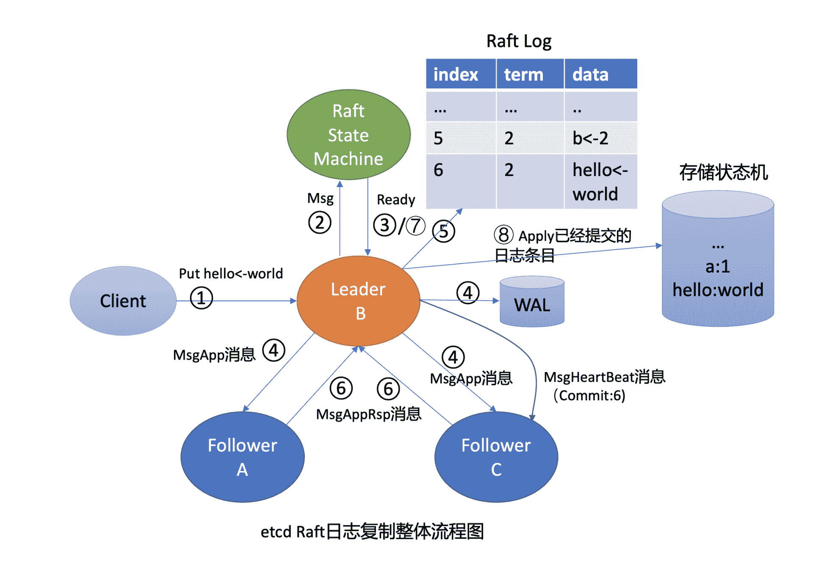
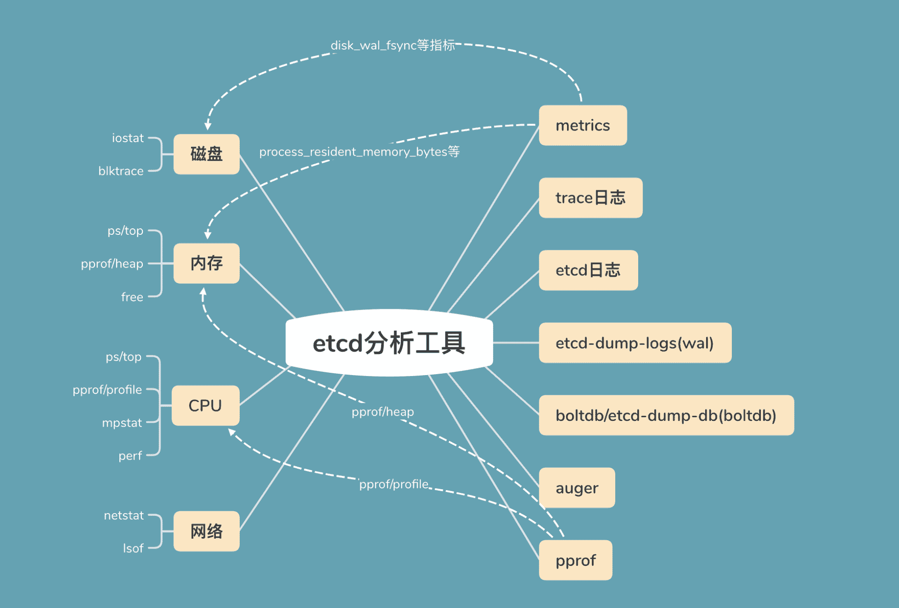
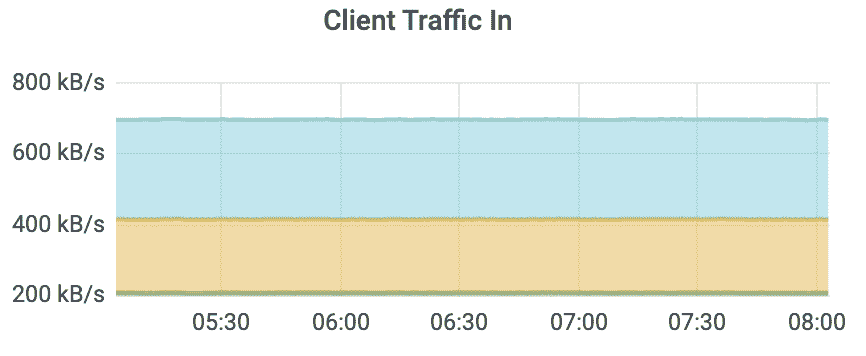
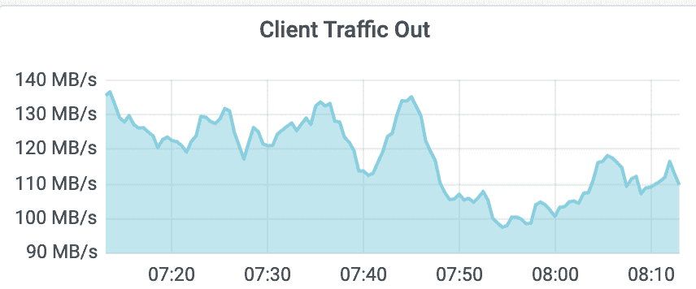
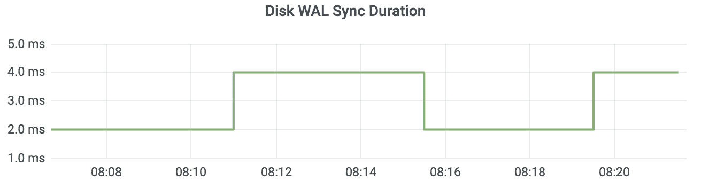
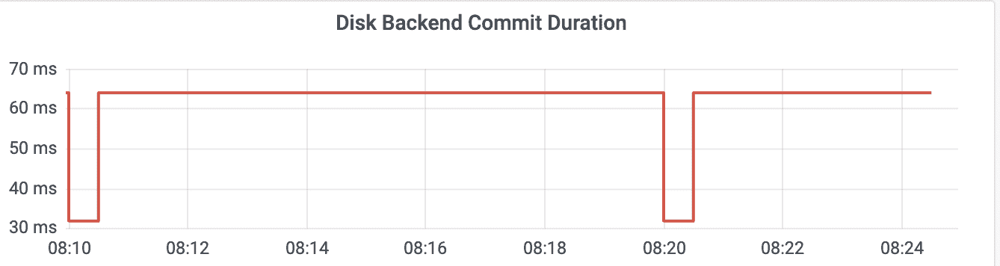
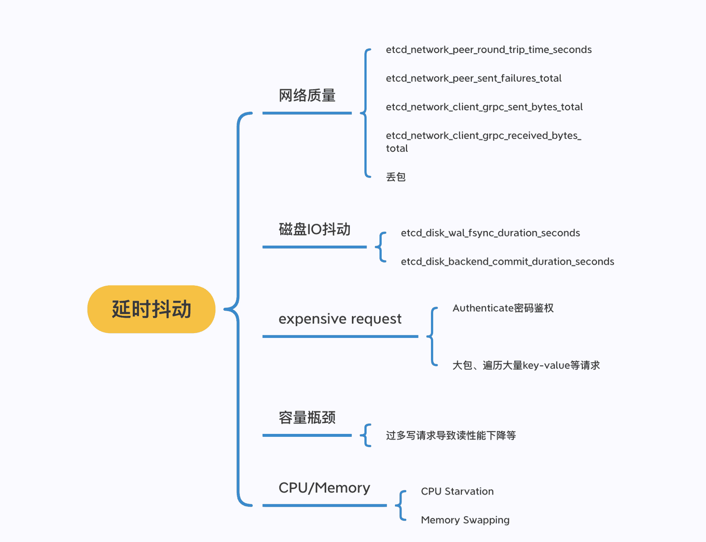

# 14 | 延时：为什么你的etcd请求会出现超时？

 

你好，我是唐聪。

在使用 etcd 的过程中，你是否被日志中的"apply request took too long"和“etcdserver: request timed out"等高延时现象困扰过？它们是由什么原因导致的呢？我们应该如何来分析这些问题？

这就是我今天要和你分享的主题：etcd 延时。希望通过这节课，帮助你掌握 etcd 延时抖动、超时背后的常见原因和分析方法，当你遇到类似问题时，能独立定位、解决。同时，帮助你在实际业务场景中，合理配置集群，遵循最佳实践，尽量减少 expensive request，避免 etcd 请求出现超时。

## 分析思路及工具

首先，当我们面对一个高延时的请求案例后，如何梳理问题定位思路呢？

知彼知己，方能百战不殆，定位问题也是类似。首先我们得弄清楚产生问题的原理、流程，在02、03、04中我已为你介绍过读写请求的核心链路。其次是熟练掌握相关工具，借助它们，可以帮助我们快速攻破疑难杂症。

这里我们再回顾下 03 中介绍的，Leader 收到一个写请求，将一个日志条目复制到集群多数节点并应用到存储状态机的流程（如下图所示），通过此图我们看看写流程上哪些地方可能会导致请求超时呢？



首先是流程四，一方面，Leader 需要并行将消息通过网络发送给各 Follower 节点，依赖网络性能。另一方面，Leader 需持久化日志条目到 WAL，依赖磁盘 I/O 顺序写入性能。

其次是流程八，应用日志条目到存储状态机时，etcd 后端 key-value 存储引擎是 boltdb。正如我们10所介绍的，它是一个基于 B+ tree 实现的存储引擎，当你写入数据，提交事务时，它会将 dirty page 持久化到磁盘中。在这过程中 boltdb 会产生磁盘随机 I/O 写入，因此事务提交性能依赖磁盘 I/O 随机写入性能。

最后，在整个写流程处理过程中，etcd 节点的 CPU、内存、网络带宽资源应充足，否则肯定也会影响性能。

初步了解完可能导致延时抖动的瓶颈处之后，我给你总结了 etcd 问题定位过程中常用的工具，你可以参考下面这幅图。



图的左边是读写请求链路中可能出现瓶颈或异常的点，比如上面流程分析中提到的磁盘、内存、CPU、网络资源。

图的右边是常用的工具，分别是 metrics、trace 日志、etcd 其他日志、WAL 及 boltdb 分析工具等。

接下来，我基于读写请求的核心链路和其可能出现的瓶颈点，结合相关的工具，为你深入分析 etcd 延时抖动的定位方法和原因。

## 网络

首先我们来看看流程图中第一个提到可能瓶颈点，网络模块。

在 etcd 中，各个节点之间需要通过 2380 端口相互通信，以完成 Leader 选举、日志同步等功能，因此底层网络质量（吞吐量、延时、稳定性）对上层 etcd 服务的性能有显著影响。

网络资源出现异常的常见表现是连接闪断、延时抖动、丢包等。那么我们要如何定位网络异常导致的延时抖动呢？

一方面，我们可以使用常规的 ping/traceroute/mtr、ethtool、ifconfig/ip、netstat、tcpdump 网络分析工具等命令，测试网络的连通性、延时，查看网卡的速率是否存在丢包等错误，确认 etcd 进程的连接状态及数量是否合理，抓取 etcd 报文分析等。

另一方面，etcd 应用层提供了节点之间网络统计的 metrics 指标，分别如下：

1. etcd_network_active_peer，表示 peer 之间活跃的连接数；
2. etcd_network_peer_round_trip_time_seconds，表示 peer 之间 RTT 延时；
3. etcd_network_peer_sent_failures_total，表示发送给 peer 的失败消息数；
4. etcd_network_client_grpc_sent_bytes_total，表示 server 发送给 client 的总字节数，通过这个指标我们可以监控 etcd 出流量；
5. etcd_network_client_grpc_received_bytes_total，表示 server 收到 client 发送的总字节数，通过这个指标可以监控 etcd 入流量。

client 入流量监控如下图所示：



client 出流量如下图监控所示。 从图中你可以看到，峰值接近 140MB/s(1.12Gbps)，这是非常不合理的，说明业务中肯定有大量 expensive read request 操作。若 etcd 集群读写请求开始出现超时，你可以用 ifconfig 等命令查看是否出现丢包等错误。



etcd metrics 指标名由 namespace 和 subsystem、name 组成。namespace 为 etcd， subsystem 是模块名（比如 network、name 具体的指标名）。你可以在 Prometheus 里搜索 etcd_network 找到所有 network 相关的 metrics 指标名。

下面是一个集群中某节点异常后的 metrics 指标：

```
etcd_network_active_peers{Local="fd422379fda50e48"，Remote="8211f1d0f64f3269"} 1  
etcd_network_active_peers{Local="fd422379fda50e48"，Remote="91bc3c398fb3c146"} 0  
etcd_network_peer_sent_failures_total{To="91bc3c398fb3c146"} 47774  
etcd_network_client_grpc_sent_bytes_total 513207
```

从以上 metrics 中，你可以看到 91bc3c398fb3c146 节点出现了异常。在 etcd 场景中，网络质量导致 etcd 性能下降主要源自两个方面：

一方面，expensive request 中的大包查询会使网卡出现瓶颈，产生丢包等错误，从而导致 etcd 吞吐量下降、高延时。expensive request 导致网卡丢包，出现超时，这在 etcd 中是非常典型且易发生的问题，它主要是因为业务没有遵循最佳实践，查询了大量 key-value。

另一方面，在跨故障域部署的时候，故障域可能是可用区、城市。故障域越大，容灾级别越高，但各个节点之间的 RTT 越高，请求的延时更高。

## 磁盘 I/O

了解完网络问题的定位方法和导致网络性能下降的因素后，我们再看看最核心的磁盘 I/O。

正如我在开头的 Raft 日志复制整体流程图中和你介绍的，在 etcd 中无论是 Raft 日志持久化还是 boltdb 事务提交，都依赖于磁盘 I/O 的性能。

**当 etcd 请求延时出现波动时，我们往往首先关注 disk 相关指标是否正常。**我们可以通过 etcd 磁盘相关的 metrics(etcd_disk_wal_fsync_duration_seconds 和 etcd_disk_backend_commit_duration_seconds) 来观测应用层数据写入磁盘的性能。

etcd_disk_wal_fsync_duration_seconds（简称 disk_wal_fsync）表示 WAL 日志持久化的 fsync 系统调用延时数据。一般本地 SSD 盘 P99 延时在 10ms 内，如下图所示。



etcd_disk_backend_commit_duration_seconds（简称 disk_backend_commit）表示后端 boltdb 事务提交的延时，一般 P99 在 120ms 内。



这里你需要注意的是，一般监控显示的磁盘延时都是 P99，但实际上 etcd 对磁盘特别敏感，一次磁盘 I/O 波动就可能产生 Leader 切换。如果你遇到集群 Leader 出现切换、请求超时，但是磁盘指标监控显示正常，你可以查看 P100 确认下是不是由于磁盘 I/O 波动导致的。

同时 etcd 的 WAL 模块在 fdatasync 操作超过 1 秒时，也会在 etcd 中打印如下的日志，你可以结合日志进一步定位。

```
if took > warnSyncDuration {  
   if w.lg != nil {  
      w.lg.Warn(  
         "slow fdatasync",  
         zap.Duration("took", took),  
         zap.Duration("expected-duration", warnSyncDuration),  
      )  
   } else {  
      plog.Warningf("sync duration of %v, expected less than %v", took, warnSyncDuration)  
   }  
}
```

当 disk_wal_fsync 指标异常的时候，一般是底层硬件出现瓶颈或异常导致。当然也有可能是 CPU 高负载、cgroup blkio 限制导致的，我们具体应该如何区分呢？

你可以通过 iostat、blktrace 工具分析瓶颈是在应用层还是内核层、硬件层。其中 blktrace 是 blkio 层的磁盘 I/O 分析利器，它可记录 IO 进入通用块层、IO 请求生成插入请求队列、IO 请求分发到设备驱动、设备驱动处理完成这一系列操作的时间，帮助你发现磁盘 I/O 瓶颈发生的阶段。

当 disk_backend_commit 指标的异常时候，说明事务提交过程中的 B+ tree 树重平衡、分裂、持久化 dirty page、持久化 meta page 等操作耗费了大量时间。

disk_backend_commit 指标异常，能说明是磁盘 I/O 发生了异常吗？

若 disk_backend_commit 较高、disk_wal_fsync 却正常，说明瓶颈可能并非来自磁盘 I/O 性能，也许是 B+ tree 的重平衡、分裂过程中的较高时间复杂度逻辑操作导致。比如 etcd 目前所有 stable 版本（etcd 3.2 到 3.4），从 freelist 中申请和回收若干连续空闲页的时间复杂度是 O(N)，当 db 文件较大、空闲页碎片化分布的时候，则可能导致事务提交高延时。

那如何区分事务提交过程中各个阶段的耗时呢？

etcd 还提供了 disk_backend_commit_rebalance_duration 和

disk_backend_commit_spill_duration 两个 metrics，分别表示事务提交过程中 B+ tree 的重平衡和分裂操作耗时分布区间。

最后，你需要注意 disk_wal_fsync 记录的是 WAL 文件顺序写入的持久化时间，disk_backend_commit 记录的是整个事务提交的耗时。后者涉及的磁盘 I/O 是随机的，为了保证你 etcd 集群的稳定性，建议使用 SSD 磁盘以确保事务提交的稳定性。

## expensive request

若磁盘和网络指标都很正常，那么延时高还有可能是什么原因引起的呢？

从02介绍的读请求链路我们可知，一个读写请求经过 Raft 模块处理后，最终会走到 MVCC 模块。那么在 MVCC 模块会有哪些场景导致延时抖动呢？时间耗在哪个处理流程上了？

etcd 3.4 版本之前，在应用 put/txn 等请求到状态机的 apply 和处理读请求 range 流程时，若一个请求执行超过 100ms 时，默认会在 etcd log 中打印一条"apply request took too long"的警告日志。通过此日志我们可以知道集群中 apply 流程产生了较慢的请求，但是不能确定具体是什么因素导致的。

比如在 Kubernetes 中，当集群 Pod 较多的时候，若你频繁执行 List Pod，可能会导致 etcd 出现大量的"apply request took too long"警告日志。

因为对 etcd 而言，List Pod 请求涉及到大量的 key 查询，会消耗较多的 CPU、内存、网络资源，此类 expensive request 的 QPS 若较大，则很可能导致 OOM、丢包。

当然，除了业务发起的 expensive request 请求导致延时抖动以外，也有可能是 etcd 本身的设计实现存在瓶颈。

比如在 etcd 3.2 和 3.3 版本写请求完成之前，需要更新 MVCC 的 buffer，进行升级锁操作。然而此时若集群中出现了一个 long expensive read request，则会导致写请求执行延时抖动。因为 expensive read request 事务会一直持有 MVCC 的 buffer 读锁，导致写请求事务阻塞在升级锁操作中。

在了解完 expensive request 对请求延时的影响后，接下来要如何解决请求延时较高问题的定位效率呢？

为了提高请求延时分布的可观测性、延时问题的定位效率，etcd 社区在 3.4 版本后中实现了 trace 特性，详细记录了一个请求在各个阶段的耗时。若某阶段耗时流程超过默认的 100ms，则会打印一条 trace 日志。

下面是我将 trace 日志打印的阈值改成 1 纳秒后读请求执行过程中的 trace 日志。从日志中你可以看到，trace 日志记录了以下阶段耗时：

1. agreement among raft nodes before linearized reading，此阶段读请求向 Leader 发起 readIndex 查询并等待本地 applied index >= Leader 的 committed index， 但是你无法区分是 readIndex 慢还是等待本地 applied index > Leader 的 committed index 慢。在 etcd 3.5 中新增了 trace，区分了以上阶段；
2. get authentication metadata，获取鉴权元数据；
3. range keys from in-memory index tree，从内存索引 B-tree 中查找 key 列表对应的版本号列表；
4. range keys from bolt db，根据版本号列表从 boltdb 遍历，获得用户的 key-value 信息；
5. filter and sort the key-value pairs，过滤、排序 key-value 列表；
6. assemble the response，聚合结果。

```
{  
    "level":"info"，  
    "ts":"2020-12-16T08:11:43.720+0800"，  
    "caller":"traceutil/trace.go:145"，  
    "msg":"trace[789864563] range"，  
    "detail":"{range_begin:a; range_end:; response_count:1; response_revision:32011; }"，  
    "duration":"318.774µs"，  
    "start":"2020-12-16T08:11:43.719+0800"，  
    "end":"2020-12-16T08:11:43.720+0800"，  
    "steps":[  
        "trace[789864563] 'agreement among raft nodes before linearized reading'  (duration: 255.227µs)"，  
        "trace[789864563] 'get authentication metadata'  (duration: 2.97µs)"，  
        "trace[789864563] 'range keys from in-memory index tree'  (duration: 44.578µs)"，  
        "trace[789864563] 'range keys from bolt db'  (duration: 8.688µs)"，  
        "trace[789864563] 'filter and sort the key-value pairs'  (duration: 578ns)"，  
        "trace[789864563] 'assemble the response'  (duration: 643ns)"  
    ]  
}
```

那么写请求流程会记录哪些阶段耗时呢？

下面是 put 写请求的执行 trace 日志，记录了以下阶段耗时：

1. process raft request，写请求提交到 Raft 模块处理完成耗时；
2. get key's previous created_revision and leaseID，获取 key 上一个创建版本号及 leaseID 的耗时；
3. marshal mvccpb.KeyValue，序列化 KeyValue 结构体耗时；
4. store kv pair into bolt db，存储 kv 数据到 boltdb 的耗时；
5. attach lease to kv pair，将 lease id 关联到 kv 上所用时间。

```
{  
    "level":"info"，  
    "ts":"2020-12-16T08:25:12.707+0800"，  
    "caller":"traceutil/trace.go:145"，  
    "msg":"trace[1402827146] put"，  
    "detail":"{key:16; req_size:8; response_revision:32030; }"，  
    "duration":"6.826438ms"，  
    "start":"2020-12-16T08:25:12.700+0800"，  
    "end":"2020-12-16T08:25:12.707+0800"，  
    "steps":[  
        "trace[1402827146] 'process raft request'  (duration: 6.659094ms)"，  
        "trace[1402827146] 'get key's previous created_revision and leaseID'  (duration: 23.498µs)"，  
        "trace[1402827146] 'marshal mvccpb.KeyValue'  (duration: 1.857µs)"，  
        "trace[1402827146] 'store kv pair into bolt db'  (duration: 30.121µs)"，  
        "trace[1402827146] 'attach lease to kv pair'  (duration: 661ns)"  
    ]  
}
```

通过以上介绍的 trace 特性，你就可以快速定位到高延时读写请求的原因。比如当你向 etcd 发起了一个涉及到大量 key 或 value 较大的 expensive request 请求的时候，它会产生如下的 warn 和 trace 日志。

从以下日志中我们可以看到，此请求查询的 vip 前缀下所有的 kv 数据总共是 250 条，但是涉及的数据包大小有 250MB，总耗时约 1.85 秒，其中从 boltdb 遍历 key 消耗了 1.63 秒。

```
{  
    "level":"warn"，  
    "ts":"2020-12-16T23:02:53.324+0800"，  
    "caller":"etcdserver/util.go:163"，  
    "msg":"apply request took too long"，  
    "took":"1.84796759s"，  
    "expected-duration":"100ms"，  
    "prefix":"read-only range "，  
    "request":"key:"vip" range_end:"viq" "，  
    "response":"range_response_count:250 size:262150651"  
}  
{  
    "level":"info"，  
    "ts":"2020-12-16T23:02:53.324+0800"，  
    "caller":"traceutil/trace.go:145"，  
    "msg":"trace[370341530] range"，  
    "detail":"{range_begin:vip; range_end:viq; response_count:250; response_revision:32666; }"，  
    "duration":"1.850335038s"，  
    "start":"2020-12-16T23:02:51.473+0800"，  
    "end":"2020-12-16T23:02:53.324+0800"，  
    "steps":[  
        "trace[370341530] 'range keys from bolt db'  (duration: 1.632336981s)"  
    ]  
}
```

最后，有两个注意事项。

第一，在 etcd 3.4 中，logger 默认为 capnslog，trace 特性只有在当 logger 为 zap 时才开启，因此你需要设置 --logger=zap。

第二，trace 特性并不能记录所有类型的请求，它目前只覆盖了 MVCC 模块中的 range/put/txn 等常用接口。像 Authenticate 鉴权请求，涉及到大量 CPU 计算，延时是非常高的，在 trace 日志中目前没有相关记录。

如果你开启了密码鉴权，在连接数增多、QPS 增大后，若突然出现请求超时，如何确定是鉴权还是查询、更新等接口导致的呢？

etcd 默认参数并不会采集各个接口的延时数据，我们可以通过设置 etcd 的启动参数 --metrics 为 extensive 来开启，获得每个 gRPC 接口的延时数据。同时可结合各个 gRPC 接口的请求数，获得 QPS。

如下是某节点的 metrics 数据，251 个 Put 请求，返回码 OK，其中有 240 个请求在 100 毫秒内完成。

```
grpc_server_handled_total{grpc_code="OK"，  
grpc_method="Put"，grpc_service="etcdserverpb.KV"，  
grpc_type="unary"} 251  
  
grpc_server_handling_seconds_bucket{grpc_method="Put"，grpc_service="etcdserverpb.KV"，grpc_type="unary"，le="0.005"} 0  
grpc_server_handling_seconds_bucket{grpc_method="Put"，grpc_service="etcdserverpb.KV"，grpc_type="unary"，le="0.01"} 1  
grpc_server_handling_seconds_bucket{grpc_method="Put"，grpc_service="etcdserverpb.KV"，grpc_type="unary"，le="0.025"} 51  
grpc_server_handling_seconds_bucket{grpc_method="Put"，grpc_service="etcdserverpb.KV"，grpc_type="unary"，le="0.05"} 204  
grpc_server_handling_seconds_bucket{grpc_method="Put"，grpc_service="etcdserverpb.KV"，grpc_type="unary"，le="0.1"} 240

## 集群容量、节点 CPU/Memory 瓶颈

介绍完网络、磁盘 I/O、expensive request 导致 etcd 请求延时较高的原因和分析方法后，我们再看看容量和节点资源瓶颈是如何导致高延时请求产生的。
```

若网络、磁盘 I/O 正常，也无 expensive request，那此时高延时请求是怎么产生的呢？它的 trace 日志会输出怎样的耗时结果？

下面是一个社区用户反馈的一个读接口高延时案例的两条 trace 日志。从第一条日志中我们可以知道瓶颈在于线性读的准备步骤，readIndex 和 wait applied index。

那么是其中具体哪个步骤导致的高延时呢？通过在 etcd 3.5 版本中细化此流程，我们获得了第二条日志，发现瓶颈在于等待 applied index >= Leader 的 committed index。

```
{  
"level": "info"，  
"ts": "2020-08-12T08:24:56.181Z"，  
"caller": "traceutil/trace.go:145"，  
"msg": "trace[677217921] range"，  
"detail": "{range_begin:/...redacted...; range_end:; response_count:1; response_revision:2725080604; }"，  
"duration": "1.553047811s"，  
"start": "2020-08-12T08:24:54.628Z"，  
"end": "2020-08-12T08:24:56.181Z"，  
"steps": [  
"trace[677217921] 'agreement among raft nodes before linearized reading'  (duration: 1.534322015s)"  
]  
}  
  
{  
  "level": "info"，  
  "ts": "2020-09-22T12:54:01.021Z"，  
  "caller": "traceutil/trace.go:152"，  
  "msg": "trace[2138445431] linearizableReadLoop"，  
  "detail": ""，  
  "duration": "855.447896ms"，  
  "start": "2020-09-22T12:54:00.166Z"，  
  "end": "2020-09-22T12:54:01.021Z"，  
  "steps": [  
    "trace[2138445431] read index received  (duration: 824.408µs)"，  
    "trace[2138445431] applied index is now lower than readState.Index  (duration: 854.622058ms)"  
  ]  
}
```

为什么会发生这样的现象呢?

首先你可以通过 etcd_server_slow_apply_total 指标，观查其值快速增长的时间点与高延时请求产生的日志时间点是否吻合。

其次检查是否存在大量写请求。线性读需确保本节点数据与 Leader 数据一样新， 若本节点的数据与 Leader 差异较大，本节点追赶 Leader 数据过程会花费一定时间，最终导致高延时的线性读请求产生。

**etcd 适合读多写少的业务场景，若写请求较大，很容易出现容量瓶颈，导致高延时的读写请求产生。**

最后通过 ps/top/mpstat/perf 等 CPU、Memory 性能分析工具，检查 etcd 节点是否存在 CPU、Memory 瓶颈。goroutine 饥饿、内存不足都会导致高延时请求产生，若确定 CPU 和 Memory 存在异常，你可以通过开启 debug 模式，通过 pprof 分析 CPU 和内存瓶颈点。

## 小结

最后小结下我们今天的内容，我按照前面介绍的读写请求原理、以及丰富的实战经验，给你整理了可能导致延时抖动的常见原因。

如下图所示，我从以下几个方面给你介绍了会导致请求延时上升的原因：

1. 网络质量，如节点之间 RTT 延时、网卡带宽满，出现丢包；
2. 磁盘 I/O 抖动，会导致 WAL 日志持久化、boltdb 事务提交出现抖动，Leader 出现切换等；
3. expensive request，比如大包请求、涉及到大量 key 遍历、Authenticate 密码鉴权等操作；
4. 容量瓶颈，太多写请求导致线性读请求性能下降等；
5. 节点配置，CPU 繁忙导致请求处理延时、内存不够导致 swap 等。



并在分析这些案例的过程中，给你介绍了 etcd 问题核心工具：metrics、etcd log、trace 日志、blktrace、pprof 等。

希望通过今天的内容，能帮助你从容应对 etcd 延时抖动。

## 思考题

在使用 etcd 过程中，你遇到过哪些高延时的请求案例呢？你是如何解决的呢？

感谢你的阅读，如果你认为这节课的内容有收获，也欢迎把它分享给你的朋友，谢谢。
