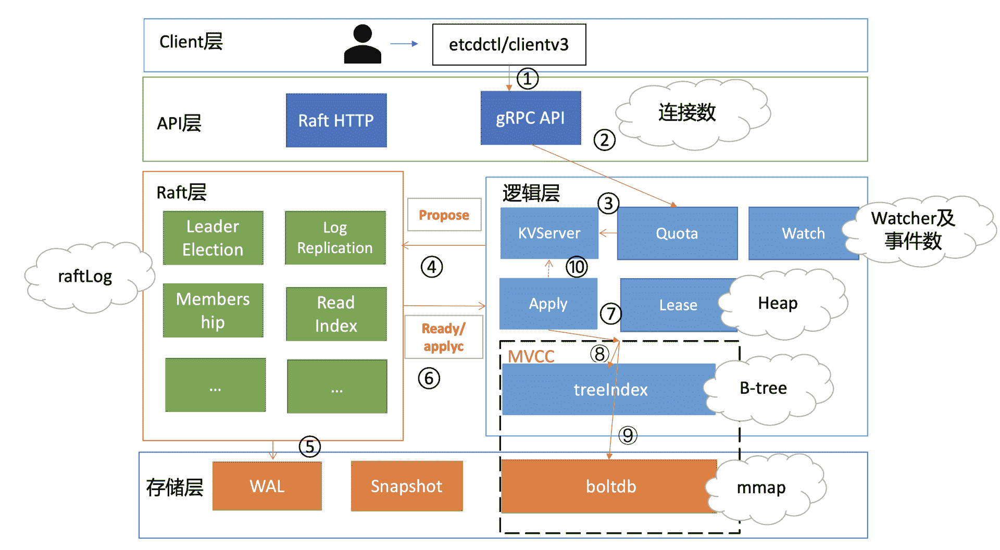
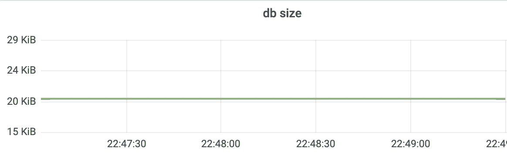
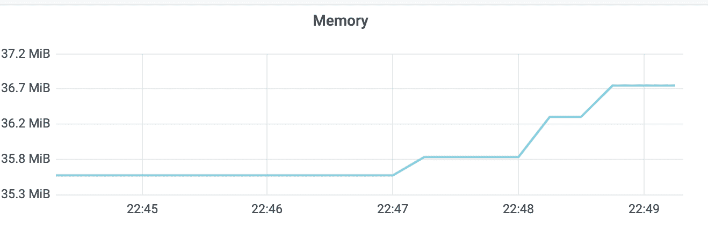
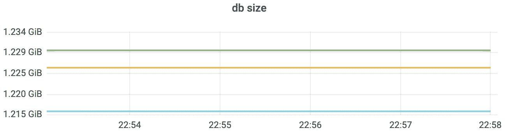
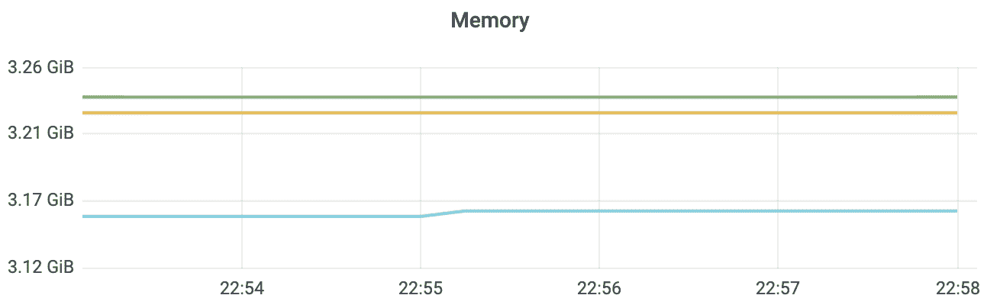
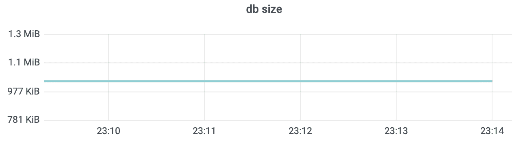
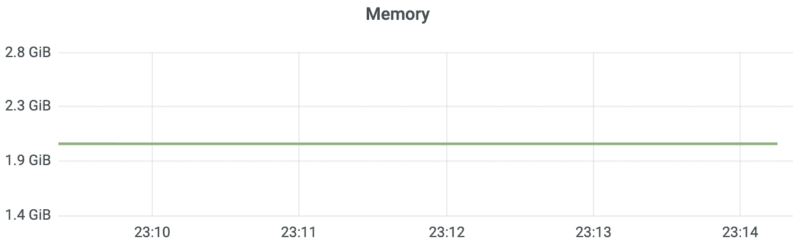
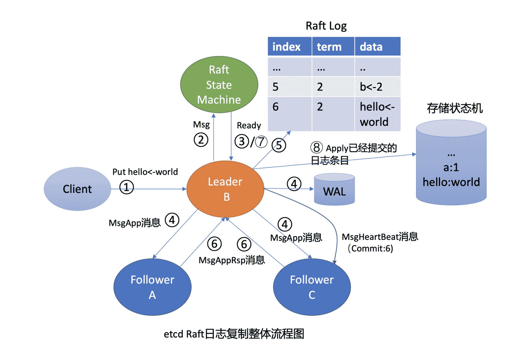
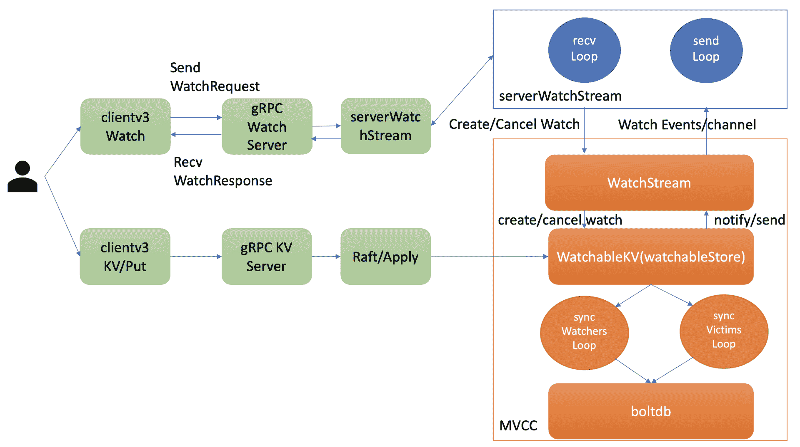
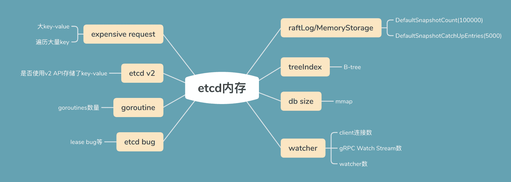

# 15 | 内存：为什么你的etcd内存占用那么高？

 

你好，我是唐聪。

在使用 etcd 的过程中，你是否被异常内存占用等现象困扰过？比如 etcd 中只保存了 1 个 1MB 的 key-value，但是经过若干次修改后，最终 etcd 内存可能达到数 G。它是由什么原因导致的？如何分析呢？

这就是我今天要和你分享的主题：etcd 的内存。 希望通过这节课，帮助你掌握 etcd 内存抖动、异常背后的常见原因和分析方法，当你遇到类似问题时，能独立定位、解决。同时，帮助你在实际业务场景中，为集群节点配置充足的内存资源，遵循最佳实践，尽量减少 expensive request，避免 etcd 内存出现突增，导致 OOM。

## 分析整体思路

当你遇到 etcd 内存占用较高的案例时，你脑海中第一反应是什么呢？

也许你会立刻重启 etcd 进程，尝试将内存降低到合理水平，避免线上服务出问题。

也许你会开启 etcd debug 模式，重启 etcd 进程等复现，然后采集 heap profile 分析内存占用。

以上措施都有其合理性。但作为团队内 etcd 高手的你，在集群稳定性还不影响业务的前提下，能否先通过内存异常的现场，结合 etcd 的读写流程、各核心模块中可能会使用较多内存的关键数据结构，推测出内存异常的可能原因？

全方位的分析内存异常现场，可以帮助我们节省大量复现和定位时间，也是你专业性的体现。

下图是我以 etcd 写请求流程为例，给你总结的可能导致 etcd 内存占用较高的核心模块与其数据结构。



从图中你可以看到，当 etcd 收到一个写请求后，gRPC Server 会和你建立连接。连接数越多，会导致 etcd 进程的 fd、goroutine 等资源上涨，因此会使用越来越多的内存。

其次，基于我们04介绍的 Raft 知识背景，它需要将此请求的日志条目保存在 raftLog 里面。etcd raftLog 后端实现是内存存储，核心就是数组。因此 raftLog 使用的内存与其保存的日志条目成正比，它也是内存分析过程中最容易被忽视的一个数据结构。

然后当此日志条目被集群多数节点确认后，在应用到状态机的过程中，会在内存 treeIndex 模块的 B-tree 中创建、更新 key 与版本号信息。 在这过程中 treeIndex 模块的 B-tree 使用的内存与 key、历史版本号数量成正比。

更新完 treeIndex 模块的索引信息后，etcd 将 key-value 数据持久化存储到 boltdb。boltdb 使用了 mmap 技术，将 db 文件映射到操作系统内存中。因此在未触发操作系统将 db 对应的内存 page 换出的情况下，etcd 的 db 文件越大，使用的内存也就越大。

同时，在这个过程中还有两个注意事项。

一方面，其他 client 可能会创建若干 watcher、监听这个写请求涉及的 key， etcd 也需要使用一定的内存维护 watcher、推送 key 变化监听的事件。

另一方面，如果这个写请求的 key 还关联了 Lease，Lease 模块会在内存中使用数据结构 Heap 来快速淘汰过期的 Lease，因此 Heap 也是一个占用一定内存的数据结构。

最后，不仅仅是写请求流程会占用内存，读请求本身也会导致内存上升。尤其是 expensive request，当产生大包查询时，MVCC 模块需要使用内存保存查询的结果，很容易导致内存突增。

基于以上读写流程图对核心数据结构使用内存的分析，我们定位问题时就有线索、方法可循了。那如何确定是哪个模块、场景导致的内存异常呢？

接下来我就通过一个实际案例，和你深入介绍下内存异常的分析方法。

## 一个 key 使用数 G 内存的案例

我们通过 goreman 启动一个 3 节点 etcd 集群 (linux/etcd v3.4.9)，db quota 为 6G，执行如下的命令并观察 etcd 内存占用情况：

1. 执行 1000 次的 put 同一个 key 操作，value 为 1MB；
2. 更新完后并进行 compact、defrag 操作；

```
# put同一个key，执行1000次  
for i in {1..1000}; do dd if=/dev/urandom bs=1024   
count=1024  | ETCDCTL_API=3 etcdctl put key  || break; done  
  
# 获取最新revision，并压缩  
etcdctl compact `(etcdctl endpoint status --write-out="json" | egrep -o '"revision":[0-9]*' | egrep -o '[0-9].*')`  
  
# 对集群所有节点进行碎片整理  
etcdctl defrag --cluster
```

在执行操作前，空集群 etcd db size 20KB，etcd 进程内存 36M 左右，分别如下图所示。





你预测执行 1000 次同样 key 更新后，etcd 进程占用了多少内存呢? 约 37M？ 1G？ 2G？3G？ 还是其他呢？

执行 1000 次的 put 操作后，db 大小和 etcd 内存占用分别如下图所示。





当我们执行 compact、defrag 命令后，如下图所示，db 大小只有 1M 左右，但是你会发现 etcd 进程实际却仍占用了 2G 左右内存。





整个集群只有一个 key，为什么 etcd 占用了这么多的内存呢？是 etcd 发生了内存泄露吗？

## raftLog

当你发起一个 put 请求的时候，etcd 需通过 Raft 模块将此请求同步到其他节点，详细流程你可结合下图再次了解下。



从图中你可以看到，Raft 模块的输入是一个消息 /Msg，输出统一为 Ready 结构。etcd 会把此请求封装成一个消息，提交到 Raft 模块。

Raft 模块收到此请求后，会把此消息追加到 raftLog 的 unstable 存储的 entry 内存数组中（图中流程 2），并且将待持久化的此消息封装到 Ready 结构内，通过管道通知到 etcdserver（图中流程 3）。

etcdserver 取出消息，持久化到 WAL 中，并追加到 raftLog 的内存存储 storage 的 entry 数组中（图中流程 5）。

下面是raftLog的核心数据结构，它由 storage、unstable、committed、applied 等组成。storage 存储已经持久化到 WAL 中的日志条目，unstable 存储未持久化的条目和快照，一旦持久化会及时删除日志条目，因此不存在过多内存占用的问题。

```
type raftLog struct {  
   // storage contains all stable entries since the last snapshot.  
   storage Storage  
  
  
   // unstable contains all unstable entries and snapshot.  
   // they will be saved into storage.  
   unstable unstable  
  
  
   // committed is the highest log position that is known to be in  
   // stable storage on a quorum of nodes.  
   committed uint64  
   // applied is the highest log position that the application has  
   // been instructed to apply to its state machine.  
   // Invariant: applied <= committed  
   applied uint64  
}
```

从上面 raftLog 结构体中，你可以看到，存储稳定的日志条目的 storage 类型是 Storage，Storage 定义了存储 Raft 日志条目的核心 API 接口，业务应用层可根据实际场景进行定制化实现。etcd 使用的是 Raft 算法库本身提供的 MemoryStorage，其定义如下，核心是使用了一个数组来存储已经持久化后的日志条目。

```
// MemoryStorage implements the Storage interface backed  
// by an in-memory array.  
type MemoryStorage struct {  
   // Protects access to all fields. Most methods of MemoryStorage are  
   // run on the raft goroutine， but Append() is run on an application  
   // goroutine.  
   sync.Mutex  
  
   hardState pb.HardState  
   snapshot  pb.Snapshot  
   // ents[i] has raftLog position i+snapshot.Metadata.Index  
   ents []pb.Entry  
}
```

那么随着写请求增多，内存中保留的 Raft 日志条目会越来越多，如何防止 etcd 出现 OOM 呢？

etcd 提供了快照和压缩功能来解决这个问题。

首先你可以通过调整 --snapshot-count 参数来控制生成快照的频率，其值默认是 100000（etcd v3.4.9，早期 etcd 版本是 10000），也就是每 10 万个写请求触发一次快照生成操作。

快照生成完之后，etcd 会通过压缩来删除旧的日志条目。

那么是全部删除日志条目还是保留一小部分呢？

答案是保留一小部分 Raft 日志条目。数量由 DefaultSnapshotCatchUpEntries 参数控制，默认 5000，目前不支持自定义配置。

保留一小部分日志条目其实是为了帮助慢的 Follower 以较低的开销向 Leader 获取 Raft 日志条目，以尽快追上 Leader 进度。若 raftLog 中不保留任何日志条目，就只能发送快照给慢的 Follower，这开销就非常大了。

通过以上分析可知，如果你的请求 key-value 比较大，比如上面我们的案例中是 1M，1000 次修改，那么 etcd raftLog 至少会消耗 1G 的内存。这就是为什么内存随着写请求修改次数不断增长的原因。

除了 raftLog 占用内存外，MVCC 模块的 treeIndex/boltdb 模块又是如何使用内存的呢？

## treeIndex

一个 put 写请求的日志条目被集群多数节点确认提交后，这时 etcdserver 就会从 Raft 模块获取已提交的日志条目，应用到 MVCC 模块的 treeIndex 和 boltdb。

我们知道 treeIndex 是基于 google 内存 btree 库实现的一个索引管理模块，在 etcd 中每个 key 都会在 treeIndex 中保存一个索引项 (keyIndex)，记录你的 key 和版本号等信息，如下面的数据结构所示。

```
type keyIndex struct {  
   key         []byte  
   modified    revision // the main rev of the last modification  
   generations []generation  
}
```

同时，你每次对 key 的修改、删除操作都会在 key 的索引项中追加一条修改记录 (revision)。因此，随着修改次数的增加，etcd 内存会一直增加。那么如何清理旧版本，防止过多的内存占用呢？

答案也是压缩。正如我在11压缩篇和你介绍的，当你执行 compact 命令时，etcd 会遍历 treeIndex 中的各个 keyIndex，清理历史版本号记录与已删除的 key，释放内存。

从上面的 keyIndex 数据结构我们可知，一个 key 的索引项内存开销跟你的 key 大小、保存的历史版本数、compact 策略有关。为了避免内存索引项占用过多的内存，key 的长度不应过长，同时你需要配置好合理的压缩策略。

## boltdb

在 treeIndex 模块中创建、更新完 keyIndex 数据结构后，你的 key-value 数据、各种版本号、lease 等相关信息会保存到如下的一个 mvccpb.keyValue 结构体中。它是 boltdb 的 value，key 则是 treeIndex 中保存的版本号，然后通过 boltdb 的写接口保存到 db 文件中。

```
kv := mvccpb.KeyValue{  
   Key:            key，  
   Value:          value，  
   CreateRevision: c，  
   ModRevision:    rev，  
   Version:        ver，  
   Lease:          int64(leaseID)，  
}
```

前面我们在介绍 boltdb 时，提到过 etcd 在启动时会通过 mmap 机制，将 etcd db 文件映射到 etcd 进程地址空间，并设置 mmap 的 MAP_POPULATE flag，它会告诉 Linux 内核预读文件，让 Linux 内核将文件内容拷贝到物理内存中。

在节点内存足够的情况下，后续读请求可直接从内存中获取。相比 read 系统调用，mmap 少了一次从 page cache 拷贝到进程内存地址空间的操作，因此具备更好的性能。

若 etcd 节点内存不足，可能会导致 db 文件对应的内存页被换出。当读请求命中的页未在内存中时，就会产生缺页异常，导致读过程中产生磁盘 IO。这样虽然避免了 etcd 进程 OOM，但是此过程会产生较大的延时。

从以上 boltdb 的 key-value 和 mmap 机制介绍中我们可知，我们应控制 boltdb 文件大小，优化 key-value 大小，配置合理的压缩策略，回收旧版本，避免过多内存占用。

## watcher

在你写入 key 的时候，其他 client 还可通过 etcd 的 Watch 监听机制，获取到 key 的变化事件。

那创建一个 watcher 耗费的内存跟哪些因素有关呢?

在08Watch 机制设计与实现分析中，我和你介绍过创建 watcher 的整体流程与架构，如下图所示。当你创建一个 watcher 时，client 与 server 建立连接后，会创建一个 gRPC Watch Stream，随后通过这个 gRPC Watch Stream 发送创建 watcher 请求。

每个 gRPC Watch Stream 中 etcd WatchServer 会分配两个 goroutine 处理，一个是 sendLoop，它负责 Watch 事件的推送。一个是 recvLoop，负责接收 client 的创建、取消 watcher 请求消息。

同时对每个 watcher 来说，etcd 的 WatchableKV 模块需将其保存到相应的内存管理数据结构中，实现可靠的 Watch 事件推送。



因此 watch 监听机制耗费的内存跟 client 连接数、gRPC Stream、watcher 数 (watching) 有关，如下面公式所示：

1. c1 表示每个连接耗费的内存；
2. c2 表示每个 gRPC Stream 耗费的内存；
3. c3 表示每个 watcher 耗费的内存。

```
memory = c1 * number_of_conn + c2 *   
avg_number_of_stream_per_conn + c3 *   
avg_number_of_watch_stream
```

根据 etcd 社区的压测报告，大概估算出 Watch 机制中 c1、c2、c3 占用的内存分别如下：

1. 每个 client 连接消耗大约 17kb 的内存 (c1)；
2. 每个 gRPC Stream 消耗大约 18kb 的内存 (c2)；
3. 每个 watcher 消耗大约 350 个字节 (c3)；

当你的业务场景大量使用 watcher 的时候，应提前估算下内存容量大小，选择合适的内存配置节点。

注意以上估算并不包括 watch 事件堆积的开销。变更事件较多，服务端、客户端高负载，网络阻塞等情况都可能导致事件堆积。

在 etcd 3.4.9 版本中，每个 watcher 默认 buffer 是 1024。buffer 内保存 watch 响应结果，如 watchID、watch 事件（watch 事件包含 key、value）等。

若大量事件堆积，将产生较高昂的内存的开销。你可以通过 etcd_debugging_mvcc_pending_events_total 指标监控堆积的事件数，etcd_debugging_slow_watcher_total 指标监控慢的 watcher 数，来及时发现异常。

## expensive request

当你写入比较大的 key-value 后，如果 client 频繁查询它，也会产生高昂的内存开销。

假设我们写入了 100 个这样 1M 大小的 key， 通过 Range 接口一次查询 100 个 key， 那么 boltdb 遍历、反序列化过程将花费至少 100MB 的内存。如下面代码所示，它会遍历整个 key-value，将 key-value 保存到数组 kvs 中。

```
kvs := make([]mvccpb.KeyValue， limit)  
revBytes := newRevBytes()  
for i， revpair := range revpairs[:len(kvs)] {  
   revToBytes(revpair， revBytes)  
   _， vs := tr.tx.UnsafeRange(keyBucketName， revBytes， nil， 0)  
   if len(vs) != 1 {  
        ......      
   }  
   if err := kvs[i].Unmarshal(vs[0]); err != nil {  
        .......  
   }
```

也就是说，一次查询就耗费了至少 100MB 的内存、产生了至少 100MB 的流量，随着你 QPS 增大后，很容易 OOM、网卡出现丢包。

count-only、limit 查询在 key 百万级以上时，也会产生非常大的内存开销。因为它们在遍历 treeIndex 的过程中，会将相关 key 保存在数组里面。当 key 多时，此开销不容忽视。

正如我在13 db 大小中讲到的，在 master 分支，我已提交相关 PR 解决 count-only 和 limit 查询导致内存占用突增的问题。

## etcd v2/goroutines/bug

除了以上介绍的核心模块、expensive request 场景可能导致较高的内存开销外，还有以下场景也会导致 etcd 内存使用较高。

首先是 **etcd 中使用了 v2 的 API 写入了大量的 key-value 数据**，这会导致内存飙高。我们知道 etcd v2 的 key-value 都是存储在内存树中的，同时 v2 的 watcher 不支持多路复用，内存开销相比 v3 多了一个数量级。

在 etcd 3.4 版本之前，etcd 默认同时支持 etcd v2/v3 API，etcd 3.4 版本默认关闭了 v2 API。 你可以通过 etcd v2 API 和 etcd v2 内存存储模块的 metrics 前缀 etcd_debugging_store，观察集群中是否有 v2 数据导致的内存占用高。

其次是 **goroutines 泄露**导致内存占用高。此问题可能会在容器化场景中遇到。etcd 在打印日志的时候，若出现阻塞则可能会导致 goroutine 阻塞并持续泄露，最终导致内存泄露。你可以通过观察、监控 go_goroutines 来发现这个问题。

最后是 **etcd bug** 导致的内存泄露。当你基本排除以上场景导致的内存占用高后，则很可能是 etcd bug 导致的内存泄露。

比如早期 etcd clientv3 的 lease keepalive 租约频繁续期 bug，它会导致 Leader 高负载、内存泄露，此 bug 已在 3.2.24/3.3.9 版本中修复。

还有最近我修复的 etcd 3.4 版本的Follower 节点内存泄露。具体表现是两个 Follower 节点内存一直升高，Leader 节点正常，已在 3.4.6 版本中修复。

若内存泄露并不是已知的 etcd bug 导致，那你可以开启 pprof， 尝试复现，通过分析 pprof heap 文件来确定消耗大量内存的模块和数据结构。

## 小节

今天我通过一个写入 1MB key 的实际案例，给你介绍了可能导致 etcd 内存占用高的核心数据结构、场景，同时我将可能导致内存占用较高的因素总结为了下面这幅图，你可以参考一下。



首先是 raftLog。为了帮助 slow Follower 同步数据，它至少要保留 5000 条最近收到的写请求在内存中。若你的 key 非常大，你更新 5000 次会产生较大的内存开销。

其次是 treeIndex。 每个 key-value 会在内存中保留一个索引项。索引项的开销跟 key 长度、保留的历史版本有关，你可以通过 compact 命令压缩。

然后是 boltdb。etcd 启动的时候，会通过 mmap 系统调用，将文件映射到虚拟内存中。你可以通过 compact 命令回收旧版本，defrag 命令进行碎片整理。

接着是 watcher。它的内存占用跟连接数、gRPC Watch Stream 数、watcher 数有关。watch 机制一个不可忽视的内存开销其实是事件堆积的占用缓存，你可以通过相关 metrics 及时发现堆积的事件以及 slow watcher。

最后我介绍了一些典型的场景导致的内存异常，如大包查询等 expensive request，etcd 中存储了 v2 API 写入的 key， goroutines 泄露以及 etcd lease bug 等。

希望今天的内容，能够帮助你从容应对 etcd 内存占用高的问题，合理配置你的集群，优化业务 expensive request，让 etcd 跑得更稳。

## 思考题

在一个 key 使用数 G 内存的案例中，最后执行 compact 和 defrag 后的结果是 2G，为什么不是 1G 左右呢？在 macOS 下行为是否一样呢？

欢迎你动手做下这个小实验，分析下原因，分享你的观点。

感谢你的阅读，如果你认为这节课的内容有收获，也欢迎把它分享给你的朋友，谢谢。
