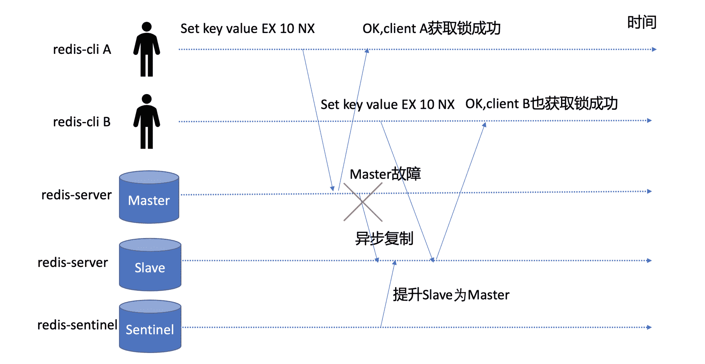
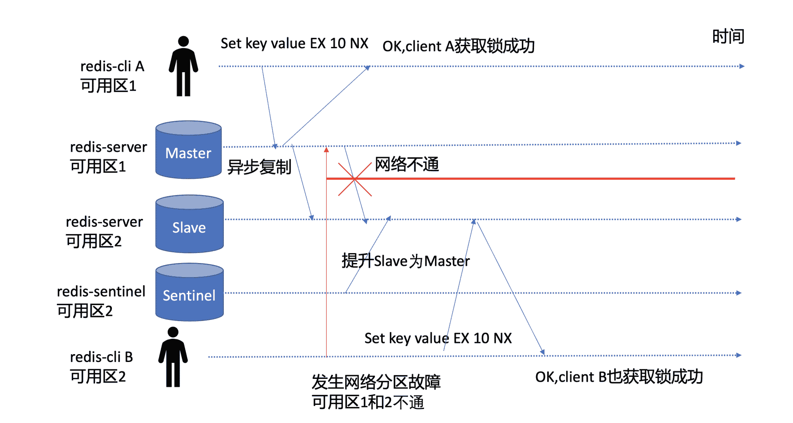

# 21 | 分布式锁：为什么基于etcd实现分布式锁比Redis锁更安全？

 

你好，我是唐聪。

在软件开发过程中，我们经常会遇到各种场景要求对共享资源进行互斥操作，否则整个系统的数据一致性就会出现问题。典型场景如商品库存操作、Kubernertes 调度器为 Pod 分配运行的 Node。

那要如何实现对共享资源进行互斥操作呢？

锁就是其中一个非常通用的解决方案。在单节点多线程环境，你使用本地的互斥锁就可以完成资源的互斥操作。然而单节点存在单点故障，为了保证服务高可用，你需要多节点部署。在多节点部署的分布式架构中，你就需要使用分布式锁来解决资源互斥操作了。

但是为什么有的业务使用了分布式锁还会出现各种严重超卖事故呢？分布式锁的实现和使用过程需要注意什么？

今天，我就和你聊聊分布式锁背后的故事，我将通过一个茅台超卖的案例，为你介绍基于 Redis 实现的分布锁优缺点，引出分布式锁的核心要素，对比分布式锁的几种业界典型实现方案，深入剖析 etcd 分布式锁的实现。

希望通过这节课，让你了解 etcd 分布式锁的应用场景、核心原理，在业务开发过程中，优雅、合理的使用分布式锁去解决各类资源互斥、并发操作问题。

## 从茅台超卖案例看分布式锁要素

首先我们从去年一个因 Redis 分布式锁实现问题导致茅台超卖案例说起，在这个网友分享的真实案例中，因茅台的稀缺性，事件最终定级为 P0 级生产事故，后果影响严重。

那么它是如何导致超卖的呢？

首先和你简单介绍下此案例中的 Redis 简易分布式锁实现方案，它使用了 Redis SET 命令来实现。

```
SET key value [EX seconds|PX milliseconds|EXAT timestamp|PXAT milliseconds-timestamp|KEEPTTL] [NX|XX]   
[GET]
```

简单给你介绍下 SET 命令重点参数含义：

1. `EX` 设置过期时间，单位秒；
2. `NX` 当 key 不存在的时候，才设置 key；
3. `XX` 当 key 存在的时候，才设置 key。

此业务就是基于 Set key value EX 10 NX 命令来实现的分布式锁，并通过 JAVA 的 try-finally 语句，执行 Del key 语句来释放锁，简易流程如下：

```
# 对资源key加锁，key不存在时创建，并且设置，10秒自动过期  
SET key value EX 10 NX  
业务逻辑流程1，校验用户身份  
业务逻辑流程2，查询并校验库存(get and compare)  
业务逻辑流程3，库存>0，扣减库存(Decr stock)，生成秒杀茅台订单  
  
# 释放锁  
Del key
```

以上流程中其实存在以下思考点:

1. NX 参数有什么作用?
2. 为什么需要原子的设置 key 及过期时间？
3. 为什么基于 Set key value EX 10 NX 命令还出现了超卖呢?
4. 为什么大家都比较喜欢使用 Redis 作为分布式锁实现？

首先来看第一个问题，NX 参数的作用。NX 参数是为了保证当分布式锁不存在时，只有一个 client 能写入此 key 成功，获取到此锁。我们使用分布式锁的目的就是希望在高并发系统中，有一种互斥机制来防止彼此相互干扰，保证数据的一致性。

**因此分布式锁的第一核心要素就是互斥性、安全性。在同一时间内，不允许多个 client 同时获得锁。**

再看第二个问题，假设我们未设置 key 自动过期时间，在 Set key value NX 后，如果程序 crash 或者发生网络分区后无法与 Redis 节点通信，毫无疑问其他 client 将永远无法获得锁。这将导致死锁，服务出现中断。

有的同学意识到这个问题后，使用如下 SETNX 和 EXPIRE 命令去设置 key 和过期时间，这也是不正确的，因为你无法保证 SETNX 和 EXPIRE 命令的原子性。

```
# 对资源key加锁，key不存在时创建  
SETNX key value  
# 设置KEY过期时间  
EXPIRE key 10  
业务逻辑流程  
  
# 释放锁  
Del key
```

**这就是分布式锁第二个核心要素，活性。在实现分布式锁的过程中要考虑到 client 可能会出现 crash 或者网络分区，你需要原子申请分布式锁及设置锁的自动过期时间，通过过期、超时等机制自动释放锁，避免出现死锁，导致业务中断。**

再看第三个问题，为什么使用了 Set key value EX 10 NX 命令，还出现了超卖呢？

原来是抢购活动开始后，加锁逻辑中的业务流程 1 访问的用户身份服务出现了高负载，导致阻塞在校验用户身份流程中 (超时 30 秒)，然而锁 10 秒后就自动过期了，因此其他 client 能获取到锁。关键是阻塞的请求执行完后，它又把其他 client 的锁释放掉了，导致进入一个恶性循环。

因此申请锁时，写入的 value 应确保唯一性（随机值等）。client 在释放锁时，应通过 Lua 脚本原子校验此锁的 value 与自己写入的 value 一致，若一致才能执行释放工作。

更关键的是库存校验是通过 get and compare 方式，它压根就无法防止超卖。正确的解决方案应该是通过 LUA 脚本实现 Redis 比较库存、扣减库存操作的原子性（或者在每次只能抢购一个的情况下，通过判断Redis Decr 命令的返回值即可。此命令会返回扣减后的最新库存，若小于 0 则表示超卖）。

**从这个问题中我们可以看到，分布式锁实现具备一定的复杂度，它不仅依赖存储服务提供的核心机制，同时依赖业务领域的实现。无论是遭遇高负载、还是宕机、网络分区等故障，都需确保锁的互斥性、安全性，否则就会出现严重的超卖生产事故。**

再看最后一个问题，为什么大家都比较喜欢使用 Redis 做分布式锁的实现呢?

考虑到在秒杀等业务场景上存在大量的瞬间、高并发请求，加锁与释放锁的过程应是高性能、高可用的。而 Redis 核心优点就是快、简单，是随处可见的基础设施，部署、使用也及其方便，因此广受开发者欢迎。

**这就是分布式锁第三个核心要素，高性能、高可用。加锁、释放锁的过程性能开销要尽量低，同时要保证高可用，确保业务不会出现中断。**

那么除了以上案例中人为实现问题导致的锁不安全因素外，基于 Redis 实现的以上分布式锁还有哪些安全性问题呢？

## Redis 分布式锁问题

我们从茅台超卖案例中为你总结出的分布式核心要素（互斥性、安全性、活性、高可用、高性能）说起。

首先，如果我们的分布式锁跑在单节点的 Redis Master 节点上，那么它就存在单点故障，无法保证分布式锁的高可用。

于是我们需要一个主备版的 Redis 服务，至少具备一个 Slave 节点。

我们又知道 Redis 是基于主备异步复制协议实现的 Master-Slave 数据同步，如下图所示，若 client A 执行 SET key value EX 10 NX 命令，redis-server 返回给 client A 成功后，Redis Master 节点突然出现 crash 等异常，这时候 Redis Slave 节点还未收到此命令的同步。



若你部署了 Redis Sentinel 等主备切换服务，那么它就会以 Slave 节点提升为主，此时 Slave 节点因并未执行 SET key value EX 10 NX 命令，因此它收到 client B 发起的加锁的此命令后，它也会返回成功给 client。

那么在同一时刻，集群就出现了两个 client 同时获得锁，分布式锁的互斥性、安全性就被破坏了。

除了主备切换可能会导致基于 Redis 实现的分布式锁出现安全性问题，在发生网络分区等场景下也可能会导致出现脑裂，Redis 集群出现多个 Master，进而也会导致多个 client 同时获得锁。

如下图所示，Master 节点在可用区 1，Slave 节点在可用区 2，当可用区 1 和可用区 2 发生网络分区后，部署在可用区 2 的 Redis Sentinel 服务就会将可用区 2 的 Slave 提升为 Master，而此时可用区 1 的 Master 也在对外提供服务。因此集群就出现了脑裂，出现了两个 Master，都可对外提供分布式锁申请与释放服务，分布式锁的互斥性被严重破坏。



**主备切换、脑裂是 Redis 分布式锁的两个典型不安全的因素，本质原因是 Redis 为了满足高性能，采用了主备异步复制协议，同时也与负责主备切换的 Redis Sentinel 服务是否合理部署有关。**

有没有其他方案解决呢？

当然有，Redis 作者为了解决 SET key value [EX] 10 [NX]命令实现分布式锁不安全的问题，提出了RedLock 算法。它是基于多个独立的 Redis Master 节点的一种实现（一般为 5）。client 依次向各个节点申请锁，若能从多数个节点中申请锁成功并满足一些条件限制，那么 client 就能获取锁成功。

它通过独立的 N 个 Master 节点，避免了使用主备异步复制协议的缺陷，只要多数 Redis 节点正常就能正常工作，显著提升了分布式锁的安全性、可用性。

但是，它的实现建立在一个不安全的系统模型上的，它依赖系统时间，当时钟发生跳跃时，也可能会出现安全性问题。你要有兴趣的话，可以详细阅读下分布式存储专家 Martin 对RedLock 的分析文章，Redis 作者的也专门写了一篇文章进行了反驳。

## 分布式锁常见实现方案

了解完 Redis 分布式锁的一系列问题和实现方案后，我们再看看还有哪些典型的分布式锁实现。

除了 Redis 分布式锁，其他使用最广的应该是 ZooKeeper 分布式锁和 etcd 分布式锁。

ZooKeeper 也是一个典型的分布式元数据存储服务，它的分布式锁实现基于 ZooKeeper 的临时节点和顺序特性。

首先什么是临时节点呢？

临时节点具备数据自动删除的功能。当 client 与 ZooKeeper 连接和 session 断掉时，相应的临时节点就会被删除。

其次 ZooKeeper 也提供了 Watch 特性可监听 key 的数据变化。

使用 Zookeeper 加锁的伪代码如下：

```
Lock  
1 n = create(l + “/lock-”, EPHEMERAL|SEQUENTIAL)  
2 C = getChildren(l, false)  
3 if n is lowest znode in C, exit  
4 p = znode in C ordered just before n  
5 if exists(p, true) wait for watch event  
6 goto 2  
Unlock  
1 delete(n)
```

接下来我重点给你介绍一下基于 etcd 的分布式锁实现。

## etcd 分布式锁实现

那么基于 etcd 实现的分布式锁是如何确保安全性、互斥性、活性的呢？

### 事务与锁的安全性

从 Redis 案例中我们可以看到，加锁的过程需要确保安全性、互斥性。比如，当 key 不存在时才能创建，否则查询相关 key 信息，而 etcd 提供的事务能力正好可以满足我们的诉求。

正如我在09中给你介绍的事务特性，它由 IF 语句、Then 语句、Else 语句组成。其中在 IF 语句中，支持比较 key 的是修改版本号 mod_revision 和创建版本号 create_revision。

在分布式锁场景，你就可以通过 key 的创建版本号 create_revision 来检查 key 是否已存在，因为一个 key 不存在的话，它的 create_revision 版本号就是 0。

若 create_revision 是 0，你就可发起 put 操作创建相关 key，具体代码如下:

```
txn := client.Txn(ctx).If(v3.Compare(v3.CreateRevision(k),   
"=", 0))
```

你要注意的是，实现分布式锁的方案有多种，比如你可以通过 client 是否成功创建一个固定的 key，来判断此 client 是否获得锁，你也可以通过多个 client 创建 prefix 相同，名称不一样的 key，哪个 key 的 revision 最小，最终就是它获得锁。至于谁优谁劣，我作为思考题的一部分，留给大家一起讨论。

相比 Redis 基于主备异步复制导致锁的安全性问题，etcd 是基于 Raft 共识算法实现的，一个写请求需要经过集群多数节点确认。因此一旦分布式锁申请返回给 client 成功后，它一定是持久化到了集群多数节点上，不会出现 Redis 主备异步复制可能导致丢数据的问题，具备更高的安全性。

### Lease 与锁的活性

通过事务实现原子的检查 key 是否存在、创建 key 后，我们确保了分布式锁的安全性、互斥性。那么 etcd 是如何确保锁的活性呢? 也就是发生任何故障，都可避免出现死锁呢？

正如在06租约特性中和你介绍的，Lease 就是一种活性检测机制，它提供了检测各个客户端存活的能力。你的业务 client 需定期向 etcd 服务发送"特殊心跳"汇报健康状态，若你未正常发送心跳，并超过和 etcd 服务约定的最大存活时间后，就会被 etcd 服务移除此 Lease 和其关联的数据。

通过 Lease 机制就优雅地解决了 client 出现 crash 故障、client 与 etcd 集群网络出现隔离等各类故障场景下的死锁问题。一旦超过 Lease TTL，它就能自动被释放，确保了其他 client 在 TTL 过期后能正常申请锁，保障了业务的可用性。

具体代码如下:

```
txn := client.Txn(ctx).If(v3.Compare(v3.CreateRevision(k), "=", 0))  
txn = txn.Then(v3.OpPut(k, val, v3.WithLease(s.Lease())))  
txn = txn.Else(v3.OpGet(k))  
resp, err := txn.Commit()  
if err != nil {  
    return err  
}

### Watch 与锁的可用性

当一个持有锁的 client crash 故障后，其他 client 如何快速感知到此锁失效了，快速获得锁呢，最大程度降低锁的不可用时间呢？
```

答案是 Watch 特性。正如在 08 Watch 特性中和你介绍的，Watch 提供了高效的数据监听能力。当其他 client 收到 Watch Delete 事件后，就可快速判断自己是否有资格获得锁，极大减少了锁的不可用时间。

具体代码如下所示：

```
var wr v3.WatchResponse  
wch := client.Watch(cctx, key, v3.WithRev(rev))  
for wr = range wch {  
   for _, ev := range wr.Events {  
      if ev.Type == mvccpb.DELETE {  
         return nil  
      }  
   }  
}

### etcd 自带的 concurrency 包

为了帮助你简化分布式锁、分布式选举、分布式事务的实现，etcd 社区提供了一个名为 concurrency 包帮助你更简单、正确地使用分布式锁、分布式选举。
```

下面我简单为你介绍下分布式锁concurrency包的使用和实现，它的使用非常简单，如下代码所示，核心流程如下：

1. 首先通过 concurrency.NewSession 方法创建 Session，本质是创建了一个 TTL 为 10 的 Lease。
2. 其次得到 session 对象后，通过 concurrency.NewMutex 创建了一个 mutex 对象，包含 Lease、key prefix 等信息。
3. 然后通过 mutex 对象的 Lock 方法尝试获取锁。
4. 最后使用结束，可通过 mutex 对象的 Unlock 方法释放锁。

```
cli, err := clientv3.New(clientv3.Config{Endpoints: endpoints})  
if err != nil {  
   log.Fatal(err)  
}  
defer cli.Close()  
// create two separate sessions for lock competition  
s1, err := concurrency.NewSession(cli, concurrency.WithTTL(10))  
if err != nil {  
   log.Fatal(err)  
}  
defer s1.Close()  
m1 := concurrency.NewMutex(s1, "/my-lock/")  
// acquire lock for s1  
if err := m1.Lock(context.TODO()); err != nil {  
   log.Fatal(err)  
}  
fmt.Println("acquired lock for s1")  
if err := m1.Unlock(context.TODO()); err != nil {  
   log.Fatal(err)  
}  
fmt.Println("released lock for s1")
```

那么 mutex 对象的 Lock 方法是如何加锁的呢？

核心还是使用了我们上面介绍的事务和 Lease 特性，当 CreateRevision 为 0 时，它会创建一个 prefix 为 /my-lock 的 key（ /my-lock + LeaseID)，并获取到 /my-lock prefix 下面最早创建的一个 key（revision 最小），分布式锁最终是由写入此 key 的 client 获得，其他 client 则进入等待模式。

详细代码如下：

```
m.myKey = fmt.Sprintf("%s%x", m.pfx, s.Lease())  
cmp := v3.Compare(v3.CreateRevision(m.myKey), "=", 0)  
// put self in lock waiters via myKey; oldest waiter holds lock  
put := v3.OpPut(m.myKey, "", v3.WithLease(s.Lease()))  
// reuse key in case this session already holds the lock  
get := v3.OpGet(m.myKey)  
// fetch current holder to complete uncontended path with only one RPC  
getOwner := v3.OpGet(m.pfx, v3.WithFirstCreate()...)  
resp, err := client.Txn(ctx).If(cmp).Then(put, getOwner).Else(get, getOwner).Commit()  
if err != nil {  
   return err  
}
```

那未获得锁的 client 是如何等待的呢?

答案是通过 Watch 机制各自监听 prefix 相同，revision 比自己小的 key，因为只有 revision 比自己小的 key 释放锁，我才能有机会，获得锁，如下代码所示，其中 waitDelete 会使用我们上面的介绍的 Watch 去监听比自己小的 key，详细代码可参考concurrency mutex的实现。

```
// wait for deletion revisions prior to myKey  
hdr, werr := waitDeletes(ctx, client, m.pfx, m.myRev-1)  
// release lock key if wait failed  
if werr != nil {  
   m.Unlock(client.Ctx())  
} else {  
   m.hdr = hdr  
}

## 小结

最后我们来小结下今天的内容。
```

今天我通过一个 Redis 分布式锁实现问题——茅台超卖案例，给你介绍了分布式锁的三个主要核心要素，它们分别如下：

1. 安全性、互斥性。在同一时间内，不允许多个 client 同时获得锁。
2. 活性。无论 client 出现 crash 还是遭遇网络分区，你都需要确保任意故障场景下，都不会出现死锁，常用的解决方案是超时和自动过期机制。
3. 高可用、高性能。加锁、释放锁的过程性能开销要尽量低，同时要保证高可用，避免单点故障。

随后我通过这个案例，继续和你分析了 Redis SET 命令创建分布式锁的安全性问题。单 Redis Master 节点存在单点故障，一主多备 Redis 实例又因为 Redis 主备异步复制，当 Master 节点发生 crash 时，可能会导致同时多个 client 持有分布式锁，违反了锁的安全性问题。

为了优化以上问题，Redis 作者提出了 RedLock 分布式锁，它基于多个独立的 Redis Master 节点工作，只要一半以上节点存活就能正常工作，同时不依赖 Redis 主备异步复制，具有良好的安全性、高可用性。然而它的实现依赖于系统时间，当发生时钟跳变的时候，也会出现安全性问题。

最后我和你重点介绍了 etcd 的分布式锁实现过程中的一些技术点。它通过 etcd 事务机制，校验 CreateRevision 为 0 才能写入相关 key。若多个 client 同时申请锁，则 client 通过比较各个 key 的 revision 大小，判断是否获得锁，确保了锁的安全性、互斥性。通过 Lease 机制确保了锁的活性，无论 client 发生 crash 还是网络分区，都能保证不会出现死锁。通过 Watch 机制使其他 client 能快速感知到原 client 持有的锁已释放，提升了锁的可用性。最重要的是 etcd 是基于 Raft 协议实现的高可靠、强一致存储，正常情况下，不存在 Redis 主备异步复制协议导致的数据丢失问题。

## 思考题

这节课到这里也就结束了，最后我给你留了两个思考题。

第一，死锁、脑裂、惊群效应是分布式锁的核心问题，你知道它们各自是怎么一回事吗？ZooKeeper 和 etcd 是如何应对这些问题的呢？

第二，若你锁设置的 10 秒，如果你的某业务进程抢锁成功后，执行可能会超过 10 秒才成功，在这过程中如何避免锁被自动释放而出现的安全性问题呢?

感谢你的阅读，也欢迎你把这篇文章分享给更多的朋友一起阅读。
